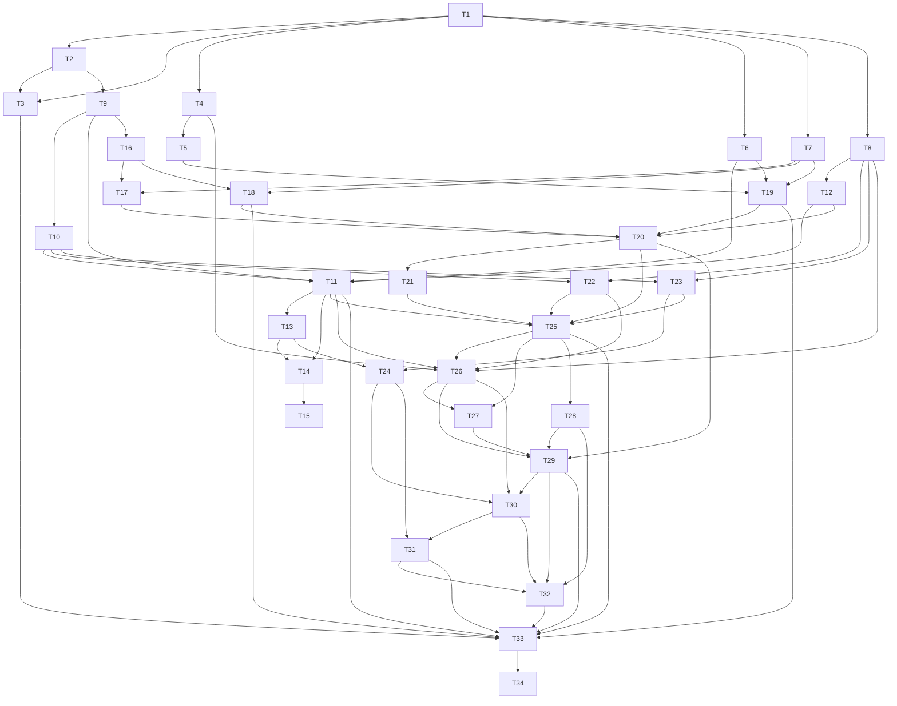

# D1 — Install, trust, and set up: task-level breakdown

Status: draft for user review. Not frozen. Phase 3 artifact for `planning-protocol.md:61-135`.

## 0. Scope, boundary, and what this deliverable deliberately does not do

### Advertised outcome

A trader can open the journal in a browser tab, be told honestly whether it is safe to write here, set up the brokerage institution and the account they trade, and reach a state ready to plan — with no network, and with the app refusing every write outside a `Writable` session.

`AC:` AC-DEL-001…006, AC-CAP-001, AC-UI-001, AC-UI-002, AC-REF-002 (partial).

### In scope

Everything below is required by `planning-protocol.md:83` and `specs/README.md:88` and is not deferrable out of the first deliverable that can mutate authoritative data.

| Mechanism | Authoritative text | Owning task |
|---|---|---|
| Web App Manifest: stable identity, name, icons, launch URL, scope, standalone request | `delivery-contract.md:11-19`, `acceptance-contract.md:460-465` | T16 |
| Versioned service worker owning a complete, digest-valid Offline Release Inventory | `delivery-contract.md:11-12`, `delivery-contract.md:48-57` | T18, T17 |
| Four-check browser-neutral Runtime Readiness, functional checks only, no allowlist | `delivery-contract.md:23-28`, `overview.md:21`, `specs/README.md:88` | T20, T21 |
| Advisory storage-protection reporting and `Workspace.requestDurability` | `delivery-contract.md:30`, `adr/0009`, `workspace.md:96-104` | T27, T29 |
| Persistence-level `RuntimeNotWritable` write gate | `overview.md:177-186`, `overview.md:262` | T12, T8 |
| IndexedDB schema, object stores, schema-version baseline | `overview.md:123-133`, `planning-decisions-2026-10-10.md:176-177` | T9 |
| Migration runner: isolated candidate plus atomic pointer flip | `workspace.md:63`, `delivery-contract.md:61-67` | T10 |
| Atomic multi-store transaction seam | `overview.md:127`, `acceptance-contract.md:423-428` | T11 |
| Optimistic revisions, snapshot-consistent reads, lifecycle index | `overview.md:128-129,133` | T13, T14, T15 |
| Injected `Clock`, versioned U.S. session calendar, exact decimals | `planning-decisions-2026-10-10.md:180-182` | T4, T5, T6 |
| `Workspace.initialize`, `getStatus`, `requestDurability`, Installed Capability Manifest | `workspace.md:11-14,25-41,96-104` | T25, T26, T27, T28 |
| `Journal.seedDefaults` for the fixed identities declared by seed manifest v1 | `journal.md:192-194`, `vertical-deliverables.md:62` | T22 |
| `ReferenceCatalog.seedDefaults` (manifest v1: Long Stock) and `save`/`query` for Institution and Account | `reference-catalog.md:33-51,120-137` | T23, T24 |
| Production UI reaching all of the above: startup/readiness, onboarding, responsive and accessible | `ui-contract.md:26-36,49-68,123-125` | T29, T30, T31, T32 |
| Mock-free real-stack integration suite and the fresh browser-critic gate | `planning-protocol.md:115-122,124-135` | T33, T34 |

### Explicitly out of scope, and why it is safe

- **PWA installation experience.** The install affordance, per-host guidance, standalone polish and installed-launch capture are deferred to D22 by decision PD4 (`planning-decisions-2026-10-10.md:264-267`). The four load-bearing mechanisms stay here. Installation is **not advertised**; the app is installable only at the browser's discretion, and the Installed Capability Manifest records that install support is not claimed (T28). This is safe because `delivery-contract.md:21` makes an ordinary browser tab a first-class delivery mode and `AC-DEL-003`'s installed-launch evidence closes at D22.
- **Update notice, deferral and activation UX.** Deferred to D22 by decision PD4 (`planning-decisions-2026-10-10.md:264-267`) and `vertical-deliverables.md:440-457`. This deliverable still builds the versioned service worker, keeps the running release in control, never calls `skipWaiting()` on its own, and proves the new inventory is complete and digest-valid before it could ever be advertised (T18). The observable update-safety guarantees of `delivery-contract.md:48-56` are therefore not contradicted by the deferral; only their presentation is absent.
- **Any Trade, Plan, Position, Mark, Journal-entry or reporting capability.** D2 onwards (`vertical-deliverables.md:70-127`). D1 is deliberately the foundation and nothing more: `Journal.seedDefaults` installs only what seed manifest v1 declares, and there is no operation in the manifest for a capability the release cannot perform end to end (`delivery-contract.md:71-79`).
- **Backup download, backup verification and Restore.** D7, D20 and D21 own `exportBackup`, `confirmBackup` and `prepareRestore`/`applyPreparedRestore`. D1 still proves the mechanisms those flows depend on — the transaction seam (T11), the migration candidate and pointer flip (T10), and the absence of any partial commit — and discloses the boundary in §8.
- **The installed Strategy set beyond Long Stock.** `AC-REF-001` is not claimed here; the eleven-seed set completes at D12 (`vertical-deliverables.md:283-293`). D1 seeds exactly what manifest v1 declares and asserts the absence of every unseeded value (T23).
- **Any latency or scale evidence.** `AC-PERF-001` is owned by no deliverable. D1 asserts only boundedness: index membership, a bounded batch, an asserted query count, and no per-record storage read (T9, T15).

### What this deliverable deliberately does not demonstrate

- **Installation support is not advertised.** The app is installable only at the browser's discretion. `AC-DEL-003` therefore cannot pass here: `T16`, `T18`, `T20` and `T29` carry the manifest identity, the inventory binding and browser-tab `Writable`, and the installed-launch evidence closes at D22. A missing install affordance is not a defect of this deliverable.
- **No offline restart after a *newer* release.** D1 proves offline restart of the installed release with no network (T18, T33). Update detection, notice and activation are D22.
- **No completed-backup claim.** Nothing in D1 reads back a saved file, so D1 can never present "Backup Complete". Backup controls are absent from the D1 navigation rather than present-but-broken (T28).
- **No calculation availability beyond its own surfaces.** D1 installs no analysis, so `Value`/`Unbounded`/`Unavailable`/`NotApplicable` results are not yet graphed or tabulated; §8 discloses that the state-distinction evidence of `AC-UI-002` is exercised on the D1 surfaces only.

## 1. Decisions this breakdown introduces (needing alignment)

Each is a consequential choice the brief asked for. None reopens a frozen product semantic; each needs user alignment before the plan freezes.

1. **Object-store granularity.** One store per fact module (`tradeRecord`, `journal`, `marketData`, `referenceCatalog`, `workspaceMeta`), one authoritative `lifecycleIndex` store, one `candidate` namespace for migration and Restore, and explicitly rebuildable projection stores. *Tradeoff:* a fine-grained store set makes each semantic command's participant list explicit and keeps the lifecycle index authoritative-but-small, which is what makes one multi-store transaction cheap; a coarse store set would need fewer index definitions but would force read-modify-write of large records and make per-fact audit versions expensive. The wrong index set is the migration-costly mistake (`handoff-deepseek-v41-flash-2026-10-11.md:257-275`), so the index list is frozen in T9 and asserted store-by-store rather than discovered later.
2. **The atomic boundary is one IndexedDB multi-store `readwrite` transaction whose commit is `oncomplete` and whose rollback is `onabort`.** No partial commit; no write outside it; the write gate is evaluated inside that boundary, not in the UI. *Tradeoff:* this is the only baseline browser mechanism that maps onto `overview.md:127` semantics and gives testable abort behavior, but it makes every semantic command's participant set a load-bearing declaration and forbids convenient autocommit writes for private projections.
3. **Migration and Restore use isolated candidate stores followed by an atomic pointer flip**, so a failure leaves prior data usable. *Tradeoff:* doubles peak storage during a migration and adds a pointer artifact to the schema; in exchange, `workspace.md:63` and `delivery-contract.md:65` become mechanically provable rather than asserted — a candidate can be validated, discarded and rebuilt without ever touching the live root.
4. **The exact `RuntimeNotWritable` payload** is fixed to `overview.md:180-186`: `runtimeReadiness` (`RecoveryOnly` or `Unsupported`), one-or-more `failedChecks`, `workspaceStatus` (`RecoveryOnly`, `IntegrityBlocked` or `None`), and ordered `safeActions`. *Tradeoff:* a structurally fixed cross-cutting branch is more code than per-operation rejection strings, and it must be constructed identically at the UI boundary and the persistence seam (T8); the payoff is that `AC-DEL-004` and `AC-DEL-005` can compare the two payloads field for field instead of trusting a label.
5. **The capacity/headroom minimum is derived from a disclosed formula** over the mature workload of `delivery-contract.md:107-113` (25,000 Trades, up to 200 open, about 200,000 position-changing facts, representative Marks/Journal/reference history) plus migration and backup headroom. *Tradeoff:* a formula with named per-Trade, per-fact, per-Mark and per-section-rewrite terms is harder to state than one constant and must be re-derived if the workload scale changes; a magic constant would be un-auditable and would silently reject a healthy browser. T19 therefore publishes the terms in readiness evidence.
6. **The pinned version profile.** The *set* is fixed now — TypeScript strict, Vite, React, IndexedDB behind the seam, `decimal.js`, an injected `Clock`, a versioned U.S. session calendar, a Workbox-assisted service worker, Vitest with `fake-indexeddb`, Playwright with axe-core — and the exact numbers are pinned at Phase 6 (`planning-decisions-2026-10-10.md:166-185`, `planning-protocol.md:193`). *Tradeoff:* fixing the set now lets every task state reproducible commands, at the cost of revisiting command spelling if Phase 6 changes a runner.
7. **A repo-local boundary lint enforces `overview.md:114-121`.** The prohibited call directions fail the build instead of being asserted in prose. *Tradeoff:* a hand-written import checker is another artifact to maintain and can only see static imports, so a dynamic escape hatch would pass it; in exchange the dependency shape that `overview.md:98-121` fixes is mechanically guarded from the first commit, which is what keeps a later UI from becoming a domain coordinator (rule 4).

## 2. Task graph

This breakdown declares **34 tasks in 16 dependency layers** (grouped into 8 implementation phases in §3). The diagram below plots every declared blocking edge from the task table, in the blocking direction: `T1` to `T2` means T1 blocks T2, which is the same edge as T2's `**Blocking edges:** T1` read in reverse. Because the two representations are the brief's own edge list, the diagram is exactly the declared blocking edges and nothing else.



The **8 implementation phases** of §3 are implementation order, not a leveling of the graph: every cross-phase edge points backwards into an earlier phase, and only same-phase edges are intra-phase. Layer P1 is the shell and the shared seams; P2 the durable schema and the release artifacts; P3 the transaction core and release integrity; P4 revisions, reads, seeds and the readiness gate; P5 the Workspace lifecycle; P6 onboarding; P7 responsive and accessibility hardening; P8 the integration suite and the critic gate. T5 sits in P1 with the other shared seams (an injected clock and a versioned calendar are consumed by T19 long before any Trade exists), while T19's capacity probe sits in P3 with the other host-derived checks.

### Declared blocking edges

Each line reads T*n* — Blocking edges: its prerequisites · Consumed by: the tasks that name it as a prerequisite.

- T1 — Blocking edges: none (root). · Consumed by: T2, T3, T4, T6, T7, T8.
- T2 — Blocking edges: T1. · Consumed by: T3, T9.
- T3 — Blocking edges: T1, T2. · Consumed by: T33.
- T4 — Blocking edges: T1. · Consumed by: T5, T26.
- T5 — Blocking edges: T4. · Consumed by: T19.
- T6 — Blocking edges: T1. · Consumed by: T11, T19.
- T7 — Blocking edges: T1. · Consumed by: T17, T18, T19.
- T8 — Blocking edges: T1. · Consumed by: T12, T22, T23, T26.
- T9 — Blocking edges: T2. · Consumed by: T10, T11, T16.
- T10 — Blocking edges: T9. · Consumed by: T11, T22, T23.
- T11 — Blocking edges: T6, T9, T10, T12. · Consumed by: T13, T14, T25, T26, T33.
- T12 — Blocking edges: T8. · Consumed by: T11, T20.
- T13 — Blocking edges: T11. · Consumed by: T14, T24.
- T14 — Blocking edges: T11, T13. · Consumed by: T15.
- T15 — Blocking edges: T14. · Consumed by: none (cross-deliverable only).
- T16 — Blocking edges: T9. · Consumed by: T17, T18.
- T17 — Blocking edges: T7, T16. · Consumed by: T20.
- T18 — Blocking edges: T7, T16. · Consumed by: T20, T33.
- T19 — Blocking edges: T5, T6, T7. · Consumed by: T20, T33.
- T20 — Blocking edges: T12, T17, T18, T19. · Consumed by: T21, T25, T29.
- T21 — Blocking edges: T20. · Consumed by: T25.
- T22 — Blocking edges: T8, T10. · Consumed by: T25, T26.
- T23 — Blocking edges: T8, T10. · Consumed by: T24, T25.
- T24 — Blocking edges: T13, T23. · Consumed by: T30, T31.
- T25 — Blocking edges: T11, T20, T21, T22, T23. · Consumed by: T26, T27, T28, T33.
- T26 — Blocking edges: T4, T8, T11, T22, T25. · Consumed by: T27, T29, T30.
- T27 — Blocking edges: T25, T26. · Consumed by: T29.
- T28 — Blocking edges: T25. · Consumed by: T29, T32.
- T29 — Blocking edges: T20, T26, T27, T28. · Consumed by: T30, T32, T33.
- T30 — Blocking edges: T24, T26, T29. · Consumed by: T31, T32.
- T31 — Blocking edges: T24, T30. · Consumed by: T32, T33.
- T32 — Blocking edges: T28, T29, T30, T31. · Consumed by: T33.
- T33 — Blocking edges: T3, T11, T18, T19, T25, T29, T31, T32. · Consumed by: T34.
- T34 — Blocking edges: T33. · Consumed by: none (cross-deliverable only).

### Verifying the graph itself

`node scripts/check-deliverable-breakdown.mjs plan/deliverable-breakdowns/*.md` is the mechanical check. For this graph it proves five things. First, *acyclicity*: the prose graph and the diagram graph are each traversed depth-first, so a dependency cycle cannot hide in either representation. Second, *endpoint declaration*: every `T<n>` named in a `**Blocking edges:**` line is a declared task header, and every id in the diagram is one of the 34 headers, so a task cannot be planned against something that does not exist. Third, *diagram and prose agreement by transitive reduction*: redundant edges are removed from both graphs before comparison, so a direct prerequisite whose dependency is already implied by a longer chain is not reported as drift, while a genuinely different order is. Fourth, *structural-task verification*: every `S` task body contains `Exact verification`, so T1, T2, T3, T4, T7, T9, T11, T16, T18 and T34 cannot pass as untested assertions (`planning-protocol.md:113`). Fifth, *the task-count claim*: the paragraph above asserts 34 tasks and the validator reconciles that with the 34 `#### T<n>` headers. The companion `node scripts/audit-breakdown-coverage.mjs` then checks the cross-document claims — that every scenario and every PD3 verification item cited in §5 and §7 exists, that each cited `T<n>` is a task in this file, and that no partial row is dressed as complete.

## 3. Task detail

### Phase P1 — shell, guards, and shared seams

#### T1 — `S` Application shell and pinned toolchain profile

- **Blocking edges:** none (root).
- **Consumed by:** T2, T3, T4, T6, T7, T8.

Stands up the Vite + React + TypeScript-strict application shell, the composition root, and the pinned toolchain profile of decision PD3 (`planning-decisions-2026-10-10.md:171-185`). It fixes the *set* — TypeScript strict, Vite, React, IndexedDB behind the persistence seam, `decimal.js`, an injected `Clock`, a versioned U.S. session calendar, a Workbox-assisted service worker, Vitest, Playwright, and ESLint — and resolves it through one lockfile. Exact version numbers are pinned at Phase 6 (`planning-protocol.md:193`); this task is where they are frozen, not where they are guessed. It declares the canonical script names every later command in this breakdown uses, and the loopback secure-context origin from `DEV_PORT` in `.env.local`, which `vite.config.ts` and `playwright.config.ts` must both read. Startup performs no network request and installs no domain module.

**The TypeScript 7 split is part of this task, not an accident.** The set above is installed through the side-by-side layout recorded in `plan/freeze-2026-10-17.md` §2, because TypeScript 7.0.x ships no programmatic API while `typescript-eslint@8.71.2` declares `typescript >=4.8.4 <6.1.0`. `@typescript/native` aliases `typescript@7.0.2` and is the only source of the `tsc` binary; the name `typescript` resolves to `@typescript/typescript6@6.0.2`, which ships only `tsc6` and re-exports the 6.0 API. So `npm run typecheck` runs `tsc` 7.0.2, `tsc6` exists for comparison and must never gate anything, and application code, `scripts/` and T2's checker must not import `typescript` as an API. The ESLint config is flat, composes `@eslint/js`'s recommended set with `typescript-eslint`'s syntactic `recommended`, and sets no `projectService` and no `project`, so no rule depends on the 6.0 API's type information and the two compilers cannot disagree behind a green gate.

**Exact verification**

| # | Command | Expected result |
|---|---|---|
| V1.1 | `npm ci` | exits 0 and leaves the lockfile unchanged, proving the pinned profile resolves deterministically. |
| V1.2 | `npx tsc --noEmit` | exits 0 with `strict` and `noUncheckedIndexedAccess` enabled in `tsconfig.json`; the program covers `src/`, `tests/` and `scripts/`. |
| V1.3 | `npm run build` | exits 0; `dist/index.html`, `dist/manifest.webmanifest` and the service-worker entry exist; stdout prints exactly one release identifier. |
| V1.4 | `npm run dev` with `DEV_PORT` set in `.env.local` | serves the shell at `http://127.0.0.1:5177`; `grep -n "DEV_PORT" vite.config.ts playwright.config.ts` prints two matches, so neither hardcodes a port. |
| V1.5 | `npx vitest run --reporter=dot` | exits 0 on the shell smoke suite, proving the Node runner is wired through the same toolchain. |
| V1.6 | `npx playwright test tests/browser/shell.spec.ts --project=chromium --project=webkit` | both projects load the shell; the recorded request log contains only the loopback origin, so startup has no network dependency. |
| V1.7 | `grep -rn "console.log" src --include=*.ts` | no output, so release identity is emitted by the build step and not by ad-hoc runtime logging. |
| V1.8 | `npx tsc -v && npx tsc6 -v && npx eslint --version` | prints `Version 7.0.2`, then the 6.0 compatibility version, then `v10.13.0`: the CLI is 7, the API package is 6, and the linter is installed. |
| V1.9 | `printf 'const probe: any = 1;\nexport { probe };\n' > src/lint-probe.ts; npm run lint; rc=$?; rm src/lint-probe.ts; exit $rc` | exits non-zero and names `src/lint-probe.ts` against an enabled rule, proving the parser and the TypeScript rules actually run rather than a config that silently matches nothing. `npm run lint` on the clean tree exits 0. |

**Depends on it:** every other D1 task. Without a compiling shell, a runnable runner and declared script names, no task in this breakdown has a reproducible command; T2, T3, T4, T6, T7 and T8 are the layer seams that only exist once the shell composes them.

#### T2 — `S` Layer-boundary lint

- **Blocking edges:** T1.
- **Consumed by:** T3, T9.

Mechanises `overview.md:114-121` so the dependency rules fail the build instead of being asserted in prose. One repo-local checker (`npm run lint:layers`) parses every import under `src/` and `tests/` and fails on any violation of the call matrix (`overview.md:102-113`) or the additional prohibitions. The enforced rules are: a fact module never imports a coordinator; `trade-analysis` and `performance-analysis` import no storage, clock, calendar or other module; `performance-analysis` never reaches raw Executions; presentation never imports the persistence seam; `decimal.js` is imported only by the value layer; `indexedDB` appears only inside `src/persistence/indexeddb`; browser host APIs appear only inside the host-capability port. The rule set is data, so a new module must declare its layer and permitted edges or the checker fails with an undeclared-module error rather than silently allowing everything.

**Exact verification**

| # | Command | Expected result |
|---|---|---|
| V2.1 | `npm run lint:layers` | exits 0 and prints `0 violations` over the current tree. |
| V2.2 | `npm run lint:layers --fixtures tests/lint-fixtures` | exits 0 only when every checked-in fixture — one forbidden import per rule — is reported; the summary prints one violation per fixture plus the fixture count. |
| V2.3 | `grep -rn "from \"decimal.js\"" src --include=*.ts \| grep -v "^src/values/"` | no output, so JS-number arithmetic cannot leak past the value layer. |
| V2.4 | `grep -rn "indexedDB" src --include=*.ts \| grep -v "^src/persistence/indexeddb/"` | no output. |
| V2.5 | `grep -rn "navigator\.\|serviceWorker\|showSaveFilePicker\|showOpenFilePicker" src --include=*.ts \| grep -v "^src/platform/host/"` | no output, so host APIs are reachable only through T7's port. |
| V2.6 | `npm run build` | exits 0 and runs `lint:layers` first; a fixture run with an injected violation makes the composed command exit non-zero, proving the lint is on the build path and not advisory. |

**Depends on it:** T3's harness and T9's schema must be written inside the permitted dependency direction; without this task a presentation module could reach into the persistence seam or an analysis module could read storage, and neither `overview.md:116-120` nor rule 4 of `overview.md:14` would be checked by anything.

#### T3 — `S` Unit and integration test harness with disclosed substitutions

- **Blocking edges:** T1, T2.
- **Consumed by:** T33.

Wires the two runners the stack fixes: Vitest for Node and component-level tests, Playwright for browser integration, the critic gate and axe-core. One harness bootstrap installs a single `fake-indexeddb` instance per test file so no test re-implements the store; the browser projects run against the loopback secure context from `DEV_PORT` and use two engines so readiness can be exercised on a real engine (`planning-decisions-2026-10-10.md:223-224`). Test-specific infrastructure replacements are disclosed in one registry, `tests/substitutions.md`, each entry naming the substituted component, the fidelity gap it introduces, and the real-engine counterpart that closes it (`planning-protocol.md:120-121`). A guard test fails when a file under `tests/integration/` introduces a mock, stub or canned response for an application dependency, so the mock-free rule is enforced rather than promised.

**Exact verification**

| # | Command | Expected result |
|---|---|---|
| V3.1 | `npx vitest run --reporter=dot` | exits 0 and prints the harness bootstrap path, the substitution registry path, and the runner version resolved from the lockfile. |
| V3.2 | `npx vitest run tests/harness/substitution-registry.test.ts` | exits 0 only when every registry entry has a non-empty `gap`, `substitutedComponent` and `realEngineCounterpart` field; a missing field fails with the entry name. |
| V3.3 | `npx playwright test tests/browser/harness.spec.ts --project=chromium --project=webkit` | both projects pass against the loopback origin; the report records both engine versions as provenance only, in a field the readiness code never reads. |
| V3.4 | `grep -rn "fake-indexeddb" tests --include=*.ts \| grep -v "^tests/harness/bootstrap"` | no output, so exactly one bootstrap path installs the substitute. |
| V3.5 | `npx vitest run tests/harness/mock-free.test.ts` | exits 0 on the current tree; it fails, naming the file and line, when a file under `tests/integration/` references `vi.mock`, `vi.spyOn`, `sinon` or a canned response fixture for an application dependency. |
| V3.6 | `npx playwright test tests/browser/a11y-smoke.spec.ts` | axe-core runs against the shell and reports 0 violations, proving the accessibility runner is wired before T32 needs it. |

**Depends on it:** T33's mock-free integration suite and T34's critic gate, and every B task's red/green evidence — without this task a red result cannot be distinguished from a fixture or configuration failure, and no substitution is disclosed (`planning-protocol.md:113,121`).

#### T4 — `S` Injected `Clock` port

- **Blocking edges:** T1.
- **Consumed by:** T5, T26.

Installs the single time seam the stack fixes (`planning-decisions-2026-10-10.md:181`): one `Clock` port with a production implementation and a fixed-instant test implementation, resolved in the composition root and injectable by the integration harness. Economic Time, U.S. Trading Date and Save Time stay distinct values on the domain side (`overview.md:156-158`); the port only supplies instants. No module outside the clock implementation reads the host clock, so every date-dependent assertion in this deliverable and in D2 onwards is reproducible.

**Exact verification**

| # | Command | Expected result |
|---|---|---|
| V4.1 | `npx tsc --noEmit` | exits 0; `Clock` and the fixed-instant implementation are exported from the composition root and nowhere else. |
| V4.2 | `grep -rn "Date.now()\|new Date(" src --include=*.ts \| grep -v "^src/platform/clock/"` | no output, proving the seam is the only time source. |
| V4.3 | `npx vitest run tests/platform/clock-injection.test.ts` | the fixed clock returns the injected instant, and two modules composed from the same root observe the identical instant in one process, proving one seam rather than per-module clocks. |
| V4.4 | `npx playwright test tests/browser/clock.spec.ts --project=chromium` | the shell's displayed opening instant equals the instant injected by the harness configuration, not wall-clock time. |
| V4.5 | `npm run build` | exits 0 with the production clock wired in the built bundle; `grep -n "platform/clock" dist/assets/*.js` prints at least one match. |

**Depends on it:** T5's calendar resolves a session from an injected instant; T26 accepts `getStatus(current observation instant)` from it. Without this task no date-dependent result in D1 is reproducible, and `AC-DEL-006`'s repeated-launch evidence could not be compared across runs.

#### T5 — `B` Versioned U.S. session calendar

- **Blocking edges:** T4.
- **Consumed by:** T19.

Resolves one U.S. Trading Date per instant under a versioned session-policy revision, so an after-close journal session, a holiday, a half day and a DST boundary all resolve the same way on every machine. The calendar is data plus one pure resolver; it reads no storage, performs no network access, and never consults the host clock. The revision identity travels with every resolved date, which is what later lets a stored Economic Date be re-derived after a new revision is added (`overview.md:158`, `planning-decisions-2026-10-10.md:182`).

**Unit test cases**

```text
describe("U.S. session calendar resolves exactly one trading date per instant under a versioned revision")
  it should return the completed session's U.S. Trading Date, together with the revision identity, when resolveSessionDate is called with an instant inside the regular trading session
  it should return the prior session's trading date when the instant falls after the close and before the next open, because after-close journaling belongs to the completed session
  it should skip the weekend and the observed Independence Day, Thanksgiving and Christmas closures declared by the revision, returning the previous trading date for an instant on a closed day
  it should treat a revision-declared early-close half day as its own session boundary, so an instant after the half-day close resolves to that same date while an instant after a normal close on a full day resolves to it too
  it should map one economic instant to the same trading date and revision when the process time zone is UTC and when it is Asia/Tokyo, proving the resolver uses the exchange session rather than the host locale
  it should return a typed CalendarOutOfRange naming the revision and its covered interval when the instant falls outside the revision's declared validity, and must not extrapolate a date
  it should return an identical result for the same instant and revision across two calls with no intervening state change, proving the resolver is pure and does not read storage or the host clock
  it should expose the trading date and the revision identity as separate fields so a caller can store the date and later re-derive it under a newer revision
```

**Integration case.** Through the production composition root with the injected fixed clock, a fresh Workspace is initialized on the real (fake-indexeddb) store; the readiness and initialization path resolves the opening instant through `resolveSessionDate`, and the resolved U.S. Trading Date and revision identity are asserted in the persisted Workspace initialization receipt after a close and reopen of the database. The layers traversed are composition root, calendar, Workspace coordinator and persistence seam. `fake-indexeddb` is the disclosed substitution for the browser-owned store; the same case is repeated against a real engine in T33.

**Red/green evidence**

| Case | Red command and the reason it must fail | Green command and expected result |
|---|---|---|
| Regular-session date | `npx vitest run tests/calendar/session-date.test.ts` — fails because the resolver always returns the calendar date of the instant, so an instant in the holiday closure resolves to a closed date | `npx vitest run tests/calendar/session-date.test.ts` — passes with the previous trading date |
| After-close rollover | `npx vitest run tests/calendar/after-close.test.ts` — fails because no close time is consulted, so an instant after the bell resolves to the next day | `npx vitest run tests/calendar/after-close.test.ts` — passes with the completed session's date |
| DST and host time zone | `npx vitest run tests/calendar/timezone-invariance.test.ts` — fails under `TZ=Asia/Tokyo` because the first implementation uses the host offset | `npx vitest run tests/calendar/timezone-invariance.test.ts` — passes identically under `TZ=UTC` and `TZ=Asia/Tokyo` |
| Out-of-range instant | `npx vitest run tests/calendar/revision-range.test.ts` — fails because the first implementation clamps to the last known date instead of returning `CalendarOutOfRange` | `npx vitest run tests/calendar/revision-range.test.ts` — passes with the typed result naming revision and interval |

#### T6 — `B` Money, Price, and Quantity value layer over `decimal.js`

- **Blocking edges:** T1.
- **Consumed by:** T11, T19.

Builds the exact value layer every authoritative amount, price and quantity passes through: `Money` (amount plus currency), `Price`, `Quantity`, and a position-value operation. No authoritative amount is ever a JS `number` (`planning-decisions-2026-10-10.md:180`), and the layer is pure — no storage, no clock, no module calls. It deliberately builds **no fee allocator**: decision PD10 captures each Execution's actual fee as a fact and excludes it from every calculation, so no pro-rata or residual-settlement helper belongs here.

**Unit test cases**

```text
describe("Money, Price and Quantity arithmetic is exact and typed at the value-layer seam")
  it should add two Money values of the same currency exactly, with the decimal string unchanged, when the sum exceeds the range a JS number represents without loss
  it should reject an operation mixing two currencies with a typed CurrencyMismatch and produce no result value
  it should compute a position value from Quantity and Price at the declared scale with no implicit rounding when the price carries more decimal places than the display scale
  it should classify a cancelling difference as exactly zero and never as negative zero, so equality against a constructed zero Money is stable
  it should reject a Quantity carrying more scale than the instrument class allows with a typed ScaleExceeded naming the class and the offending string
  it should round-trip a Money, Price and Quantity through the persistence codec with the exact decimal string preserved and no numeric coercion
  it should reject construction of an authoritative Money from a JS number literal with a typed NonExactInput naming the field, so a widening conversion cannot enter the value layer
```

**Integration case.** A value-layer record written through the production persistence codec is read back through the same codec from the real (fake-indexeddb) store; the assertion is on the durable bytes — the stored record contains decimal strings and no JS `number` for an amount, price or quantity — so the codec, not just the arithmetic, is proven. The durable half lands with T11's seam and joins the cumulative suite; until then the case runs against the schema module from T9. `fake-indexeddb` is disclosed as the substituted store.

**Red/green evidence**

| Case | Red command and the reason it must fail | Green command and expected result |
|---|---|---|
| Wide addition | `npx vitest run tests/values/money-add.test.ts` — fails because the first implementation stores amounts as `number`, losing the low-order digits | `npx vitest run tests/values/money-add.test.ts` — passes with the exact decimal string |
| Currency mismatch | `npx vitest run tests/values/currency.test.ts` — fails because the first implementation coerces both operands to the left operand's currency | `npx vitest run tests/values/currency.test.ts` — passes with `CurrencyMismatch` |
| Persistence round-trip | `npx vitest run tests/values/codec-round-trip.test.ts` — fails because the codec serializes through `Number()` and the read-back string differs | `npx vitest run tests/values/codec-round-trip.test.ts` — passes with byte-identical decimal strings |

#### T7 — `S` Browser-host capability port: readiness, protection, download, file read

- **Blocking edges:** T1.
- **Consumed by:** T17, T18, T19.

Provides one narrow port for the browser-host delivery capabilities of `overview.md:44`: storage protection state, capacity estimate, the durability request, service-worker control state, the cache used by the release inventory, an ordinary file download, and reading a trader-selected file. Only this module may touch host APIs; every other module receives typed results and never a raw host object. A host that does not expose a capability returns a typed `NotExposed` result rather than throwing, so readiness and protection reporting can stay honest without feature-detecting in the caller. Nothing here decides readiness; the port only reports host facts to T19, T17, T18 and T26.

**Exact verification**

| # | Command | Expected result |
|---|---|---|
| V7.1 | `npx tsc --noEmit` | exits 0; the port's result types are the only host-derived types crossing the boundary, and no raw `StorageManager`, `Cache` or `FileSystemHandle` type appears outside the port. |
| V7.2 | `grep -rn "navigator\.\|caches\.\|registration\." src --include=*.ts \| grep -v "^src/platform/host/"` | no output. |
| V7.3 | `npx vitest run tests/platform/host-port.test.ts` | with a capability absent from the test implementation the port returns typed `NotExposed`; with it present the port returns `Protected`, `BestEffort(reason)` or `Unavailable(reason)` exactly as reported, and never throws. |
| V7.4 | `npx playwright test tests/browser/host-port.spec.ts --project=chromium` | the protection state read at launch is recorded into readiness evidence; a download call produces a file in Playwright's download directory; the file-read call reads a file chosen through an ordinary file input. |
| V7.5 | `npx vitest run tests/platform/host-port-no-gate.test.ts` | the port exposes no operation that returns a readiness decision, proving the four checks are decided in T20 and not by the host adapter. |

**Depends on it:** T17 reads release assets through it, T18 checks service-worker control through it, T19 reads the capacity estimate through it, and T26 and T29 report protection and offer the durability action through it. Without this task, host APIs would be reached from presentation and readiness code and the dependency shape of `overview.md:120` would be unenforced.

#### T8 — `B` Shared result-union and `RuntimeNotWritable` conventions

- **Blocking edges:** T1.
- **Consumed by:** T12, T22, T23, T26.

Defines the one cross-cutting result branch and the shared conventions every mutating operation's result union uses. The payload is exactly `overview.md:180-186` — `runtimeReadiness`, one-or-more `failedChecks`, `workspaceStatus`, and ordered `safeActions` — and one constructor serves both the UI-visible result and the persistence seam's rejection, so the two can never drift. The module also holds the discriminators that keep an operational safety result distinct from an expected trader rejection, and the exhaustiveness helper over the calculation-availability union of `overview.md:164-169`. It writes nothing and reads nothing.

**Unit test cases**

```text
describe("the shared RuntimeNotWritable branch and result conventions behave identically at every construction site")
  it should construct a RuntimeNotWritable carrying runtimeReadiness Unsupported, every supplied failed check, workspaceStatus None and the ordered safe actions when the caller supplies them
  it should carry runtimeReadiness RecoveryOnly together with readable Workspace status and backup safe actions when an existing Workspace remains readable
  it should carry workspaceStatus IntegrityBlocked and never None when the constructor is told that a known or possible existing root could not be read
  it should reject construction with an empty failed-check list with a typed programming error, so a non-writable result without a reason is not representable
  it should return the safe actions in a stable documented order for identical inputs across two constructions, so the UI cannot render them differently between the two boundaries
  it should answer the isRuntimeNotWritable discriminator positively for the safety branch and negatively for a typed trader rejection, so no caller can classify an operational failure as trader behaviour
  it should place exactly one cross-cutting RuntimeNotWritable member alongside the command-specific members of a result union, so no operation-specific label replaces it
  it should round-trip the payload through the persistence codec with workspaceStatus and safeActions preserved exactly
```

**Integration case.** The D1 integration suite drives one production mutation path twice: once with the readiness gate passing and once with it forced to fail. The rejected run's payload, obtained from the persistence boundary, is compared field for field with a payload built directly by this module, and the assertion is that they are deep-equal in readiness outcome, failed checks, workspace status and safe-action order. The layers traversed are the production UI form, composition root, coordinator, the T11 seam and the raw stores; the durable assertion is that no store changed between the two runs.

**Red/green evidence**

| Case | Red command and the reason it must fail | Green command and expected result |
|---|---|---|
| Simultaneous failures | `npx vitest run tests/results/runtime-not-writable.test.ts` — fails because the first constructor keeps only the first failed check | `npx vitest run tests/results/runtime-not-writable.test.ts` — passes with every failed check in input order |
| Integrity Blocked status | `npx vitest run tests/results/integrity-blocked.test.ts` — fails because the first implementation always reports workspaceStatus None on the Unsupported path | `npx vitest run tests/results/integrity-blocked.test.ts` — passes with IntegrityBlocked carried through |
| Boundary equality | `npx vitest run tests/results/boundary-equality.test.ts` — fails because the seam builds its own ad-hoc rejection shape | `npx vitest run tests/results/boundary-equality.test.ts` — passes with a deep-equal payload from both sites |

### Phase P2 — durable schema and release artifacts

#### T9 — `S` IndexedDB schema, object stores, and schema-version baseline

- **Blocking edges:** T2.
- **Consumed by:** T10, T11, T16.

Declares the schema of decision 1 in §1 and the internal obligations of `overview.md:123-133`. Authoritative stores: `tradeRecord` (facts and immutable audit versions), `journal` (Entry versions, definitions, Debt, declines), `marketData` (Marks, Daily Bars, acknowledgments), `referenceCatalog` (Institutions, Accounts, Strategies, Tag Types, Tag Values, reasons), `workspaceMeta` (settings, schema versions, receipts, capability binding), and the authoritative `lifecycleIndex`. A `candidate` namespace holds isolated migration/Restore databases. Rebuildable projections are declared as such and may be deleted and rebuilt at any time (`overview.md:18`, rule 8). Indexes exist for bounded reads — lifecycle state membership, fact Economic Time, Journal Anchor, Journal obligation key, Market Data key-and-date, reference kind-and-parent — and every store carries a declared residency and rebuildability flag in one manifest so a new store cannot be added informally. The schema-version baseline constant is the durable representation version (`delivery-contract.md:61-65`).

**Exact verification**

| # | Command | Expected result |
|---|---|---|
| V9.1 | `npx vitest run tests/persistence/schema.test.ts` | every declared store exists with the manifest's keyPath; `db.version` equals the schema baseline constant; a missing or renamed index fails naming it. |
| V9.2 | `npx vitest run tests/persistence/schema-manifest.test.ts` | each store declares residency (authoritative or rebuildable) and the projections declare their rebuild source; adding a store without declaring both fails. |
| V9.3 | `npx vitest run tests/persistence/schema-boundedness.test.ts` | with 25,000 synthetic lifecycle rows and 200 open rows, the open query reads the 200 indexed rows plus one bounded batch and performs exactly one index cursor; the assertion is on the counted storage requests, not on elapsed time. |
| V9.4 | `npx playwright test tests/browser/schema.spec.ts --project=chromium` | a real Chromium IndexedDB database is created at the declared name, `objectStoreNames` equals the manifest, and a full stop and restart reopens it at the same version with every row intact. |
| V9.5 | `grep -rn "createObjectStore\|createIndex\|deleteObjectStore" src --include=*.ts \| grep -v "^src/persistence/indexeddb/schema"` | no output, so schema definition is centralised and a second upgrade path cannot appear. |
| V9.6 | `npx vitest run tests/persistence/schema-rebuild.test.ts` | deleting every rebuildable projection store and rebuilding from authoritative facts reproduces identical projection contents, proving rule 8 holds for the schema as declared. |

**Depends on it:** T10's candidate stores and version baseline, T11's named stores in the multi-store transaction, and T16's release artifact, which carries the schema version in its identity. A wrong index set here is the migration-costly change the brief flags, which is why the index list is asserted store by store.

#### T16 — `S` Web App Manifest and Offline Release Inventory artifact

- **Blocking edges:** T9.
- **Consumed by:** T17, T18.

Generates the two delivery artifacts of `delivery-contract.md:11-19`. The Web App Manifest carries one stable application identity (`id`), name, icons, launch URL, navigation scope and a `standalone` display request. The Offline Release Inventory is a build-time artifact listing every asset and digest required for this release to start and support its installed capabilities without a network, keyed by an immutable release identity; it is distinct from the Installed Capability Manifest of T28. The build also emits the asset inventory with a declared exclusion list, so completeness is checkable rather than assumed. Decision PD3 records that Workbox's precache manifest may not be usable as the digest-valid inventory check without custom instrumentation (`planning-decisions-2026-10-10.md:230-235`), so this task assumes custom instrumentation and asserts the digests itself.

**Exact verification**

| # | Command | Expected result |
|---|---|---|
| V16.1 | `npm run build` | `dist/manifest.webmanifest` exists and contains a stable `id`, `name`, `start_url`, `scope`, `display: "standalone"`, and at least the declared icon sizes; the file parses as JSON. |
| V16.2 | `node -e "const i=require('./dist/release-inventory.json'); const bad=i.entries.filter(e=>!e.url\|\|!/^[0-9a-f]{64}$/.test(e.sha256)); console.log(i.releaseId, i.entries.length, bad.length); process.exit(bad.length?1:0)"` | prints the release identity and the entry count, then `0`; exits 0, so every entry carries a 64-hex digest. |
| V16.3 | `node -e "const c=require('node:crypto'),f=require('node:fs'),i=require('./dist/release-inventory.json'); const bad=i.entries.filter(e=>c.createHash('sha256').update(f.readFileSync('dist/'+e.url)).digest('hex')!==e.sha256); console.log(bad.length); process.exit(bad.length?1:0)"` | prints `0` and exits 0, recomputing every digest from the built bytes. |
| V16.4 | `node -e "const f=require('node:fs'),i=require('./dist/release-inventory.json'); const listed=new Set(i.entries.map(e=>e.url)); const need=['index.html','manifest.webmanifest']; const missing=need.filter(n=>!listed.has(n)); console.log(missing.length); process.exit(missing.length?1:0)"` | prints `0`; every startup-required asset is present in the inventory, and the declared exclusion list is the only reason a built file may be absent. |
| V16.5 | `npm run build && npm run build` | two consecutive builds over identical inputs print the same release identity and the same inventory list digest; a one-line source change changes both, proving the identity is content-derived rather than time-derived. |
| V16.6 | `grep -c "release-inventory" dist/sw.js` | at least one match, so the service-worker entry references the inventory it must validate. |

**Depends on it:** T17's runtime validation reads this artifact, and T18's service worker binds it as the release identity. Without it the third and fourth readiness checks have nothing to evaluate and no release can be `Writable`.

### Phase P3 — transaction core and release integrity

#### T10 — `B` Migration runner with isolated candidate and atomic pointer flip

- **Blocking edges:** T9.
- **Consumed by:** T11, T22, T23.

Implements decision 2 of §1 and `workspace.md:63`: a supported older schema migrates through an isolated candidate database that receives the same module validation and analytical verification Restore will use, and only a fully valid candidate is activated by an atomic pointer flip. New defaults join the candidate without overwriting customization (`workspace.md:63`). Failure discards the candidate and leaves the prior data intact and readable. Unknown newer data, a missing migration link and a required lossy conversion are typed rejections that write nothing (`delivery-contract.md:65`). The runner also recovers an interrupted migration by discarding a stale candidate on reopen, and reports a migration receipt naming schema transitions, migrations, seed versions and additions, and private rebuilds.

**Unit test cases**

```text
describe("migrationRunner moves a Workspace to the target schema through an isolated candidate and an atomic pointer flip")
  it should build the candidate, validate every section, and flip the active pointer only after validation when the stored schema version is one supported step behind
  it should leave the prior database readable and unchanged at its original version when validation of one candidate section is made to fail
  it should add a new manifest default to the candidate without overwriting a trader rename when the target release introduces a seed addition
  it should reject an unknown newer stored version with a typed UnsupportedVersion naming both versions and write nothing
  it should reject a conversion that cannot preserve an authoritative identity, fact, audit revision or provenance field with a typed LossyMigrationRequired and discard the candidate
  it should discard a stale candidate and leave the prior version in control when the process is interrupted after the candidate is built and before the pointer flip
  it should rebuild the private projections inside the candidate and prove recomputed index membership equals the candidate's stored membership before the flip
  it should return a migration receipt naming the schema transitions, the migrations applied, the seed versions and additions, and every private rebuild when migration succeeds
```

**Integration case.** With a database written through the production schema at the older version, the production startup path runs `Workspace.initialize` (T25) against it; after a real close and reopen the active database is the target version, the prior database is still present and openable at the source version, and every migrated row is readable through the ordinary queries. A second run injects a failure in one candidate section and asserts the live root is untouched, the prior version still opens, and no partial version becomes Ready. `fake-indexeddb` is the disclosed substitution; T33 repeats the durability-critical half on a real engine.

**Red/green evidence**

| Case | Red command and the reason it must fail | Green command and expected result |
|---|---|---|
| Successful step | `npx vitest run tests/persistence/migration.test.ts` — fails because the first implementation upgrades in place, so the source-version database is gone after the run | `npx vitest run tests/persistence/migration.test.ts` — passes with the source version still openable |
| Failed validation | `npx vitest run tests/persistence/migration-rollback.test.ts` — fails because the injected failure leaves the root half-upgraded | `npx vitest run tests/persistence/migration-rollback.test.ts` — passes with the root unchanged and the candidate discarded |
| Newer version | `npx vitest run tests/persistence/migration-unsupported.test.ts` — fails because the first implementation attempts a best-effort upgrade | `npx vitest run tests/persistence/migration-unsupported.test.ts` — passes with `UnsupportedVersion` and no write |
| Interrupted flip | `npx vitest run tests/persistence/migration-interrupted.test.ts` — fails because a stale candidate is treated as the active database | `npx vitest run tests/persistence/migration-interrupted.test.ts` — passes with the prior version in control |

#### T11 — `S` Atomic multi-store transaction seam

- **Blocking edges:** T6, T9, T10, T12.
- **Consumed by:** T13, T14, T25, T26, T33.

Implements decision 2 of §1 and `overview.md:127`: exactly one commit/rollback boundary per semantic command, expressed as one IndexedDB multi-store `readwrite` transaction whose commit is `oncomplete` and whose rollback is `onabort`. The seam exposes one public `commit(participants)` entry, evaluates T12's write gate before opening any transaction, binds prepared domain values to durable facts without exposing a database handle or reserving identities (`overview.md:135`), and returns the committed revisions per participating store. Reading uses a separate read-only snapshot path (T14). No module outside `src/persistence/indexeddb` touches a database object.

**Exact verification**

| # | Command | Expected result |
|---|---|---|
| V11.1 | `npx vitest run tests/persistence/transaction.test.ts` | one commit naming three stores writes all three participants, and the returned per-store revisions equal the persisted rows. |
| V11.2 | `npx vitest run tests/persistence/transaction-rollback.test.ts` | when the third participant throws, `onabort` fires and the first two stores contain their pre-transaction rows; the assertion compares snapshots taken before and after. |
| V11.3 | `npx vitest run tests/persistence/transaction-write-gate.test.ts` | with the gate non-`Writable`, `commit` rejects with `RuntimeNotWritable` and the seam's transaction counter is unchanged, proving no readwrite transaction was opened. |
| V11.4 | `npx vitest run tests/persistence/transaction-snapshot.test.ts` | a snapshot opened before a concurrent commit continues to read pre-commit rows for its whole lifetime, proving the read path is snapshotted and not live. |
| V11.5 | `npx vitest run tests/persistence/transaction-single.test.ts` | one semantic commit opens exactly one readwrite transaction spanning the named stores, with no nested transaction, asserted by the counted open transactions. |
| V11.6 | `npx playwright test tests/browser/transaction.spec.ts --project=chromium --project=webkit` | aborting a multi-store transaction after a staged write leaves every store at its prior revision after a full browser restart, on both engines. |
| V11.7 | `grep -rn "IDBDatabase\|IDBTransaction" src --include=*.ts \| grep -v "^src/persistence/indexeddb/"` | no output, so no module outside the persistence implementation can open or hold a transaction. |

**Depends on it:** T13's revisions, T14's snapshots, T25's initialization, T26's status and T33's durability proofs. Without this task no D1 mutation is atomic and every rollback claim in `AC-DEL-004`, `AC-DEL-005` and the PD3 verification items would be unprovable.

#### T12 — `B` Persistence-level write gate returning `RuntimeNotWritable`

- **Blocking edges:** T8.
- **Consumed by:** T11, T20.

Implements `overview.md:177` and rule 11 of `overview.md:21` at the seam rather than in the UI: whenever the current session is not `Writable`, the persistence boundary returns the cross-cutting `RuntimeNotWritable` branch before beginning a write. It reads the current readiness decision from T20, carries the readiness outcome, every failed check, the readable-or-integrity-blocked Workspace status and ordered safe actions, and re-evaluates at every mutation rather than caching the previous verdict. `Workspace.requestDurability` is exempt because it mutates no authoritative Workspace data (`overview.md:177`), and no rejection path touches a store.

**Unit test cases**

```text
describe("the persistence seam refuses every write outside a Writable session and reports exactly why")
  it should reject with RuntimeNotWritable carrying the current readiness outcome and every failed check when a mutating call is made outside a Writable session
  it should reject before opening any readwrite transaction when readiness is RecoveryOnly, proven by a zero readwrite-transaction count and identical revisions
  it should carry runtimeReadiness Unsupported and workspaceStatus None with safe retry actions when no readable Workspace root exists
  it should carry workspaceStatus IntegrityBlocked with safe recovery actions when a known or possible existing root cannot be read, and must not fall through to initialization
  it should allow the write and return the command-specific post-commit revisions when all four readiness checks pass
  it should reject the next mutation when Writable was invalidated after an earlier successful write in the same session
  it should exempt Workspace.requestDurability from the gate while still reporting protection honestly
  it should leave every authoritative revision unchanged for every rejection branch, compared against a binding captured before the call
```

**Integration case.** The D1 integration suite invokes the production Institution save path with the readiness check forced to fail, with the UI bypassed, and asserts that `RuntimeNotWritable` arrives from the persistence seam carrying the failing check identity, that the on-disk stores are byte-identical before and after, and that no readwrite transaction was opened. The successful counterpart runs the same command with all four checks passing and asserts the returned revision equals the persisted row. Layers traversed: coordinator, seam, raw stores; `fake-indexeddb` disclosed, repeated on a real engine in T33.

**Red/green evidence**

| Case | Red command and the reason it must fail | Green command and expected result |
|---|---|---|
| Recovery Only rejection | `npx vitest run tests/persistence/write-gate.test.ts` — fails because the first implementation checks writability in the caller and the seam still writes | `npx vitest run tests/persistence/write-gate.test.ts` — passes with the seam rejecting and revisions unchanged |
| Integrity Blocked | `npx vitest run tests/persistence/write-gate-integrity.test.ts` — fails because an unreadable root is treated as an empty store and the write proceeds | `npx vitest run tests/persistence/write-gate-integrity.test.ts` — passes with IntegrityBlocked carried and no initialization |
| Mid-session invalidation | `npx vitest run tests/persistence/write-gate-recheck.test.ts` — fails because the gate caches the first `Writable` verdict | `npx vitest run tests/persistence/write-gate-recheck.test.ts` — passes with the second mutation rejected |
| Durability exemption | `npx vitest run tests/persistence/write-gate-exemption.test.ts` — fails because the durability request is rejected by its own gate | `npx vitest run tests/persistence/write-gate-exemption.test.ts` — passes with the request reaching the host |

#### T17 — `B` Offline Release Inventory runtime validation

- **Blocking edges:** T7, T16.
- **Consumed by:** T20.

Validates, at runtime and with no network, that the running release's Offline Release Inventory is complete and digest-valid. Every asset listed in the artifact must be present in the cache the service worker owns and must hash to the recorded digest; the inventory artifact itself is validated against the release identity. Failures name the exact entry or entries, and the check reports every failure rather than stopping at the first (`acceptance-contract.md:471`). The validated inventory identity and list digest become readiness evidence, which is what makes the fourth check auditable rather than a boolean.

**Unit test cases**

```text
describe("Offline Release Inventory validation reports completeness and per-entry digest truth without a network")
  it should report complete and digest-valid with the inventory identity and list digest when every listed asset is cached and every digest matches
  it should fail naming the exact missing asset identities when one listed asset has no cached bytes
  it should fail naming the corrupt entry when one cached asset's bytes hash differently from its recorded digest
  it should fail when the inventory artifact itself is unreadable or its own digest does not match the release identity
  it should report every failed entry rather than the first one when several assets are missing or corrupt
  it should complete with no non-loopback network request when the network is disabled, asserted from the recorded request log
  it should fail when the running release identity differs from the inventory's release identity, even if every listed asset is present
  it should expose the validated inventory identity and list digest as readiness evidence so the fourth readiness check can record what it verified
```

**Integration case.** In a real browser, after one successful load the context's network is blocked, the browser is fully stopped and the URL reopened: validation reports complete and digest-valid and the recorded list digest equals the built artifact's digest. A separate run deletes exactly one cached entry before reopening and asserts the failure payload names that entry and that readiness becomes `Unsupported`. Layers traversed: service worker cache, host-capability port, validation module, readiness gate. The network block is infrastructure substitution only; no application layer is bypassed.

**Red/green evidence**

| Case | Red command and the reason it must fail | Green command and expected result |
|---|---|---|
| Complete inventory | `npx vitest run tests/release/inventory-valid.test.ts` — fails because the first implementation trusts the inventory file without hashing cached bytes | `npx vitest run tests/release/inventory-valid.test.ts` — passes with the recorded digest |
| Missing asset | `npx vitest run tests/release/inventory-missing.test.ts` — fails because a missing entry is reported as an empty cache rather than named | `npx vitest run tests/release/inventory-missing.test.ts` — passes naming the entry |
| Corrupt asset | `npx vitest run tests/release/inventory-corrupt.test.ts` — fails because only presence, not digest, is checked | `npx vitest run tests/release/inventory-corrupt.test.ts` — passes naming the corrupt entry |
| Offline completion | `npx playwright test tests/browser/inventory-offline.spec.ts --project=chromium` — fails because validation fetches an asset over the network and the request is blocked | `npx playwright test tests/browser/inventory-offline.spec.ts --project=chromium` — passes with no non-loopback request |

#### T18 — `S` Versioned service worker with intended-release control

- **Blocking edges:** T7, T16.
- **Consumed by:** T20, T33.

Emits the versioned service worker: one cache namespace per release identity, precache of the complete inventory, a control check that answers whether the intended release controls this page, and an update posture that never calls `skipWaiting()` on its own. A newer release installs and waits; the running release stays in control until the trader triggers activation at a safe reload (`delivery-contract.md:48-56`, `planning-decisions-2026-10-10.md:286-294`). Failed staging leaves the previous worker in control and the previous release `Writable`. The update notice itself is D22; this task proves the mechanism the notice would depend on.

**Exact verification**

| # | Command | Expected result |
|---|---|---|
| V18.1 | `grep -n "skipWaiting" dist/sw.js` | exactly one occurrence, inside the message-activated handler; no occurrence at module scope. |
| V18.2 | `grep -n "releaseId\|CACHE_NAME" dist/sw.js` | the cache name embeds the release identity, so two releases cannot share a cache; the printed name contains the identity from `dist/release-inventory.json`. |
| V18.3 | `npx playwright test tests/browser/sw-control.spec.ts --project=chromium --project=webkit` | after one load `navigator.serviceWorker.controller` is the intended release and the control check reports controlled. |
| V18.4 | `npx playwright test tests/browser/sw-offline.spec.ts --project=chromium --project=webkit` | with the context stopped and the network disabled the URL reopens from cache and inventory validation passes with no network request. |
| V18.5 | `npx playwright test tests/browser/sw-update.spec.ts --project=chromium` | with a staged newer worker the running worker is still in control, no reload occurs, and the newer worker is in `waiting`. |
| V18.6 | `npx playwright test tests/browser/sw-staging-failure.spec.ts --project=chromium` | with one asset deliberately absent from the deployed build the new worker fails to install, the previous worker remains in control, and readiness stays `Writable` on the previous release. |
| V18.7 | `npx playwright test tests/browser/sw-two-releases.spec.ts --project=chromium` | activating the waiting worker at an explicit reload leaves the previous release's cache untouched and the new inventory validated. |

**Depends on it:** T20's control check and T33's offline cold-restart proof. Without this task two of the four readiness checks can never pass and no Workspace can initialize (`planning-decisions-2026-10-10.md:270-274`).

#### T19 — `B` Capacity and headroom derivation

- **Blocking edges:** T5, T6, T7.
- **Consumed by:** T20, T33.

Derives the second readiness check from a disclosed formula rather than a constant (decision 5 of §1). The minimum covers the mature workload of `delivery-contract.md:107-113` — 25,000 Trades, up to 200 open, about 200,000 position-changing facts, representative Marks, Daily Bars, Journal Entries and correction history — expressed as named per-record terms, plus migration headroom sized from the largest section rewrite and backup headroom sized from a representative artifact, each with a disclosed multiple. The check compares the host's reported free capacity with the derived minimum, reports the terms as readiness evidence, and treats a host that cannot report an estimate as a failed check rather than as sufficient capacity.

**Unit test cases**

```text
describe("capacity derivation derives a minimum from the mature workload and judges the host against it fairly")
  it should derive the minimum from the declared workload terms — Trade, position-changing fact, Mark, Journal and reference counts — and expose each term with its contribution when deriveMinimum is called
  it should pass the check when the host reports free capacity at or above the derived minimum, returning the observed value and the derived minimum as evidence
  it should fail the check naming the derived minimum, the observed free capacity and the shortfall when the host reports less
  it should treat a host that cannot report a capacity estimate as a failed check with Unavailable evidence rather than assuming sufficient capacity
  it should include backup headroom sized from the representative full-artifact size with a disclosed multiple, and migration headroom sized from the largest section rewrite, as separately named terms
  it should scale the minimum with the declared workload: doubling the declared Trade count increases the derived minimum by the documented per-Trade term, proving no baked-in byte constant
  it should return the same derived minimum for the same inputs across two runs and across the Node and browser hosts, because the arithmetic is integer bytes in both
  it should record the derived minimum, the observed capacity and the headroom terms in readiness evidence so the second check is auditable after the fact
```

**Integration case.** In a real browser the check reads the true storage estimate through T7's port and returns a real verdict; in the Node integration suite a disclosed host-capability test implementation supplies a controlled estimate, that substitution is recorded in `tests/substitutions.md`, and the same assertion runs against a real engine in T33. The durable assertion is that the verdict appears in the Workspace initialization receipt and is unchanged after a restart.

**Red/green evidence**

| Case | Red command and the reason it must fail | Green command and expected result |
|---|---|---|
| Pass at the minimum | `npx vitest run tests/capacity/derive-minimum.test.ts` — fails because the first implementation returns a fixed constant with no terms | `npx vitest run tests/capacity/derive-minimum.test.ts` — passes with the named terms and their contributions |
| Shortfall naming | `npx vitest run tests/capacity/shortfall.test.ts` — fails because the first implementation returns a bare boolean | `npx vitest run tests/capacity/shortfall.test.ts` — passes naming minimum, observed value and shortfall |
| No estimate available | `npx vitest run tests/capacity/unavailable.test.ts` — fails because an absent estimate is treated as unlimited | `npx vitest run tests/capacity/unavailable.test.ts` — passes with the check failed and Unavailable evidence |
| Workload scaling | `npx vitest run tests/capacity/scaling.test.ts` — fails because the constant does not move when the declared Trade count doubles | `npx vitest run tests/capacity/scaling.test.ts` — passes with the documented per-Trade increment |

### Phase P4 — revisions, reads, seeds, and the readiness gate

#### T13 — `B` Optimistic revisions and typed conflict results

- **Blocking edges:** T11.
- **Consumed by:** T14, T24.

Adds the optimistic bindings of `overview.md:128` on top of the transaction seam: a query snapshot token, a record revision, a fact version, a definition/catalog/observation revision, and a full Workspace content revision are distinct kinds, and a mutation accepts only the kind it expects. A stale expected binding produces a typed `Conflict` carrying the current value and the changed domains, and writes nothing (`overview.md:175`). A committed command returns the complete post-commit representation of each directly changed subject at the exact committed revisions, which is what lets the caller render success without reading back (`overview.md:194-196`).

**Unit test cases**

```text
describe("optimistic revisions accept only the matching binding kind and return post-commit state without a read-back")
  it should commit and return the new record revision when the supplied expected revision equals the current one
  it should return a typed Conflict carrying the current revision and the changed domains, and write nothing, when the supplied expected revision is stale
  it should reject a query snapshot token supplied where a mutation revision is required with a typed WrongBindingKind and no write, so the two binding kinds are not interchangeable
  it should preserve fact identity while appending exactly one immutable version when a retained reference is corrected through the seam
  it should increment the Workspace content revision exactly once per committed semantic command even when several stores participate
  it should leave every revision unchanged for each expected no-write result — Rejected, Conflict and RuntimeNotWritable — compared against a binding captured before the call
  it should return the canonical post-commit representation of every directly changed subject so the caller renders the successful command without a follow-up read
```

**Integration case.** Two commands are submitted in one process against the same expected revision: the first commits and the second returns `Conflict`. After a real close and reopen of the store, exactly one version chain exists, the losing command's subject is absent, and the returned revision of the winning command equals the persisted row. Layers traversed: coordinator, seam, stores; `fake-indexeddb` disclosed.

**Red/green evidence**

| Case | Red command and the reason it must fail | Green command and expected result |
|---|---|---|
| Stale expectation | `npx vitest run tests/persistence/revision-conflict.test.ts` — fails because the first implementation overwrites regardless of the expected revision | `npx vitest run tests/persistence/revision-conflict.test.ts` — passes with `Conflict` and no write |
| Binding kind | `npx vitest run tests/persistence/revision-kind.test.ts` — fails because a snapshot token is accepted as a revision | `npx vitest run tests/persistence/revision-kind.test.ts` — passes with `WrongBindingKind` |
| Post-commit sufficiency | `npx vitest run tests/persistence/revision-postcommit.test.ts` — fails because the result carries only an identity and the test must re-query to render it | `npx vitest run tests/persistence/revision-postcommit.test.ts` — passes with the complete subject in the result |

#### T14 — `B` Snapshot-consistent multi-module reads

- **Blocking edges:** T11, T13.
- **Consumed by:** T15.

Provides `overview.md:129`: a multi-module read either returns one coherent view bound to the fact, observation, Journal and reference revisions it represents, or returns an explicit changed-during-assembly result. It never returns a torn view, it performs no write, and the retry work is bounded rather than unbounded (`overview.md:190`).

**Unit test cases**

```text
describe("a multi-module read snapshot is coherent or explicitly reports changed-during-assembly")
  it should return one coherent view bound to the represented fact, observation, Journal and reference revisions when no writer commits during assembly
  it should return ChangedDuringAssembly naming the changed revisions, and never a mixed result, when a writer commits between two module reads
  it should stop after the configured bounded number of attempts and return ChangedDuringAssembly rather than retrying without limit
  it should bind every returned read model to the exact revision set it was assembled from, so a caller cannot mistake a snapshot for a mutation binding
  it should read the pre-commit rows for its whole lifetime when the snapshot begins before a concurrent commit completes
  it should leave every store byte-identical after the read, compared against a digest captured before it
```

**Integration case.** Through the real stack with a controllable commit injected between two module reads, the result is asserted to be wholly the old view or wholly the new view and never a mixture; the same case is repeated on a real engine in T33. The durable assertion is that no store changed as a result of the read.

**Red/green evidence**

| Case | Red command and the reason it must fail | Green command and expected result |
|---|---|---|
| Coherent read | `npx vitest run tests/persistence/snapshot-coherent.test.ts` — fails because the first implementation reads each module in its own transaction and returns mixed revisions | `npx vitest run tests/persistence/snapshot-coherent.test.ts` — passes with one revision set |
| Torn read | `npx vitest run tests/persistence/snapshot-torn.test.ts` — fails because the mid-assembly commit is never detected | `npx vitest run tests/persistence/snapshot-torn.test.ts` — passes with `ChangedDuringAssembly` |
| Read-only proof | `npx vitest run tests/persistence/snapshot-nonmutating.test.ts` — fails because the first implementation opens a readwrite transaction | `npx vitest run tests/persistence/snapshot-nonmutating.test.ts` — passes with read-only store digests |

#### T15 — `B` Lifecycle index membership and bounded cutoff queries

- **Blocking edges:** T14.
- **Consumed by:** none (cross-deliverable only).

Implements the authoritative stored Lifecycle State membership of `overview.md:133` and the boundedness constraint of `overview.md:268-273`: membership changes in the same commit as the lifecycle-changing facts, and Open selection uses the stored index with a bounded batch rather than replaying history. A past-cutoff query answers from membership facts, so a Trade closed afterwards still appears for the earlier completed session. The index is authoritative while the projections around it are rebuildable; a disagreement surfaces rather than being repaired by a read (`overview.md:18`, `acceptance-contract.md:62-67`).

**Unit test cases**

```text
describe("lifecycle index membership commits with its facts and answers cutoff queries within a bounded read")
  it should write the lifecycle index membership inside the same transaction as the lifecycle-changing facts, so a committed fact and its membership cannot disagree
  it should return only the currently Open Trades from the index, reading one indexed cursor plus the declared bounded batch rather than scanning the Trade store
  it should return the Trades that were Open at a past completed-session cutoff from membership facts, including one that has since closed, rather than from current membership
  it should rebuild membership from authoritative facts and prove recomputed membership equals the rebuilt index after the projection is deliberately deleted
  it should fail the whole transaction when a required index membership write fails, leaving the facts unwritten, so facts and membership are never split
  it should stay bounded at 25,000 Trades: the query reads at most the declared batch plus the indexed rows, asserted by the counted storage requests and never by elapsed time
  it should surface a structured disagreement, and never repair it, when stored membership for a Trade contradicts its effective facts
```

**Integration case.** Against a 25,000-Trade synthetic fixture written through the production schema, one bounded open query returns the 200 open identities and the counted storage requests equal the declared batch plus the indexed rows, so no per-record read occurs on the ordinary path. The timing targets themselves are owned by no scheduled deliverable; this case therefore asserts boundedness and query counts only. `fake-indexeddb` is disclosed, with the real-engine repetition in T33.

**Red/green evidence**

| Case | Red command and the reason it must fail | Green command and expected result |
|---|---|---|
| Membership atomicity | `npx vitest run tests/lifecycle/index-atomic.test.ts` — fails because membership is written after the facts in a second transaction | `npx vitest run tests/lifecycle/index-atomic.test.ts` — passes with both in one commit |
| Cutoff query | `npx vitest run tests/lifecycle/cutoff.test.ts` — fails because the first implementation filters on current membership and drops the closed Trade | `npx vitest run tests/lifecycle/cutoff.test.ts` — passes with the Trade returned for the earlier date |
| Query count | `npx vitest run tests/lifecycle/bounded-count.test.ts` — fails because the first implementation scans the Trade store | `npx vitest run tests/lifecycle/bounded-count.test.ts` — passes with the counted bound |
| Disagreement surfaced | `npx vitest run tests/lifecycle/disagreement.test.ts` — fails because a read silently rewrites the membership row | `npx vitest run tests/lifecycle/disagreement.test.ts` — passes with the structured disagreement and no write |

#### T20 — `B` Runtime Readiness gate: four functional checks, browser-neutral

- **Blocking edges:** T12, T17, T18, T19.
- **Consumed by:** T21, T25, T29.

Implements the four checks of `delivery-contract.md:23-28` — an isolated diagnostic transaction that leaves no authoritative fact, capacity headroom, service-worker control by the intended release, and a complete digest-valid Offline Release Inventory — and nothing else. Support is decided from functional results only; no browser name, family, operating system or user-agent identity participates (`delivery-contract.md:23`, `specs/README.md:88`). All four checks always run, so a simultaneous failure reports every failed check (`acceptance-contract.md:471`). The all-pass outcome is `Writable`; a failure with no readable root is `Unsupported`; the gate never writes an authoritative fact and never initializes a Workspace. Storage protection is reported alongside the outcome and never changes it (`adr/0009`).

**Unit test cases**

```text
describe("the Runtime Readiness gate decides Writable from four functional checks and reports every failure")
  it should return Writable with all four check results recorded in evidence when the diagnostic transaction, capacity headroom, service-worker control and inventory validation all pass
  it should return Unsupported listing every failed check when two or more checks fail, rather than stopping at the first failure
  it should return Unsupported with a safe retry action when the isolated diagnostic transaction fails, and leave no authoritative fact behind, proven by an unchanged revision binding
  it should return Unsupported naming the derived minimum and the observed capacity when the capacity check fails
  it should return Unsupported naming the intended release when the running release's service worker does not control the page
  it should return Unsupported naming the missing or corrupt assets when the Offline Release Inventory check fails
  it should decide from functional results only: the same failing check with a user-agent claiming a supported browser yields Unsupported, and an all-passing run with an unrecognised user-agent yields Writable
  it should report the storage-protection state alongside the outcome and still return Writable when protection is BestEffort or Unavailable, with the not-protected warning state set
```

**Integration case.** On the production origin over the loopback secure context, the gate runs on two real engines; the all-pass run returns `Writable` and the engine versions are recorded as provenance only, in a field the decision logic never reads. Controlled runs then force each check to fail in turn and assert the exact `Unsupported` payload, including the simultaneous-failure case that names every failing check. The diagnostic transaction's non-effect is asserted by comparing authoritative revisions before and after; the loopback origin is a disclosed automation accommodation and does not replace the production HTTPS evidence required by `delivery-contract.md:132`.

**Red/green evidence**

| Case | Red command and the reason it must fail | Green command and expected result |
|---|---|---|
| All-pass | `npx vitest run tests/readiness/all-pass.test.ts` — fails because the first implementation returns Writable without running the inventory check | `npx vitest run tests/readiness/all-pass.test.ts` — passes with four recorded check results |
| Simultaneous failure | `npx vitest run tests/readiness/simultaneous.test.ts` — fails because the first implementation short-circuits on the first failed check | `npx vitest run tests/readiness/simultaneous.test.ts` — passes listing every failed check |
| No allowlist | `npx vitest run tests/readiness/no-allowlist.test.ts` — fails because the first implementation consults the user-agent string | `npx vitest run tests/readiness/no-allowlist.test.ts` — passes on functional results alone |
| Protection advisory | `npx vitest run tests/readiness/protection-advisory.test.ts` — fails because BestEffort protection is treated as a failed check | `npx vitest run tests/readiness/protection-advisory.test.ts` — passes with `Writable` and the warning state set |
| Real engines | `npx playwright test tests/browser/readiness.spec.ts --project=chromium --project=webkit` — fails because the gate is only implemented for one engine's cache behaviour | `npx playwright test tests/browser/readiness.spec.ts --project=chromium --project=webkit` — passes on both, with engine versions recorded as provenance |

#### T21 — `B` Readiness re-establishment at every safety boundary

- **Blocking edges:** T20.
- **Consumed by:** T25.

Makes readiness a decision rather than a flag: it is freshly established on every launch and again after application update activation and Restore, each evaluation produces its own evidence record, and a failure observed during a running session invalidates the previous `Writable` immediately so the next mutation is refused at the persistence boundary (`acceptance-contract.md:481-486`).

**Unit test cases**

```text
describe("readiness is re-established at every safety boundary and a later failure invalidates the running session")
  it should run all four checks on every launch and produce a fresh evidence record carrying a new evaluation instant from the injected Clock
  it should re-establish readiness after application update activation and enable mutating actions only after the fresh evaluation passes
  it should re-establish readiness after a Restore application before the next mutation is permitted, exposing the boundary hook D21 will consume
  it should invalidate the current Writable state immediately when a release-integrity or storage failure is observed during a running session
  it should enter Recovery Only rather than Unsupported when the existing Workspace remains readable after such a failure
  it should never reuse a previous readiness decision to authorize a later mutation, proven by a mutation rejected after the earlier verdict was Writable
  it should record each boundary evaluation as a separate evidence record — launch, update activation, Restore — rather than overwriting one mutable flag
```

**Integration case.** Three consecutive cold starts each write a distinct readiness receipt with the injected instant, and the store's authoritative revisions are unchanged by the gate. A runtime failure is then injected by deleting one cached release asset while the session is running, and the next production mutation is asserted to return `RuntimeNotWritable` with unchanged revisions and a `Recovery Only` status because the Workspace remains readable.

**Red/green evidence**

| Case | Red command and the reason it must fail | Green command and expected result |
|---|---|---|
| Fresh per launch | `npx vitest run tests/readiness/per-launch.test.ts` — fails because the first implementation caches the first verdict in a module-level constant | `npx vitest run tests/readiness/per-launch.test.ts` — passes with three distinct receipts |
| Mid-session invalidation | `npx vitest run tests/readiness/invalidate.test.ts` — fails because a later failure leaves `Writable` in place | `npx vitest run tests/readiness/invalidate.test.ts` — passes with the next mutation rejected |
| Boundary receipts | `npx vitest run tests/readiness/boundary-receipts.test.ts` — fails because all three boundaries overwrite one flag | `npx vitest run tests/readiness/boundary-receipts.test.ts` — passes with three separate records |

#### T22 — `B` `Journal.seedDefaults` for the fixed identities

- **Blocking edges:** T8, T10.
- **Consumed by:** T25, T26.

Implements `journal.md:192-194`: a Workspace-only, stable-keyed, atomic, idempotent seeder for Journal's fixed product identities. It creates only the identities the supplied versioned manifest declares and never matches by mutable label, never resets a trader revision, never rewrites history and never creates a new Entry Type. Seed manifest v1 declares the Plan Reflection Entry Type with its four initial prompts of `journal.md:45-52` and the Plan Confirmation Source (`vertical-deliverables.md:62`); the remaining fixed Entry Types and Sources are declared by later deliverables at their owning boundaries (`vertical-deliverables.md:465-481`), and this task proves the mechanism that will carry them without previewing their definitions. The result returns the resulting definition revision and the exact additions, so Workspace builds its receipt without a follow-up query.

**Unit test cases**

```text
describe("Journal.seedDefaults creates only the manifest's declared fixed identities, atomically and idempotently")
  it should create exactly the identities declared by the supplied manifest and no others when seeding a fresh Workspace, with Plan Reflection's four initial prompts matching the contract in order, requiredness and kind
  it should create the Plan Confirmation Source bound to the Plan confirmation writing path
  it should return a typed SeedConflict and write nothing when a known stable product key already exists with an incompatible meaning
  it should be idempotent: repeating the same manifest leaves the normalized identity-and-definition manifest identical and adds no revision
  it should match by stable product key and never by label, so a reworded prompt label does not create a second Entry Type or a duplicate prompt
  it should retain a trader-revised definition and not reset it, returning the retained revision as the current one
  it should create each of the seven fixed Entry Type keys and seven Source keys with only the missing ones created when a manifest declares all of them, proving later additions join without reshaping the mechanism
  it should commit every seeded identity, definition revision and Source in one transaction, so an interrupted seed leaves no partial Journal configuration
```

**Integration case.** `Workspace.initialize` on a fresh store seeds Journal and the catalog inside one transaction; after a close and reopen the normalized identity/definition manifest read through `Journal` is identical to the pre-close manifest, and the initialization receipt names the seed version and the exact additions. A repeat `initialize` against the existing Workspace changes no definition revision. Layers traversed: composition root, Workspace coordinator, Journal module, seed manifest, seam, stores; `fake-indexeddb` disclosed.

**Red/green evidence**

| Case | Red command and the reason it must fail | Green command and expected result |
|---|---|---|
| Exactly the manifest | `npx vitest run tests/journal/seed-manifest.test.ts` — fails because the first implementation seeds a hardcoded seven-type set regardless of the manifest | `npx vitest run tests/journal/seed-manifest.test.ts` — passes with only the declared identities |
| Idempotence | `npx vitest run tests/journal/seed-idempotent.test.ts` — fails because the second seed appends a definition revision | `npx vitest run tests/journal/seed-idempotent.test.ts` — passes with an unchanged manifest |
| Stable key, not label | `npx vitest run tests/journal/seed-stable-key.test.ts` — fails because renaming a prompt causes a duplicate to be created | `npx vitest run tests/journal/seed-stable-key.test.ts` — passes with one Entry Type |
| Incompatible key | `npx vitest run tests/journal/seed-conflict.test.ts` — fails because an incompatible existing key is overwritten | `npx vitest run tests/journal/seed-conflict.test.ts` — passes with `SeedConflict` and no write |
| Atomic seed | `npx vitest run tests/journal/seed-atomic.test.ts` — fails because a failure after the third type leaves four types committed | `npx vitest run tests/journal/seed-atomic.test.ts` — passes with zero types committed |

#### T23 — `B` `ReferenceCatalog.seedDefaults` for manifest v1

- **Blocking edges:** T8, T10.
- **Consumed by:** T24, T25.

Implements `reference-catalog.md:120-137` for seed manifest v1, which declares the Long Stock Strategy only (`vertical-deliverables.md:62`). Seeding matches stable product keys, creates only genuinely missing additions, is idempotent, never matches by mutable label, never overwrites a trader rename, never reactivates a legitimately retireable seed and never assigns default origin to ordinary UI-created data. An accepted result returns the resulting Catalog snapshot, the exact additions and the selectable-Account summary Workspace needs for onboarding, without a follow-up query. The absence assertions matter as much as the additions: no Institution, no Account, no reason taxonomy, no generic Custom or Other strategy, no settlement-as-reason value and no Tag Type may be seeded here (`reference-catalog.md:118`; decision PD15).

**Unit test cases**

```text
describe("ReferenceCatalog.seedDefaults seeds exactly manifest v1's declared identities and reports the catalog state")
  it should create exactly the Long Stock Strategy under its stable product key with one long Stock role and the contract's shape vocabulary, and no other Strategy
  it should create no seeded Institution, no seeded Account, no Close Reason, no Abandonment Reason, no generic Custom or Other Strategy, no settlement-derived reason value and no Tag Type
  it should be idempotent and stable-keyed: a second seed with the same manifest adds nothing, and a reworded label never causes a duplicate identity
  it should return a typed SeedConflict and write nothing when a known stable product key already exists with an incompatible shape
  it should retain a trader rename and not reactivate a legitimately retired seed, returning the retained current label and availability
  it should return the resulting Catalog snapshot, the exact additions and the selectable-Account summary Workspace needs for onboarding without a follow-up query
  it should commit every seeded identity, immutable shape and seed-manifest state in one transaction so an interrupted seed leaves no partial catalog
```

**Integration case.** `Workspace.initialize` on a fresh store seeds the catalog and Journal in one transaction; a typed `CatalogQuery` afterwards returns exactly the manifest-v1 Strategy set with deterministic order, and the Accounts family returns an empty Selectable view while the initialization receipt names the seed version and additions. After a close and reopen the catalog is unchanged and no duplicate Long Stock exists. `fake-indexeddb` is disclosed; the real-engine repetition is in T33.

**Red/green evidence**

| Case | Red command and the reason it must fail | Green command and expected result |
|---|---|---|
| Exactly manifest v1 | `npx vitest run tests/catalog/seed-manifest.test.ts` — fails because the first implementation seeds the full eleven-Strategy set | `npx vitest run tests/catalog/seed-manifest.test.ts` — passes with Long Stock only |
| Absence assertions | `npx vitest run tests/catalog/seed-absences.test.ts` — fails because a placeholder Institution and Account are created for convenience | `npx vitest run tests/catalog/seed-absences.test.ts` — passes with every absence asserted |
| Rename retention | `npx vitest run tests/catalog/seed-rename.test.ts` — fails because the second seed rewrites the renamed label | `npx vitest run tests/catalog/seed-rename.test.ts` — passes with the trader label retained |
| Shape conflict | `npx vitest run tests/catalog/seed-shape-conflict.test.ts` — fails because an incompatible Long Stock role count is silently replaced | `npx vitest run tests/catalog/seed-shape-conflict.test.ts` — passes with `SeedConflict` and no write |

### Phase P5 — Workspace lifecycle

#### T24 — `B` `save`/`query` for Institution and Account

- **Blocking edges:** T13, T23.
- **Consumed by:** T30, T31.

Adds the two reference families D1's onboarding needs. `save` supports typed creation, rename, archive/retire and reactivation with expected revisions, appending one administrative decision and never editing an earlier revision (`reference-catalog.md:33-39`). An Account has one immutable Institution parent and may be created or reactivated only under a selectable Institution; an Institution with selectable Accounts cannot be archived. `query` lists one typed family with Selectable-only or Include-inactive views, deterministic order, snapshot-bound pagination and complete history for one identity (`reference-catalog.md:41-43`). Resolution distinguishes a new selection from a retained reference, which is the partial `AC-REF-002` claim (T24, T30, T31).

**Unit test cases**

```text
describe("ReferenceCatalog save and query handle Institution and Account identity, availability and history")
  it should create an Institution and return the generated stable identity, the complete current record, the appended history head and the new Catalog snapshot, so the caller needs no query
  it should create an Account under a selectable Institution and bind its Institution parent immutably for the life of that identity
  it should reject Account creation with a typed Rejected naming the parent when the named Institution is archived or unknown, and write nothing
  it should refuse to archive an Institution that has selectable Accounts, and refuse reactivation whose meaning changed, with typed rejections and no writes
  it should append a rename revision under the same stable identity and return both the historical and the current label for a retained reference
  it should reject a new selection of an archived Institution or a retired Account with InactiveForRequestedUse while resolving the same identity as a retained reference successfully
  it should return a typed Conflict carrying the current Catalog snapshot and write nothing when the supplied expected snapshot is stale
  it should list one typed family in deterministic label-and-identity order with snapshot-bound pagination and an Include-inactive view, and return complete history for one identity
```

**Integration case.** Through the production UI form and the real stack, an Institution is created and then an Account under it; after a browser restart both are present, the Institution is selectable, the Account's parent is the same identity, and the returned Catalog snapshot from the second save equals the persisted catalog state. The typed query returns the pair in deterministic order. Layers traversed: form, coordinator, catalog module, seam, stores; `fake-indexeddb` disclosed, real-engine repetition in T33.

**Red/green evidence**

| Case | Red command and the reason it must fail | Green command and expected result |
|---|---|---|
| Account parent | `npx vitest run tests/catalog/account-parent.test.ts` — fails because the first implementation allows an Account under an archived Institution | `npx vitest run tests/catalog/account-parent.test.ts` — passes with `Rejected` and no write |
| Rename history | `npx vitest run tests/catalog/rename-history.test.ts` — fails because the first implementation edits the existing revision in place instead of appending | `npx vitest run tests/catalog/rename-history.test.ts` — passes with both labels available |
| Retained versus new | `npx vitest run tests/catalog/resolution-modes.test.ts` — fails because one resolution mode serves both cases | `npx vitest run tests/catalog/resolution-modes.test.ts` — passes with RetainedReference valid and InactiveForRequestedUse for the new selection |
| Snapshot conflict | `npx vitest run tests/catalog/save-conflict.test.ts` — fails because the first implementation ignores the expected snapshot | `npx vitest run tests/catalog/save-conflict.test.ts` — passes with `Conflict` and no write |

#### T25 — `B` `Workspace.initialize`

- **Blocking edges:** T11, T20, T21, T22, T23.
- **Consumed by:** T26, T27, T28, T33.

Implements `workspace.md:39-41`: re-establish readiness, then create Workspace metadata and atomically seed Journal and Catalog defaults, deriving onboarding from the resulting Catalog state through the same operation. A failed readiness gate creates no Workspace, no defaults and no imported facts. The result is `Opened` with a receipt naming the readiness evidence, fresh or existing status, schema transitions, migrations, seed versions and additions, private rebuilds and incomplete-transaction recovery, or one of `Time Zone Selection Required`, `Migration Blocked`, `Integrity Blocked`, or the cross-cutting `RuntimeNotWritable` where `Recovery Only` additionally carries readable status and backup actions and `Unsupported` carries every failed check with safe retry actions. A known or possible existing root that cannot be read can never fall through to fresh initialization.

**Unit test cases**

```text
describe("Workspace.initialize creates one initialized Workspace or refuses with a typed non-writable result")
  it should create Workspace metadata and atomically seed the declared Journal and Catalog defaults, returning Opened with a receipt naming readiness evidence, schema transitions, seed versions and additions when readiness is Writable and no Workspace exists
  it should create no Workspace, no defaults and no imported facts when the readiness gate fails, returning the cross-cutting RuntimeNotWritable branch
  it should carry Recovery Only with readable status and backup safe actions when a readable root exists but a check failed, and Unsupported with every failed check and safe retry actions when no readable root exists
  it should carry Integrity Blocked and never fall through to fresh initialization when a known or possible existing root cannot be read
  it should return Time Zone Selection Required when the optional first-run time zone is absent, and never write a guessed time zone
  it should return Migration Blocked with unchanged-data evidence when a supported older version fails candidate validation, leaving the prior Workspace untouched
  it should return Integrity Blocked with recovery actions when readiness passed but stored contents fail integrity validation
  it should open the existing Workspace rather than reseeding or duplicating identities when called a second time against an initialized store
```

**Integration case.** Entered from the production UI on a fresh loopback origin, initialize runs the real readiness gate, seeds Journal and Catalog in one transaction, and returns `Opened` with onboarding `Needs Institution and Account`. After a full browser stop and reopen, the same call opens the existing Workspace, the normalized identity manifests are unchanged, and the readiness diagnostic transaction left no authoritative fact — asserted by comparing the authoritative revisions before and after the gate. `fake-indexeddb` is disclosed for the Node suite; the browser suite runs the real engine and repeats in T33.

**Red/green evidence**

| Case | Red command and the reason it must fail | Green command and expected result |
|---|---|---|
| Fresh initialization | `npx vitest run tests/workspace/initialize-fresh.test.ts` — fails because the first implementation seeds Journal and Catalog in two transactions | `npx vitest run tests/workspace/initialize-fresh.test.ts` — passes with one commit and a complete receipt |
| Refusal creates nothing | `npx vitest run tests/workspace/initialize-refused.test.ts` — fails because a workspace row is written before the readiness check finishes | `npx vitest run tests/workspace/initialize-refused.test.ts` — passes with zero rows and `RuntimeNotWritable` |
| Unreadable root | `npx vitest run tests/workspace/initialize-integrity.test.ts` — fails because an unreadable root is treated as a fresh install | `npx vitest run tests/workspace/initialize-integrity.test.ts` — passes with Integrity Blocked and no initialization |
| Idempotent reopen | `npx vitest run tests/workspace/initialize-existing.test.ts` — fails because the second call re-seeds and appends definition revisions | `npx vitest run tests/workspace/initialize-existing.test.ts` — passes with unchanged manifests |
| Migration blocked | `npx vitest run tests/workspace/initialize-migration-blocked.test.ts` — fails because a failed candidate exposes partial readiness | `npx vitest run tests/workspace/initialize-migration-blocked.test.ts` — passes with `Migration Blocked` and prior data intact |

#### T26 — `B` `Workspace.getStatus`

- **Blocking edges:** T4, T8, T11, T22, T25.
- **Consumed by:** T27, T29, T30.

Implements `workspace.md:25-33`. Status carries one full-content `WorkspaceSnapshotBinding`, the time-zone setting and revision, the immutable Installed Capability Manifest, onboarding state, current Runtime Readiness with per-check evidence, local-data-protection state, schema versions and the latest migration/seed/private-rebuild receipt. The outcome is `Ready` only with `Writable` readiness; `Initialization Required` only when a writable store was opened successfully and proved that no Workspace exists; `Recovery Only` with readable status and safe backup actions when data is readable but readiness fails; `Unsupported` with failed-check reasons when no existing root needs protection; and Integrity Blocked with the underlying readiness evidence and safe actions when a known or possible existing root cannot be read or validated. A failed or ambiguous store read is never treated as an empty store, and status never mutates or repairs.

**Unit test cases**

```text
describe("Workspace.getStatus reports one honest lifecycle status from readiness, root state and installed capability")
  it should return Ready with the full-content Workspace binding, time-zone setting and revision, immutable Installed Capability Manifest, onboarding state, readiness evidence, protection state, schema versions and latest receipt when readiness is Writable
  it should return Initialization Required only when a writable store was opened successfully and proved that no Workspace exists
  it should return Recovery Only with readable status and safe backup actions when the Workspace is readable and readiness fails
  it should return Unsupported with the failed-check reasons when no existing root needs protection
  it should return Integrity Blocked with the underlying readiness evidence and safe actions when a known or possible existing root cannot be read or validated
  it should never treat a failed or ambiguous store read as an empty store, returning Integrity Blocked rather than Initialization Required
  it should mutate and repair nothing, proven by identical store digests before and after a call that reports a disagreement
  it should accept the current observation instant from the injected Clock and return identical status for identical inputs
```

**Integration case.** Against the production UI the same build is opened on a fresh origin, on a seeded origin, and then with a release asset deleted while the session runs; the three resulting statuses are `Initialization Required`, `Ready` and `Recovery Only`, and in every case the authoritative store digests are unchanged by the status call. Layers traversed: UI, Workspace coordinator, persistence read snapshot, stores.

**Red/green evidence**

| Case | Red command and the reason it must fail | Green command and expected result |
|---|---|---|
| Readable failure | `npx vitest run tests/workspace/status-recovery.test.ts` — fails because the first implementation reports Unsupported whenever readiness fails | `npx vitest run tests/workspace/status-recovery.test.ts` — passes with `Recovery Only` and backup actions |
| Ambiguous read | `npx vitest run tests/workspace/status-integrity.test.ts` — fails because a thrown read is swallowed and reported as an empty store | `npx vitest run tests/workspace/status-integrity.test.ts` — passes with Integrity Blocked |
| Non-mutating | `npx vitest run tests/workspace/status-nonmutating.test.ts` — fails because the first implementation repairs a stale receipt while reporting | `npx vitest run tests/workspace/status-nonmutating.test.ts` — passes with identical digests |

#### T27 — `B` `Workspace.requestDurability`

- **Blocking edges:** T25, T26.
- **Consumed by:** T29.

Implements `workspace.md:96-104`: one explicit trader gesture asking the host for stronger local persistence, returning exactly `Improved`, `AlreadyProtected` or `NotImproved` with the current protection state. A denied or unsupported request neither fabricates success nor deletes or exports data, the operation never promises protection against device loss, and it is exempt from the write gate because it mutates no authoritative Workspace data.

**Unit test cases**

```text
describe("Workspace.requestDurability reports the host's real answer and never fabricates protection")
  it should return Improved with currentProtection Protected when the host grants the request
  it should return AlreadyProtected with currentProtection Protected when protection was already granted and no new grant is required
  it should return NotImproved with currentProtection BestEffort and the host's reason when the host denies the request
  it should return NotImproved with currentProtection Unavailable and a reason when the host does not expose the request at all
  it should leave Runtime Readiness unchanged: the session remains Writable with the not-protected warning visible after a NotImproved result while all four checks pass
  it should delete, export and mutate nothing, proven by identical authoritative revisions before and after the call
  it should record the protection state in the readiness evidence at each launch regardless of the request outcome
  it should return a typed NotImproved rather than throwing when the host API rejects with a security or permission error
```

**Integration case.** In a real browser the production UI's single durability action is invoked; the returned branch is one of the three, the visible not-protected warning reflects the current protection state, and the authoritative revisions and store contents are unchanged. A second run with the host API absent returns `NotImproved { Unavailable }` and the warning remains, proving the control is never disabled by an honest failure (`ui-contract.md:64`).

**Red/green evidence**

| Case | Red command and the reason it must fail | Green command and expected result |
|---|---|---|
| Denied request | `npx vitest run tests/workspace/durability-denied.test.ts` — fails because the first implementation returns Improved when the promise resolves with a falsy grant | `npx vitest run tests/workspace/durability-denied.test.ts` — passes with `NotImproved { BestEffort }` |
| API absent | `npx vitest run tests/workspace/durability-absent.test.ts` — fails because an absent host capability throws instead of returning a typed result | `npx vitest run tests/workspace/durability-absent.test.ts` — passes with `NotImproved { Unavailable }` |
| Advis-only | `npx vitest run tests/workspace/durability-advisory.test.ts` — fails because a denied request flips the session to Recovery Only | `npx vitest run tests/workspace/durability-advisory.test.ts` — passes with `Writable` retained and revisions unchanged |

#### T28 — `B` Installed Capability Manifest

- **Blocking edges:** T25.
- **Consumed by:** T29, T32.

Publishes the immutable, dependency-closed Installed Capability Manifest of `workspace.md:27` and `delivery-contract.md:69-79`. It declares exactly the operations, variants, report families, provider adapters and backup/schema ranges this release actually installs and can perform end to end; an undelivered capability is absent, never a fabricated domain `Unavailable`. It describes installed code rather than trader data, cannot be toggled, is not restored and is not part of any backup section. It is bound to the installed release identity and states explicitly that install support is not claimed by D1 (`planning-decisions-2026-10-10.md:307-313`).

**Unit test cases**

```text
describe("the Installed Capability Manifest declares only installed, dependency-closed, UI-reachable capability")
  it should declare exactly the D1-installed operations and variants with complete dependency closure, and omit every capability owned by a later deliverable
  it should declare that install support is not claimed, so no installation experience is advertised by this release
  it should declare the installed backup/schema version ranges and the provider adapters actually installed, which is none for D1
  it should be immutable and not trader data: no operation in the product can toggle it and it appears in no backup section
  it should be bound to the installed release identity so a stale manifest cannot be read after an update activates
  it should return absent rather than a domain-level Unavailable for an omitted operation, so a caller cannot mistake absence for a failed calculation
  it should make the reachable production navigation equal to its declared set for the installed release
  it should fail its runtime self-check, naming the capability, when it declares an operation whose production entry point is missing
```

**Integration case.** The manifest is read from the running release and compared with the built manifest artifact and with the production navigation: every declared capability has a reachable UI entry point and every navigation destination is declared, while Trade, Plan, Journal-entry, Mark, report and Restore destinations are absent rather than disabled. Layers traversed: build artifact, composition root, manifest module, navigation.

**Red/green evidence**

| Case | Red command and the reason it must fail | Green command and expected result |
|---|---|---|
| Honest omission | `npx vitest run tests/capability/manifest-omission.test.ts` — fails because the first implementation lists every target capability with an Unavailable marker | `npx vitest run tests/capability/manifest-omission.test.ts` — passes with the capability absent |
| Closure | `npx vitest run tests/capability/manifest-closure.test.ts` — fails because a declared operation depends on an undeclared one | `npx vitest run tests/capability/manifest-closure.test.ts` — passes with the dependency closure complete |
| Reachability | `npx vitest run tests/capability/manifest-reachability.test.ts` — fails because the navigation offers a destination the manifest does not declare | `npx vitest run tests/capability/manifest-reachability.test.ts` — passes with the two sets equal |

#### T29 — `B` Startup, readiness, and protection presentation

- **Blocking edges:** T20, T26, T27, T28.
- **Consumed by:** T30, T32, T33.

Presents the readiness contract in the production UI per `ui-contract.md:58-68`. While readiness is pending the UI identifies startup verification and presents neither an empty Workspace nor an enabled mutating action. Only `Writable` enables data entry and the complete normal navigation. A not-protected state keeps a visible warning, recommends a backup, and offers one explicit durability action where the host can request it, without disabling any control. `Unsupported` names each failed check, offers safe retry where meaningful and recommends another browser. `Recovery Only` presents restricted read, history and backup navigation and disables every authoritative mutation and Restore-apply control with one clear reason, stating that another browser has separate storage. Integrity Blocked pairs with `Unsupported` and never shows empty-workspace initialization. Every data-bearing view distinguishes Loading, Ready with partial availability, Empty and Error (`ui-contract.md:49-56`).

**Unit test cases**

```text
describe("startup presentation tells the trader the truth about write safety and never fakes an empty journal")
  it should show a startup verification state with no enabled mutating control and no empty-Workspace copy while readiness is pending
  it should enable data entry and the complete normal navigation only after readiness returns Writable
  it should keep the not-protected warning visible, recommend a backup, and offer exactly one durability action where the host supports it, while leaving every control enabled when protection is BestEffort or Unavailable
  it should present an Unsupported view naming each failed check with safe retry where meaningful and a recommendation to try another browser, and no Workspace initialization control
  it should present a Recovery Only view with reading, history and backup export available, every authoritative mutation and Restore-apply control unavailable with one clear reason, and a statement that another browser has separate storage
  it should pair Unsupported with Integrity Blocked, warn that journal data may already exist, and offer only safe retry and recovery actions rather than empty-workspace initialization
  it should distinguish Loading, Ready with partial availability, Empty and Error on the same data-bearing view, never rendering a failed request as an empty result
  it should give every status and warning region a programmatic role and name so an accessibility-tree consumer reads the readiness outcome
```

**Integration case.** Against the production UI in a real browser each forced condition is asserted on visible text and control state: pending readiness, all-pass `Writable`, BestEffort protection with the durability action offered and accepted, each single failed check, the simultaneous-failure case, `Unsupported` before any Workspace exists, `Recovery Only` with mutations disabled, and Integrity Blocked over an unreadable root. The durable assertion is that no store changed in any read-only or refused case. `fake-indexeddb` is not used here; the flows run on real engines.

**Red/green evidence**

| Case | Red command and the reason it must fail | Green command and expected result |
|---|---|---|
| Pending readiness | `npx playwright test tests/browser/startup-pending.spec.ts --project=chromium` — fails because the first implementation renders the empty journal shell before the gate resolves | `npx playwright test tests/browser/startup-pending.spec.ts --project=chromium` — passes with the verification state and no enabled mutation |
| Recovery Only | `npx playwright test tests/browser/startup-recovery.spec.ts --project=chromium` — fails because mutation controls remain enabled | `npx playwright test tests/browser/startup-recovery.spec.ts --project=chromium` — passes with reads available and every mutation disabled |
| Integrity Blocked | `npx playwright test tests/browser/startup-integrity.spec.ts --project=chromium` — fails because the view offers fresh initialization over an unreadable root | `npx playwright test tests/browser/startup-integrity.spec.ts --project=chromium` — passes with recovery actions only |
| View-state discipline | `npx playwright test tests/browser/view-states.spec.ts --project=chromium` — fails because a failed request renders the Empty state | `npx playwright test tests/browser/view-states.spec.ts --project=chromium` — passes with four distinguishable states |

### Phase P6 — onboarding

#### T30 — `B` Onboarding: Institution setup

- **Blocking edges:** T24, T26, T29.
- **Consumed by:** T31, T32.

Turns the `Needs Institution and Account` onboarding state into work the trader can do. The first step creates the Institution through the production form and returns the generated identity, the complete record and the new onboarding state without a follow-up query. No fictional brokerage record is seeded at any point (`workspace.md:29`). Validation, conflict and empty-state behavior follow `ui-contract.md:45-46,70-80`: an unambiguous rejection, safe user input preserved on conflict, and an explanatory empty state with a next action. Inactive Institutions are presented as Archived and are never offered for a new Account, which is part of this deliverable's partial `AC-REF-002` claim.

**Unit test cases**

```text
describe("Institution onboarding creates the trader's own Institution and never invents one")
  it should show onboarding as Needs Institution and Account on a fresh Workspace and offer no preselected or fictional brokerage record
  it should create the Institution through the production form and return the generated identity, the complete record and the new onboarding state without a follow-up query
  it should reject an empty or whitespace-only required name with a field-level validation message and write nothing
  it should present an inactive Institution as Archived everywhere and never offer it as the parent for a new Account
  it should preserve entered-but-unsaved values across a live narrow-to-wide resize and across navigation within the workflow, recording nothing on resize or navigation
  it should keep a historical and a current label both available after a rename of a retained reference
  it should return a typed conflict carrying the current catalog snapshot, preserve the trader's input and explain what must be reviewed when the expected snapshot is stale
  it should present the no-Institution-yet state with an explanatory next action rather than an error
```

**Integration case.** A keyboard-only walk through the production UI creates the Institution from an empty onboarding state; after a full browser restart the Institution is present, selectable and unchanged, and the onboarding state is still `Needs Institution and Account` because no Account exists yet. The durable assertion is the persisted catalog row and its history head. Layers traversed: form, controller, catalog module, seam, real store.

**Red/green evidence**

| Case | Red command and the reason it must fail | Green command and expected result |
|---|---|---|
| No fictional record | `npx playwright test tests/browser/onboarding-empty.spec.ts --project=chromium` — fails because the first implementation shows a placeholder brokerage row | `npx playwright test tests/browser/onboarding-empty.spec.ts --project=chromium` — passes with an explanatory empty state |
| Required field | `npx vitest run tests/onboarding/institution-validation.test.ts` — fails because a whitespace-only name is accepted | `npx vitest run tests/onboarding/institution-validation.test.ts` — passes with a field-level message and no write |
| Unsaved state across resize | `npx playwright test tests/browser/onboarding-resize.spec.ts --project=chromium` — fails because narrowing the viewport clears the field | `npx playwright test tests/browser/onboarding-resize.spec.ts --project=chromium` — passes with the text intact and nothing stored |

#### T31 — `B` Account setup and readiness to plan

- **Blocking edges:** T24, T30.
- **Consumed by:** T32, T33.

Completes onboarding: an Account is created under the chosen selectable Institution, and the Workspace reaches `Ready for Trade Planning` only when both an Institution and a selectable Account exist (`workspace.md:29`). The Account carries its immutable Institution parent, so renaming the Institution changes the shown label and never the parent identity. A stale parent choice is a typed conflict with safe input preserved. This task closes the D1 stories and carries the remainder of the partial `AC-REF-002` claim with T24 and T30.

**Unit test cases**

```text
describe("Account setup completes onboarding and reports readiness to plan honestly")
  it should create an Account under the chosen selectable Institution and move onboarding to Ready for Trade Planning only after both an Institution and a selectable Account exist
  it should reject an Account whose parent Institution was archived between form render and submit with a typed conflict, preserving input and writing nothing
  it should reject a missing Institution choice with a field-level validation message and write nothing
  it should keep the Account's Institution parent identity immutable while the displayed label follows a rename of that Institution
  it should return the resulting catalog snapshot and onboarding state so the UI continues without a status re-read
  it should preserve unsaved Account fields across a live resize and record nothing when the trader navigates away without Save
  it should not report readiness to plan while the only Account is retired or while no Account exists
  it should return the Account in the typed query under the Selectable-only default view in deterministic order
```

**Integration case.** A keyboard-only walk completes both onboarding steps through the production UI; the landing state is `Ready for Trade Planning` with exactly one Institution and one Account persisted, and after a full browser restart the same landing state and the same two identities are present. The durable assertion is the catalog snapshot returned by the initialization receipt and the rows read back by the typed query. Layers traversed: forms, controller, catalog module, Workspace coordinator, seam, real store.

**Red/green evidence**

| Case | Red command and the reason it must fail | Green command and expected result |
|---|---|---|
| Ready only with both | `npx vitest run tests/onboarding/ready-state.test.ts` — fails because the first implementation reports readiness to plan once an Institution exists | `npx vitest run tests/onboarding/ready-state.test.ts` — passes only with both identities |
| Archived parent race | `npx vitest run tests/onboarding/account-parent-conflict.test.ts` — fails because the parent is resolved once at render and never rechecked | `npx vitest run tests/onboarding/account-parent-conflict.test.ts` — passes with a typed conflict and no write |
| Label versus identity | `npx vitest run tests/onboarding/account-label.test.ts` — fails because the displayed Institution label is stored on the Account and does not follow the rename | `npx vitest run tests/onboarding/account-label.test.ts` — passes with the parent identity unchanged and the label current |

### Phase P7 — responsive and accessibility hardening

#### T32 — `B` Responsive layout, accessibility, and live resize

- **Blocking edges:** T28, T29, T30, T31.
- **Consumed by:** T33.

Delivers `ui-contract.md:26-36` and `ui-contract.md:123-125` for every D1 surface rather than deferring them: the narrow single-column bottom navigation and the wide left-sidebar layout switch live at the disclosed breakpoint with no reload and no lost state, and every supported width exposes equivalent information, fields, actions, validation and Save/Cancel outcomes. Keyboard-only completion, programmatic names, roles and states, logical focus after navigation and validation, readable zoom and reflow, non-color error and status cues, and contrast meeting WCAG AA are all part of this task; automated axe-core checks support but do not replace the manual record.

**Unit test cases**

```text
describe("viewport-driven layout switches live and preserves every action and value at both widths")
  it should switch from the wide left-sidebar layout to the narrow single-column bottom navigation at the disclosed breakpoint without a reload when the viewport narrows
  it should keep route, selected record, filters, unsaved field values, validation messages and available actions identical across the switch in both directions
  it should expose every D1 action at both widths with equivalent accessible names, roles and states
  it should keep keyboard focus visible and in a logical order after navigation and after a validation error
  it should not carry meaning by color alone for the not-protected warning, a readiness failure or a validation state
  it should report zero axe-core violations at both widths on every D1 view
  it should support the supported zoom levels and reflow without losing content or an action
  it should expose the readiness outcome and the not-protected warning as programmatic status regions an accessibility-tree consumer can read
```

**Integration case.** With an active Institution form part-filled, Playwright narrows the viewport and widens it again without reloading; the entered text, the focused control, the validation state and the available actions survive, and axe-core reports zero violations at both widths. The same sequence is repeated on the Account form. The durable assertion is that nothing was written by resizing (`AC-UI-001`).

**Red/green evidence**

| Case | Red command and the reason it must fail | Green command and expected result |
|---|---|---|
| Live switch | `npx playwright test tests/browser/responsive-switch.spec.ts --project=chromium` — fails because the first implementation reloads on a width change | `npx playwright test tests/browser/responsive-switch.spec.ts --project=chromium` — passes with the layout switched and the page never reloaded |
| State survival | `npx playwright test tests/browser/responsive-state.spec.ts --project=chromium` — fails because entering narrow layout discards the form values | `npx playwright test tests/browser/responsive-state.spec.ts --project=chromium` — passes with values and focus intact |
| Accessibility | `npx playwright test tests/browser/a11y-d1.spec.ts --project=chromium` — fails because the warning relies on color alone and axe-core reports a violation | `npx playwright test tests/browser/a11y-d1.spec.ts --project=chromium` — passes with 0 violations at both widths |

### Phase P8 — integration suite and critic gate

#### T33 — `B` Mock-free integration suite for D1

- **Blocking edges:** T3, T11, T18, T19, T25, T29, T31, T32.
- **Consumed by:** T34.

Joins the whole deliverable into one automated, mock-free suite over the real stack (`planning-protocol.md:115-122`). It starts from a clean origin, runs the real readiness gate, initializes the Workspace, completes onboarding, and proves durable state after a full stop and reopen with no network. It carries the failure matrix, the persistence-boundary rejection, the multi-store rollback proof and the real-engine repetition of the durability-critical proofs, and it discloses every test-specific infrastructure substitution. It is also the regression surface earlier-green cases accumulate into, and it fails loudly if a file under `tests/integration/` introduces a mock, stub or canned response for an application dependency.

**Unit test cases**

```text
describe("the D1 integration suite proves the installed foundation end to end through the real stack")
  it should start from a clean origin, pass the real readiness gate, initialize the Workspace, create an Institution and an Account, and prove the durable after-state through one production request/response path per layer
  it should re-establish Writable after a full stop with the network disabled, reach an interactive initial screen, and keep every D1-installed Manual path usable with stored data intact
  it should return RuntimeNotWritable from Workspace initialization and from the persistence seam with unchanged authoritative revisions for each single failed check and for the simultaneous-failure case
  it should re-establish readiness on each of three consecutive launches and reject the next mutation when a release-integrity failure is injected during a running session
  it should roll back every participating store to its prior revision when one participant fails inside a multi-store semantic commit
  it should repeat the durability-critical proofs against a real browser engine with no fake store, recording the engine versions as provenance only
  it should run the cumulative unit and integration suites with every earlier-green case still green
  it should fail, naming the file and line, when a file under tests/integration/ introduces a mock, stub or canned response for an application dependency
```

**Integration case.** This task is the integration suite; its entry point is the composed `npm run test:integration` command, which runs Vitest over `tests/integration/` in Node with the disclosed `fake-indexeddb` substitution and Playwright over `tests/browser/` against the loopback secure origin on two engines. No application dependency is mocked; the substitution registry entry for the store names the fidelity gap and points at the real-engine counterpart inside this same suite.

**Red/green evidence**

| Case | Red command and the reason it must fail | Green command and expected result |
|---|---|---|
| Whole-deliverable path | `npm run test:integration` — fails because the first composed run has no onboarding step, so the landing state never becomes Ready for Trade Planning | `npm run test:integration` — passes with the durable after-state proven |
| Offline restart | `npx playwright test tests/browser/offline-restart.spec.ts --project=chromium --project=webkit` — fails because the first run's release cache was never installed | `npx playwright test tests/browser/offline-restart.spec.ts --project=chromium --project=webkit` — passes with the network disabled |
| Rollback matrix | `npx vitest run tests/integration/rollback-matrix.test.ts` — fails because the first suite asserts only the visible refusal, not the store revisions | `npx vitest run tests/integration/rollback-matrix.test.ts` — passes with before/after revision equality |
| Real engine | `npx playwright test tests/browser/durability-real-engine.spec.ts --project=chromium --project=webkit` — fails because the case was written against `fake-indexeddb` semantics only | `npx playwright test tests/browser/durability-real-engine.spec.ts --project=chromium --project=webkit` — passes on both engines |

#### T34 — `S` Independent browser-critic gate for D1

- **Blocking edges:** T33.
- **Consumed by:** none (cross-deliverable only).

Runs the fresh browser-critic gate of `planning-protocol.md:124-135`. The main agent spawns a fresh critic with access to the frozen `specs/` baseline and this breakdown; the critic starts the production runtime itself and exercises every flow in §4 at both a narrow and a wide viewport, returning a structured report per flow with the actions performed, the observed result and a pass or fail status. The critic does not modify the implementation. Every defect it reports is also a testing failure: before any implementation change, a unit, integration or automated browser test is added or strengthened and confirmed to fail for the reported defect, then the fix is made and the complete cumulative suites are rerun. The gate closes only when a newly spawned fresh critic reports every D1 flow passing at both widths.

**Exact verification**

| # | Command | Expected result |
|---|---|---|
| V34.1 | `npm run build && npx vite preview --port $DEV_PORT` | the production build is served on the loopback secure origin; the critic starts this itself and records the exact command and the resolved port. |
| V34.2 | `node -e "const r=require('./artifacts/critic/D1-report.json'); const want=13*2; const have=r.flows.flatMap(f=>f.viewports).filter(v=>v.status).length; console.log(want, have); process.exit(have===want?0:1)"` | prints `26 26` and exits 0: one entry for each of the 13 flows at each of the two viewports, each with a status. |
| V34.3 | `node -e "const r=require('./artifacts/critic/D1-report.json'); const bad=r.flows.flatMap(f=>f.viewports).filter(v=>v.status!=='pass'); console.log(bad.length); process.exit(bad.length?1:0)"` | prints `0` and exits 0; any failure entry carries reproducible steps, expected versus actual behaviour and the console or screenshot evidence path. |
| V34.4 | `grep -rn "AC-\|flow" artifacts/critic/D1-report.json \| grep -c "AC-"` | every failed entry names the acceptance scenario it bears on, so a defect is never filed without a scenario. |
| V34.5 | `npx vitest run && npm run test:integration && npx playwright test` | after every fix the complete cumulative unit, integration and browser suites pass, and each fix was preceded by a test that failed for the reported defect. |
| V34.6 | `node -e "const r=require('./artifacts/critic/D1-report.json'); console.log(r.criticId, r.spawnedAfterFix, r.flows.length); process.exit(r.spawnedAfterFix?0:1)"` | the closing report identifies a critic spawned after the last fix, proving the deliverable was not self-certified. |

**Depends on it:** the completeness claim of this deliverable. `AC-DEL-001`, `AC-DEL-004`, `AC-CAP-001` and the D3 items owned here are cited in §5 and §7 against T34 as the independent verification surface, and `planning-protocol.md:135` does not allow a deliverable to be complete without a passing fresh-critic report.

## 4. Browser-critic flow list for D1

Every flow is run by the critic at **both** a narrow viewport (375 × 812) and a wide viewport (1440 × 900); the paired widths are the same for all flows, so the viewport column states the pair once per row. The critic starts the production build itself with the V34.1 command and carries full regression responsibility for earlier deliverables through the automated suites; D1 is the first deliverable, so no earlier flows exist. Flows F1–F13 correspond one-to-one with the report entries of V34.2.

| # | Flow | Steps | Expected observable result | Viewport |
|---|---|---|---|---|
| F1 | Readiness pending | Load the origin with the readiness diagnostic deliberately delayed | A startup verification state is visible; no empty-journal copy, no enabled mutating control, no navigation implying a ready Workspace | narrow and wide |
| F2 | All-pass `Writable` | Load the origin normally and wait for readiness | The initial screen is interactive; normal navigation is present; the Installed Capability Manifest's declared destinations are reachable and no undeclared one is | narrow and wide |
| F3 | Unconfirmed storage protection | Load with storage protection withheld and invoke the durability action | The not-protected warning stays visible, a backup is recommended, one durability action is offered and accepted, the returned branch is honest, and every control remains enabled | narrow and wide |
| F4 | Failed diagnostic transaction | Load with the isolated diagnostic transaction made to fail | `Unsupported` names the failed check, offers safe retry where meaningful, recommends another browser, and creates no Workspace | narrow and wide |
| F5 | Insufficient capacity | Load with the reported free capacity below the derived minimum | `Unsupported` names the derived minimum, the observed capacity and the shortfall, and creates no Workspace | narrow and wide |
| F6 | Missing service-worker control | Load with the intended worker not controlling the page | `Unsupported` names the intended release that is not controlling the page and creates no Workspace | narrow and wide |
| F7 | Incomplete or corrupt inventory | Load with one release asset missing, then with one asset corrupt | `Unsupported` names the exact missing or corrupt entry or entries; no Workspace is created; recoverable cases offer safe retry | narrow and wide |
| F8 | Simultaneous failure | Load with two checks failing at once | `Unsupported` reports every failed check rather than stopping at the first, with no Workspace and no imported data | narrow and wide |
| F9 | `Unsupported` before any Workspace exists | Open the origin on a clean profile with a failing check | Only failed-check reasons, safe retry and another-browser guidance appear; no initialization, import or empty-workspace claim is offered | narrow and wide |
| F10 | `Recovery Only` over a readable Workspace | Seed a Workspace, then reload with a readiness check failing | Reading, history and backup export remain available; every authoritative mutation and Restore application is unavailable with one clear reason; the separate-storage statement is present | narrow and wide |
| F11 | Integrity Blocked over an unreadable root | Corrupt or lock the existing root, then load | `Unsupported` is paired with Integrity Blocked, the warning that journal data may already exist is shown, and only safe retry and recovery actions are offered | narrow and wide |
| F12 | Onboarding to Ready for Trade Planning | Complete onboarding from a fresh Workspace | The landing state moves from Needs Institution and Account to Ready for Trade Planning exactly when both identities exist; no fictional brokerage record ever appears | narrow and wide |
| F13 | Institution then Account setup, with live resize | Create an Institution, then an Account, resizing mid-form in both directions | Every required field validates, unsaved values and focus survive the resize, Save returns the revision-bound result without a query, and after a restart both identities and the landing state are intact | narrow and wide |

### Intentional non-defects

A critic must not report any of the following for this deliverable. Installation is **not advertised**, so a missing install affordance or absent platform installation guidance is not a defect (decision PD4). The update notice, deferral and activation UX belong to D22, so no notice appearing when a newer release is staged is not a defect, and the absence of any activation control is expected. Trade, Plan, Journal-entry, Position, Mark and report navigation are absent by design and must not be reported as missing or disabled. Provider recovery is absent, so no provider configuration or recovery surface is expected. Backup download, backup verification and Restore are D7, D20 and D21, so their absence from navigation is not a defect; that also means the UI never shows "Backup Complete" here, which is correct rather than incomplete. The seeded Strategy set is Long Stock only, and the reason taxonomies and remaining Entry Types and Sources are absent until their owning deliverables, so a short Strategy picker or a catalog without reasons is not a defect. Stored lifetime values and any figure that would round or lag are absent because D1 installs no calculations; no chart, no replay and no availability legend is expected yet. A browser tab that passes the four functional checks is a first-class delivery mode, so operating without installation is not a defect, and a differing result between two engines is not by itself a defect unless a functional check produced it.

## 5. Acceptance coverage for D1

The statuses below are honest about what this deliverable proves. **A Partial row is not a pass.** A partial claim records the part of the scenario this deliverable actually demonstrates through its production UI, unit tests, integration suite and critic flows; the remaining part is not evidenced here and is completed by the deliverable named in the row. `AC-DEL-002` and `AC-DEL-003` complete at D22, the backup and read-back parts of `AC-DEL-005` at D7 and D20, the wider rename/retire policy of `AC-REF-002` at D6 and D17, and the chart-gap and destructive-Restore states of `AC-UI-002` at D18 and D21.

| Scenario | Status | Tasks and evidence |
|---|---|---|
| AC-DEL-001 | Covered | One successful online load, then a full stop with the network disabled, reopening to `Writable` and reaching an interactive initial screen with every D1-installed Manual path usable and stored data intact: T16, T17, T18, T20, T21, T25, T29, T33, T34. Re-verified cumulatively as later deliverables add installed paths. |
| AC-DEL-002 | Partial — the new inventory is complete and digest-valid before any notice, and the running release stays in control; the notice, deferral and activation UX land at D22. | T17, T18, T21, T33. |
| AC-DEL-003 | Partial — stable manifest identity, launch URL, scope and standalone request, the service worker bound to the complete inventory, and a browser tab reaching `Writable` with no identity-based allowlist; installed-launch evidence closes at D22. | T16, T18, T20, T29. |
| AC-DEL-004 | Covered | Per-check pass and failure matrix including the simultaneous-failure result, the unconfirmed-protection warning with an accepted write and offered durability request, the disclosed capacity derivation, and `RuntimeNotWritable` returned from both initialization and the persistence seam with unchanged revisions: T12, T19, T20, T25, T29, T33, T34. |
| AC-DEL-005 | Partial — readable `Recovery Only` views, `Unsupported` plus Integrity Blocked with preserved root bytes, and `RuntimeNotWritable` on every mutation; backup export and verification evidence land at D7 and D20. | T12, T20, T25, T26, T29, T33. |
| AC-DEL-006 | Covered | Readiness freshly re-established on every launch and after each boundary, with an injected runtime failure invalidating `Writable` and the next mutation rejected at the persistence boundary: T21, T25, T29, T33. |
| AC-CAP-001 | Covered | The Installed Capability Manifest declares only dependency-closed, UI-reachable, real-stack-functional capability, and omitted behavior is absent rather than a fabricated `Unavailable`: T28, T29, T31, T32, T33, T34. |
| AC-REF-002 | Partial — retained-reference validity, historical and current labels, and rejection of a new selection on an archived Institution or Account; the wider rename/retire policy for reasons and tag values lands at D6 and D17. | T24, T30, T31. |
| AC-UI-001 | Covered | Live viewport change between the wide sidebar and narrow bottom navigation with route, selected record, unsaved fields and actions intact: T29, T30, T31, T32. |
| AC-UI-002 | Partial — Loading, Ready with partial availability, Empty, Error, validation and conflict states with keyboard and accessibility-tree coherence at supported zoom and width; chart-gap and destructive-Restore states land at D18 and D21. | T29, T32, T33. |

## 6. What counts as valid red evidence

The rule is `planning-protocol.md:104-111`, restated for this stack. **Red** means exactly one test was added through the identified public seam — the operation, port or module named in the task's `it should` statements — and the recorded command was run and observed to fail *because the planned behaviour is absent or incorrect*. Anything else is not valid red: a test that passes immediately proves nothing; a failure caused by a syntax error, an unresolved import, a misconfigured runner or project, a missing fixture, a wrong selector, or an unrelated flake is a harness defect, not evidence. Each task's `**Red/green evidence**` table states the red command and, in the same row, the reason that command must fail, so a reviewer can tell a real red from a broken run. **Green** means the smallest production change that satisfies that one test, rerun to pass without breaking the task's already-green cases. One case at a time: never all tests then all implementation. Refactoring after green is a separate review step and leaves the affected cases green. Every case in every `it should` list needs recorded red and green commands and outcomes (`planning-protocol.md:111`).

For this stack the recorded commands are exactly these forms, run from the worktree root: `npx vitest run tests/<area>/<case>.test.ts` for a Node unit or integration case (the harness from T3 installs the single disclosed `fake-indexeddb` instance), `npm run lint:layers` for the boundary check of T2, `npm run lint` for the ESLint check of T1 and of every later deliverable's tree, `npm run build` for build-artifact verification, `node -e "<script>"` for the artifact checks of T16 and the critic-report checks of T34, and `npx playwright test tests/browser/<case>.spec.ts --project=chromium` (adding `--project=webkit` where the task states both engines) for browser cases on the loopback secure origin from `DEV_PORT`. The recorded outcome format is one line per case: the task id and case name, the exact command, red observed with its failure reason, green observed, and the commit or working-tree digest the run used. The exact pinned package versions are fixed at Phase 6 (`planning-protocol.md:193`); until then the lockfile resolved by T1 is the version record, and no command here depends on a version number.

**Structural tasks have exact verification instead of red/green.** T1, T2, T3, T4, T7, T9, T11, T16, T18 and T34 are `S` tasks: they state an exact automated or reproducible verification with an expected result and the deliverable behaviour that depends on them (`planning-protocol.md:113`), and they do not invent unit tests. **Every defect a critic finds is a testing failure first** (`planning-protocol.md:131`): before any implementation change, the most appropriate unit, integration or automated browser test is added or strengthened and confirmed to fail for the reported defect, and only then is the fix made and the complete cumulative suites rerun. A critic finding that exposes a genuine ambiguity or contradiction is classified separately and pauses for manual clarification rather than being encoded as expected behaviour.

## 7. planning-decisions PD3 verification items inside this deliverable

Rows 1–9 are the nine verification items of decision PD3 (`planning-decisions-2026-10-10.md:212-228`), copied with the resolution this deliverable can honestly offer. `Owned` means the item is claimed here with cited tasks; `Deferred` and `Partial here, deferred` are deferrals and claim nothing.

| Item | Where it is resolved | Status |
|---|---|---|
| 1 | T10 and T11 give the isolated-candidate and pointer-flip mechanism its small-scale rollback proof; the target-scale replacement and AC-REST-003 evidence are deferred to D21. | Partial here, deferred |
| 2 | The index and bounded-read work a scale deliverable must build on is T9, T13, T14, T15; the latency targets themselves are owned by no scheduled deliverable, so no figure is claimed here. | Deferred |
| 3 | T16, T17, T18, T20, T33, T34 prove runtime completeness and digest validation and that the gate fails on a missing or corrupt asset and on missing service-worker control. | Owned |
| 4 | T12 returns `RuntimeNotWritable` from the persistence seam itself, proven by T20, T25 and T33 with the UI bypassed. | Owned |
| 5 | T11 is the seam that must carry it; the multi-store rollback proof proving a Journal-participant failure rolls back staged Trade effects is deferred to D2. | Deferred |
| 6 | T20 and T29 exercise real-engine readiness on two engines, recording versions as provenance only and deciding support by functional check; T33 and T34 re-run it. | Owned |
| 7 | T7 is the host download and file-read seam; the download, secrets exclusion and read-back receipt are deferred to D7 and D20. | Deferred |
| 8 | T32, T33 and T34 drive keyboard-only completion of D1's flows plus axe-core checks. | Owned |
| 9 | T3 discloses every `fake-indexeddb` fidelity gap, and T33 repeats the durability-critical proofs against a real engine. | Owned |

## 8. Open items and risks

- **Pinned versions are deferred to Phase 6.** Decision PD3 fixes the stack *set* and says so explicitly (`planning-decisions-2026-10-10.md:166-169`), and `planning-protocol.md:193` requires the version profile at freeze. Every command in this breakdown is therefore expressed against declared script names and resolved lockfile entries rather than version numbers, and T1 is where the numbers become concrete. If Phase 6 changes a runner, the command spellings in §6 and in the `S` tasks are the only text that must be revisited.
- **Workbox's precache manifest may not serve as the digest-valid inventory check.** Decision PD3 lists this as unverified and assumes custom instrumentation (`planning-decisions-2026-10-10.md:230-235`). T16 therefore asserts its own digests over the built bytes and T17 hashes the cached bytes at runtime. If Phase 6 review finds a supported way to obtain digest evidence directly from the toolchain, T16's custom instrumentation can shrink; it cannot be dropped without an equivalent runtime digest check, because readiness check four is one of the four gate conditions.
- **The `fake-indexeddb` fidelity gap.** The Node suites run against a behaviourally compatible substitute, which is allowed and must be disclosed (`planning-protocol.md:120-121`). The gaps that matter for D1 are: a substitute may not reproduce a real engine's transaction scheduling under contention, its quota accounting differs from `navigator.storage.estimate()`, and it cannot exercise service-worker-controlled cache behavior at all. The real-engine counterparts are T9.4, T11.6, T18.3, T18.4, T20's two-engine run, and T33's real-engine repetition of the durability-critical proofs; the disclosure registry of T3 names each gap and its counterpart.
- **`AC-PERF-001` has no owning deliverable.** No deliverable's `AC:` line names it and nothing in this breakdown claims it. D1 asserts only boundedness: an authoritative lifecycle index (T9, T15), a bounded batch, an asserted query count, and no per-record storage read on the ordinary path. The absence of a scale-owning deliverable is disclosed rather than hidden, and no latency figure appears anywhere in this document.
- **The `Temporal` API is not depended on.** Decision PD3 records its cross-browser availability as unverified (`planning-decisions-2026-10-10.md:230-235`). D1 therefore pins an explicit date library behind T4's `Clock` and T5's versioned calendar; if a later review adopts `Temporal`, the change is confined to those two seams and does not change a stored Economic Date.
- **The capacity minimum is a plan-derived minimum, not a measured constant.** T19's formula is derived from the declared workload plus migration and backup headroom and is published in readiness evidence. It is not validated against a real 25,000-Trade Workspace in D1, because that dataset is built by a later scale effort. The risk is a minimum that is too high, which surfaces as `Unsupported` in an otherwise healthy browser; the mitigation is that the terms are auditable in the readiness evidence and can be corrected in one place without touching T20's decision logic.
- **`ReferenceCatalog.seedDefaults` seeds Long Stock only here.** `AC-REF-001` is not claimed by this deliverable and completes at D12 (`vertical-deliverables.md:283-293`). The consequence for the trader is an honest short Strategy picker in D1's scope rather than a partially broken one: the Installed Capability Manifest advertises the reference settings capability this release can perform end to end, and the unseeded taxonomies are absent rather than present-but-incomplete.
- **`Journal.seedDefaults` seeds only what seed manifest v1 declares.** Manifest v1 declares the Plan Reflection Entry Type and the Plan Confirmation Source (`vertical-deliverables.md:62`); the remaining fixed Entry Types and Sources arrive with the deliverables whose stories need them (`vertical-deliverables.md:465-481`), and `AC-JOUR-007` completes at D17. T22 therefore proves the complete mechanism — stable-keyed, idempotent, atomic, label-independent — and asserts a subset, so later additions join without reshaping it. The one risk to watch is a later deliverable adding a definition that a D1 test asserted as absent; T22's subset case is written against the manifest, not against a hardcoded list, so that stays a one-line change.
- **Infrastructure substitution, stated plainly.** The only substituted infrastructure in D1 is the authoritative store in the Node suites (`fake-indexeddb` instead of a browser-owned IndexedDB) and the loopback secure origin for browser automation (`delivery-contract.md:132` permits local automation on a browser-recognised secure loopback origin but does not let it replace production HTTPS evidence). No application layer is bypassed by either substitution, and neither is used in a case whose claim depends on real-engine behavior: T33 is where the durability-critical proofs run on real engines.
- **Coverage this deliverable cannot demonstrate yet.** Installation support is not advertised, so `AC-DEL-003` cannot pass here; the offline restart of a *newer* release, backup export, backup verification, Restore, and every Trade/Plan/Journal/Mark/report capability in §0 remain unevidenced by D1 and are disclosed in the coverage table rather than counted. The acceptance-to-evidence matrix (Phase 4) is not drafted, so this breakdown maps only the scenarios in its brief.
