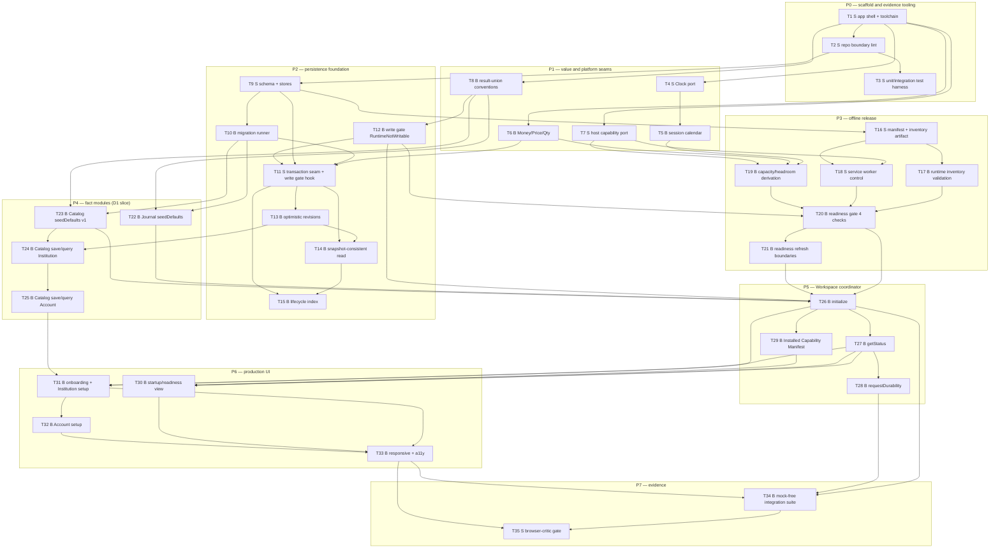

# D1 — Install, trust, and set up: task-level breakdown

Status: **draft for user review**, 2026-10-10. Not frozen. Phase 3 artifact for
`planning-protocol.md:61-135`.

Frozen inputs: `specs/` (read-only) and decisions D1–D6 in
[planning-decisions-2026-10-10.md](../planning-decisions-2026-10-10.md).
Deliverable scope and user stories: [vertical-deliverables.md](../vertical-deliverables.md) D1.

This file is the **D1 slice only**. It contains the task graph, per-task TDD cases and
structural verifications, the mock-free integration suite, and the browser-critic flow list.

---

## 0. Scope, boundary, and what D1 deliberately does not do

### Advertised outcome

A person opens the app in a browser. Before anything can be recorded, the app proves the
session is safe to write into. They then create their brokerage Institution and the Account
they trade, and the app is ready to plan.

### In scope (from `vertical-deliverables.md:43-68`)

| Area | Included |
|---|---|
| Delivery identity | Web App Manifest, stable identity, icons, launch URL, scope, standalone request |
| Offline release | Versioned service worker, complete digest-valid Offline Release Inventory, runtime validation |
| Readiness | Four-check browser-neutral Runtime Readiness, on every launch and after update/Restore |
| Write gate | Persistence-level `RuntimeNotWritable` rejection, not merely a UI block |
| Storage protection | Advisory `Protected`/`Best Effort`/`Unavailable` reporting, visible warning, `Workspace.requestDurability` |
| Persistence | IndexedDB schema, migration runner, atomic transaction seam, optimistic revisions, lifecycle index |
| Workspace | `initialize`, `getStatus` |
| Reference Catalog | `seedDefaults` (manifest v1), `save`/`query` for Institution and Account |
| Journal | `seedDefaults` (seven fixed Entry Types, initial definitions, seven Sources) |
| Honesty | Installed Capability Manifest advertising only what D1 delivers |
| UI | Runtime-Readiness/startup view, onboarding, Institution and Account setup, narrow and wide |

### Explicitly out of scope, and why it is safe

- **Installation experience** (in-app affordance, per-host guidance, standalone polish) and
  **update notice/deferral/activation UX** → D22 (decision D4). D1 still ships the manifest,
  the service worker, the inventory, readiness, and the write gate, which `planning-protocol.md:83`
  forbids deferring.
- **Trade, Trade Record, Trade Analysis, Trade Workflows, Market Data, Daily Review,
  Performance Analysis, Trade Views** — no such capability is advertised, reachable, or
  callable in D1 (`specs/README.md:98`).
- **`exportBackup`/`confirmBackup`/`prepareRestore`/`applyPreparedRestore`/`saveSettings`** → D6,
  D20, D21, and the settings surface respectively. The *gate* they will obey is built here;
  the operations are not.
- **Every Seed manifest value except Long Stock, the Plan Reflection Entry Type, and the Plan
  Confirmation Source.** Journal's seven fixed Entry Types are seeded in D1 — they are fixed
  identities, not a growing seed set — but only the Plan Reflection definition is exercised.
  Un-seeded *catalog* values are absent, not present-but-broken.
- **Real cross-engine support claims.** D1 produces readiness evidence on at least two engines
  (D3 item 6). It does not claim an allowlist.

### The one thing D1 cannot demonstrate

Installation capture. `AC-DEL-003` completes at D22 (`vertical-deliverables.md:66-68`);
D1 covers manifest identity, inventory binding, and browser-tab `Writable`, and the Installed
Capability Manifest says so.

---

## 1. Decisions this breakdown introduces (needing alignment)

Section 5 of the handoff allows the breakdown to introduce structure, but these choices are
consequential enough that they should be confirmed before D2 is written.

| # | Choice | Why this way | Alternative considered |
|---|---|---|---|
| B1 | **One persistence implementation, two IndexedDB providers.** Production uses browser IndexedDB; unit tests use `fake-indexeddb`; browser integration uses real IndexedDB. No in-memory fake of the seam ships. | `fakeIndexedDB` is named as acceptable by `planning-protocol.md:120` and is behaviorally the same engine. Inventing a second persistence implementation would create a path that does not exist in production. | A hand-written in-memory seam — rejected: it would let a unit test pass against semantics production does not have. |
| B2 | **`Clock` and the session calendar are injected ports; `Temporal` is not used.** | Verified 2026-10-10: Safari has no Temporal support. Decision D3 already directs an explicit date library plus our own calendar. | Temporal — rejected on measured availability, not preference. |
| B3 | **The Offline Release Inventory is our own build-emitted artifact, generated by a Vite plugin that also feeds the precache list.** Workbox does not own the inventory. | Workbox's precache manifest has no app-reachable runtime digest check (verified 2026-10-10), and its entries are URL+revision, not digests the app can re-verify. `delivery-contract.md:16` requires an *asset digest for every entry*. | Treat the Workbox manifest as the inventory and accept install-time-only verification — rejected: it cannot fail the readiness check on a corrupt cached asset, so `AC-DEL-004`'s "incomplete or digest-invalid inventory" case would not be demonstrable. |
| B4 | **Readiness is a Workspace-owned application service behind a retained host-capability port, and the transaction seam re-reads the latest readiness on every mutation.** | `overview.md:21` requires the seam itself to reject; `ACDEL-006` requires a later failure to invalidate `Writable` immediately. | Pass readiness as an argument to every call — rejected: a stale or forging caller could then write. |
| B5 | **`Workspace.initialize` distinguishes "no store" from "unreadable store" by a positive probe result, never by an empty read.** | `workspace.md:33,41` and the glossary's **Integrity Blocked** forbid treating a failed read as empty. | Treat any thrown open as "fresh" — rejected: prohibited. |
| B6 | **The lifecycle index store exists in D1 even though no Trade exists yet.** It is created by the D1 schema migration, and D1's integration suite proves membership moves atomically with a synthetic fact in a test-only fixture. | The schema is durable and migration-costly to change; `trade-record.md:155` requires index membership to change in the same commit as its facts. | Add the index at D2/D3 — rejected: it makes D4's "Open at cutoff" query a schema migration instead of a design. |
| B7 | **Repo layout** `src/{app,ui,modules/*,platform,persistence}` with module boundaries mirroring `overview.md`; `tests/integration` for the mock-free suite. | Keeps the dependency direction in `overview.md:46-121` mechanically checkable by lint rather than by review. | Flat `src/` — rejected: nothing then stops a component importing Trade Record directly. |

---

## 2. Task graph

35 tasks in nine phases. Every task states its type, blocking edges, and the deliverable
behaviour that depends on it. `S` = structural (exact verification required, no invented unit
tests). `B` = behaviour-bearing (red→green TDD required).



Two edges deserve comment because they are the ones a reviewer would question:

- **T12 → T11** (write gate before the seam it gates). The gate is a pure decision function
  with its own cases; the seam then *calls* it. This keeps the gate's failure matrix testable
  without a database, which is what makes `AC-DEL-004`'s per-check matrix cheap. It is also the
  one edge that runs against task numbering, and it is deliberate.
- **T31 → T32** (Institution before Account). Not a technical dependency but a workflow one:
  an Account requires a selectable Institution (`reference-catalog.md:35`), so the Account
  screen is unreachable before the Institution screen works.

### Verifying the graph itself

The graph above is not prose to be taken on trust. `scripts/check-deliverable-breakdown.mjs`
parses the task headers and their `Blocking edges:` declarations and the mermaid flowchart, then
checks: every task declares a type and its blocking edges; every referenced endpoint is a
declared task; neither representation contains a cycle; both describe the same dependency order,
compared as transitive reductions so a diagram may legitimately omit an edge that transitivity
already implies; every task appears in the diagram; and every structural task states an exact
verification.

```sh
node scripts/check-deliverable-breakdown.mjs plan/deliverable-breakdowns/D1-install-trust-set-up.md
```

Expected result: `35 (10 structural, 25 behaviour-bearing)`, `65 declared, 60 drawn`, the
topological order `T1 … T35`, and `result: OK` with exit status 0. The checker was itself
validated against injected cycles, an undefined edge endpoint, and a structural task with its
verification removed; it fails on each.

A second planning check audits claims that only make sense across files:

```sh
node scripts/audit-breakdown-coverage.mjs
```

It verifies that every acceptance scenario a breakdown claims exists in the acceptance contract,
that every scenario cited names tasks that exist in that deliverable, that no row presents partial
coverage as complete, that a row saying "not covered" does not also claim coverage, that task
citations for another deliverable are written `D<n>:T<m>` rather than bare, and that each of the
nine `planning-decisions` D3 verification items has a named owner or an explicit deferral. It was
validated against injected faults: an invented scenario ID, a row stripped of its tasks, a bare
cross-deliverable citation, a wrong task-count claim, a bogus cross reference, a task ID in a
status cell, and a status both claiming and disowning coverage.

Both are **planning** checks, not application code. They exist so that a later revision of these
files cannot silently break the ordering or the coverage the deliverables depend on.

### Shared-resource ownership

D1 is the single owner of the IndexedDB schema and the Persistence/Transaction seam, the seed
manifest, the Installed Capability Manifest, and the UI shell and navigation
(`vertical-deliverables.md:500-511`). Later deliverables extend these; D1 defines them.

---

## 3. Task detail

### Phase P0 — scaffold and evidence tooling

#### T1 — `S` Application shell and toolchain

TypeScript strict, Vite, React, Vitest, Playwright, and the pinned version profile recorded in
one place.

- **Blocking edges:** none (root).
- **Consumed by:** everything.

**Exact verification**

| # | Command | Expected result |
|---|---|---|
| V1.1 | `pnpm install --frozen-lockfile && pnpm exec tsc --noEmit` | exit 0, no diagnostics |
| V1.2 | `pnpm run build` | exit 0; `dist/index.html` exists; build log names the pinned Vite/React/Vitest/Playwright versions |
| V1.3 | `node -e "const p=require('./package.json');console.log(Object.keys(p.devDependencies).sort().join('\n'))"` | lists TypeScript, Vite, Vitest, Playwright, `decimal.js`, `vite-plugin-pwa` exactly as the recorded profile |
| V1.4 | `grep -c '"strict": true' tsconfig.json` | `1` |

**Depends on it:** every task.

**Version profile note.** The Phase 6 freeze requires exact pinned versions
(`planning-protocol.md:195`). This breakdown fixes the *set* and defers the *numbers* to the
freeze, which is the only defensible point given no `package.json` exists yet. Flagged as an
open item in §8.

---

#### T2 — `S` Repo boundary lint

An automated check that `src/ui/**` does not import a fact module or the persistence seam
directly, and that `src/modules/trade-analysis/**` imports no storage, clock, calendar, or
other module.

- **Blocking edges:** T1.
- **Consumed by:** T33 (the UI must use the Workspace surface only), T11.

**Exact verification**

| # | Command | Expected result |
|---|---|---|
| V2.1 | `pnpm run lint:boundaries` on the clean tree | exit 0 |
| V2.2 | A deliberately added violation, e.g. `src/ui/__probe.ts` importing the persistence seam, then `pnpm run lint:boundaries` | exit non-zero naming the file and the forbidden edge |
| V2.3 | Revert the probe and re-run | exit 0 |

**Depends on it:** `overview.md:114-121` prohibits fact modules calling coordinators and Trade
Analysis touching storage. D1 is the only deliverable that can install that guard cheaply.

---

#### T3 — `S` Unit and integration test harness

Vitest configured with `fake-indexeddb` as the Node IndexedDB provider; Playwright configured
with a GitHub-Actions-free local browser set; `DEV_PORT` read from `.env.local` by both Vite
and Playwright.

- **Blocking edges:** T1, T2 (the harness must satisfy the boundary lint it will be run under).
- **Consumed by:** T9–T15, T34, T35.

**Exact verification**

| # | Command | Expected result |
|---|---|---|
| V3.1 | `pnpm exec vitest run --reporter=verbose` | exit 0; reports a non-zero test count; no test is skipped |
| V3.2 | A committed harness self-test opens a database through the Vitest environment, writes to two object stores in one transaction, and asserts both are visible | passes under `fake-indexeddb` |
| V3.3 | `grep -n "DEV_PORT" vite.config.ts playwright.config.ts .env.local` | all three reference `DEV_PORT`; no literal `5173` appears in either config |
| V3.4 | `pnpm exec playwright test --list` | lists at least one spec; no browser download is attempted at list time |

**Why `DEV_PORT` is structural, not cosmetic.** `vertical-deliverables.md:118-120` names it a
known trap: hardcoding `5173` while `.env.local` says `5177` would make the critic gate start a
server the tests do not talk to.

**Disclosed test-infrastructure replacement:** `fake-indexeddb` standing in for the browser's
IndexedDB. Fidelity limits are recorded in T34.

---

### Phase P1 — value and platform seams

#### T4 — `S` Injected `Clock` port

A `Clock` port returning an instant, with a fixed test clock implementation retained for tests
only.

- **Blocking edges:** T1.
- **Consumed by:** T5, T26, T27.

**Exact verification**

| # | Command | Expected result |
|---|---|---|
| V4.1 | `grep -rn "new Date()\|Date.now()" src --include=*.ts --include=*.tsx \| grep -v "src/platform/clock"` | no matches |
| V4.2 | `pnpm exec vitest run src/platform/clock` | the fixed clock returns the injected instant regardless of wall time |

**Depends on it:** `AC-DEL-001`'s restart evidence and D2/D3's Economic Time determinism both
need a controllable clock. One `Date.now()` in domain code makes a benchmark and a red→green
run non-reproducible.

---

#### T5 — `B` Versioned U.S. session calendar

**Behaviour under test (seam: the calendar port's session and completed-session queries).**

- `describe("U.S. session calendar")`
  - `it should resolve the latest completed regular session for an instant inside an active Tuesday session as the preceding Monday`
  - `it should treat a holiday as a non-session and not report it as a completed session`
  - `it should return the session policy revision alongside every resolved session, so a later calendar update cannot silently change an earlier answer`
  - `it should report an explicit gap rather than substituting the nearest session when the requested date is not a session`

**Red → green.** Write the first case; it fails because no calendar resolves sessions. Implement
session resolution for the case; confirm green. Add the holiday case; it fails on the holiday
fixture; extend the resolver. Continue case by case.

**Valid red evidence:** the failure message names the missing resolution behaviour.
**Not valid red:** a failure from an unpopulated holiday fixture, a timezone-parsing exception,
or a missing module import.

**Blocking edges:** T4.
**Consumed by:** T19 (capacity derivation uses Trading Date), T26, and D4's Expected Mark Date.

**Why D1 owns this.** `glossary.md:140` fixes the Tuesday/Monday rule as normal evidence, and
`AC-MARK-001` tests it. D1 needs Trading Date for the readiness capacity derivation, and the
calendar is versioned session data whose internal shape is durable. Building it later would
reopen a value D1 already depends on.

---

#### T6 — `B` Money, Price, and Quantity value layer

`decimal.js` behind a value layer. Never JS `number` for a Money, Price, or Quantity.

**Behaviour under test (seam: the Money/Price/Quantity constructors and their arithmetic).**

- `describe("exact Money, Price, and Quantity")`
  - `it should represent a price of 0.1 plus 0.2 as exactly 0.3, so an equality assertion across two paths agrees`
  - `it should scale a Quantity by a contract multiplier of 100 without binary floating-point drift`
  - `it should reject constructing a Money from a JS number, so no caller can introduce an inexact value`
  - `it should keep a zero result distinguishable from an absent one rather than collapsing both to falsy`

**Red → green.** Case 1 fails while values are JS numbers. Introduce the decimal-backed value
layer; green. Add the multiplier case; it fails on a float path; fix the multiplication. Add the
constructor-rejection case; it fails because a number is accepted; add the type guard.

**Valid red evidence:** the assertion shows a value inequality caused by floating-point
representation, or a number being accepted where an exact value is required.
**Not valid red:** a TypeScript compile error (that is a build failure, not behavioural red), or
a failing assertion caused by the test's own literal.

**Blocking edges:** T1.
**Consumed by:** T19, and every monetary case in D2 and D3.

---

#### T7 — `S` Browser-host capability port

One narrow port aggregating the host capabilities Workspace is allowed to see: storage estimate,
persistence status and durability request, service-worker registration/control, cache storage
access, and (later) file download and file selection. Raw host APIs are not exposed to any
domain module (`overview.md:44`).

- **Blocking edges:** T1.
- **Consumed by:** T17, T18, T19, T28, T30.

**Exact verification**

| # | Command | Expected result |
|---|---|---|
| V7.1 | `grep -rn "navigator\.\|window\.\|caches\.\|serviceWorker" src --include=*.ts --include=*.tsx \| grep -v "src/platform/host"` | no matches |
| V7.2 | `pnpm exec tsc --noEmit` | the port's interface declares no `File`/`FileSystemFileHandle`/`navigator` type in a domain module's import graph |

**Depends on it:** `delivery-contract.md:132` requires delivery behaviour to be evidence-bearing
without turning host APIs into domain interfaces.

---

#### T8 — `B` Shared result-union conventions

The `CalculationResult` union, the cross-cutting `RuntimeNotWritable` branch shape, and typed
no-write failure conventions, as values every later module returns.

**Behaviour under test (seam: the shared result constructors and their narrowing helpers).**

- `describe("shared result conventions")`
  - `it should keep Value, Unbounded, Unavailable, and NotApplicable mutually distinguishable and never collapse Unavailable into NotApplicable`
  - `it should carry, on one RuntimeNotWritable result, the readiness outcome, every failed check, the Workspace status, and ordered safe actions`
  - `it should preserve a valid Value alongside an Unavailable sibling rather than suppressing it, so one unavailable figure cannot hide a good one`
  - `it should label a partial sum as a covered subtotal rather than returning it as a total`

**Red → green.** Case 1 fails while results are nullable numbers. Introduce the union; green.
Cases 2–4 added one at a time, each red for its own reason (missing branch; suppression on
first missing component; unlabelled partial).

**Valid red evidence:** the failure is an unavailable-vs-not-applicable conflation, a dropped
sibling value, or a subtotal presented as a total — each a `glossary.md:131` /
`overview.md:171` violation.
**Not valid red:** a missing barrel export.

**Blocking edges:** T1.
**Consumed by:** T12, T22, T23, T27, and every accepted result in D2/D3.

**Why this is a D1 task.** `overview.md:160-186` fixes these conventions, and D1 is the first
deliverable whose operations return any of them (`RuntimeNotWritable` from `initialize`).

---

### Phase P2 — persistence foundation

#### T9 — `S` IndexedDB schema and object stores

One object store per fact module, a lifecycle-index store, and rebuildable projection stores,
with a versioned schema identifier.

- **Blocking edges:** T2.
- **Consumed by:** T10–T15, T22–T26.

**Exact verification**

| # | Command | Expected result |
|---|---|---|
| V9.1 | A committed schema self-test opens the database and asserts the exact store list and each store's key path and index list | passes; the asserted list matches the declared schema constant |
| V9.2 | The same test asserts that opening a database whose stored version is newer than the code's supported version fails closed rather than being upgraded | the open rejects with a typed unsupported-version result |
| V9.3 | `grep -rn "createObjectStore" src/persistence` | occurrences appear only in the schema module and the migration modules |

**Depends on it:** every durable behaviour in D1.

**Note on B6.** The lifecycle-index store is created here. D1's integration suite proves a
membership move is atomic (T15) using a test-only fixture, because no Trade exists yet.

---

#### T10 — `B` Migration runner

Staged, validated version transitions with a recorded receipt and a rejected unknown-newer case.

**Behaviour under test (seam: the migration runner's `migrate(from, to)` entry point).**

- `describe("durable schema migration")`
  - `it should apply a known older version to the current version and report a receipt naming each transition`
  - `it should reject an unknown newer stored version with the current data unchanged and readable`
  - `it should run a failed migration step inside a candidate that is discarded, leaving the prior data intact and readable`
  - `it should be idempotent when the stored version already equals the code's version, reporting no transitions`

**Red → green.** Case 1 fails with no runner. Implement a single-step migration; green. Case 2
fails because a newer version is silently opened; add the version check. Case 3 fails because a
mid-step throw leaves a half-migrated root; move the step into a candidate. Case 4 fails because
a no-op reports a transition; fix the receipt.

**Valid red evidence:** data left unreadable, a silently-ignored newer version, or a fabricated
transition — each a `delivery-contract.md:63-65` violation.
**Not valid red:** a missing migration fixture constant.

**Blocking edges:** T9.
**Consumed by:** T11, T22, T23, T26, and every later deliverable that changes a durable shape.

---

#### T11 — `S` Atomic transaction seam

One multi-store IndexedDB transaction with `oncomplete`/`onabort` semantics, rollback on any
participant failure, and the write-gate hook.

- **Blocking edges:** T6, T9, T10, T12.
- **Consumed by:** T13–T15, T22–T26, T34.

**Exact verification**

| # | Command | Expected result |
|---|---|---|
| V11.1 | A committed seam self-test stages writes to two stores, makes one participant throw, and asserts the transaction aborted | both stores show their pre-transaction contents |
| V11.2 | The same test asserts the seam calls the write gate before staging anything | with the gate returning a rejection, no object store is written |
| V11.3 | `grep -rn "transaction(" src/persistence` | transactions are opened only inside the seam module |
| V11.4 | A test asserts a committed transaction is durable after a simulated close-and-reopen | values are present on reopen |

**Depends on it:** `ADR 0002` and `overview.md:127`. This is also the mechanism
`planning-decisions` D3 item 5 requires (`AC-CORR-004`), which is proven in D15 but installed here.

---

#### T12 — `B` Persistence-level write gate returning `RuntimeNotWritable`

**Behaviour under test (seam: the write gate's decision function, then the transaction seam
that calls it).**

- `describe("persistence-level write gate")`
  - `it should return RuntimeNotWritable carrying RecoveryOnly, the failed checks, and the readable Workspace status when readiness is RecoveryOnly`
  - `it should return RuntimeNotWritable carrying Unsupported and every failed check when readiness is Unsupported`
  - `it should reject with RuntimeNotWritable before any object store is written, not after a partial write`
  - `it should allow the write when readiness is Writable`
  - `it should reject the next mutation immediately after readiness re-evaluates as not Writable, without reusing the earlier Writable decision`

**Red → green.** Case 1 fails while the gate has no branch. Implement the branch; green. Case 3
fails because the gate is consulted after staging begins; move the check to the transaction
entry. Case 5 fails because readiness is cached per session; make the seam read the latest
evaluated readiness.

**Valid red evidence:** a partial write observed, a rejected-not-attempted distinction that
cannot be made from the result, or a stale-`Writable` acceptance after a re-evaluation.
**Not valid red:** the gate module missing entirely (import failure).

**Blocking edges:** T8.
**Consumed by:** T11 (which calls it), T20, T26.

> **This is `planning-decisions` D3 verification item 4** — "the write gate rejecting at the
> transaction seam, not merely in the UI." Case 3 is that item's test, and its evidence is the
> before/after store contents, not the returned result alone.

---

#### T13 — `B` Optimistic revisions and conflict results

**Behaviour under test (seam: a module operation accepting an expected revision).**

- `describe("optimistic revision binding")`
  - `it should accept a write carrying the current expected revision and return the new revision in its result`
  - `it should return a typed Conflict with the current revision and write nothing when the expected revision is stale`
  - `it should distinguish a query snapshot binding from a mutation revision, so a snapshot cannot be used to authorize a write`
  - `it should bind a multi-store commit to one resulting revision visible to every participant`

**Red → green.** Case 2 fails while revisions are ignored. Add expected-revision checking; green.
Case 3 fails because one token type serves both; separate the types.

**Valid red evidence:** a stale write succeeding, or a snapshot token authorizing a mutation.
**Not valid red:** a revision fixture number changed in the test.

**Blocking edges:** T11.
**Consumed by:** T24, T25, T26, and every D2/D3 mutation.

---

#### T14 — `B` Snapshot-consistent multi-module reads

**Behaviour under test (seam: the read snapshot entry point).**

- `describe("snapshot-consistent reads")`
  - `it should return every participating module's data from one snapshot when a concurrent commit lands during assembly`
  - `it should never return a torn view mixing pre-commit and post-commit participants`
  - `it should invalidate a returned pagination cursor after the snapshot changes`

**Red → green.** Case 1 fails while each module is read separately. Introduce the snapshot;
green. Case 2 fails when a commit lands between two reads; fix by reading inside one snapshot.

**Valid red evidence:** an observed mixed-revision result.
**Not valid red:** a timing-dependent test that flakes. Case 2 must force the interleaving
deterministically through a seam hook, not by racing.

**Blocking edges:** T11, T13.
**Consumed by:** T11, T14, D6's backup export, and T34.

---

#### T15 — `B` Lifecycle index membership

**Behaviour under test (seam: the lifecycle index store queried through the persistence read
API, exercised by a test-only fixture module that stands in for a future fact module).**

- `describe("authoritative lifecycle index")`
  - `it should reflect a membership move in the same commit as the fact change that justifies it`
  - `it should return no membership for a Trade absent from the index rather than falling back to replay`
  - `it should be rebuildable from the authoritative facts with an equivalent result`
  - `it should remain correct after a simulated interrupted transaction, showing neither the pre-commit nor post-commit membership exclusively`

**Red → green.** Case 1 fails while the index is written in a second transaction. Move it into
the same transaction; green. Case 4 fails on an interruption; the abort path must restore.

**Valid red evidence:** an index that disagrees with the facts it indexes, or an index used as
authority *instead of* the facts.
**Not valid red:** the fixture module's own bug.

**Blocking edges:** T11, T14.
**Consumed by:** D2 (stored `Planned`), D3 (`Planned`→`Open`), D4 (Open at cutoff).

**Disclosed fixture:** the test-only fixture module is not an application layer and is not
reachable from the production graph. It exists because no real fact module exists yet; it is
removed when D2's Trade Record arrives and the real cases take over. This is recorded so the
critic does not read it as a bypass.

---

### Phase P3 — offline release

#### T16 — `S` Web App Manifest and Offline Release Inventory artifact

One manifest with stable identity, name, icons (192 and 512), launch URL, navigation scope, and
standalone request; plus a build-emitted inventory listing every asset required for the release
to start offline, each with a digest, under one immutable release identity.

- **Blocking edges:** T9 (the build must be able to emit and store the release identity).
- **Consumed by:** T17, T18, T20.

**Exact verification**

| # | Command | Expected result |
|---|---|---|
| V16.1 | `pnpm run build && node scripts/verify-manifest.mjs` | exit 0; the manifest parses and declares `name`, `start_url`, `scope`, `display: standalone`, and icons including 192×192 and 512×512 |
| V16.2 | `node scripts/verify-inventory.mjs dist` | exit 0; the emitted inventory names every file in `dist` that the release needs, and every entry has a non-empty digest |
| V16.3 | Delete one entry from the built inventory and re-run V16.2 | exit non-zero, naming the missing asset |
| V16.4 | Flip one character of one entry's digest and re-run V16.2 | exit non-zero, naming that asset |
| V16.5 | `pnpm run build` twice | the release identity changes only when asset content changes |

**Why the inventory is ours (B3).** `delivery-contract.md:16` requires a digest per entry;
Workbox's precache manifest is URL+revision and offers no app-reachable verification API.
T17 is what turns this artifact into a passing or failing readiness check.

---

#### T17 — `B` Runtime Offline Release Inventory validation

**Behaviour under test (seam: the inventory validation used by the readiness check, over the
host capability port's cache access).**

- `describe("runtime Offline Release Inventory validation")`
  - `it should report the release inventory complete and digest-valid when every entry's cached bytes hash to its recorded digest`
  - `it should report the missing-asset check failed, naming the asset, when one entry is absent from the cache`
  - `it should report the digest-invalid check failed, naming the asset, when one cached asset's bytes no longer match its recorded digest`
  - `it should report the release-identity check failed when the cached inventory belongs to a different release than the running one`
  - `it should validate without a network request, so the check passes with the network disabled`

**Red → green.** Case 1 fails with no validator. Implement digest comparison over cached bytes;
green. Case 2 fails because a missing entry is treated as a zero-length asset; add presence
checking. Case 3 fails because validation only compares names; add byte hashing. Case 5 fails
because the validator fetches; read from cache only.

**Valid red evidence:** a corrupt or missing asset reported as valid, or a validation that
silently passes on an empty inventory. The empty-inventory case must be one of the cases, since
"all zero entries valid" is the obvious way to pass wrongly.
**Not valid red:** WebCrypto unavailable in the Node test environment — that is a harness
defect to fix, not behaviour.

**Blocking edges:** T16.
**Consumed by:** T20.

> **This is `planning-decisions` D3 verification item 3** — inventory completeness and digest
> validation achievable at runtime, and the gate genuinely failing on a missing/corrupt asset
> and on missing service-worker control (`AC-DEL-004`). Cases 2, 3, and 4 are that item.

---

#### T18 — `S` Versioned service worker with intended-release control

A versioned worker that installs and verifies its inventory before being treated as available,
never calling `skipWaiting()` on its own.

- **Blocking edges:** T7, T16.
- **Consumed by:** T20, T21, T34, and D22's update work.

**Exact verification**

| # | Command | Expected result |
|---|---|---|
| V18.1 | `grep -rn "skipWaiting" src` | the only occurrence is inside a message handler reachable from an explicit user action (none in D1) |
| V18.2 | `pnpm run build` then inspect the emitted worker | it contains the release identity and imports or embeds the inventory |
| V18.3 | In the browser integration suite, load the app and assert `navigator.serviceWorker.controller` becomes non-null after the first controlled load | control is established |
| V18.4 | Load in a fresh context with the worker script removed from `dist` and re-run V18.3 | no control; the readiness check observes it |

**Depends on it:** `delivery-contract.md:48-49` and `planning-decisions` D4's update rules. D1
installs the worker and the no-self-skip invariant; D22 builds the notice UX on it.

---

#### T19 — `B` Capacity and headroom derivation

**Behaviour under test (seam: the capacity check over the host capability port's storage
estimate).**

- `describe("capacity headroom derivation")`
  - `it should pass when available capacity exceeds the disclosed minimum for the mature Workspace plus migration and backup headroom`
  - `it should fail, naming the derived minimum and the observed available capacity, when capacity is below that minimum`
  - `it should expose the derivation — mature-Workspace estimate, migration factor, backup factor — so the minimum is auditable rather than a magic constant`
  - `it should treat an unavailable storage estimate as a failed capacity check rather than as sufficient capacity`

**Red → green.** Case 1 fails with no derivation. Implement the disclosed derivation; green.
Case 2 fails because the check only tests truthiness of the estimate; compare against the
derived minimum. Case 4 fails because a missing estimate passes; fail it closed.

**Valid red evidence:** an undisclosed magic minimum, or an absent estimate treated as ample —
the latter is a real trap, because `navigator.storage.estimate()` can return zeros.
**Not valid red:** the estimate unavailable in the Node harness; that case belongs to the
browser suite, and in the unit harness the estimate is a supplied port value.

**Blocking edges:** T5, T6, T7.
**Consumed by:** T20, T34.

> **This is `planning-decisions` D3 verification item 2's** disclosure half and
> `AC-DEL-004`'s "disclosed capacity derivation using mature data plus migration/backup
> headroom." The latency half of item 2 belongs to a later deliverable with real data.

---

#### T20 — `B` Runtime Readiness gate: four checks, browser-neutral

**Behaviour under test (seam: the readiness gate, evaluated against the host capability port
and the persistence diagnostic transaction).**

- `describe("runtime readiness gate")`
  - `it should return Writable when the isolated diagnostic transaction completes, capacity headroom meets the derived minimum, the intended worker controls the scope, and the release inventory is complete and digest-valid`
  - `it should return Unsupported naming the failed diagnostic-transaction check when the isolated transaction cannot complete`
  - `it should return Unsupported naming the failed capacity check when headroom is below the derived minimum`
  - `it should return Unsupported naming the failed service-worker-control check when the intended worker does not control the scope`
  - `it should return Unsupported naming the failed inventory check when the inventory is incomplete or digest-invalid`
  - `it should report every failed check when more than one check fails, rather than stopping at the first`
  - `it should leave no authoritative fact behind from its diagnostic transaction`
  - `it should not consult browser name, browser family, operating system, or user-agent identity in any decision`
  - `it should remain Writable when host storage protection is Best Effort or Unavailable`

**Red → green.** Case 1 fails with no gate. Implement one check; extend check by check, adding
each case before its behaviour. Case 6 fails because evaluation short-circuits; make the gate
accumulate. Case 7 is verified by inspecting the stores after a run, not by the result — a
diagnostic transaction that accidentally creates a fact passes case 1 and fails case 7, which
is exactly the trap.

**Valid red evidence:** a single-failure matrix where the named check is wrong or missing, a
short-circuit hiding a second failure, a diagnostic that left a fact, or a decision that reads
an identity string. Case 8's red is a gate that returns Unsupported for a spoofed user agent.
**Not valid red:** the gate's dependency injection wiring being absent.

**Blocking edges:** T12, T17, T18, T19.
**Consumed by:** T21, T26, T30.

> **This is `planning-decisions` D3 verification item 3's** service-worker-control half and
> item 6's subject. Case 8 is the "no allowlist" rule
> (`delivery-contract.md:23`, `planning-protocol.md:212`).

---

#### T21 — `B` Readiness re-establishment at every boundary

**Behaviour under test (seam: the readiness service across repeated evaluation).**

- `describe("readiness re-establishment")`
  - `it should evaluate readiness freshly on each launch rather than reusing a previously stored Writable result`
  - `it should re-evaluate readiness after release activation and expose the new result before mutations are enabled`
  - `it should invalidate a previously Writable result as soon as a later check fails, and prevent the next mutation`
  - `it should enter Recovery Only when a later failure occurs while existing data remains readable`

**Red → green.** Case 1 fails while the result is cached. Remove caching across launches; green.
Case 3 fails because the seam keeps the earlier decision; make the seam consult the latest
evaluation (T12 case 5 is its persistence-side twin).

**Valid red evidence:** a mutation accepted after a re-evaluated failure, or a launch that
reports Writable without running the checks.
**Not valid red:** the injected failure not being triggered.

**Blocking edges:** T20.
**Consumed by:** T26.

> **`AC-DEL-006`.** D1 proves the launch and running-session halves. The update-activation and
> post-Restore halves are proven in D22 and D21 respectively, using this same service.

---

### Phase P4 — fact modules, D1 slice

#### T22 — `B` `Journal.seedDefaults` for the fixed identities

**Behaviour under test (seam: `Journal.seedDefaults`, then `Journal.getDefinitions`).**

- `describe("Journal.seedDefaults")`
  - `it should create all seven fixed Entry Types — Plan Reflection, Position Change Reflection, Management Revision, Close Review, Daily Trade Review, Review Note, Trader Reflection — under stable product identities`
  - `it should create the seven initial Sources — Plan Confirmation, Position Change, Management Revision, Trade Close, Daily Review, Trade Detail, Journal`
  - `it should create the Plan Reflection initial definition with the exact required Thesis and Invalidation roles, the optional Conviction 1–5 Scale, and the Primary emotion single-select options from the Journal contract`
  - `it should be idempotent, so a repeat seed adds nothing and leaves every existing definition revision untouched`
  - `it should not overwrite a trader revision of an existing definition when seeding is repeated`
  - `it should return SeedConflict with no write when a known stable key exists with incompatible meaning`
  - `it should preserve a trader rename of a fixed Entry Type label without changing the Entry Type identity`

**Red → green.** Case 1 fails with no seeding. Implement fixed-type creation; green. Case 3
fails on the missing role; add the definition. Case 4 fails because repeat seeding duplicates;
add stable-key matching. Case 6 fails because an incompatible key is silently overwritten; add
the conflict result.

**Valid red evidence:** a missing fixed identity, a definition that does not match the contract,
a duplicate on repeat seed, or an overwritten trader revision.
**Not valid red:** the seed manifest fixture being incomplete.

**Blocking edges:** T8, T10.
**Consumed by:** T26, and D2's `Journal.prepareEffects` for the Plan Reflection.

> **`AC-JOUR-007` is only partial.** It completes at D17. D1 must state that the seeded set is
> present and honest, not that the scenario passes (`vertical-deliverables.md:154-156`).

---

#### T23 — `B` `ReferenceCatalog.seedDefaults` for manifest v1

**Behaviour under test (seam: `ReferenceCatalog.seedDefaults`, then `ReferenceCatalog.query`).**

- `describe("ReferenceCatalog.seedDefaults manifest v1")`
  - `it should create exactly the Long Stock Strategy seed with one long Stock role and no strike, expiration, or quantity default`
  - `it should create the single IdeaSource Tag Type with no seeded Tag Values`
  - `it should create no Account, no Institution, no Close Reason, no Abandonment Reason, and no generic Custom or Other Strategy`
  - `it should be idempotent, so a repeat seed returns no additions and an unchanged Catalog snapshot`
  - `it should not reactivate a legitimately retireable seed on re-seed`
  - `it should match stable product keys and never match by mutable label`
  - `it should return SeedConflict with no write when a known key is present with an incompatible meaning`

**Red → green.** Case 1 fails with no seeding. Implement the Long Stock seed; green. Case 3
fails because a lenient seeder also creates Close Reasons; narrow the manifest. Case 6's red is
a seeder that renames a Strategy then re-seeds and matches by label — it duplicates or ignores.
The test renames through `save`, re-seeds, and asserts no new identity.

**Valid red evidence:** an extra or missing seed, a shape carrying a default the Strategy
vocabulary forbids (`reference-catalog.md:80`), a duplicate created by label matching, or a
reactivated retireable seed.
**Not valid red:** the manifest constant not being exported.

**Blocking edges:** T8, T10.
**Consumed by:** T24, T26, and D2's Strategy selector.

> **`AC-REF-001` is only partial in D1.** It requires exactly eleven Strategy seeds and the two
> five-value reason taxonomies (`acceptance-contract.md:390`) and completes at D13/D8. D1 must
> advertise a partial catalog honestly rather than as a passing scenario
> (`vertical-deliverables.md:154-156`).

---

#### T24 — `B` `save`/`query` for Institution

**Behaviour under test (seam: `ReferenceCatalog.save`, `ReferenceCatalog.query`).**

- `describe("Institution administration")`
  - `it should create an Institution and return its generated stable identity, complete current record, appended history head, and new Catalog snapshot`
  - `it should rename an Institution by appending a revision and never editing an earlier revision`
  - `it should list selectable Institutions in deterministic label/identity order`
  - `it should include an inactive Institution in an include-inactive query while keeping it out of a selectable-only query`
  - `it should reject archival of an Institution that has selectable Accounts, with a typed no-write result naming the conflict`
  - `it should reject a stale expected revision with Conflict carrying the current revision and no write`
  - `it should distinguish two Institutions whose labels differ only by surrounding whitespace or case, because label text is never identity`

**Red → green.** Case 1 fails with no save. Implement creation; green. Case 5 fails because
archival succeeds regardless of child Accounts; add the check. Case 7 fails because the lookup
normalizes labels; key on identity.

**Valid red evidence:** an allocation of a second identity for the same subject, an earlier
revision mutated in place, or a rejected operation that still wrote.
**Not valid red:** a missing test fixture Institution.

**Blocking edges:** T13, T23.
**Consumed by:** T25, T31.

**Seam note.** `save` returns the record it created, so no case may assert a follow-up `query`
as part of success (`reference-catalog.md:37`, `AC-RESP-001`). Case 1 asserts the returned
record directly.

---

#### T25 — `B` `save`/`query` for Account

**Behaviour under test (seam: `ReferenceCatalog.save`, `ReferenceCatalog.query`, `ReferenceCatalog.resolve`).**

- `describe("Account administration")`
  - `it should create an Account under a selectable Institution and return its stable identity with its immutable Institution parent`
  - `it should reject creating an Account under a non-selectable Institution with a typed rejection and no identity allocated`
  - `it should resolve an Account as NewSelection only when both the Account and its parent Institution are selectable`
  - `it should keep an inactive Account valid for RetainedReference and HistoricalSnapshot while rejecting it for NewSelection`
  - `it should derive the Institution through the Account on every read rather than storing a second Institution reference`
  - `it should enforce Account label distinguishability within its Institution and allow the same label in a different Institution`

**Red → green.** Case 2 fails because the parent is not checked; add it. Case 3 fails because
`resolve` returns valid without checking the parent; extend resolution. Case 6 fails because
distinguishability is enforced globally.

**Valid red evidence:** an Account created under an archived Institution, a retained inactive
reference rejected as a new selection, or an Account carrying a second Institution reference.
**Not valid red:** the Institution fixture not being created.

**Blocking edges:** T24.
**Consumed by:** T26 (onboarding), T31, T32.

---

### Phase P5 — Workspace coordinator

#### T26 — `B` `Workspace.initialize`

**Behaviour under test (seam: `Workspace.initialize`).**

- `describe("Workspace.initialize")`
  - `it should return RuntimeNotWritable with Recovery Only and readable status plus backup actions when readiness is Recovery Only, writing nothing`
  - `it should return RuntimeNotWritable with Unsupported, every failed check, and safe retry actions when readiness is Unsupported, creating no Workspace, defaults, or imported facts`
  - `it should return RuntimeNotWritable carrying Integrity Blocked when a known or possible existing root cannot be read, and never fall through to fresh initialization`
  - `it should create Workspace metadata and seed Journal and Catalog defaults in one transaction on a fresh Writable store, and return Opened with the onboarding state Needs Institution and Account`
  - `it should return Opened with a receipt identifying the readiness evidence, schema transitions, seed versions and additions, and private rebuilds`
  - `it should derive onboarding from the resulting Catalog state in the same operation, so a Workspace with a selectable Account reports Ready for Trade Planning without a follow-up query`
  - `it should return Migration Blocked with unchanged-data evidence when a supported older version cannot be migrated`
  - `it should write neither Workspace metadata nor defaults when any seeding participant fails, leaving no partial initialization`
  - `it should treat opening the store as an existing Workspace on a second call and report that as existing rather than fresh`

**Red → green.** Case 4 fails with no initialization. Implement metadata plus one seeding
participant; green. Case 8 fails because metadata commits before a seeding failure; move
everything into one transaction. Case 3 fails because an unreadable root throws and is caught
as "no Workspace"; add the positive-probe distinction (B5) — this is the highest-value case in
the task.

**Valid red evidence:** a Workspace created despite a failed readiness check, defaults seeded
over an unreadable root, a partial initialization, or a fresh-initialization path reached from
an unreadable root.
**Not valid red:** the readiness service not being wired.

**Blocking edges:** T12, T20, T21, T22, T23.
**Consumed by:** T27, T29, T31, T34.

---

#### T27 — `B` `Workspace.getStatus`

**Behaviour under test (seam: `Workspace.getStatus`).**

- `describe("Workspace.getStatus")`
  - `it should return Ready only with Writable readiness, and include the full-content Workspace binding, time-zone setting and revision, Installed Capability Manifest, onboarding state, per-check readiness evidence, protection state, schema versions, and the latest migration/seed/rebuild receipt`
  - `it should return Initialization Required only when a writable store was opened and proved no Workspace exists`
  - `it should return Recovery Only with readable status and safe backup actions when data is readable and a write-safety condition fails`
  - `it should return Integrity Blocked with the underlying readiness evidence and safe actions whenever a known or possible existing root cannot be read or validated`
  - `it should never mutate or repair during a status read`
  - `it should not treat a failed or ambiguous store read as an empty store`

**Red → green.** Case 1 fails with no status. Implement Ready; green. Case 6 fails because a
thrown read is caught and reported as empty; distinguish.

**Valid red evidence:** Integrity Blocked rendered as Initialization Required, or a status read
that wrote.
**Not valid red:** a missing status field constant.

**Blocking edges:** T26.
**Consumed by:** T28, T29, T30, T31.

---

#### T28 — `B` `Workspace.requestDurability`

**Behaviour under test (seam: `Workspace.requestDurability`).**

- `describe("Workspace.requestDurability")`
  - `it should return Improved with currentProtection Protected when the host grants the request`
  - `it should return AlreadyProtected with currentProtection Protected when protection was already held`
  - `it should return NotImproved carrying BestEffort or Unavailable with a reason when the host denies or does not support the request`
  - `it should not change Runtime Readiness or the Workspace status in any of the three outcomes`
  - `it should neither delete nor export any data, and should fabricate no success`
  - `it should remain callable while readiness is Recovery Only, because it does not mutate authoritative Workspace data`

**Red → green.** Case 3 fails because a denial is reported as an error; introduce the
`NotImproved` branch. Case 6 fails because the operation is gated like a mutation; exempt it
(`overview.md:177`).

**Valid red evidence:** a denial reported as success, a readiness change caused by a durability
request, or data removed. `AC-DEL-004` explicitly pairs unconfirmed protection with a still
`Writable` Workspace and an accepted write.
**Not valid red:** the host port's denial stub not being installed.

**Blocking edges:** T27.
**Consumed by:** T30.

---

#### T29 — `B` Installed Capability Manifest

**Behaviour under test (seam: `Workspace.getStatus`'s manifest, plus the navigation it drives).**

- `describe("Installed Capability Manifest")`
  - `it should declare only the D1 capability set, and omit Trade Record, Trade Workflows, Trade Analysis, Market Data, Daily Review, Performance Analysis, Trade Views and Reporting, and backup/Restore capabilities entirely`
  - `it should be immutable for the installed release, and not togglable`
  - `it should be absent from restored and exported Workspace data, because it describes installed code rather than trader data`
  - `it should be dependency-closed, so every declared capability's dependencies are declared too`
  - `it should answer "not installed" for an undeclared capability rather than returning a domain Unavailable result`

**Red → green.** Case 1 fails while the manifest lists target-shape operations. Narrow it to
what exists; green. Case 5's red is a navigation query for an undeclared capability returning
`Unavailable`; it must return absence.

**Valid red evidence:** an advertised operation that is not reachable or not functional, or an
absent capability surfaced as domain `Unavailable`. Both are `specs/README.md:98` violations and
`AC-CAP-001`'s subject.
**Not valid red:** the manifest constant not existing yet.

**Blocking edges:** T26.
**Consumed by:** T30, T33.

---

### Phase P6 — production UI

#### T30 — `B` Startup, readiness, and protection presentation

**Behaviour under test (seam: the production UI at D1's routes, driven through the Workspace
public operations only).**

- `describe("startup and readiness presentation")`
  - `it should identify startup verification while readiness is pending, without presenting an empty Workspace or an enabled mutating action`
  - `it should present the writable application once readiness is Writable`
  - `it should name each failed readiness check, explain that no journal data will be risked, offer safe retry where meaningful, and recommend another browser when readiness is Unsupported`
  - `it should present restricted read and history navigation and disable every authoritative mutation with one clear reason when readiness is Recovery Only`
  - `it should pair Unsupported readiness with Integrity Blocked status, warn that journal data may already exist, and offer only safe retry or recovery actions`
  - `it should keep a visible warning that the browser may clear data whenever protection is not Protected, and never disable a control because of it`
  - `it should offer exactly one explicit durability action where the host can request it, invoking Workspace.requestDurability`
  - `it should explain that another browser has separate storage and requires a completed backup and Restore to transfer data`
  - `it should render the not-protected warning and the failed-check list without relying on color alone`

**Red → green.** Case 1 fails while the shell renders empty immediately. Add the pending state;
green. Case 6 fails because the warning disables Save; stop gating on protection.

**Valid red evidence:** an empty-workspace or stale-values presentation during verification, a
disabled control caused by protection state, an Integrity Blocked root presented as fresh, or a
failed check omitted. `ui-contract.md:60-68` is the contract for every one of these.
**Not valid red:** a route not yet registered.

**Blocking edges:** T27, T29.
**Consumed by:** T33, T34, T35.

---

#### T31 — `B` Onboarding and Institution setup

**Behaviour under test (seam: the production UI over `Workspace.getStatus` and
`ReferenceCatalog.save`/`query`).**

- `describe("onboarding and Institution setup")`
  - `it should present Needs Institution and Account as the landing state for a freshly initialized Workspace`
  - `it should create an Institution through the UI and show it in the selectable list from the mutation result, without a follow-up list read`
  - `it should present an empty state explaining that no Institution exists yet and offering creation, rather than a blank list`
  - `it should preserve entered-but-unsaved field values across a validation rejection, and explain what to correct`
  - `it should record nothing when the trader opens the form, types, and navigates away without Save`
  - `it should distinguish Loading, Ready, Empty, and Error for the Institution list`
  - `it should keep the lifecycle label for an archived Institution reading Archived, and keep it out of the selectable list`

**Red → green.** Case 5 fails while field changes are persisted on change. Move persistence to
the explicit Save; green. Case 2 fails because the UI re-queries after save; use the returned
record (`AC-RESP-001`).

**Valid red evidence:** an Institution created without Save, a follow-up read required to render
the saved record, or an Empty list presented while the request is still loading.
**Not valid red:** a missing route.

**Blocking edges:** T25, T26, T27.
**Consumed by:** T32, T33.

---

#### T32 — `B` Account setup and readiness to plan

**Behaviour under test (seam: the production UI over `ReferenceCatalog.save`/`query` and
`Workspace.getStatus`).**

- `describe("Account setup")`
  - `it should require a selected Institution before an Account can be created, and explain the requirement when none is selectable`
  - `it should create an Account and move onboarding to Ready for Trade Planning from the mutation result`
  - `it should show the Account's Institution as derived context, without offering to change it`
  - `it should reject an Account label duplicated within the same Institution, explaining the conflict, and allow the same label under a different Institution`
  - `it should record nothing on Cancel or navigation away without Save`

**Red → green.** Case 1 fails while the Account form is offered with no Institution. Add the
precondition; green. Case 3 fails because the Institution is presented as editable; render it as
derived. Case 4 fails because duplicates are allowed; add the check and the message.

**Valid red evidence:** an Account created with no selectable Institution, a duplicated label
accepted, or an editable Institution shown.
**Not valid red:** the onboarding assertion failing because the state string moved.

**Blocking edges:** T31.
**Consumed by:** T33, T34.

---

#### T33 — `B` Responsive layout, accessibility, and live resize

**Behaviour under test (seam: the production UI at both viewport classes).**

- `describe("responsive and accessible delivery")`
  - `it should use single-column bottom navigation at narrow widths and a left sidebar with centered content at wide widths`
  - `it should switch layout live on viewport change without reload and without losing route, selected record, filter state, or entered-but-unsaved field values`
  - `it should expose equivalent information, fields, actions, validation, and Save/Cancel outcomes at every supported width`
  - `it should meet WCAG AA contrast for normal text, large text, essential non-text controls, focus indicators, and meaningful graphics`
  - `it should give every control an accessible name and understandable validation`
  - `it should show a visible focus indicator and a logical focus order, and move focus appropriately after a validation failure`
  - `it should never use color as the only carrier of the not-protected warning, a failed check, or a validation error`
  - `it should support keyboard-only completion of Institution and Account setup`

**Red → green.** Case 2 fails because resize remounts the form; preserve state. Case 4's red is
a measured contrast failure from the automated check. Case 8's red is an unreachable control by
keyboard.

**Valid red evidence:** measured contrast below threshold, an unreachable control, lost unsaved
input on resize, or an action present at one width and absent at the other.
**Not valid red:** the axe-core harness failing to load.

**Blocking edges:** T30, T31, T32.
**Consumed by:** T34, T35.

---

### Phase P7 — evidence

#### T34 — `B` Mock-free integration suite for D1

Runs the whole D1 capability through the production stack: UI → Workspace → Journal/Reference
Catalog → Persistence → IndexedDB, in a real browser, with no mock of any application
dependency.

**Cases** (seam: the running application, exercised through the UI and asserted against both
the visible result and durable state).

- `describe("D1 end to end")`
  - `it should initialize a fresh Workspace in a real browser and show Needs Institution and Account`
  - `it should create an Institution and an Account through the UI and reach Ready for Trade Planning`
  - `it should survive a full reload with both records present and onboarding preserved, proving durability rather than only visibility`
  - `it should reopen offline after a full stop with network disabled, re-establish Writable, and still reach the interactive setup screen`
  - `it should leave no authoritative fact behind from the readiness diagnostic, asserted by comparing store contents before and after a launch`
  - `it should reject a mutation with RuntimeNotWritable while readiness is not Writable, asserting unchanged store contents`
  - `it should seed Journal's seven fixed Entry Types and Sources exactly once across repeated initialization`

**Test infrastructure replacement, disclosed:**

| Replacement | Scope | What it does not weaken |
|---|---|---|
| `fake-indexeddb` | Vitest/Node unit suites only | Unit suites never claim durability, atomicity across a real close/reopen, or readiness. Those are asserted only in this browser suite. |
| A fixed `Clock` implementation | Both suites | The clock is an injected port by design (T4). The browser suite still asserts real ordering behaviour by supplying explicit instants. |
| No replacement | The browser suite's IndexedDB, Cache Storage, service worker, and storage estimate | — |

**Fidelity disclosure required by `planning-decisions` D3 item 9.** Three gaps must be written
down with this suite and re-checked at freeze:

1. `fake-indexeddb` does not implement the browser's storage quota or eviction, so no unit case
   may assert capacity behaviour; capacity is asserted only through the port in unit tests and
   through the real browser in this suite.
2. `fake-indexeddb` transaction abort ordering is specification-faithful but not browser-bug-faithful.
   The real-engine abort proof for the multi-store rollback (T11 case 1) must therefore also run
   in this browser suite.
3. Upgrade/blocked semantics on a concurrently open connection differ. No unit case may assert
   the "newer stored version" rejection (T10 case 2) as sufficient evidence; this suite
   re-asserts it against a real engine.

**Blocking edges:** T26, T27, T28, T29, T30, T31, T32, T33.
**Consumed by:** T35, and the cumulative suite that later deliverables join
(`planning-protocol.md:122`).

---

#### T35 — `S` Independent browser-critic gate for D1

A fresh critic agent that starts the runtime itself and exercises every D1 flow through the
production UI, in both viewports, against the frozen `specs/` baseline and this breakdown. The
critic does not modify the implementation.

**Exact procedure**

1. The critic starts the app with `DEV_PORT` from `.env.local` and confirms the served origin.
2. It runs the flow list in §4 in narrow and wide viewports.
3. It returns one structured record per flow: browser actions, observed result, pass/fail, and on
   failure the reproducible steps, expected vs actual, and screenshot/console/server evidence.
4. Every defect found becomes a test-first repair: the main agent adds or strengthens the most
   appropriate unit, integration, or browser test, confirms it fails for the reported defect,
   fixes, and reruns the complete cumulative unit and integration suites
   (`planning-protocol.md:131`).
5. A fresh critic then repeats the complete D1 flow list. The loop ends only when a fresh critic
   reports all D1 flows passing.
6. A finding that exposes a genuine ambiguity or contradiction in `specs/` or this plan is
   classified separately and the main agent pauses for clarification rather than inventing
   expected behaviour.

**Environment provenance.** The critic records the exact browser and operating-system versions
it used. These are evidence provenance, never a support allowlist
(`planning-protocol.md:196`, `delivery-contract.md:132`).

**Exact verification of the gate itself**

| # | Check | Expected result |
|---|---|---|
| V35.1 | The critic's report covers every flow in §4 | one record per flow, each with pass/fail |
| V35.2 | The critic ran at both viewport classes | both recorded in the report |
| V35.3 | The recorded browser/OS versions are present | provenance recorded, not used as a decision input |
| V35.4 | If any flow failed, a new automated test exists that fails for that defect before the fix | test present and its red run recorded |

**Blocking edges:** T34.

---

## 4. Browser-critic flow list for D1

Each flow is run in **narrow** (phone-class, bottom navigation) and **wide** (laptop-class, left
sidebar) viewports.

| # | Flow | Steps | Expected observable result |
|---|---|---|---|
| F1 | First load, readiness pending | Open the origin with storage cleared | Startup verification is identified; no empty-Workspace claim; no mutating control is enabled |
| F2 | Fresh writable initialization | Continue from F1 with all four checks passing | Reaches the setup screen; onboarding reads Needs Institution and Account |
| F3 | Integrity Blocked root | Open with an existing but unreadable store fixture | Unsupported readiness paired with Integrity Blocked status; warns data may already exist; offers only safe retry/recovery; no initialization control |
| F4 | Unsupported, one check failing | Open with the service worker unregistered | Names the failed service-worker-control check; explains no data will be risked; offers safe retry; recommends another browser |
| F5 | Unsupported, two checks failing | Open with the worker unregistered and capacity forced low | Reports **both** failed checks, not only the first |
| F6 | Inventory corrupt | Corrupt one cached asset's bytes after a successful load, then reload | Names the digest-invalid inventory check and the affected asset; becomes Unsupported |
| F7 | Recovery Only | Open with an existing readable Workspace and a forced write-safety failure | Reads and history remain available; every mutating control is disabled with one clear reason |
| F8 | Write rejected at the persistence boundary | In the F7 session, attempt the setup mutation by direct call as well as through the disabled UI | `RuntimeNotWritable` from both; store contents unchanged |
| F9 | Protection warning | Open with protection Best Effort | Visible warning that the browser may clear data; a backup is recommended; **no control is disabled** |
| F10 | Durability request | Use the single explicit durability action | One of Improved / AlreadyProtected / NotImproved; readiness unchanged; warning state updates honestly |
| F11 | Create Institution | Create an Institution from the setup screen | It appears from the mutation result with no follow-up list read; onboarding advances |
| F12 | Cancel records nothing | Open the Institution form, type a name, Cancel | No Institution exists; a later reload shows none |
| F13 | Rejected save preserves input | Submit a duplicate or otherwise rejected Institution label | The rejection explains the conflict; entered values remain |
| F14 | Create Account | Create an Account under the Institution | Account appears with its derived Institution shown as read-only context; onboarding reads Ready for Trade Planning |
| F15 | Duplicate Account label | Create a second Account with the same label in the same Institution | Rejected with an explained conflict; no second Account |
| F16 | Reload durability | Reload the application | Institution and Account are still present; onboarding preserved |
| F17 | Offline restart | Stop the browser fully, disable network, reopen | Re-establishes Writable without network; reaches the interactive setup screen; data present |
| F18 | Live resize with unsaved input | Begin typing a new Institution name, then narrow and widen the viewport without reload | Layout switches between sidebar and bottom navigation; typed value, route, and enabled actions survive |
| F19 | Keyboard-only setup | Complete Institution and Account creation using only the keyboard | Every control is reachable; focus order is logical; validation errors are announced and focus moves sensibly |
| F20 | Non-color status cues | Inspect the protection warning, a failed check, and a validation error | Each carries text or an icon, not color alone |
| F21 | No identity allowlist | Spoof a user-agent string that names no known browser, then reload | Readiness decision is unchanged from the unspoofed run with the same functional conditions |

**Intentional non-defects the critic must not report:** installation affordance absent (D22);
update notice absent (D22); backup, Restore, Trade, Journal-writing, Mark, and report surfaces
absent (later deliverables). The Installed Capability Manifest should corroborate each absence.

---

## 5. Acceptance coverage for D1

Headline scenarios from `vertical-deliverables.md:64`, plus the foundational ones D1 must carry.

| Scenario | D1 status | Covered by |
|---|---|---|
| AC-DEL-001 | Planned here; the *stopped-app-offline restart* case is asserted at D1 scope (F17) | T16–T21, T34 |
| AC-DEL-002 | **Intentionally not advertised** (D22) | — |
| AC-DEL-003 | **Partial** — manifest identity, inventory binding, browser-tab Writable | T16, T18, T20, T34; install capture at D22 |
| AC-DEL-004 | Planned, fully | T12, T17–T21, T34 |
| AC-DEL-005 | Requires backup export and verification, which arrive at D6/D20. D1 covers the Recovery Only and Integrity Blocked halves and the write prohibition | T20, T21, T26, T27, T30, F3, F4, F7, F8 |
| AC-DEL-006 | **Partial** — launch and running-session halves | T21, T34; update/Restore halves at D22/D21 |
| AC-CAP-001 | Planned | T29, T33, T34 |
| AC-UI-001 | Planned | T33, F18 |
| AC-UI-002 | **Partial** — D1's states only | T30, T31, T33, F1, F3, F20 |
| AC-REF-002 | **Partial** — Institution and Account only | T24, T25 |
| AC-JOUR-007 | **Partial** — seeded identities and definitions, not the full scenario | T22 |
| AC-REF-001 | **Intentionally partial** — Long Stock only; completes at D13 | T23 |

**Nothing in the "partial" or "not advertised" rows may be counted as passing.** This table is
the D1 row set for the Phase 4 matrix; the matrix itself is a separate artifact.

---

## 6. What counts as valid red evidence

The protocol's rule (`planning-protocol.md:106`) is narrow, so D1 states it operationally:

**Valid red for a case in this breakdown:** the test executes through the named seam, reaches
the assertion, and fails because the planned behaviour is absent or wrong. The failure message
identifies the missing or incorrect behaviour — e.g. "expected 3 increments, received 2", "a
mutation was accepted while readiness was RecoveryOnly", "the diagnostic left 1 fact".

**Not valid red, and a red run using one must be repeated:**

- a compile or type error;
- a missing module, export, or fixture;
- the test harness failing (environment, DI wiring, missing port implementation);
- an unrelated pre-existing failure;
- a test that passes on its first run;
- a failure whose message does not identify a behaviour.

**Recorded per case:** the exact command, the observed failure message, then the command and
outcome after the production change. No task is complete without both, per
`planning-protocol.md:111`.

**Ordering rule for D1 specifically.** One case at a time per task. T20's nine cases must not be
written first and satisfied afterwards; each check is added with its case.

---

## 7. `planning-decisions` D3 verification items inside this deliverable

| D3 item | Where it is resolved in D1 | Status after D1 |
|---|---|---|
| 3 — inventory completeness and digest validation at runtime; gate genuinely failing on a missing/corrupt asset and on missing worker control | T16 (artifact), T17 (cases 2, 3, 4), T20 (case 4), F4, F6 | **Resolved** |
| 4 — write gate rejecting at the transaction seam | T12 (case 3), T11 (case 2), T34, F8 | **Resolved** |
| 6 — real-engine readiness on at least two engines; versions as provenance only | T20 (case 8), T34, T35, F21 | **Resolved for D1 scope**; provenance recorded at the critic gate |
| 9 — disclosed `fakeIndexedDB` fidelity gaps, with durability-critical proofs against a real engine | T34's disclosure table and three named gaps | **Disclosed**; re-checked at freeze |
| 1 — Restore/migration replacement at target scale | Not D1; the migration runner's candidate/rollback shape is installed in T10 | Later (D21), with the mechanism proven here at small scale |
| 2 — both latency targets at mature scale | Not D1; capacity headroom derivation is T19 | Later deliverable with real data |
| 5 — multi-store rollback proving a Journal-participant failure rolls back staged Trade effects | Mechanism installed in T11; the Journal-participant case needs D2's Trade staging | Partially here, completed at D2/D3 |
| 7 — download plus read-back verification yielding a `CompletedBackupReceipt`, secrets excluded | Not D1; the export/verification operations are D6 and D20 | Later (D6/D20) |
| 8 — keyboard-only completion plus axe-core | T33, F19 | **Resolved for D1 scope** |

---

## 8. Open items and risks

1. **Exact version numbers are not pinned.** `planning-protocol.md:195` requires them at freeze.
   T1 verifies the *set*; the numbers must be fixed before the Phase 6 freeze.
2. **`src/` layout is a proposal (B7).** Package-manager choice also remains unrecorded. Both
   should be confirmed with the other structural choices before D2.
3. **The three `fake-indexeddb` fidelity gaps** in T34 need to be re-checked at freeze,
   particularly whether a real-engine abort proof is needed for the candidate/rollback mechanism
   that D21 will rely on.
4. **D1's size is a real risk.** 35 tasks, of which roughly 20 are behaviour-bearing. The
   Protocol requires each deliverable to be reviewable incrementally. If the reviewer wants a
   smaller first boundary, the only clean split is *delivery foundation* (P0–P3, T1–T21) from
   *setup capability* (P4–P6, T22–T33) — but that split is **layer-only** and therefore needs a
   specific recorded exception under `planning-protocol.md:85-98`. Recommendation: do not split;
   keep D1 whole, because that exception would advertise no capability and the protocol explicitly
   disfavours it.
5. **The lifecycle-index test fixture** (T15) is a disclosed stand-in that disappears at D2. It
   must not be reachable from the production graph, and T3's boundary lint should prove that.
6. **`AC-DEL-005` cannot pass in D1** and must be recorded as partial, not waived. Its remaining
   half needs D6/D20.

---

## Related

- [vertical-deliverables.md](../vertical-deliverables.md) — D1 scope and user stories
- [planning-decisions-2026-10-10.md](../planning-decisions-2026-10-10.md) — D3 stack, D4 offline scope
- `specs/design/delivery-contract.md`, `specs/design/workspace.md`, `specs/design/reference-catalog.md`,
  `specs/design/journal.md`, `specs/design/overview.md`
- `specs/acceptance/acceptance-contract.md` — AC-DEL-001…006, AC-CAP-001, AC-UI-001/002, AC-REF-002, AC-JOUR-007
