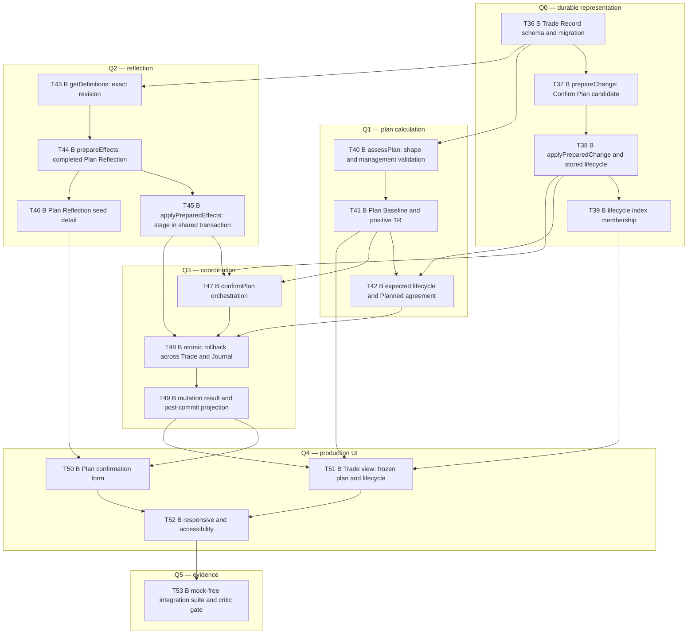

# D2 — Confirm my first plan (long stock): task-level breakdown

Status: **draft for user review**, 2026-10-10. Not frozen. Phase 3 artifact for
`planning-protocol.md:61-135`.

Frozen inputs: `specs/` (read-only) and decisions D1–D6 in
[planning-decisions-2026-10-10.md](../planning-decisions-2026-10-10.md).
Deliverable scope and user stories: [vertical-deliverables.md](../vertical-deliverables.md) D2.

Task numbering continues D1's sequence (`T36`…), so a task ID is unique across the plan.

---

## 0. Scope, boundary, and what D2 deliberately does not do

### Advertised outcome

A trader with an Institution and Account selects the Long Stock strategy, writes why they are
taking the trade and what would invalidate it, records their intended entry, stop, and target,
and confirms once. The Plan is frozen against one risk figure. Afterwards they can open the
Trade and see exactly what they committed to.

### In scope (from `vertical-deliverables.md:70-84`)

| Area | Included |
|---|---|
| Coordination | `TradeWorkflows.confirmPlan` as the only ordinary mutation path for a Plan |
| Calculation | `TradeAnalysis.assessPlan` for the Long Stock shape: leg coherence, management coverage, Plan Baseline, **positive 1R** |
| Facts | `TradeRecord.prepareChange`/`applyPreparedChange` for the Confirm Plan change; stored `Planned` Lifecycle State; lifecycle-index membership |
| Reflection | `Journal.getDefinitions`, `Journal.prepareEffects`/`applyPreparedEffects` for the Plan Reflection; Source Plan Confirmation; Trade Anchor; Thesis/Invalidation shared with the frozen Plan |
| Atomicity | One transaction for Trade + Journal, with rollback on any participant failure |
| Seeds | Manifest v2: the Plan Reflection definition detail D1 seeded is the form this deliverable consumes |
| UI | Plan confirmation form with a Strategy selector offering Long Stock only; a Trade view showing the frozen plan and stored lifecycle |
| Honesty | Installed Capability Manifest grows to advertise exactly D2's capability |

### Explicitly out of scope, and why it is safe

- **Any entry, exit, or settlement.** No Position Change, no Execution, no Open lifecycle, no
  Position, no lot, no P&L. That is D3 and later. D2's Trade stays `Planned` forever unless
  later deliverables act on it.
- **Correction, Roll, Abandonment, Management Revision** — D15/D16, D14, D8, D7.
- **`reviseDefinition`** (changing the Plan Reflection wording) → D17. D2 only *reads* the
  definition revision it renders and submits against.
- **Marks, Daily Review, reports, backup, Restore** — later deliverables. So the Trade view in
  D2 shows facts and the frozen baseline, never a current valuation.
- **`Delete` of a Trade.** There is no such operation, and D2 must not invent one.

### What D2 does *not* demonstrate, stated honestly

`AC-LIFE-001` covers `Planned → Open → Open → Closed`. D2 proves **only** the `Planned` step and
the index membership that goes with it; the later steps arrive at D3 (Open) and D8 (Closed).
`AC-JOUR-007` completes at D17; D2 covers the Plan Reflection definition and its Source only.

---

## 1. Dependence on D1's contested decisions

D1 carries three decisions awaiting your confirmation (§1 there). D2's content survives all
three, which is why it is safe to draft before they are settled:

| D1 decision | Effect on D2 |
|---|---|
| **B1** one persistence implementation, `fake-indexeddb` in tests | None. D2 consumes the seam; it does not choose its internals. |
| **B3** the Offline Release Inventory is our own build artifact | None. D2 neither reads nor extends the inventory. |
| **B7** `src/` layout and package manager | Mechanical only. Task IDs and dependencies are unaffected; only file paths in commands would move. |

D2 *does* consume two D1 mechanisms, and would need rework only if those changed:
T11's transaction seam (multi-store atomicity) and T15's lifecycle index. Both are D3-verification
items, not open questions.

---

## 2. Task graph

18 tasks in six phases (T36–T53): 1 structural, 17 behaviour-bearing. Cross-deliverable
dependencies are written `D1:T<n>`. Types and `Blocking edges:` conventions are otherwise as in D1.

Two edges worth stating, because they are the ones a reviewer would question:

- **T44 → T46** (reflection preparation before its seed detail). The seed detail is the form the
  preparation validates against, so the seed work is genuinely blocked by knowing the exact
  definition shape the preparation requires. It is not an ordering accident.
- **T47 → T48** (orchestration before the atomicity proof). T48 exists to prove the *failure*
  path of the transaction T47 opens, so it cannot be written before the command exists.

### Shared-resource ownership

D2 is the second writer of the IndexedDB schema (D1 owns it), the seed manifest, the Installed
Capability Manifest, and the UI shell. Each is extended by a migration and a manifest addition
rather than redefined. `TradeAnalysis.derive` is deliberately **not** introduced here; D3
introduces it, and D2's `assessPlan` is a separate operation on proposed Plan facts
(`trade-analysis.md:12`).

---

## 3. Task detail

### Phase Q0 — durable representation

#### T36 — `S` Trade Record schema and migration

The durable Trade Record section: Trade identity, immutable fact versions, Plan and Planned Legs,
management, lifecycle state, and version metadata — with an explicit migration from D1's schema
version.

- **Blocking edges:** D1:T3 (test harness), D1:T9 (schema), D1:T10 (migration runner).
- **Consumed by:** T37–T39, T43, T47, T53.

**Exact verification**

| # | Command | Expected result |
|---|---|---|
| V36.1 | The schema self-test asserts the Trade Record stores, key paths, and indexes against the declared schema constant | passes; matches exactly |
| V36.2 | A migration test opens a D1-version database with seeded Journal and Catalog content, migrates, and asserts both the new Trade stores exist and every pre-existing identity/definition survives | passes; no pre-existing record is lost |
| V36.3 | The same test opens the migrated database at the D1 schema version | the open rejects as unsupported-newer rather than silently downgrading |
| V36.4 | `grep -rn "createObjectStore" src/persistence` | occurrences only in the schema module and migration modules (D1's T9 V9.3 still holds) |

**Migration treatment.** This deliverable changes a durable representation, so it carries its own
migration (`vertical-deliverables.md:481-486`). The migration is additive: it creates the Trade
Record section and does not rewrite Journal or Catalog. V36.2 is the compatibility proof.

---

#### T37 — `B` `prepareChange` for the Confirm Plan candidate

**Behaviour under test (seam: `TradeRecord.prepareChange`).**

- `describe("prepareChange for Confirm Plan")`
  - `it should return a candidate Trade and Planned Legs for a complete confirm-plan change without writing anything`
  - `it should return a candidate that reserves no durable identity, so a discarded preparation leaves no placeholder behind`
  - `it should reject a change whose expected Trade revision is stale with a typed no-write result`
  - `it should return the before and candidate AnalysisInput projections plus a canonical digest over the candidate`
  - `it should reject a candidate that references an Account or Strategy that is not selectable, without allocating an identity`
  - `it should leave the stored Trade section byte-identical after every rejected preparation`

**Red → green.** Write case 1; it fails because no candidate is built. Implement the candidate;
green. Case 2's red is a preparation that allocates an identity and leaks it on discard. Case 6 is
the no-write proof: compare all Trade stores before and after a rejection.

**Valid red evidence:** a candidate written to storage, an identity allocated by a discarded
preparation, or a stale revision accepted.
**Not valid red:** a missing fixture Account, or a TypeScript error in the candidate type.

**Blocking edges:** T36.
**Consumed by:** T47, T48.

---

#### T38 — `B` `applyPreparedChange` and stored `Planned` Lifecycle State

**Behaviour under test (seam: `TradeRecord.applyPreparedChange`).**

- `describe("applyPreparedChange and stored lifecycle")`
  - `it should append the Trade, frozen Plan, frozen Planned Legs, and frozen original management, and store Lifecycle State Planned`
  - `it should store lifecycle with its effective-fact digest and FactRevision binding`
  - `it should require a valid reconciliation for the exact candidate set and refuse to apply without one`
  - `it should recheck every base revision and the candidate digest, returning a typed no-write conflict when either changed`
  - `it should write nothing when a participant fails, revealing no partial Trade after reopen`
  - `it should never accept an independent lifecycle setter, so lifecycle changes only with its justifying facts`

**Red → green.** Case 1 fails because no Trade is applied. Implement the append; green. Case 3
fails because apply proceeds without reconciliation. Case 5 fails because the Trade row is written
before the lifecycle row; move both into one transactional stage. Case 6's red is an added setter
being callable — a design test that fails if the interface grows a setter.

**Valid red evidence:** a Trade visible without its lifecycle, or a lifecycle disagreeing with its
facts after a failed transaction.
**Not valid red:** a reconciliation object missing from the fixture.

**Blocking edges:** T37.
**Consumed by:** T39, T42, T47, T48, T53.

---

#### T39 — `B` Lifecycle index membership for `Planned`

**Behaviour under test (seam: `TradeRecord.queryRecords` with a `CurrentState` lifecycle filter).**

- `describe("lifecycle index membership")`
  - `it should make a newly confirmed Trade visible to a CurrentState Planned query in the same commit that stores it`
  - `it should return no membership for a Trade whose confirmation was rolled back`
  - `it should answer the index query without replaying Trade facts`
  - `it should keep membership consistent with the stored lifecycle after an interrupted transaction`

**Red → green.** Case 1 fails because the index is not written. Add membership in the same
transaction as T38's stage; green. Case 2 fails because a rolled-back confirmation leaves index
membership; fix the rollback participation. Case 3 is the design case: the red is an implementation
that derives membership by replay, which must fail the "no replay" assertion.

**Valid red evidence:** a Planned Trade missing from the index, or index membership surviving a
rollback. `AC-LIFE-001` requires membership to change in the same commit.
**Not valid red:** the query filter constant not being exported.

**Blocking edges:** T38.
**Consumed by:** T51, T53.

---

### Phase Q1 — plan calculation

#### T40 — `B` `assessPlan`: shape and management validation

**Behaviour under test (seam: `TradeAnalysis.assessPlan`).**

- `describe("assessPlan validation")`
  - `it should accept a Long Stock Plan whose Planned Legs match the Long Stock shape exactly`
  - `it should reject a Plan whose leg set does not match the declared Strategy shape, naming the mismatch`
  - `it should reject a Plan missing exact contract or complete objective selection criteria for a leg`
  - `it should reject a Plan with no management coverage`
  - `it should report every missing or incoherent field in one typed rejection rather than the first`
  - `it should be pure, returning the same result for the same input with no storage, clock, or calendar access`
  - `it should never be reached with a Strategy shape other than Long Stock, because Trading Workflows rejects an unselectable Strategy first`

**Red → green.** Case 1 fails because no assessment exists. Implement shape conformance; green.
Case 5 fails because validation throws on the first problem; accumulate. Case 6's red is an
implementation that reads a clock or storage — assert by supplying inputs and observing no
dependency is needed, plus D1's boundary lint.

**Valid red evidence:** an incoherent Plan accepted, or a rejection naming only the first issue.
**Not valid red:** the Long Stock shape fixture being wrong.

**Blocking edges:** T36.
**Consumed by:** T41, T47, T51.

---

#### T41 — `B` Plan Baseline and positive 1R

**Behaviour under test (seam: `TradeAnalysis.assessPlan`).**

- `describe("Plan Baseline and 1R")`
  - `it should return one numeric Plan Baseline whose Original Planned Risk is positive`
  - `it should return 1R equal to that Original Planned Risk`
  - `it should contain Original Planned Reward and the planned reward/risk ratio alongside the risk`
  - `it should evaluate intended entry against every original Stop and Target using independent-OR conditions with the nearest nonnegative monetary boundary`
  - `it should retain each condition's basis separately, so a headline never hides the other conditions`
  - `it should reject a Plan whose Original Planned Risk is zero or negative, because a Plan must have a calculable positive baseline`
  - `it should freeze the values from the confirmation input rather than from the Strategy label`

**Red → green.** Case 1 fails because no baseline is computed. Implement the single-condition
baseline; green. Case 4 fails once a second Stop exists, because only one condition is evaluated.
Case 6 fails because a zero-risk Plan is accepted — this is `AC-PLAN-002`'s "no numeric baseline"
case.

**Valid red evidence:** a non-positive baseline accepted, a missing condition basis, or a headline
that dropped an independent condition.
**Not valid red:** the stop/target fixture using `number` instead of D1's exact value layer.

**Blocking edges:** T40.
**Consumed by:** T42, T47, T49, T51, T53.

---

#### T42 — `B` Expected lifecycle state and `Planned` agreement

**Behaviour under test (seam: `TradeAnalysis` lifecycle derivation consumed by
`TradeRecord.applyPreparedChange`).**

- `describe("expected lifecycle agreement")`
  - `it should derive expected Lifecycle State Planned for a confirmed Plan with no effective position-changing fact`
  - `it should report agreement with the stored lifecycle when they match`
  - `it should report a structured integrity disagreement, without repairing it, when stored lifecycle differs from the derived state`
  - `it should derive an expected state from effective facts only, ignoring any draft or uncommitted candidate`

**Red → green.** Case 1 fails because no derivation exists. Implement; green. Case 3 fails because
a disagreement is silently corrected on read; make it a reported finding. That case is D2's slice
of `AC-LIFE-003`, and it is the one that catches a "helpful" read-time repair.

**Valid red evidence:** a read that repaired the lifecycle, or a disagreement that passed as
agreement.
**Not valid red:** the disagreement fixture not being installed.

**Blocking edges:** T38, T41.
**Consumed by:** T48, T49, T51, T53.

---

### Phase Q2 — reflection

#### T43 — `B` `getDefinitions`: the exact Plan Reflection revision

**Behaviour under test (seam: `Journal.getDefinitions`).**

- `describe("getDefinitions")`
  - `it should return the latest Plan Reflection definition revision after D1's seeding`
  - `it should return the exact retained revision when asked for a specific one`
  - `it should return the ordered Prompts with their stable Prompt identities, requiredness, and the Thesis and Invalidation workflow-critical semantic roles`
  - `it should report the definition revision identity alongside the definition, so a form can name what it rendered`
  - `it should be read-only, leaving every definition revision unchanged`

**Red → green.** Case 1 fails because no definition is returned. Implement; green. Case 3 fails
because the semantic roles are absent from the returned definition, which would make the
Thesis/Invalidation binding impossible.

**Valid red evidence:** a definition missing a workflow-critical role, or a form rendering a
revision other than the one submitted.
**Not valid red:** D1's seed not having run in the fixture.

**Blocking edges:** D1:T22 (Journal seedDefaults), T36.
**Consumed by:** T44, T46, T50.

---

#### T44 — `B` `prepareEffects` for a completed Plan Reflection

**Behaviour under test (seam: `Journal.prepareEffects`).**

- `describe("prepareEffects for a completed Plan Reflection")`
  - `it should accept an exact Complete disposition for the Plan Reflection and return a prepared effect bound to the rendered revision`
  - `it should reject a submission whose expected Entry Definition revision does not match the rendered one`
  - `it should reject a completed form missing the required Thesis or Invalidation answer, naming which is missing`
  - `it should return Thesis and Invalidation by stable semantic role so the caller can freeze them into the Plan`
  - `it should reject an attempt to Defer or Decline a Plan Reflection, because Plan confirmation requires completion now`
  - `it should allocate no Entry identity, so a failed confirmation leaves no partial Entry`

**Red → green.** Case 1 fails because no effect is prepared. Implement; green. Case 4 fails because
the answers are returned positionally rather than by role — the trap that would silently bind the
wrong text into the frozen Plan. Case 5 fails because Defer is accepted, which
`journal.md:188` forbids for Plan Reflection.

**Valid red evidence:** Thesis and Invalidation swapped or positionally bound, a deferral of a
Plan Reflection accepted, or an Entry identity reserved before commit.
**Not valid red:** the form fixture using prompt labels instead of stable identities.

**Blocking edges:** T43.
**Consumed by:** T45, T46, T47, T48.

---

#### T45 — `B` `applyPreparedEffects` staged in the shared transaction

**Behaviour under test (seam: `Journal.applyPreparedEffects`).**

- `describe("applyPreparedEffects in a shared transaction")`
  - `it should stage the completed Plan Reflection entry with Source Plan Confirmation and a Trade Anchor to the confirming Trade`
  - `it should bind the candidate Anchor to the exact durable Trade identity supplied by Trade Record's mapping`
  - `it should snapshot the exact definition revision rendered to the trader`
  - `it should refuse to apply outside a shared semantic transaction`
  - `it should stage nothing when the supplied Trade identity mapping is absent or inconsistent`
  - `it should record no Entry, Debt, or decline when the surrounding transaction is rolled back`

**Red → green.** Case 1 fails because nothing is staged. Implement; green. Case 4 fails because
apply succeeds standalone — the invariant that makes atomicity possible. Case 6 fails because the
Entry is committed independently.

**Valid red evidence:** an Entry committed outside the shared transaction, or an Anchor pointing at
a candidate identity that never became durable.
**Not valid red:** the transaction fixture not being supplied.

**Blocking edges:** T44.
**Consumed by:** T47, T48, T49, T53.

---

#### T46 — `B` Plan Reflection seed detail for manifest v2

**Behaviour under test (seam: `Journal.seedDefaults`, then `Journal.getDefinitions`).**

- `describe("Plan Reflection seed detail")`
  - `it should seed the Plan Reflection definition with the four contract prompts in order: Why this trade, why now?; What would invalidate the thesis?; Conviction; Primary emotion`
  - `it should mark the first two required with the Thesis and Invalidation workflow-critical roles`
  - `it should mark Conviction as an optional 1–5 Scale`
  - `it should mark Primary emotion as an optional single select with exactly the contract options Calm, Eager, Anxious, FOMO, Revenge, Relieved, Frustrated, Other`
  - `it should remain idempotent, so a Workspace already seeded at manifest v1 gains the detail without duplicating the Entry Type or resetting a trader revision`
  - `it should never seed a second Entry Type for the Plan Reflection`

**Red → green.** Case 1 fails on the missing prompts. Implement; green. Case 5 fails because D1's
already-seeded Workspace gets a duplicate Entry Type; fix stable-key matching. That case is the
migration story for the seed manifest, and it is the one that matters for an existing Workspace.

**Valid red evidence:** a duplicated Entry Type, a reset trader revision, an option list differing
from the contract, or a missing semantic role.
**Not valid red:** the manifest version constant not being bumped.

**Blocking edges:** T44.
**Consumed by:** T50, T53.

**Seed-manifest note.** D1 seeded the Plan Reflection Entry Type and the Plan Confirmation Source.
D2 adds the *definition detail* those require (`vertical-deliverables.md:469`). The version is
bumped and the change is additive and stable-keyed, which is why case 5 is written against an
existing v1 Workspace rather than a fresh one.

---

### Phase Q3 — coordination

#### T47 — `B` `confirmPlan` orchestration

**Behaviour under test (seam: `TradeWorkflows.confirmPlan`).**

- `describe("TradeWorkflows.confirmPlan")`
  - `it should resolve the Account and Strategy as NewSelection under one Catalog snapshot and reject an unselectable Account or Strategy with no write`
  - `it should confirm a complete Plan once and return a success result rather than a conflict`
  - `it should obtain Thesis and Invalidation from the prepared Journal effect by semantic role and freeze them as the authoritative Plan semantics`
  - `it should call Trade Analysis for the Plan Baseline and refuse to commit when the baseline is not a positive numeric value`
  - `it should create exactly one Trade, one frozen Plan, and one completed Plan Reflection, with no second Entry for the Thesis`
  - `it should reject an incomplete confirmation with all issues returned as typed rejections and with unchanged Trade Record, Journal, and Catalog revisions`
  - `it should refuse to commit when the exact Plan Reflection form revision rendered to the trader is no longer the revision supplied`

**Red → green.** Case 1 fails because no command exists. Implement resolution; green. Case 3
fails because the Plan's Thesis is stored from a separate field while the Entry holds the answer —
the specific duplication `AC-PLAN-001` forbids. Case 5's red is two Entries appearing. Case 6 is
`AC-PLAN-002`: assert unchanged revisions after a rejection, not just a rejection result.

**Valid red evidence:** a Trade created by a rejected confirmation, a duplicated Thesis Entry, or a
Plan frozen from an unvalidated baseline.
**Not valid red:** the Catalog fixture lacking the Long Stock seed.

**Blocking edges:** T38, T40, T41, T44, T45.
**Consumed by:** T48, T49, T50, T53.

---

#### T48 — `B` Atomic rollback across Trade and Journal effects

**Behaviour under test (seam: `TradeWorkflows.confirmPlan`, with an injected failing participant).**

- `describe("semantic atomicity of Plan confirmation")`
  - `it should roll back the staged Trade, Plan, Planned Legs, management, and lifecycle/index effects when the Journal participant rejects`
  - `it should roll back the staged Entry, Anchor, and definition snapshot when the Trade participant rejects`
  - `it should leave no candidate identity from the failed attempt resolvable or visible`
  - `it should recover after a simulated interruption to either the complete pre-commit state or the complete post-commit state, never a mixture`
  - `it should report the failure as an infrastructure or typed rejection without classifying it as trader behaviour`
  - `it should commit both participants together when every participant succeeds`

**Red → green.** Case 1 fails because the Journal failure is caught and the Trade write survives.
Make the seam own the boundary; green. Case 4 fails when an injected interruption mid-transaction
leaves one store advanced; the abort path must restore. Case 5 fails because an infrastructure
failure is surfaced as a validation rejection.

**Valid red evidence:** a Trade present without its Entry, an Entry present without its Trade, or a
mixed state after reopen.
**Not valid red:** the injected failure not firing.

**Blocking edges:** T38, T42, T44, T45, T47.
**Consumed by:** T49, T53.

> **This is `planning-decisions` D3 verification item 5** — "multi-store rollback proving a
> Journal-participant failure rolls back staged Trade effects (AC-CORR-004)." D1 installed the
> seam and proved a generic participant failure (its T11 case 1); **D2 is where the Journal
> participant becomes real**, so this is the item's first honest proof. D15 re-proves it for the
> linked-correction case.

---

#### T49 — `B` Mutation result and post-commit projection

**Behaviour under test (seam: `TradeWorkflows.confirmPlan`'s accepted result).**

- `describe("confirmPlan post-commit result")`
  - `it should return the committed Trade projection for every affected Trade at its new FactRevision`
  - `it should return the created Trade, Plan, Planned Leg, and Entry identities`
  - `it should return the Lifecycle State transition into Planned`
  - `it should return the completed Journal outcome projection for the Plan Reflection`
  - `it should return the command-required derivation bound to the exact committed facts and evidence`
  - `it should let the caller render the saved outcome without calling getRecord or a Journal query`
  - `it should not embed unrelated lists or reports, and should identify affected scopes only as advisory`
  - `it should return the result only after every effect is durable, so a post-restart read agrees with it`

**Red → green.** Case 6 fails because the result is a receipt and the caller re-reads — the
read-back pattern `ADR 0002` rejected. Include the projections; green. Case 8 fails when the result
is returned before the transaction completes.

**Valid red evidence:** a required follow-up read to render the saved command, or a returned
projection that disagrees with a post-restart read. That second one is the real trap: a projection
built from the candidate rather than the committed state can differ.
**Not valid red:** a missing field on the result type.

**Blocking edges:** T41, T42, T45, T47, T48.
**Consumed by:** T50, T51, T53.

> **`AC-RESP-001`.** D2 is the first deliverable that can satisfy it, and case 8 is the
> response-to-durable-state equivalence the scenario requires.

---

### Phase Q4 — production UI

#### T50 — `B` Plan confirmation form

**Behaviour under test (seam: the production UI over `getDefinitions`, `assessPlan`, and
`confirmPlan`).**

- `describe("Plan confirmation")`
  - `it should offer the Strategy selector with Long Stock as the only selectable option, because no other Strategy is seeded`
  - `it should render the exact Plan Reflection definition revision returned and submit that revision with stable Prompt identities`
  - `it should require Thesis and Invalidation before the confirm action succeeds, and explain which is missing`
  - `it should collect intended entry, original Stop, and original Target and show the resulting planned risk and reward before confirmation`
  - `it should require explicit confirmation and record nothing when the trader abandons the form`
  - `it should preserve entered-but-unsaved values across a validation rejection`
  - `it should present typed rejections for every validation issue rather than a single generic message`
  - `it should show the frozen Plan, baseline, and 1R after a successful confirmation, from the returned post-commit projection`
  - `it should not present a current valuation, risk-to-stop, or P&L, because no mark or position exists`
  - `it should treat a conflict result as a review-and-retry, preserving safe input`

**Red → green.** Case 5 fails because opening and typing are captured. Move every write behind the
explicit confirm; green. That is `AC-JOUR-001`, and it is the one case in D2 most likely to be
broken by a well-meaning autosave. Case 9's red is a rendered zero or fill-cost placeholder where a
valuation would go — a real hazard, because showing `$0` risk reads as a fact.

**Valid red evidence:** evidence stored without confirmation, a wrong definition revision
submitted, or an invented valuation. `ui-contract.md:77` forbids all three.
**Not valid red:** the route not being registered.

**Blocking edges:** T43, T46, T49.
**Consumed by:** T52, T53.

---

#### T51 — `B` Trade view: frozen plan and stored lifecycle

**Behaviour under test (seam: the production UI over `TradeRecord.getRecord`/`queryRecords` and
`TradeAnalysis` derivation).**

- `describe("Trade view")`
  - `it should show the stored Lifecycle State as Planned, separately from any derived state`
  - `it should show the frozen Plan, Planned Legs, original management, Plan Baseline, and 1R exactly as committed`
  - `it should show the completed Plan Reflection with its Entry Type, single Trade Anchor, and Source Plan Confirmation`
  - `it should show no Terminal Disposition and no Close Reason, because the Trade is not Closed`
  - `it should show an integrity disagreement as its own disclosure, and never silently present the derived state as stored`
  - `it should list Planned Trades from the lifecycle index without replaying historical Trades`
  - `it should render every money, price, and quantity value with its unit and sign, unrounded in the read model`
  - `it should present a Loading state before the authoritative result and an Empty state only when the query genuinely matched nothing`

**Red → green.** Case 1 fails because the derived state is shown as if stored. Separate them; green.
Case 4 fails because a Terminal Disposition renders from a default. Case 8 fails because the
initial render shows Empty before the query resolves — `ui-contract.md:50` forbids a false Empty.

**Valid red evidence:** a derived state presented as stored, a manufactured disposition, or a false
Empty during loading.
**Not valid red:** the Trade fixture not being committed.

**Blocking edges:** T39, T41, T42, T49.
**Consumed by:** T52, T53.

---

#### T52 — `B` Responsive layout and accessibility for D2's surfaces

**Behaviour under test (seam: the production UI at both viewport classes).**

- `describe("responsive and accessible Plan confirmation")`
  - `it should use bottom navigation at narrow widths and a left sidebar at wide widths on the Plan and Trade surfaces`
  - `it should switch layout live without reload and without losing route, selected Trade, or entered-but-unsaved form values`
  - `it should expose equivalent fields, actions, validation, and confirm/cancel outcomes at every supported width`
  - `it should give every control an accessible name and understandable validation`
  - `it should group the Strategy single choice as a labelled radio group rather than unlabelled chips`
  - `it should meet WCAG AA contrast and keep a visible focus indicator with logical focus order`
  - `it should move focus to the first invalid field, and announce the rejection, after a failed confirmation`
  - `it should support keyboard-only completion of Plan confirmation`
  - `it should never use color as the only carrier of a validation or integrity-disagreement cue`

**Red → green.** Case 2 fails because resizing remounts the form and drops input. Preserve state;
green. Case 5's red is chips with no fieldset or radio semantics. Case 7's red is focus remaining
on the submit control after a rejection.

**Valid red evidence:** lost unsaved input on resize, a missing accessible name, focus not moved
after validation, or an action present at one width and missing at the other.
**Not valid red:** the axe harness failing to load.

**Blocking edges:** T50, T51.
**Consumed by:** T53.

---

### Phase Q5 — evidence

#### T53 — `B` Mock-free integration suite and browser-critic gate

Runs D2's complete capability through the production stack in a real browser, with no mock of any
application dependency, and ends with the independent critic gate.

**Integration cases** (seam: the running application; asserted against both the visible result and
durable state, after a reload).

- `describe("D2 end to end")`
  - `it should confirm a Long Stock Plan through the UI on a Workspace initialized in D1 and show the frozen Plan, baseline, and 1R`
  - `it should persist the Trade, its Planned lifecycle, its index membership, and its Plan Reflection across a full reload`
  - `it should reject an incomplete confirmation and leave Trade Record, Journal, and Catalog revisions unchanged`
  - `it should record nothing when the confirmation form is abandoned, asserted by comparing Journal and Trade Record revisions before and after`
  - `it should roll back every Trade effect when the Journal participant is made to fail, asserted by real-engine store contents`
  - `it should confirm the Thesis and Invalidation are shared between the frozen Plan and the Entry with exactly one Entry created`
  - `it should re-confirm a second Plan and leave the first Trade and its reflection intact`

**Test infrastructure replacement, disclosed:**

| Replacement | Scope | What it does not weaken |
|---|---|---|
| `fake-indexeddb` | Vitest/Node unit suites only | D2's atomicity (T48) is asserted here against a real engine as well, because D1's disclosure records that abort ordering is only specification-faithful in the fake. |
| A fixed `Clock` implementation | Both suites | Injected port by design. The browser suite supplies explicit confirmation instants. |
| No replacement | IndexedDB, Cache Storage, service worker, storage estimate | — |

Carries forward D1's three disclosed `fake-indexeddb` fidelity gaps. In addition, D2 must state
that **`AC-LIFE-001` is only partially covered here** (the `Planned` step) and **`AC-RESP-001` is
covered for the confirm-plan mutation family only**, not for every installed family.

**Blocking edges:** D1:T3, D1:T11, D1:T15, D1:T22, D1:T29, and every D2 task (T36–T52).
**Consumed by:** the cumulative suite, and D3's suite which joins it.

**Browser-critic gate.** A fresh critic starts the runtime itself and exercises the flow list in §4
in both viewports, returning a structured record per flow. Every defect becomes a test-first
repair, then a fresh critic repeats the complete D2 flow list. D1's gate procedure (its T35) is
reused verbatim; it is not re-specified here.

---

## 4. Browser-critic flow list for D2

Run in **narrow** and **wide** viewports, on a Workspace that has completed D1's setup.

| # | Flow | Steps | Expected observable result |
|---|---|---|---|
| F1 | Strategy selector is honest | Open the Plan form | Long Stock is the only selectable Strategy; no unseeded Strategy is offered or shown as unavailable |
| F2 | Reflection form matches the definition | Inspect the Plan Reflection fields | The four contract prompts, in order, with Thesis and Invalidation required and Conviction/Primary emotion optional |
| F3 | Missing Thesis rejects | Submit with Thesis blank | Typed rejection naming the missing answer; no Trade created; entered values preserved |
| F4 | Missing Invalidation rejects | Submit with Invalidation blank | Typed rejection naming it; still no Trade |
| F5 | No baseline rejects | Submit with no Stop so no baseline is calculable | Typed rejection; no Trade, no Entry, no index membership |
| F6 | Multiple issues reported | Submit with Thesis blank and no Stop | **Every** issue reported, not just the first |
| F7 | Planned risk/reward preview | Enter intended entry, stop, and target | Planned risk and reward shown before confirmation; 1R is positive and matches the displayed original risk |
| F8 | Abandon records nothing | Fill the form, then navigate away without confirming | No Trade; no Entry; unchanged revisions after a reload |
| F9 | Confirm freezes the Plan | Confirm a complete Plan | Trade shown as Planned; frozen Plan, Planned Legs, original management, baseline, and 1R exactly as entered |
| F10 | One Entry, shared Thesis | Inspect the Trade's Journal after confirmation | Exactly one Plan Reflection Entry, anchored to the Trade, Source Plan Confirmation, with the same Thesis/Invalidation text frozen into the Plan |
| F11 | Confirm is one action | Note the revision before confirming, confirm once | Exactly one Trade and one Entry created; a double-submit creates nothing extra |
| F12 | Stale form revision | Load the form, change the definition in another tab, then submit | Rejected for the stale form revision; nothing written |
| F13 | Reload durability | Reload the application | Trade still Planned; Plan and reflection intact; index membership preserved |
| F14 | No invented valuation | Inspect the Trade view | No current valuation, risk-to-stop, or P&L; nothing rendered as `$0` in place of an unavailable figure |
| F15 | Lifecycle is not derived-only | Inspect the Trade view's lifecycle presentation | Stored Lifecycle State shown as Planned and distinguishable from any derived state; no Close Reason or Terminal Disposition |
| F16 | Loading is not Empty | Reload the Trade list and observe the first paint | A Loading state appears; no Empty state claims there are no Trades before the query resolves |
| F17 | Live resize with unsaved input | Begin a new Plan, type, then narrow and widen without reload | Layout switches sidebar/bottom-navigation; typed values, route, and actions survive |
| F18 | Keyboard-only confirmation | Complete Plan confirmation with the keyboard only | Every control reachable; radio-group semantics on the Strategy choice; focus moves to the first invalid field on rejection |
| F19 | Non-color cues | Inspect a validation error and any integrity disagreement | Each carries text or an icon, not color alone |
| F20 | Installed capability honesty | Inspect the Installed Capability Manifest and navigation | Confirming a Plan is advertised; entry, exit, settlement, marks, review, reporting, backup, and Restore are absent — not present as unavailable |

**Intentional non-defects the critic must not report:** no entry/exit controls; no Marks or
Daily Review; no reports; no backup or Restore; installation affordance absent (D22);
`AC-LIFE-001`'s Open and Closed steps absent (D3/D8); no Position or P&L (D3).

---

## 5. Acceptance coverage for D2

| Scenario | D2 status | Covered by |
|---|---|---|
| AC-PLAN-001 | Planned, fully | T37–T41, T44–T49, T53, F9, F10 |
| AC-PLAN-002 | Planned, fully | T40, T41, T44, T47, T53, F3–F6 |
| AC-LIFE-001 | **Partial** — the `Planned` step and index membership only | T38, T39, T42, F9, F15; Open at D3, Closed at D8 |
| AC-LIFE-003 | **Partial** — the Planned agreement case and no read-time repair | T42, T51, F15 |
| AC-RESP-001 | **Partial** — the confirm-plan mutation family only | T49, T53, F9 |
| AC-JOUR-007 | **Partial** — Plan Reflection Entry Type, its definition, and the Plan Confirmation Source | T43, T44, T46; completes at D17 |
| AC-JOUR-001 | **Partial** — that abandonment records nothing on D2's surfaces | T50, T53, F8 |
| AC-REF-002 | **Partial** — the stale/unselectable Strategy rejection path | T47, F1, F12 |
| AC-UI-001, AC-UI-002 | **Partial** — D2's surfaces and states | T52, F16–F19 |

**Nothing in a "partial" row may be counted as passing.** This table is D2's row set for the
Phase 4 matrix.

---

## 6. What counts as valid red evidence

D1's §6 rules apply verbatim. Two additions specific to D2, because both are cases where a wrong
red would hide a real defect:

- **For T48 (atomicity), a red caused by the injected failure not firing is not valid.** The test
  must assert the injection happened before asserting the rollback, or the case can pass while
  proving nothing.
- **For T49 (result equivalence), a red caused by a fixture mismatch is not valid.** The case must
  compare the returned projection against a post-restart read of the same committed state.

---

## 7. Open items and risks

1. **`assessPlan`'s exact baseline inputs for Long Stock.** The contract fixes the *policy*
   (independent-OR, nearest nonnegative monetary boundary, positive Original Planned Risk) but not
   the input shape. D2 proposes intended entry, original Stop, original Target, and Planned Leg
   quantity as the command's Plan facts. This needs confirmation before implementation, and it is
   the most likely place for D2 to be wrong.
2. **Where the Trade view lives.** D2 places it at a Trade detail surface reachable from a
   confirmed confirmation and from a Planned list. `ui-contract.md:41` allows any coherent
   navigation hierarchy, so this is a proposal, not a specification reading.
3. **Definition-revision staleness (F12).** The Journal contract requires submitting the rendered
   revision. D2 asserts a stale revision is rejected, but the exact result name for that rejection
   is not fixed by `specs/` — it is a typed rejection, not a `Conflict`, because no revision binding
   on the *definition* is specified as a conflict. Worth confirming.
4. **`AC-LIFE-003`'s controlled integrity fixture.** D2 needs to induce a stored-lifecycle
   disagreement to prove no read-time repair. The acceptance contract permits test-only mutation of
   private projections "solely in scenarios that explicitly exercise reconstruction"
   (`acceptance-contract.md:7`). Whether inducing it here qualifies, or needs a different fixture
   route, should be confirmed.
5. **D2 reuses D1's critic procedure by reference.** If the reviewer wants each deliverable's gate
   fully restated rather than referenced, say so and I will inline it.

---

## 8. `planning-decisions` D3 verification items inside this deliverable

D1 owns items 1, 2, 3, 4, 6, 7, 8, and 9. D2's contribution is item 5, which needs a real
Journal participant and therefore cannot be proven at D1.

| D3 item | Where it is resolved in D2 | Status after D2 |
|---|---|---|
| 5 — multi-store rollback proving a Journal-participant failure rolls back staged Trade effects | T48 (cases 1, 2, 3), T53, F-none (asserted in the integration suite, not a browser flow) | **Resolved for the Plan-Reflection effect shape**; D3 re-proves it for a Defer, and D15 for linked corrections |
| 5 — the same mechanism with a Debt rather than an Entry effect | D3:T71, because staged Debt needs a Position Change | Later |

## Related

- [vertical-deliverables.md](../vertical-deliverables.md) — D2 scope and user stories
- [D1-install-trust-set-up.md](D1-install-trust-set-up.md) — the mechanisms D2 consumes
- [planning-decisions-2026-10-10.md](../planning-decisions-2026-10-10.md) — D3 verification item 5
- `specs/design/trade-workflows.md`, `specs/design/trade-record.md`,
  `specs/design/trade-analysis.md`, `specs/design/journal.md`
- `specs/acceptance/acceptance-contract.md` — AC-PLAN-001/002, AC-LIFE-001/003, AC-RESP-001, AC-JOUR-001/007
