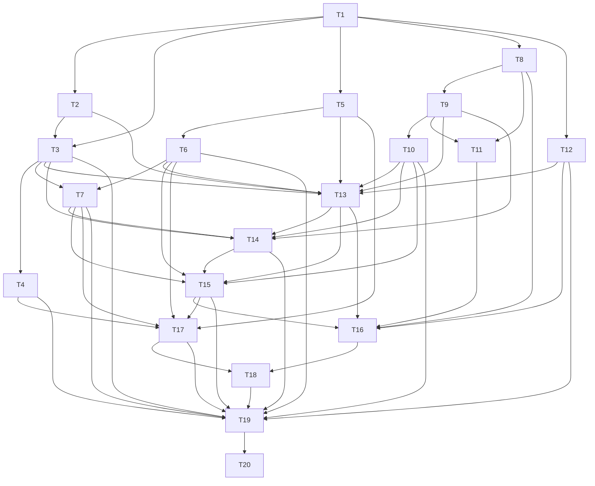

# D2 — Confirm my first plan (long stock): task-level breakdown

Status: draft for user review. Not frozen. Phase 3 artifact for `planning-protocol.md:61-135`.

## 0. Scope, boundary, and what this deliverable deliberately does not do

### Advertised outcome

A trader can select the Account they trade and the Long Stock Strategy, write why they are taking the
trade and what would invalidate it, record intended entry, Stop and Target, and confirm once. After
that one confirmation the Plan, its intended Planned Legs, its original management, one positive 1R
and the completed Plan Reflection are frozen atomically against one risk figure that a later edit
cannot rewrite. An incomplete confirmation writes nothing.

Concretely, D2 installs `TradeWorkflows.confirmPlan` (`trade-workflows.md:51-78`) end to end: the
command resolves Account and Strategy as new selections under one Catalog snapshot
(`reference-catalog.md:44-64`), obtains the exact Plan Reflection definition and prepares its
completion (`journal.md:184-188`), asks Trade Analysis for the Plan Baseline and 1R
(`trade-analysis.md:51-57`), prepares and applies the Trade candidate (`trade-record.md:60-70`),
and returns one command-specific post-commit result sufficient to render the saved Plan without a
read-back (`overview.md:192-196`, `acceptance-contract.md:25-30`).

Primary acceptance scenarios: AC-PLAN-001, AC-PLAN-002, AC-LIFE-001 (the `Planned` step only),
AC-RESP-001 (the creation member only) and AC-JOUR-007 (the Plan Reflection definition and Plan
Confirmation Source only). §5 records exactly how much of each of those is claimed here.

| # | In scope | Module or layer |
|---|---|---|
| 1 | Durable representation of the Trade, frozen Plan, Planned Legs, original management conditions, stored Lifecycle State, lifecycle-index membership and the FactRevision binding, plus the D2 migration on top of D1's schema and version constant. | Persistence/Transaction |
| 2 | `TradeRecord.prepareChange(ConfirmPlanChange)`: nonpersistent candidate records, structural coherence, expected-revision checking, canonical digest. | Trade Record |
| 3 | `TradeRecord.applyPreparedChange`: durable identity assignment, version append, staging of lifecycle and lifecycle-index effects, and the `DerivedTradeReconciliation` requirement for the exact candidate set. | Trade Record |
| 4 | Lifecycle index membership for `Planned` as the authoritative current-state index, with independent derivation used only for agreement checking. | Trade Record + Trade Analysis |
| 5 | `TradeAnalysis.assessPlan` for the Long Stock shape: leg coherence, exact-contract or objective-criteria completeness, management coverage, typed rejection of every missing or incoherent field. | Trade Analysis |
| 6 | Plan Baseline and 1R under independent-OR, nearest-nonnegative-monetary-boundary policy, with Original Planned Risk required positive and equal to 1R. | Trade Analysis |
| 7 | Expected Lifecycle State derivation and its agreement with stored `Planned`. | Trade Analysis + Trade Record |
| 8 | `Journal.getDefinitions` returning the exact Plan Reflection revision, and `Journal.prepareEffects`/`applyPreparedEffects` for a completed Plan Reflection with its workflow-critical Thesis and Invalidation roles. | Journal |
| 9 | The Journal definition revision that carries the complete initial Plan Reflection definition (prompts, order, requiredness, scale bounds, single-select options, workflow-critical roles) and the Catalog manifest v2 seed state. | Journal + Reference Catalog |
| 10 | The Strategy selector offering only Long Stock, because Long Stock is the only seeded Strategy; no Catalog identity beyond it exists at v2. | Reference Catalog + Presentation |
| 11 | `TradeWorkflows.confirmPlan` orchestration across Catalog, Journal, Trade Analysis and Trade Record inside one semantic transaction. | Trade Workflows |
| 12 | Atomic rollback across Trade and Journal effects when any participant rejects. | Trade Workflows + Persistence/Transaction |
| 13 | `ConfirmPlanResult` as the creation member of the mutation-result contract: committed Trade projection, completed Entry projection, and the derivation the command had to establish. | Trade Workflows |
| 14 | The Plan confirmation form, the Trade view showing the frozen Plan, and responsive and accessible behavior for both. | Presentation |
| 15 | A mock-free integration suite and an independent browser-critic gate for D2. | Test infrastructure |

### Explicitly out of scope, and why it is safe

| Not in D2 | Why it is safe to defer |
|---|---|
| Every other Strategy shape and every non-Long-Stock seed's behavior. | `reference-catalog.md:80-98` fixes the shape vocabulary and the eleven canonical seeds. D2 implements the shape *vocabulary* plus the Long Stock seed's assessment, and the selector offers Long Stock only, so no other shape can reach `assessPlan` through the production UI. D8 onwards adds the remaining seeds and their assessment without reshaping frozen Plan facts — the contract already says "Later delivery adds capability without reshaping authoritative facts or redefining earlier semantics" (`overview.md:260`). |
| Position recording, Positions, Lots, FIFO Lot Matches, fees, realized P&L, and stored lifecycle `Planned` becoming `Open`. | D3 owns the stock-open variant of `recordPositionChange` (`vertical-deliverables.md:86-101`). D2 only has to leave the Trade parked at `Planned` with a correct index entry, and AC-LIFE-001's later steps are claimed by D3 and D6. Nothing D2 freezes forecloses them: the Plan is frozen facts, and opening facts are separate facts appended later. |
| Daily Review, Mark selection, Expected Mark Status, Stop-Discipline deviation reconciliation. | D4 owns the ritual and introduces Stop Discipline only (`vertical-deliverables.md:103-130`). D2's Plan has no Marks to evaluate, so nothing in D2 depends on observation evidence. |
| Corrections: Replace, Void, Rebuild, Correction Footprint, audit history UI. | D15 and D16 own them. D2 nevertheless stores the version metadata and FactRevision binding that correction requires (`trade-record.md:36-38`), so adding correction later is append-only rather than a schema rewrite. This is exactly the "capture facts needed by later analytics before the behavior occurs" condition (`overview.md:264`). |
| The remaining six Entry Types, six Sources and the full `seedDefaults` manifest. | D17 completes AC-JOUR-007 (`vertical-deliverables.md:355-372`). D2 seeds and pins only the Plan Reflection definition and the Plan Confirmation Source, and asserts the others are absent rather than half-built. |
| Close Reason, Abandonment Reason, Close Review, `abandonPlan`. | D6 owns them (`vertical-deliverables.md:149-165`). No Plan fact D2 freezes needs a reason taxonomy. |
| Backup, Restore, migration of *older* Workspaces, installation, update. | D7, D20, D21 and D22 own them. D2's migration is the forward migration within the current branch and is deliberately not a Restore path. |
| Any latency claim at all. | `AC-PERF-001` is owned by no deliverable in the `AC:` lines of `vertical-deliverables.md`. D2 asserts boundedness only: index membership for lifecycle selection, one bounded page, no per-record storage read, no all-history replay (`overview.md:273`). |

### What this deliverable deliberately does not demonstrate

- Any Strategy other than Long Stock, including a second seed's assessment path.
- Any Exit, Roll, Adjust or other management revision: D2 freezes *original* management and never
  revises it. The only management behavior present is "original conditions are complete and frozen".
- Any Deviation category. A single confirmed unentered Plan can exhibit none of the four categories
  (`trade-analysis.md:111`); Stop Discipline arrives at D4 and the other three at D11 and D12.
- Any lifecycle state other than `Planned`. `Open`, `Closed` and `Abandoned` transitions are D3 and D6.
- Any Mark-dependent calculation. There is no observation evidence to bind, so ongoing risk, marked
  valuation, Overrun and Expiration Payoff are out of scope beyond the Planned view that
  `assessPlan` returns as "independently available" (`trade-analysis.md:53`).
- Any Journal behavior beyond "one completed Plan Reflection was prepared and applied atomically".
  Direct `Journal.save`, Edit, Addendum, Void, Debt and decline are D5 and D17.
- Any Abandonment, correction, Restore or Rebuild path for the Plan it creates.
- Any claim about AC-LIFE-003. It is an open under-specification; §8 raises it and D2 does not claim it.

## 1. Decisions this breakdown introduces (needing alignment)

These are decisions the frozen contracts do not settle. Each is a branch-local planning decision
consistent with `specs/`, not an amendment to `specs/`. They are listed in the order the brief gives
them, with the consequence of getting each wrong.

1. **`assessPlan`'s input shape for a long stock Plan — settled by decision PD9.** `trade-analysis.md:51-57`
   fixes the baseline *policy* but never the inputs. The input is
   `PlanAssessmentInput { strategyShape; intendedEntry: Price; plannedLegs: ordered PlannedLeg[] with
   Instrument, signed quantity and either an exact contract or complete objective criteria;
   originalManagement: ordered PlanCondition[]; economicTime }`. The condition type is fixed in full by
   decision **PD9** in `plan/planning-decisions-2026-10-10.md`: a discriminated union on `kind` —
   `UnderlyingPriceCondition` carrying an exact `boundaryPrice` plus a frozen `monetaryBoundary`, and
   `StructureValueCondition` carrying a `scope` and a resolved `boundaryValue` — with every condition
   carrying a `conditionId`, a `role` of Stop or Target, and a `ConditionBasis` whose `comment` is the
   trader's optional view-only text. Conditions are independent OR alternatives, and the set is plural
   from D2 because `trade-analysis.md:57` requires the frozen baseline to use the same
   nearest-nonnegative-monetary-boundary policy as current headlines; a singular baseline policy would
   diverge from D4's and put `AC-CALC-001`'s "1R remains $500" guarantee at risk. A `monetaryBoundary`
   is required on every underlying-price condition, Target as well as Stop, because without it neither
   the planned reward/risk ratio nor Ongoing Risk and Incremental Reward are computable as dollar
   values (`trade-analysis.md:57`, `glossary.md:150-152`). D2 constructs only `UnderlyingPriceCondition`;
   `StructureValueCondition` is reserved in the type and **not installed** until D8, so it is absent
   rather than a fabricated `Unavailable` (`overview.md:19`). Consequences: this is the most
   load-bearing shape in D2 because D3, D4, D11, D12 and D14 all consume the same frozen Plan facts.
2. **Plan Baseline and 1R.** The Plan Baseline is computed at confirmation time from intended entry
   against every original Stop and Target under the independent-OR, nearest-nonnegative-monetary-
   boundary policy (`trade-analysis.md:57`). Original Planned Risk must be positive and *is* 1R.
   The baseline is frozen by *confirmation time*, not by the Strategy label, and no standing
   Accepted-Position baseline exists (`trade-analysis.md:109`). Consequence: a Plan whose computed
   Original Planned Risk is zero or negative is a typed rejection, not a Plan with an unavailable 1R.
3. **`DerivedTradeReconciliation` is required by `applyPreparedChange` for the exact candidate set.**
   `trade-record.md:66` states the requirement but not the value. D2 decides it is the supplied
   `TradeAnalysis` result bound to the prepared candidate digest plus the derived expected Lifecycle
   State; Trade Record never sets lifecycle independently and never re-derives analysis itself.
   Consequence: the coordinator must call Trade Analysis between prepare and apply, and a mismatched
   binding is a typed no-write result.
4. **The Plan Reflection is entered once.** Thesis and Invalidation are answered once during
   confirmation and supply both the frozen Plan semantics and the saved Entry snapshot
   (`journal.md:52`). D2 decides the form submits one response set against one exact definition
   revision, and that the Plan's Thesis/Invalidation fields are *derived from* those answers rather
   than collected a second time. Consequence: the Plan and the Entry cannot disagree, and there is no
   second entry path to reconcile.
5. **One isolated D2 migration candidate.** D2 adds the Trade, Plan/Planned-Leg, original-management
   and lifecycle records plus the Journal definition revision and the Catalog manifest v2 state in
   one isolated candidate created against D1's schema and migration runner. Consequence: a failed
   D2 migration leaves the D1 Workspace usable, matching the isolated-candidate requirement in
   `overview.md:131` and `planning-decisions-2026-10-10.md:179`.
6. **Unsaved form state is not evidence.** Cancel and navigation record nothing
   (`journal.md:7`, `journal.md:182`, `ui-contract.md:45`). D2 decides that the confirmation form may
   preserve entered values across a live resize (`ui-contract.md:34`) and that this preserved state
   must never reach storage, no Debt may be created by an abandoned confirmation, and no draft may
   exist. Consequence: AC-JOUR-001's confirmation-form member is verifiable by comparing Journal
   revisions before and after abandonment.
7. **Selector scope versus seed scope, settled by decision PD15.** Manifest v2 carries Long Stock
   only: the Catalog side adds no identity that manifest v1 did not already seed, and the version
   advances because the Journal side adds the exact Plan Reflection definition. The selector therefore
   offers exactly one Strategy because exactly one exists, not because a fuller catalog is filtered, so
   no presentation scoping rule is needed. Seeding is need-driven: the five reasons arrive at D6, the
   remaining ten Strategies at D8, D9, D11 and D12, and D12 also seeds the empty IdeaSource Tag Type
   because AC-REF-001 completes there. Seeding the canonical set early would make AC-REF-001 pass at
   D2 while the plan records it completing at D12, and D2 claims nothing of that scenario.
8. **Test and tooling seam names.** The stack is approved (`planning-decisions-2026-10-10.md:164-185`)
   but exact versions are pinned at freeze. D2 decides the *names* only: Vitest projects `unit` and
   `integration`, `fake-indexeddb` for the Node projects, Playwright plus axe-core for the browser
   gate, and the scripts `test:unit`, `test:integration`, `test:browser`, `typecheck`. Consequence:
   every command in this document runs unchanged once versions are pinned, and §8 notes that no
   version-sensitive assertion is embedded in a case.

## 2. Task graph

This breakdown declares **20 tasks in 11 dependency layers** (grouped into 7 implementation phases in §3). The layers are a *named projection* of
the edge set for planning and review; the authoritative ordering is the edge list below.

| Layer | Name | Tasks | Why they share a layer |
|---|---|---|---|
| L1 | Durable substrate | T1 | Nothing else can start until the D2 representation exists. |
| L2 | Nonpersistent preparation and frozen mathematics | T2, T5, T8, T12 | Each depends only on L1, and each is a non-writing producer: Trade candidate preparation, Plan assessment, Journal definitions, Catalog manifest. |
| L3 | Persistence apply, ordinary derivation, and prepared Journal effects | T3, T6, T9 | Each consumes exactly one L2 producer plus, for T6 and T9, their own predecessors. None writes another module's facts. |
| L4 | Agreement, index membership, and manifest detail | T4, T7, T10, T11 | Each closes the loop between a stored value and its independently derived or manifest-required value. |
| L5 | Orchestration | T13 | The join of every L2–L4 producer into one semantic command. |
| L6 | Transaction safety and result contract | T14, T15 | Rollback and the post-commit result are the two cross-cutting obligations of the orchestration. |
| L7 | Production surfaces, verification, and the critic gate | T16, T17, T18, T19, T20 | The form, the Trade view, responsive/accessible behavior, the mock-free integration suite, and the independent browser-critic gate. |

In longest-path ordinal terms the same graph resolves to eleven levels — L1; {T2, T5, T8, T12};
{T3, T6, T9}; {T4, T7, T10, T11}; T13; T14; T15; {T16, T17}; T18; T19; T20 — which is why the seven
named layers are the review unit and the ordinal levels are only a sanity check.

### Declared blocking edges

Each task's `**Blocking edges:**` line in §3 is authoritative. The edge list as drawn is:

| Task | Blocking edges | Consumed by |
|---|---|---|
| T1 | none (root within D2). | T2, T3, T5, T8, T12 |
| T2 | T1. | T3, T13 |
| T3 | T1, T2. | T4, T7, T13, T14, T19 |
| T4 | T3. | T17, T19 |
| T5 | T1. | T6, T13, T17 |
| T6 | T5. | T7, T13, T15, T17, T19 |
| T7 | T3, T6. | T14, T15, T17, T19 |
| T8 | T1. | T9, T11, T16 |
| T9 | T8. | T10, T11, T13, T14 |
| T10 | T9. | T13, T14, T15, T19 |
| T11 | T8, T9. | T16 |
| T12 | T1. | T13, T16, T19 |
| T13 | T2, T3, T5, T6, T9, T10, T12. | T14, T15, T16 |
| T14 | T3, T7, T9, T10, T13. | T15, T19 |
| T15 | T6, T7, T10, T13, T14. | T16, T17, T19 |
| T16 | T8, T11, T12, T13, T15. | T18 |
| T17 | T4, T5, T6, T7, T15. | T18, T19 |
| T18 | T16, T17. | T19 |
| T19 | T3, T4, T6, T7, T10, T12, T14, T15, T17, T18. | T20 |
| T20 | T19. | none (cross-deliverable only). |

**Cross-deliverable blocking edges are declared in the task bodies and deliberately not drawn.**
Three task bodies in §3 name edges into D1: T1 is blocked by D1:T9 and D1:T10 (the persistence and
transaction seam plus the D1 durable schema and migration runner), T8 is blocked by D1:T22 (the D1
Journal seed of the Plan Reflection Entry Type and Plan Confirmation Source), and T19 additionally
depends on D1:T3, D1:T11 and D1:T25 (the D1 integration harness, the D1 Runtime Readiness and
write-gate behavior it must not bypass, and the D1 acceptance evidence it must not regress). The
diagram validator and the prose/diagram agreement check read only *local* `T<n>` endpoints, so those
six cross-deliverable edges appear in prose and in the task bodies only, and the mermaid block below
holds exactly the local edges.



### Verifying the graph itself

The graph is a directed acyclic graph over twenty tasks with three terminal obligations: T19 must be
green before T20 runs, T18 must pass in both viewports before T19 counts, and T13 must not be
implemented before T2, T3, T5, T6, T9, T10 and T12 are individually green, because T13's whole
purpose is to join them without duplicating any of their work. The structural migration in T1 is the
only D2 root; every other task has at least one local predecessor, so a failure at T1 blocks the
whole deliverable rather than a single branch.

Three properties a reviewer should check by hand, because they are the ones a plausible reworded edge
set would break:

1. **No task reaches §3's `Planned` index membership without T3.** T4 is the only task that writes
   lifecycle-index membership, and it is blocked by T3, which is the only task that stages stored
   lifecycle. If T4 were ever allowed before T3, the index could name a membership with no
   justifying fact, violating `trade-record.md:155`.
2. **T6's frozen numbers cannot be recomputed after T13.** T6 is consumed by T7, T13, T15, T17 and
   T19, and nothing consumes T13 back into T6. That is the graph-level statement of "1R remains the
   Plan Baseline and later edits cannot rewrite it" (`trade-analysis.md:109`).
3. **T14 precedes T15 by one edge only.** T15's result contract claims the committed projection *and*
   the rollback guarantee it depends on; if T14 and T15 were parallelized, T15 would be asserting
   post-commit state for a transaction whose all-or-nothing behavior had not been proven.

## 3. Task detail

### Phase P1 — durable substrate (layer L1)

#### T1 — `S` D2 durable schema and migration

- **Blocking edges:** D1:T9, D1:T10.
- **Consumed by:** T2, T3, T5, T8, T12.

Add the D2 durable representation on top of D1's schema and migration runner, inside one isolated
migration candidate. The representation must hold: the Trade with its Account reference and typed
tags; the confirmed Plan with intended entry, the frozen Plan Baseline, Original Planned Risk,
Original Planned Reward, planned reward/risk ratio and per-condition basis; the ordered Planned Legs
with Instrument, quantity, side, exact contract or objective criteria; the original management
conditions with their explicit basis and, for an underlying-price Stop, its frozen monetary loss
boundary; the stored Lifecycle State record with its effective-fact digest, causing fact/correction
and FactRevision binding (`trade-record.md:31-34`); the lifecycle-index store used by
`queryRecords(CurrentState)`; the FactRevision and RecordedSequence metadata that later correction and
ordering require (`trade-record.md:36-38`); the Journal definition revision carrying the complete
initial Plan Reflection definition; and the Catalog manifest v2 marker. All names and the version
constant are fixed in one module so that T2, T3, T8 and T12 cannot disagree. The migration is
forward-only within this branch; it is not a Restore path and must not be presented as one.

**Exact verification**

| # | Command | Expected result |
|---|---|---|
| V1.1 | `npm run typecheck` | exits 0; the D2 schema module exports the store names, key paths, index declarations and the D2 version constant with no `any` and no unused export. |
| V1.2 | `npx vitest run --project integration src/persistence/migrations` | all migration cases pass: a fresh D1 database upgrades to the D2 version in one transaction; every D2 store and declared index exists at the end; each store's `keyPath` and every index's `keyPath`/`multiEntry`/`unique` flag match the declaration. |
| V1.3 | `npx vitest run --project integration src/persistence/migrations -t "isolated candidate"` | the interrupted-upgrade case passes: an error injected partway through the candidate leaves the D1 data readable at the D1 version constant, and no partially created D2 store is visible on the next open. |
| V1.4 | `npx vitest run --project integration src/persistence/migrations -t "idempotent"` | re-running the migration against an already-upgraded database changes no record count and no store/index set, and returns an unchanged-version result rather than an error. |
| V1.5 | `npx vitest run --project integration src/persistence/seam -t "write gate"` | with the session not `Writable`, the migration runner refuses to begin and returns `RuntimeNotWritable`; no D2 store is created. This is the D2 obligation of `overview.md:177` at the persistence boundary, and the rejection itself is `D1:T12`'s persistence-level gate (`D1:T9` schema, `D1:T10` runner). |
| V1.6 | `npx vitest run --project integration src/persistence/seam -t "one transaction"` | a commit touching Trade, Journal and Catalog stores either commits on all three or aborts on all three; the assertion compares each participant's revision before and after. |

**Depends on it:** T2, T3, T5, T8 and T12 all read or write the representation this task fixed, and every
later acceptance claim in D2 compares revisions of these stores; without it there is no durable
subject to prepare, apply, index, seed or project.

### Phase P2 — nonpersistent preparation and frozen mathematics (layer L2)

#### T2 — `B` `prepareChange` for the Confirm Plan candidate

- **Blocking edges:** T1.
- **Consumed by:** T3, T13.

Implement `TradeRecord.prepareChange` for the Confirm Plan member of the closed `TradeRecordChange`
union (`trade-record.md:58`). The seam is the public `prepareChange` operation; it performs no write,
checks expected revisions, validates structural coherence, and returns before/candidate
`AnalysisInput` records plus a canonical digest (`trade-record.md:60-62`). The candidate carries the
frozen Plan, ordered Planned Legs and original management exactly as the command supplied them; the
baseline numbers are *not* part of the change, because Trade Record "does not calculate Position,
P&L, risk" (`trade-record.md:7`) and the reconciliation that binds analysis to the candidate arrives
in T3. An accepted preparation returns records, not identities: "Candidate references exist only
inside a prepared command. They reserve no durable identities" (`trade-record.md:40`).

**Unit test cases**

```text
describe("TradeRecord.prepareChange for a ConfirmPlanChange, at the public prepareChange seam")
  it should return one candidate AnalysisInput record carrying the frozen Plan, the ordered Planned Legs and the original management conditions when the command supplies a complete long stock Plan and the expected revision matches
  it should reserve no durable TradeId, TradeFactId or FactVersionId in the returned candidate when preparation succeeds, so that a prepared-but-never-applied command leaves the record set byte-identical
  it should return a canonical digest that is identical when the same semantic change is prepared twice with the same inputs and differs when any Plan value, leg quantity or management condition changes
  it should return the before AnalysisInput record for the referenced Trade identity together with the candidate when preparing a change to an existing Plan
  it should return a typed no-write rejection naming the changed revision and an empty candidate set when the expected Trade revision no longer matches the stored revision
  it should reject a structurally incoherent leg set with a typed issue per offending leg and return no candidate when a leg has a non-positive quantity, a duplicated role, or a missing exact contract and missing objective criteria
  it should preserve the command's Economic Time in the returned records and keep it distinct from save time when the two differ
  it should reject a Plan whose ordered Planned Legs do not match the supplied Strategy shape with a typed shape-coherence issue when the shape declares one long Stock role and the command supplies a second leg
```

**Integration case.** Through the real `TradeRecord` implementation on a real D1-to-D2 migrated
`fake-indexeddb` database, call `prepareChange` with a complete Confirm Plan change, then read every
store in the D2 representation with a raw cursor walk and assert that no store gained or lost a
record and that no lifecycle-index entry exists. Re-prepare the same change and assert equal digests.
No mock stands in for Trade Record or the persistence seam; the only disclosed substitution is
`fake-indexeddb` for the browser-owned IndexedDB instance, and the real-engine counterpart is T19's
durability pass.

**Red/green evidence**

| Case | Red command and the reason it must fail | Green command and expected result |
|---|---|---|
| Complete Plan prepares one candidate | `npx vitest run --project unit src/trade-record/prepare-change.confirm-plan.test.ts -t "one candidate AnalysisInput"` — fails because `prepareChange` has no Confirm Plan member, so the call returns an unsupported-change rejection instead of a candidate | same command — passes with one candidate record whose Plan, legs and conditions equal the command's values |
| No durable identity reserved | `... -t "reserve no durable"` — fails because an early implementation allocates a placeholder TradeId during preparation | same command — passes after the candidate identity type is made non-durable |
| Digest stability | `... -t "canonical digest"` — fails because no digest is returned | same command — passes; two identical preparations agree and a one-unit leg change differs |
| Before record present | `... -t "before AnalysisInput"` — fails because the result omits the before record | same command — passes with the stored revision represented |
| Stale revision rejected | `... -t "typed no-write rejection"` — fails because a stale revision is accepted | same command — passes with a typed issue and an empty candidate set |
| Incoherent legs rejected | `... -t "structurally incoherent leg set"` — fails because non-positive quantity is accepted | same command — passes with one issue per offending leg |
| Economic Time preserved | `... -t "preserve the command's Economic Time"` — fails because Economic Time is replaced by the injection clock's save time | same command — passes with both values distinct |
| Shape coherence | `... -t "do not match the supplied Strategy shape"` — fails because any leg set is accepted for any shape | same command — passes with a typed shape-coherence issue |

#### T5 — `B` `assessPlan`: Long Stock shape, leg coherence, management coverage

- **Blocking edges:** T1.
- **Consumed by:** T6, T13, T17.

Implement the Long Stock member of `TradeAnalysis.assessPlan` (`trade-analysis.md:51-57`) as a pure
operation over the T1 representation's Plan shape and the decision-1 input struct. It validates leg
coherence (one long Stock role with a positive relative quantity, `reference-catalog.md:80-83`),
exact contracts or complete objective criteria, management coverage (at least one original Stop or
Target, each with an explicit basis), the D9 condition union, and the availability of a calculable
numeric baseline. At D2 the union is narrowed to `UnderlyingPriceCondition`: a `StructureValueCondition`
is a typed not-installed rejection rather than a silently accepted or fabricated state. Acceptance returns normalized Plan
semantics, the positive dollar value of 1R, the independently available Planned Expiration Payoff,
and retained conformance-evidence requirements. Rejection is typed and identifies *every* missing or
incoherent field, and writes nothing (`trade-analysis.md:55`). A Plan can be complete before any entry
occurs; D2 must not require an Execution.

**Unit test cases**

```text
describe("TradeAnalysis.assessPlan for the Long Stock shape, at the public assessPlan seam")
  it should accept a complete long stock Plan and return normalized semantics, a positive 1R and the Planned Expiration Payoff when the one long Stock leg has a positive quantity, an exact Instrument, intended entry, one Stop with a frozen monetary loss boundary and one Target
  it should reject with one typed issue per missing field and return no normalized semantics when the Plan omits the intended entry, omits every management condition and omits both the exact contract and the objective criteria
  it should reject a long stock Plan with a typed issue when the supplied leg's Instrument is not a Stock instrument, so that an option leg cannot be assessed under the Long Stock shape
  it should reject with a typed issue naming the Stop when the Stop names underlying price but carries no frozen monetary loss boundary, because measurement would be impossible without being mislabeled as a structure-value trigger
  it should accept an ordered set of two underlying-price conditions, one direction at-or-below and one at-or-above, and return normalized semantics with both conditions retained and each condition's basis preserved, so that a multi-condition Plan is expressible before any option shape exists
  it should reject with a typed not-installed issue naming the condition when a StructureValueCondition is supplied at D2, because that kind is reserved in the type and absent from the installed capability rather than a fabricated Unavailable
  it should reject with a typed issue naming the condition when an underlying-price Stop sits at or above the intended entry of a long leg, so that a non-positive Original Planned Risk is named against the offending condition rather than reported as a generic incoherence
  it should reject with a typed issue naming the condition when a condition omits its breach direction or the Planned Leg set it protects, because a condition's basis is required and only its comment is optional
  it should reject with a typed issue when the Plan has no management condition at all, so that a Plan without any Stop or Target never reaches a baseline
  it should return the Planned Expiration Payoff as an unavailable calculation state, not as a number, when a required input for that payoff is absent, while still returning valid normalized semantics and 1R
  it should return an identical normalized semantics value when the same Plan is assessed twice with the same Strategy shape, because the operation is pure and deterministic
  it should report the Long Stock shape's role and quantity constraint as the reason when the Plan supplies two Stock legs
```

**Integration case.** Through the real `TradeAnalysis` implementation with the D2 Strategy shape
loaded from the real Reference Catalog seed (no hand-written shape literal), call `assessPlan` with
the exact `ConfirmPlanCommand` Plan payload that T13 will use, and assert the returned 1R is a
`decimal.js` value equal to the independently computed nearest-nonnegative-monetary risk, and that
the returned normalized semantics survives a round trip through the T1 representation's field set
without loss. No mock substitutes for Trade Analysis or the Catalog; `fake-indexeddb` is the only
disclosed substitution.

**Red/green evidence**

| Case | Red command and the reason it must fail | Green command and expected result |
|---|---|---|
| Complete Plan accepted | `npx vitest run --project unit src/trade-analysis/assess-plan.long-stock.test.ts -t "accept a complete long stock Plan"` — fails because `assessPlan` returns an unimplemented rejection for the Long Stock shape | same command — passes with normalized semantics, positive 1R and a payoff state |
| Missing fields rejected | `... -t "one typed issue per missing field"` — fails because the first missing field short-circuits and returns one generic issue | same command — passes with one issue per field and no semantics |
| Non-Stock instrument rejected | `... -t "not a Stock instrument"` — fails because the shape check is absent | same command — passes with a typed issue |
| Stop without monetary boundary | `... -t "no frozen monetary loss boundary"` — fails because an underlying-price Stop is accepted without a boundary | same command — passes with an issue naming the Stop |
| Management coverage required | `... -t "no management condition at all"` — fails because a Plan with no Stop or Target reaches a baseline | same command — passes with a coverage issue and no baseline |
| Payoff unavailable independently | `... -t "unavailable calculation state"` — fails because the absent payoff input suppresses the whole assessment | same command — passes with semantics and 1R present and the payoff a typed unavailable state |
| Purity and determinism | `... -t "assessed twice"` — fails on the first run because normalized semantics include a generated identity | same command — passes with byte-equal semantics |
| Shape constraint reported | `... -t "two Stock legs"` — fails because extra legs are ignored | same command — passes with the role/quantity constraint named |

#### T8 — `B` `getDefinitions`: the exact Plan Reflection revision

- **Blocking edges:** T1, D1:T22.
- **Consumed by:** T9, T11, T16.

Implement `Journal.getDefinitions` (`journal.md:16`, `journal.md:192`) so that D2 can obtain the
*latest* Plan Reflection definition or one exact retained revision, with every field the confirmation
form must render and every identity the form must submit. D1 seeded the Plan Reflection Entry Type and
the Plan Confirmation Source; D2 pins the complete initial definition — four ordered prompts, their
requiredness, the closed option set for the Single Select, the 1–5 bounds for the Scale, and the two
workflow-critical semantic roles — exactly as `journal.md:45-52` states, and asserts the other six
Entry Types and six Sources are absent rather than half-defined. Workflow-critical roles cannot be
removed or repurposed while the capability is installed (`journal.md:106`).

The exact frozen definition this task must return is:

```text
Entry Type: Plan Reflection (fixed product identity)
Revision 1 (exact initial definition)
  1. "Why this trade, why now?"          required Text, workflow-critical Thesis role
  2. "What would invalidate the thesis?" required Text, workflow-critical Invalidation role
  3. "Conviction"                        optional 1-5 Scale
  4. "Primary emotion"                   optional Single Select:
                                         Calm, Eager, Anxious, FOMO, Revenge, Relieved, Frustrated, Other
Source: Plan Confirmation (fixed product identity, the product writing path and not a user answer)
```

**Unit test cases**

```text
describe("Journal.getDefinitions for the Plan Reflection Entry Type, at the public getDefinitions seam")
  it should return the complete exact initial Plan Reflection definition when no explicit revision is requested and the Plan Reflection type has been seeded
  it should return prompts in the frozen order with their exact labels, requiredness, Prompt kinds and stable Prompt identities when the definition is requested by its latest revision
  it should mark exactly the Thesis and Invalidation prompts with their workflow-critical semantic roles and return the other two prompts without a workflow-critical role when the complete initial Plan Reflection definition is read
  it should return the closed Primary emotion option set of Calm, Eager, Anxious, FOMO, Revenge, Relieved, Frustrated and Other with stable Option identities when the Single Select prompt is read
  it should return the 1 to 5 bounds for the Conviction Scale prompt and mark it optional when the Conviction prompt is read, so that Unanswered is a valid saved value and never a decline
  it should return the identical definition again when the same revision is requested twice, because definitions are immutable revisions and not recomputed views
  it should return a typed not-found result naming the requested revision and write nothing when an exact revision that was never retained is requested
  it should report the Plan Reflection and Plan Confirmation identities as the only installed Journal definitions for this deliverable, with the other six Entry Types and six Sources absent from the returned set, when the latest definitions are requested for every fixed type
```

**Integration case.** Through the real Journal implementation over the real seeded D1-to-D2 migrated
database, call `getDefinitions` for the latest Plan Reflection revision and the Plan Confirmation
Source, and assert the returned structure equals the normalized expected manifest by stable identity
and order — not by label comparison — then repeat the read and assert identity-equal results. No mock
stands in for Journal; `fake-indexeddb` is the only disclosed substitution.

**Red/green evidence**

| Case | Red command and the reason it must fail | Green command and expected result |
|---|---|---|
| Complete definition returned | `npx vitest run --project unit src/journal/get-definitions.plan-reflection.test.ts -t "complete exact initial"` — fails because D1's seed has no complete definition revision, so the read returns an incomplete prompt list | same command — passes with four ordered prompts |
| Exact order and labels | `... -t "prompts in the frozen order"` — fails because the seeded prompts are label-sorted | same command — passes with the frozen order and stable identities |
| Workflow-critical roles | `... -t "workflow-critical semantic roles"` — fails because roles are absent from the returned structure | same command — passes with exactly two role-bearing prompts |
| Option set closed | `... -t "closed Primary emotion option set"` — fails because the option list includes a free-text Other or omits Other | same command — passes with the exact eight options |
| Scale bounds | `... -t "1 to 5 bounds"` — fails because the Scale has no bounds | same command — passes with bounds and optionality |
| Immutable revision | `... -t "identical definition again"` — fails because the read builds a new revision identity per call | same command — passes with an equal revision identity |
| Unknown revision | `... -t "typed not-found"` — fails because an unknown revision returns the latest definition silently | same command — passes with a typed not-found and unchanged revisions |
| Only two identities installed | `... -t "only installed Journal definitions"` — fails because the returned set claims all seven fixed types | same command — passes with the two installed identities and an explicit absence list |

#### T12 — `B` Reference Catalog manifest v2: Long Stock only in the selector

- **Blocking edges:** T1.
- **Consumed by:** T13, T16, T19.

Grow the versioned seed manifest to v2 and make `ReferenceCatalog.resolve` the only way D2 obtains
the Account and the Strategy. Seeding matches stable product keys, creates only genuinely missing
defaults atomically, and is idempotent; it never matches by mutable label and never overwrites a
trader rename (`reference-catalog.md:120-136`). D2 resolves the Account and Strategy under
`NewSelection` semantics (`reference-catalog.md:44-51`), so an Archived Account or Retired Strategy
is a typed rejection at confirmation rather than a silent fallback, and a concurrent retirement
between resolve and commit is a snapshot conflict with no writes (`reference-catalog.md:53-65`).
The selector offers Long Stock only because Long Stock is the only seeded Strategy; the other ten are
not seeded until D8, D9, D11 and D12 (decision PD15), and their absence is never presented as a domain
`Unavailable` (`overview.md:19` rule 9).

**Unit test cases**

```text
describe("ReferenceCatalog.resolve and seedDefaults at manifest v2, at the public resolve and seedDefaults seams")
  it should return the active Account and the immutable Long Stock shape as bound NewSelection values under one Catalog snapshot when both are selectable
  it should reject with a typed NewSelection issue naming the Account when the Account has been archived, and return no Strategy binding
  it should reject with a typed NewSelection issue naming the Strategy when the Long Stock Strategy has been retired
  it should return a snapshot conflict and no bindings when the expected Catalog snapshot is stale because the Strategy was retired between resolve and the caller's next step
  it should seed only the missing v2 additions and return the resulting snapshot plus the exact additions when the Workspace already holds a compatible v1 seed
  it should create no Strategy beyond Long Stock and no Close Reason, Abandonment Reason or Tag Type when manifest v2 is applied to a v1 Workspace, asserting those absences rather than reporting them as uninstalled capability
  it should return an idempotent unchanged result with no rewrite when the v2 manifest is applied twice
  it should return a typed SeedConflict and write nothing when an existing stable product key carries an incompatible shape
  it should return the Long Stock shape's one long Stock role with its positive relative quantity and no embedded days-to-expiration, delta, price, Stop, Target or quantity default when the shape is read
```

**Integration case.** Through the real Reference Catalog over the real migrated database, run
`seedDefaults` with manifest v2 twice, then `resolve` for a real Account created through the
production `save` path and for Long Stock as `NewSelection`; assert the second seed changed no
revision, then archive the Account and assert `resolve` rejects with no stored change. Then assert
through the real selector's data feed that exactly Long Stock is offered and that the Catalog holds no
Strategy beyond it, no Close or Abandonment Reason and no Tag Type. No mock substitutes for the
Catalog; `fake-indexeddb` is the only disclosed substitution.

**Red/green evidence**

| Case | Red command and the reason it must fail | Green command and expected result |
|---|---|---|
| Both bindings resolved | `npx vitest run --project unit src/reference-catalog/resolve.new-selection.test.ts -t "bound NewSelection values"` — fails because v2 seeding is absent, so no Long Stock identity exists | same command — passes with an Account binding and the frozen shape |
| Archived Account rejected | `... -t "Account has been archived"` — fails because an inactive Account is treated as retained | same command — passes with a typed issue and no Strategy binding |
| Retired Strategy rejected | `... -t "Strategy has been retired"` — fails because a retired Strategy still resolves | same command — passes with a typed issue |
| Stale snapshot conflicts | `... -t "snapshot conflict"` — fails because resolution ignores the expected snapshot | same command — passes with a conflict and no writes |
| v1 to v2 additions only | `... -t "only the missing v2 additions"` — fails because the seed rewrites existing identities | same command — passes with an additions list and preserved revisions |
| No extra identities in v2 | `... -t "no Strategy beyond Long Stock"` — fails because the v2 seed adds a placeholder Strategy or a Tag Type | same command — passes with Long Stock only and every absence asserted |
| Repeat seed idempotent | `... -t "idempotent unchanged result"` — fails because the second seed appends new revisions | same command — passes with unchanged revisions |
| Incompatible key conflicts | `... -t "typed SeedConflict"` — fails because an incompatible shape is overwritten | same command — passes with no writes |
| Shape has no embedded defaults | `... -t "no embedded"` — fails because the v2 shape carries a default Stop or quantity | same command — passes with the bare role and quantity |

### Phase P3 — persistence apply, derivation, and prepared Journal effects (layer L3)

#### T3 — `B` `applyPreparedChange` and stored `Planned` Lifecycle State

- **Blocking edges:** T1, T2.
- **Consumed by:** T4, T7, T13, T14, T19.

Implement `TradeRecord.applyPreparedChange` (`trade-record.md:64-70`) for the prepared Confirm Plan
candidate. It may run only inside a coordinator-owned semantic transaction; it rechecks every base
revision and the digest, **requires a valid `DerivedTradeReconciliation` for the exact candidate
set**, assigns durable identities, appends versions, and stages the lifecycle and lifecycle-index
effects together with the facts. The caller supplies facts and Trade Analysis supplies the expected
state; there is no independent lifecycle setter and Trade Record never sets lifecycle on its own
initiative. An accepted result returns the durable-identity mapping and the exact staged Trade
projections with their revisions that will become current if the surrounding transaction commits,
and the coordinator returns those bound projections after commit without calling `getRecord` merely
to obtain the facts it just changed (`trade-record.md:70`). A Journal-participant failure rolls back
the staged Trade effects (`trade-record.md:68`).

**Unit test cases**

```text
describe("TradeRecord.applyPreparedChange for a prepared Confirm Plan candidate, at the public applyPreparedChange seam inside a coordinator transaction")
  it should assign durable Trade, Plan, Planned-Leg and management identities and return them in the identity mapping when the prepared candidate is applied with a reconciliation bound to the exact candidate set
  it should stage stored Lifecycle State as Planned with its effective-fact digest, causing fact and FactRevision binding when the candidate creates a new Trade with no position-changing fact
  it should return a typed no-write rejection and stage nothing when the supplied reconciliation does not bind the exact candidate set that was prepared
  it should return a typed no-write rejection naming the changed revision and stage nothing when a base revision changed after preparation
  it should return a typed no-write rejection and stage nothing when the digest of the re-supplied preparation does not match the digest recorded at preparation time
  it should roll back every staged D2 effect when the surrounding transaction is aborted by a Journal participant failure after this operation has run
  it should return the staged Trade projection at its exact new FactRevision and the committed Plan, Planned Legs and original management values when the surrounding transaction commits
  it should reject the change and stage nothing when the prepared candidate carries no reconciliation at all, because the caller must supply the expected derived state rather than an implied default
```

**Integration case.** Inside one real IndexedDB multi-store transaction over the migrated database,
call `prepareChange` then `applyPreparedChange` with a real `TradeAnalysis` derivation, abort the
transaction deliberately, and assert by a raw cursor walk that no Trade record, no lifecycle record,
no lifecycle-index entry and no version metadata survives; then repeat and commit, and assert the
durable Trade, Plan, Planned-Leg, management and lifecycle records are present with revisions equal
to the values the result returned. No mock substitutes for Trade Record or the transaction seam;
`fake-indexeddb` is the only disclosed substitution and T19 repeats the durability-critical half
against a real engine.

**Red/green evidence**

| Case | Red command and the reason it must fail | Green command and expected result |
|---|---|---|
| Identities assigned | `npx vitest run --project unit src/trade-record/apply-prepared-change.confirm-plan.test.ts -t "durable Trade, Plan"` — fails because `applyPreparedChange` rejects the Confirm Plan prepared change as unsupported | same command — passes with a complete identity mapping |
| Stored Planned staged | `... -t "stored Lifecycle State as Planned"` — fails because no lifecycle record is staged | same command — passes with the lifecycle binding |
| Unbound reconciliation rejected | `... -t "does not bind the exact candidate set"` — fails because any reconciliation is accepted | same command — passes with a typed rejection and no staging |
| Stale base revision rejected | `... -t "base revision changed after preparation"` — fails because the recheck is missing | same command — passes with a typed rejection |
| Digest mismatch rejected | `... -t "does not match the digest"` — fails because the digest is not rechecked | same command — passes with a typed rejection |
| Journal failure rolls back | `... -t "roll back every staged D2 effect"` — fails because staged effects survive the abort on the real path | same command — passes with an empty D2 representation |
| Committed projection returned | `... -t "staged Trade projection at its exact new FactRevision"` — fails because the result omits the projection | same command — passes with values equal to a durable read |
| Missing reconciliation rejected | `... -t "no reconciliation at all"` — fails because a default reconciliation is synthesized | same command — passes with a typed rejection |

#### T6 — `B` Plan Baseline and positive 1R

- **Blocking edges:** T5.
- **Consumed by:** T7, T13, T15, T17, T19.

Extend `assessPlan` so that acceptance returns the Plan Baseline: the evaluation of intended entry
against *every* original Stop and Target under the same independent-OR and nearest-nonnegative-
monetary-boundary policy used by current headlines (`trade-analysis.md:57`). The baseline contains
Original Planned Risk, Original Planned Reward, the planned reward/risk ratio and per-condition
basis. Original Planned Risk must be positive and *is* exactly 1R; "the frozen Plan Baseline defines
1R" and there is no separate standing Accepted-Position baseline (`trade-analysis.md:109`). Each
condition remains independently visible even when a headline nearest boundary exists. Defaults are
forbidden: an unavailable or non-numeric baseline is a typed rejection of the Plan, not a coerced
number (`trade-analysis.md:134`). The arithmetic is computed over the ordered condition set rather
than a single Stop and Target, because `trade-analysis.md:57` requires the baseline and current
headlines to share one policy, and `AC-CALC-003` requires every effective condition to retain
independent status. A D2 stock Plan typically carries one Stop and one Target; the set-shaped policy
is what the multi-condition structures at D11/D12 need and what must not be retrofitted.

**Unit test cases**

```text
describe("TradeAnalysis.assessPlan Plan Baseline computation, at the public assessPlan seam")
  it should return Original Planned Risk equal to the positive monetary distance from intended entry to the nearest nonnegative Stop boundary and expose that same value as 1R when the Plan has one Stop and one Target
  it should evaluate intended entry against every original Stop and Target independently and return per-condition basis for each when the Plan has several OR alternatives, so that the headline nearest boundary never hides a farther condition
  it should select the nearest nonnegative monetary boundary as the headline Stop when two underlying-price Stops are OR alternatives at different distances, while the farther Stop remains individually visible with its own basis
  it should keep a crossed Stop and an unreached Target independently visible in the returned per-condition basis rather than collapsing them into one headline number
  it should reject the Plan with a typed issue and return no 1R when every original condition yields a zero or negative monetary risk, because Original Planned Risk must be positive
  it should return the planned reward/risk ratio computed from the same frozen baseline values and re-derive an identical ratio when the Plan is assessed twice
  it should return an unavailable baseline rather than zero when a condition's basis cannot be computed from the supplied inputs
  it should keep Original Planned Reward as an independent value when the risk side is valid, so that one unavailable component never suppresses the other
  it should not change the returned 1R when the assessment is repeated after the Plan was confirmed in a previous call, because confirmation time and not the strategy label freezes these values
```

**Integration case.** Through the real `assessPlan` with a real long stock Plan whose Stop and Target
are both monetary, assert the returned 1R equals an independent `decimal.js` computation of
intended entry minus the Stop boundary, and that serializing the returned baseline into the T1
representation and reading it back yields an identical exact value with no floating-point drift. A
second case adds an underlying-price Stop with its frozen monetary loss boundary and asserts the
headline is the nearest nonnegative monetary boundary while both conditions remain visible. No mock
substitutes for Trade Analysis; `fake-indexeddb` is the only disclosed substitution.

**Red/green evidence**

| Case | Red command and the reason it must fail | Green command and expected result |
|---|---|---|
| Risk equals nearest boundary | `npx vitest run --project unit src/trade-analysis/plan-baseline.test.ts -t "equal to the positive monetary distance"` — fails because `assessPlan` returns no baseline | same command — passes with 1R equal to the computed distance |
| Independent OR alternatives | `... -t "every original Stop and Target independently"` — fails because only the nearest condition is returned | same command — passes with per-condition basis |
| Nearest nonnegative headline | `... -t "nearest nonnegative monetary boundary"` — fails because a structure-value condition hides the underlying-price condition | same command — passes with both visible and the nearest as headline |
| Non-positive risk rejected | `... -t "zero or negative monetary risk"` — fails because a negative risk is returned as a signed number | same command — passes with a typed rejection and no 1R |
| Reward/risk ratio | `... -t "planned reward/risk ratio"` — fails because the ratio is absent | same command — passes with a `decimal.js` ratio and stable re-derivation |
| Unavailable basis | `... -t "unavailable baseline rather than zero"` — fails because zero is substituted | same command — passes with a typed unavailable state |
| Reward independent | `... -t "Original Planned Reward as an independent value"` — fails because one unavailable side blanks the other | same command — passes with the valid side present |
| Stable across calls | `... -t "repeated after the Plan was confirmed"` — fails on the second call because the baseline is recomputed from a mutable default | same command — passes with identical 1R |

#### T9 — `B` `prepareEffects` for a completed Plan Reflection

- **Blocking edges:** T8.
- **Consumed by:** T10, T11, T13, T14.

Implement `Journal.prepareEffects` (`journal.md:184-188`) for the one obligation D2 has: a completed
Plan Reflection. The nonpersistent path accepts the complete set of obligations with explicit
`Complete(exact JournalForm)`, `Decline(reason)` or `Defer` dispositions (`trade-workflows.md:26-29`);
it snapshots the definition, validates semantic roles and Tag selections, and binds candidate
Anchors and origins without reserving identities. Plan Reflection requires completion *now* —
completion, deferral and decline are legal only for Position Change Reflection and Close Review
(`journal.md:188`) — so a `Defer` or `Decline` for this Entry Type is a typed rejection rather than a
Debt. The candidate carries exactly one Anchor, an automatic Source snapshot, an optional origin
association, moment time and first-authored time (`journal.md:111-125`).

**Unit test cases**

```text
describe("Journal.prepareEffects for one completed Plan Reflection, at the public prepareEffects seam")
  it should return one prepared completed Plan Reflection bound to the exact Entry Definition revision supplied in the form when the form answers both required Thesis and Invalidation prompts
  it should bind the Thesis and Invalidation answers by their stable workflow-critical Prompt identities rather than by label when the same form is prepared against a later revision whose wording changed, so that a reworded prompt cannot re-target the prepared effect
  it should reserve no durable Entry identity, version identity or Debt identity in the prepared result when preparation is repeated for the same form, because prepared candidates are nonpersistent
  it should reject with a typed issue naming the unanswered prompt and return no prepared Entry when the form omits the Thesis answer even though it answers Invalidation
  it should reject with a typed `CompleteNow`-required issue and prepare no Debt when the disposition is Defer for the Plan Reflection obligation
  it should reject with a typed issue and prepare no decline when the disposition is Decline for the Plan Reflection obligation
  it should return the definition snapshot it validated against, including prompt order, labels and option set, when the completed form is prepared, so that the eventual Entry can render the exact form the trader saw
  it should reject with a typed issue naming the selection and write nothing when the form answers a Single Select prompt with an option that does not belong to that prompt's closed option set
```

**Integration case.** Through the real Journal implementation with the real seeded definition, call
`prepareEffects` with the exact form payload the production form submits, then assert by a raw cursor
walk over the real database that no Entry, version, Debt or decline record and no Journal revision
change resulted; commit the prepared set through T10 and assert the durable Entry's stored Thesis and
Invalidation equal the Plan values the Plan claim will publish. No mock stands in for Journal;
`fake-indexeddb` is the only disclosed substitution.

**Red/green evidence**

| Case | Red command and the reason it must fail | Green command and expected result |
|---|---|---|
| Prepared completed reflection | `npx vitest run --project unit src/journal/prepare-effects.plan-reflection.test.ts -t "one prepared completed Plan Reflection"` — fails because `prepareEffects` has no Plan Reflection obligation path | same command — passes with one prepared effect at the exact revision |
| Answers bound by identity | `... -t "stable workflow-critical Prompt identities"` — fails because answers are keyed by label text | same command — passes with identity-keyed answers |
| No identity reserved | `... -t "reserve no durable Entry identity"` — fails because a placeholder Entry id is allocated | same command — passes with an identity-free candidate |
| Missing Thesis rejected | `... -t "omits the Thesis answer"` — fails because a one-answer form is accepted | same command — passes with an issue naming the prompt |
| Defer rejected | `... -t "disposition is Defer"` — fails because Defer silently creates Debt | same command — passes with a `CompleteNow` issue and no Debt |
| Decline rejected | `... -t "disposition is Decline"` — fails because Decline is accepted for this type | same command — passes with a typed issue |
| Definition snapshot returned | `... -t "definition snapshot it validated against"` — fails because the snapshot is omitted | same command — passes with order, labels and options |
| Foreign option rejected | `... -t "does not belong to that prompt's closed option set"` — fails because any option string is stored | same command — passes with a typed issue |

### Phase P4 — agreement, index membership, and manifest detail (layer L4)

#### T4 — `B` Lifecycle index membership for `Planned`

- **Blocking edges:** T3.
- **Consumed by:** T17, T19.

Make stored Lifecycle State authoritative for current-state reads and keep its index membership
atomic with the justifying facts. `queryRecords(CurrentState)` selects from the authoritative
lifecycle index in one query snapshot and returns a complete bounded `AnalysisInput` batch, without
one child or per-Trade load (`trade-record.md:99-116`). Confirm Plan is the first command that ever
creates an index entry, so this task also fixes the index key shape that D3, D4 and D6 will reuse.
Stored Lifecycle State and every affected current-state index entry change atomically with the facts
that justify them (`trade-record.md:155`), and no read or query ever repairs them as a side effect
(`trade-record.md:157`).

**Unit test cases**

```text
describe("TradeRecord.queryRecords CurrentState selection over the lifecycle index, at the public queryRecords and applyPreparedChange seams")
  it should return the newly confirmed Trade in the Planned current-state page when the index is queried immediately after the confirming transaction commits
  it should exclude the Trade from a page filtered to Open when its stored Lifecycle State is Planned, because current-state selection uses the authoritative index rather than a derived value
  it should return exactly one index entry for one Trade when the same Trade is re-read after a further successful commit, so that a re-apply cannot duplicate membership
  it should return a complete bounded AnalysisInput batch for the page in one query snapshot, with no per-Trade record load, when the page holds several Planned Trades
  it should leave the index and the stored Lifecycle State unchanged when the surrounding transaction aborts before completion
  it should not add, remove or repair any index entry when a query, a history read or a page request runs, because reads never repair
  it should keep the index entry addressable by Trade identity when a later commit changes the Trade's FactRevision, because membership tracks lifecycle and not one revision
  it should return an empty page rather than a fabricated membership when no Trade currently has Planned stored Lifecycle State
```

**Integration case.** Through the real Trade Record over the real migrated database, commit a real
confirmation, then issue one real `queryRecords(CurrentState Planned, AnalysisInput, bounded page)`
and assert the returned batch contains the Trade once with its exact FactRevision and that the number
of storage queries is bounded by the index lookup rather than by the number of returned Trades. Abort
a second confirmation and assert the index set is byte-identical to before. No mock substitutes for
Trade Record; `fake-indexeddb` is the only disclosed substitution and T19 repeats the index-membership
assertion against a real engine.

**Red/green evidence**

| Case | Red command and the reason it must fail | Green command and expected result |
|---|---|---|
| Planned page includes Trade | `npx vitest run --project integration src/trade-record/lifecycle-index.test.ts -t "Planned current-state page"` — fails because no lifecycle index entry is written by the apply path | same command — passes with one entry |
| Open page excludes Trade | `... -t "exclude the Trade from a page filtered to Open"` — fails because selection is by derived state rather than index membership | same command — passes with an empty Open page |
| No duplicate membership | `... -t "exactly one index entry"` — fails because a second apply appends a second entry | same command — passes with one entry |
| Bounded batch | `... -t "complete bounded AnalysisInput batch"` — fails because one record is loaded per row | same command — passes with one bounded page query |
| Abort leaves index intact | `... -t "unchanged when the surrounding transaction aborts"` — fails because a partial index write survives | same command — passes with a byte-identical index |
| Reads never repair | `... -t "reads never repair"` — fails because a read backfills a missing index entry | same command — passes with no write |
| Addressable across revisions | `... -t "after a later commit changes the Trade's FactRevision"` — fails because the key embeds the revision | same command — passes with identity-keyed membership |
| Empty page honest | `... -t "empty page rather than a fabricated membership"` — fails because a derived fallback invents a Planned row | same command — passes with an empty page |

#### T7 — `B` Expected lifecycle and `Planned` agreement

- **Blocking edges:** T3, T6.
- **Consumed by:** T14, T15, T17, T19.

Derive the expected Lifecycle State for a confirmed, unentered Plan and compare it with stored
`Planned`, reporting agreement or a structured disagreement. `DerivedTradeState` carries "expected
Lifecycle State and agreement status" (`trade-analysis.md:39`), lifecycle is expected as `Planned`,
`Open`, `Closed` or `Abandoned` (`trade-analysis.md:108`), and `derive` reports disagreements with
stored lifecycle as structured integrity findings and never silently repairs them
(`trade-analysis.md:63`). This is the D2 instance of the authority split: stored Lifecycle State is
authoritative, expected Lifecycle State is derived and used to preserve agreement
(`overview.md:141`).

**Unit test cases**

```text
describe("TradeAnalysis.derive expected Lifecycle State and agreement, at the public derive seam with a stored lifecycle binding supplied")
  it should return expected Lifecycle State Planned with agreement status agreed when the effective facts contain a confirmed Plan and no position-changing fact and the stored state is Planned
  it should return agreement status disagreement with the stored and expected values named when the stored state is Open but the effective facts contain no position-changing fact
  it should report the disagreement as a structured integrity finding rather than raising an infrastructure error when the stored and expected states differ, so that a caller can surface it without a retry
  it should not modify the supplied record, the stored lifecycle binding or any derived input when it reports a disagreement, because derive is pure and writes nothing
  it should return expected Lifecycle State Planned when the Plan was confirmed with an Economic Time in the future relative to the supplied analysis cutoff, ordering by Economic Time and not by save time
  it should return the expected state as unavailable with a stable reason when the supplied facts are insufficient to decide an expected state, rather than guessing Planned
  it should bind the returned DerivedTradeState to the exact source FactRevision it was derived from when a staged candidate is supplied, so that a later apply can require a reconciliation for that exact candidate set
  it should return identical expected lifecycle and agreement values when the same record and cutoff are derived twice
```

**Integration case.** Through the real Trade Analysis over a real stored record read by the real
Trade Record, derive the state after a real confirmation and assert `agreed` with `Planned`; then
mutate the stored lifecycle record directly through the private persistence binding only (a
test-only write permitted solely by the integrity-fixture allowance for reconstruction scenarios at
`acceptance-contract.md:7`), re-derive, and assert a structured disagreement with the stored value
named and no read-time repair. No mock substitutes for Trade Analysis or Trade Record;
`fake-indexeddb` is the only disclosed substitution.

**Red/green evidence**

| Case | Red command and the reason it must fail | Green command and expected result |
|---|---|---|
| Planned agrees | `npx vitest run --project unit src/trade-analysis/expected-lifecycle.test.ts -t "agreement status agreed"` — fails because `derive` returns no agreement status | same command — passes with Planned and agreed |
| Disagreement reported | `... -t "agreement status disagreement"` — fails because a mismatch is ignored | same command — passes with both values named |
| Structured not thrown | `... -t "structured integrity finding rather than raising"` — fails because the mismatch throws | same command — passes with a finding object |
| Purity | `... -t "not modify the supplied record"` — fails because derive writes the expected state into the record | same command — passes with an unchanged input |
| Economic Time ordering | `... -t "Economic Time in the future relative to the supplied analysis cutoff"` — fails because ordering follows save time | same command — passes with Planned |
| Insufficient facts | `... -t "unavailable with a stable reason"` — fails because Planned is guessed | same command — passes with a typed unavailable state |
| Bound to FactRevision | `... -t "exact source FactRevision"` — fails because the state carries no revision binding | same command — passes with the binding |
| Deterministic | `... -t "derived twice"` — fails on the second call because the derived state embeds a clock reading | same command — passes with identical values |

#### T10 — `B` `applyPreparedEffects` staged in the shared transaction

- **Blocking edges:** T9.
- **Consumed by:** T13, T14, T15, T19.

Implement `Journal.applyPreparedEffects` (`journal.md:184-188`). Apply is allowed only inside a shared
semantic transaction, maps candidates using Trade Record's exact durable mapping, rechecks
uniqueness and revisions, and stages the complete batch or none; its accepted result supplies the
assigned identities and staged outcome projections so the coordinator can return them after commit
without a Journal query. The Plan Reflection Entry must end up with exactly one Anchor, an automatic
Source snapshot, an optional origin association, and moment and first-authored times
(`journal.md:111-125`); because the Entry is workflow-created, its Anchor cannot be reassigned later
(`journal.md:131`). One obligation key has exactly one current outcome, so a retry cannot duplicate
it (`journal.md:135`).

**Unit test cases**

```text
describe("Journal.applyPreparedEffects for the prepared Plan Reflection, at the public applyPreparedEffects seam inside a shared transaction")
  it should return the assigned Entry identity and the staged outcome projection bound to the Trade identity mapping supplied by the coordinator when the candidate is mapped through Trade Record's exact durable mapping
  it should stage exactly one Anchor of TradeAnchor kind pointing at the mapped Trade identity and one automatic Plan Confirmation Source snapshot when the prepared Plan Reflection effect is applied
  it should stage the Entry with moment time and first-authored time and preserve the definition snapshot that was validated at preparation time when the prepared effect is applied inside the transaction
  it should return a typed no-write conflict and stage nothing when the supplied mapping does not contain the candidate the prepared effect was bound to
  it should return a typed no-write conflict and stage nothing when a retry applies the same obligation a second time, so that exactly one current outcome exists
  it should roll back every staged Journal effect when the surrounding transaction aborts
  it should reject and stage nothing when the candidate's definition revision no longer matches a retained revision, rather than substituting the latest definition
  it should return the staged projection such that no Journal query is needed to render the saved Entry after commit, when the surrounding transaction succeeds
```

**Integration case.** Inside one real multi-store transaction, prepare through T9, apply through T10
with a real Trade identity mapping produced by T3, and assert a raw cursor walk finds exactly one
Entry record, its one Anchor, its Source snapshot and its definition snapshot; abort a second attempt
and assert the Journal revision set is unchanged. No mock substitutes for Journal or the transaction
seam; `fake-indexeddb` is the only disclosed substitution, with T19 repeating the abort proof on a
real engine.

**Red/green evidence**

| Case | Red command and the reason it must fail | Green command and expected result |
|---|---|---|
| Identity and projection returned | `npx vitest run --project unit src/journal/apply-prepared-effects.plan-reflection.test.ts -t "assigned Entry identity"` — fails because `applyPreparedEffects` returns no boundary mapping | same command — passes with the identity and staged projection |
| One Anchor staged | `... -t "exactly one Anchor of TradeAnchor kind"` — fails because the Anchor is left unbound | same command — passes with one Anchor |
| Snapshot and times preserved | `... -t "moment time and first-authored time"` — fails because first-authored time is dropped | same command — passes with both times and the snapshot |
| Mapping mismatch conflicts | `... -t "mapping does not contain the candidate"` — fails because the effect is applied to a guessed Trade | same command — passes with a conflict and no staging |
| Retry cannot duplicate | `... -t "retry applies the same obligation a second time"` — fails because a second Entry is staged | same command — passes with one current outcome |
| Abort rolls back | `... -t "roll back every staged Journal effect"` — fails because the staged Entry survives | same command — passes with an unchanged Journal |
| Unknown revision rejected | `... -t "no longer matches a retained revision"` — fails because the latest definition is substituted | same command — passes with a typed rejection |
| No read-back needed | `... -t "no Journal query is needed"` — fails because the projection omits the rendered values | same command — passes with a complete projection |

#### T11 — `B` Journal manifest v2 seed detail for the Plan Reflection definition

- **Blocking edges:** T8, T9.
- **Consumed by:** T16.

Pin the manifest v2 seed detail for the Journal side so that the exact Plan Reflection definition
from `journal.md:45-52` exists under stable product identities and repeat seeding is idempotent.
`seedDefaults` is Workspace-only, idempotent, stable-keyed and atomic; it creates the fixed types,
initial definitions and Sources when absent, never resets trader revisions, and returns
`SeedConflict` with no write on incompatible key history (`journal.md:194`, `reference-catalog.md:120-136`
gives the parallel Catalog discipline). This task is the Journal half of AC-JOUR-007's partial
claim: the Plan Reflection definition and the Plan Confirmation Source are exact, repeat seeding
changes nothing, and the remaining six types and six Sources are recorded as absent rather than
seeded with placeholder content.

**Unit test cases**

```text
describe("Journal.seedDefaults with manifest v2, at the public seedDefaults seam")
  it should create the Plan Reflection definition revision and the Plan Confirmation Source when the Workspace has the D1 seed and both are missing
  it should return an idempotent unchanged result with no new revision when manifest v2 is applied to a Workspace that already holds the exact definition
  it should return a typed SeedConflict and write nothing when the existing Plan Reflection stable key carries an incompatible definition
  it should not rewrite a trader-revised Plan Reflection definition when seeding runs after `reviseDefinition` changed the future form
  it should return the resulting definition revision, the exact additions and the installed-Source summary when the seed applies its additions, without requiring a follow-up read
  it should report the six uninstalled Entry Types and six uninstalled Sources as absent from the manifest rather than creating empty definitions when the Plan Reflection type and Plan Confirmation Source have been installed
  it should match the Plan Reflection Entry Type by stable product identity when its label has been renamed by the trader
  it should never create a new Entry Type when the manifest is applied to a Workspace that already holds compatible identities, so that the seeded fixed set is a subset of the seven canonical identities
```

**Integration case.** Through the real Journal over the real migrated database, apply manifest v2
twice from the real Workspace seed path, assert the second application changed no revision and
produced no additions, then call `reviseDefinition` through the real operation, re-seed, and assert
the revised definition is preserved and the manifest reports it as a trader revision. No mock
substitutes for Journal; `fake-indexeddb` is the only disclosed substitution.

**Red/green evidence**

| Case | Red command and the reason it must fail | Green command and expected result |
|---|---|---|
| Missing additions created | `npx vitest run --project integration src/journal/seed-defaults.manifest-v2.test.ts -t "both are missing"` — fails because manifest v2 is not applied at all | same command — passes with the definition and Source created |
| Repeat idempotent | `... -t "idempotent unchanged result"` — fails because the second seed appends a revision | same command — passes with no new revision |
| Incompatible conflict | `... -t "typed SeedConflict"` — fails because an incompatible definition is overwritten | same command — passes with no writes |
| Trader revision preserved | `... -t "not rewrite a trader-revised"` — fails because seeding resets the form | same command — passes with the revised form intact |
| Summary without read | `... -t "without requiring a follow-up read"` — fails because the result omits the summary | same command — passes with revisions and additions |
| Uninstalled identities absent | `... -t "absent from the manifest"` — fails because empty definitions are created for all seven types | same command — passes with an explicit absence list |
| Rename does not break matching | `... -t "label has been renamed"` — fails because seeding matches by label | same command — passes by stable identity |
| No new Entry Type | `... -t "never create a new Entry Type"` — fails because seeding invents a custom type | same command — passes with a subset of the canonical seven |

### Phase P5 — orchestration (layer L5)

#### T13 — `B` `confirmPlan` orchestration

- **Blocking edges:** T2, T3, T5, T6, T9, T10, T12.
- **Consumed by:** T14, T15, T16.

Implement `TradeWorkflows.confirmPlan` (`trade-workflows.md:51-78`) as the join of every producer
above, in the order the contract fixes: resolve Account and Strategy as bound references under one
Catalog snapshot; prepare the completed Plan Reflection against the exact displayed definition
revision; assess the Plan and require a positive numeric Plan Baseline and 1R; prepare the Trade
candidate; require the `DerivedTradeReconciliation` for that exact candidate set; then commit all
Trade and Journal effects together in one semantic transaction. Success creates the Trade, freezes
Planned Legs and original management, stores `Planned`, and saves the completed Entry whose Thesis
and Invalidation answers also supply the authoritative Plan semantics (`trade-workflows.md:53`). The
completed Entry uses Source Plan Confirmation and a Trade Anchor, and failure before commit creates
neither a Trade nor a Journal outcome (`trade-workflows.md:55`). Expected validation failures and
stale bindings return typed no-write results; infrastructure failure rolls back every participant
(`trade-workflows.md:47`).

**Unit test cases**

```text
describe("TradeWorkflows.confirmPlan, at the public confirmPlan seam")
  it should create exactly one Trade and exactly one completed Plan Reflection Entry in one commit when the command supplies one selectable Account, the active Long Stock Strategy, a complete Plan and a complete reflection form
  it should stage no Trade or Journal effect before Catalog resolution, Journal form validation and Plan assessment have all been accepted, when a valid complete command is confirmed
  it should return typed issues naming the Plan field and write nothing when the Plan has no numeric baseline, so that no Trade, candidate identity, Entry, Debt or index membership exists afterwards
  it should return typed issues naming the reflection prompt and write nothing when the required Invalidation answer is missing from an otherwise complete Plan
  it should return a typed rejection naming the shape/leg mismatch and write nothing when the supplied Planned Legs are incoherent for the Long Stock shape
  it should return a typed rejection naming the Strategy and write nothing when the Strategy was retired between resolution and commit
  it should supply the derivation the command had to establish, namely the accepted Plan Baseline and 1R and the expected Lifecycle State, in its result rather than only in an internal step, when confirmation succeeds
  it should never write stored lifecycle through any setter other than `applyPreparedChange` when confirmation succeeds, so that stored `Planned` can only arrive with its justifying facts
```

**Integration case.** Through the real assembled runtime over the real migrated `fake-indexeddb`
database, invoke `confirmPlan` with the exact command the production form submits: assert the durable
Trade, Plan, Planned Legs, original management, lifecycle record, index entry and Journal Entry all
exist after commit with revisions equal to the returned projection, then re-read each store with a
raw cursor walk. Then invoke it four more times with the four rejection payloads and assert identical
Trade Record, Journal and Catalog revisions before and after each call. No mock substitutes for any
participant; `fake-indexeddb` is the only disclosed substitution.

**Red/green evidence**

| Case | Red command and the reason it must fail | Green command and expected result |
|---|---|---|
| One atomic success | `npx vitest run --project unit src/trade-workflows/confirm-plan.success.test.ts -t "exactly one Trade and exactly one completed"` — fails because `confirmPlan` returns an unimplemented rejection | same command — passes with one Trade and one Entry |
| Ordering before staging | `... -t "no Trade or Journal effect is staged before"` — fails because the first implementation stages the Trade before assessing the Plan | same command — passes with staging last |
| No baseline writes nothing | `npx vitest run --project unit src/trade-workflows/confirm-plan.rejections.test.ts -t "no numeric baseline"` — fails because a baseline-less Plan is accepted | same command — passes with field-naming issues and unchanged revisions |
| Missing Invalidation | `... -t "Invalidation answer is missing"` — fails because a one-answer form is accepted | same command — passes with a prompt-naming issue |
| Incoherent legs | `... -t "shape/leg mismatch"` — fails because any leg set is accepted | same command — passes with a typed rejection |
| Retired Strategy | `... -t "Strategy was retired between resolution and commit"` — fails because the commit proceeds on a stale snapshot | same command — passes with a Strategy-naming rejection |
| Derivation in the result | `... -t "supply the derivation the command had to establish"` — fails because the result omits the baseline and expected lifecycle | same command — passes with both present |
| No lifecycle setter | `... -t "never call Trade Record's lifecycle setter"` — fails because the first implementation writes lifecycle directly through the seam | same command — passes after routing through `applyPreparedChange` |

### Phase P6 — transaction safety and result contract (layer L6)

#### T14 — `B` Atomic rollback across Trade and Journal effects

- **Blocking edges:** T3, T7, T9, T10, T13.
- **Consumed by:** T15, T19.

Make the confirmation all-or-nothing across both fact modules, at the transaction seam rather than in
the UI. "A mutating workflow writes all required related effects or none" (`trade-workflows.md:193`);
"one atomic commit/rollback boundary spanning every fact-module effect required by a semantic
command" (`overview.md:127`); and "a Journal-participant failure rolls back the staged Trade effects"
(`trade-record.md:68`). The task must prove the failure from both directions and prove that the
Runtime Readiness write gate is enforced at the persistence boundary rather than only in the UI
(`overview.md:177`, `delivery-contract.md:132`, `D1:T12`). Interrupted work recovers to its before or after
state and never to a cross-module mixture (`delivery-contract.md:112-114`).

**Unit test cases**

```text
describe("The confirmPlan semantic transaction, at the persistence transaction seam")
  it should leave every participant's recorded revision unchanged when the Journal participant rejects after the Trade effects have been staged
  it should leave every participant's recorded revision unchanged when the Trade Record participant rejects after the Journal effects have been staged
  it should leave the lifecycle index membership and the stored Lifecycle State unchanged when the transaction aborts, so that no index entry justifies itself with a fact that was never committed
  it should commit every staged effect together and return one durable result when all participants succeed
  it should reject the whole command with RuntimeNotWritable and stage nothing when the session is not Writable at the persistence boundary, even though the UI believes it is ready
  it should expose no partially staged state to a concurrent read while the transaction is open, when a read runs between staging and commit
  it should roll back the Journal Entry when the Trade Record apply fails on a digest mismatch discovered after Journal effects were staged
  it should report the failing participant and the reason in the no-write result without returning a Trade or Entry identity, when a participant rejects the transaction
```

**Integration case.** Through the real assembled stack over the real migrated database, use a
controlled in-test failure injection at the Journal participant boundary (the injection is test
infrastructure only, disclosed in §8, and never bypasses an application layer) and assert, by a raw
store-by-store revision comparison, that Trade Record, Journal, Catalog and the lifecycle index are
all unchanged; then re-run with the injection removed and assert the single committed result. A
second case forces the write gate closed at the seam and asserts `RuntimeNotWritable` with no
staging. The durability-critical half is repeated against a real engine in T19.

**Red/green evidence**

| Case | Red command and the reason it must fail | Green command and expected result |
|---|---|---|
| Journal rejection rolls back Trade | `npx vitest run --project integration src/trade-workflows/confirm-plan.atomicity.test.ts -t "Journal participant rejects"` — fails because the staged Trade survives the Journal failure | same command — passes with unchanged participant revisions |
| Trade rejection rolls back Journal | `... -t "Trade Record participant rejects"` — fails because the Entry survives | same command — passes with unchanged participant revisions |
| Index and lifecycle roll back | `... -t "lifecycle index membership and the stored Lifecycle State unchanged"` — fails because the index entry survives | same command — passes with no membership |
| All effects commit together | `... -t "commit every staged effect together"` — fails because one participant commits early | same command — passes with one result |
| Write gate at the seam | `... -t "session is not Writable at the persistence boundary"` — fails because the UI-level check is bypassed by the seam | same command — passes with `RuntimeNotWritable` |
| No torn read | `... -t "partially staged state to a concurrent read"` — fails because a read sees staged rows | same command — passes with a coherent snapshot |
| Digest failure after staging | `... -t "digest mismatch discovered after Journal effects were staged"` — fails because the Journal Entry remains | same command — passes with no Entry |
| No identities on failure | `... -t "without returning a Trade or Entry identity"` — fails because a candidate identity leaks into the result | same command — passes with a clean no-write result |

#### T15 — `B` Mutation result and post-commit projection for `confirmPlan`

- **Blocking edges:** T6, T7, T10, T13, T14.
- **Consumed by:** T16, T17, T19.

Make `ConfirmPlanResult` a faithful creation member of the mutation-result contract. Every accepted
domain-changing operation returns one command-specific mutation result bound to the exact committed
revisions, including generated identities, the canonical post-commit representation of each directly
created or changed subject, related outcomes, and any derivation the command had to establish for its
own acceptance; it is returned only after all effects are durable and is sufficient to render the
success and continue the workflow without reading back the directly changed state
(`overview.md:192-196`). `TradeMutationSuccess` fixes the shape: affected TradeIds and new
FactRevisions, created or revised identities, Lifecycle State transitions, Entry and Debt identities,
reconciliation and warnings, plus a post-commit committed Trade projection for every affected Trade
at its new FactRevision, the command-required derivation bound to those exact facts, and created
Journal outcome projections (`trade-workflows.md:31-43`).

**Unit test cases**

```text
describe("ConfirmPlanResult, at the public confirmPlan seam")
  it should return the committed Trade projection, the frozen Plan, the Planned Legs and the original management at the exact new FactRevision when the confirmation commits
  it should return the completed Plan Reflection Entry projection including its Anchor, Source, definition snapshot and the Thesis and Invalidation answers when the confirmation commits
  it should return the accepted Plan Baseline and positive 1R as the derivation the command had to establish, bound to the same FactRevision as the committed Trade projection, when the confirmation commits
  it should return the created Trade, Plan, Planned-Leg, management and Entry identities and the Lifecycle State transition to Planned when the confirmation commits
  it should be sufficient to render the saved Plan and continue the workflow without calling getRecord or any Journal query after the call, when the caller renders the committed result
  it should not include unrelated lists, reports or other Trades, and should limit affected-scope metadata to advisory identity information, when the confirmed Trade is one of several existing Trades
  it should return a no-write typed result that contains no Trade identity, no Entry identity and no FactRevision when the command is rejected
  it should return values that equal a fresh authoritative read at the same revisions when the projection is compared after commit, so that the projection is not a synthesized approximation
```

**Integration case.** Through the real assembled stack, confirm a real Plan, then assert the returned
projection equals a fresh real read of the committed Trade, its Plan and its Entry at the returned
FactRevision — field by field, including exact decimal values — and assert that the production
success path performs no operation-required follow-up read by tracing the Trade Record and Journal
read operations during the success path only. No mock substitutes for any participant;
`fake-indexeddb` is the only disclosed substitution.

**Red/green evidence**

| Case | Red command and the reason it must fail | Green command and expected result |
|---|---|---|
| Committed projection present | `npx vitest run --project unit src/trade-workflows/confirm-plan.result.test.ts -t "committed Trade projection"` — fails because the result returns only identities | same command — passes with the projection |
| Entry projection present | `... -t "completed Plan Reflection Entry projection"` — fails because the Entry is represented only by an id | same command — passes with Anchor, Source and answers |
| Derivation included | `... -t "derivation the command had to establish"` — fails because the baseline is dropped after assessment | same command — passes with baseline and 1R |
| Identities and transition | `... -t "Lifecycle State transition to Planned"` — fails because the transition is not reported | same command — passes with identities and transition |
| No read-back | `... -t "without calling getRecord or any Journal query"` — fails because the surfaced view triggers a read | same command — passes with no follow-up read |
| No unrelated payload | `... -t "unrelated lists, reports or other Trades"` — fails because the result embeds a Trade list | same command — passes with advisory metadata only |
| Rejection carries no identity | `... -t "contains no Trade identity"` — fails because a candidate id leaks | same command — passes with a clean rejection |
| Equals a fresh read | `... -t "equal a fresh authoritative read"` — fails because rounding differs from the durable value | same command — passes with exact decimal equality |

### Phase P7 — production surfaces, verification, and the critic gate (layer L7)

#### T16 — `B` Plan confirmation form

- **Blocking edges:** T8, T11, T12, T13, T15.
- **Consumed by:** T18.

Build the production entry point: a confirmation form that renders the *exact* Plan Reflection
definition revision it loaded, collects the Plan facts (Account, Long Stock Strategy, intended entry, an ordered
list of underlying-price Stops and Targets with an optional view-only comment on each, Planned Leg
quantity and exact contract or objective criteria), and submits stable Prompt and Option identities.
The condition list is a list from D2 rather than a fixed Stop-and-Target pair, so the multi-condition
structures at D11/D12 do not require the form to be rebuilt. The UI renders the exact definition revision loaded for a form and
submits stable identities; a forward-only configuration revision never silently replaces an already
rendered form (`ui-contract.md:75-76`). Opening, focusing, typing, selecting or abandoning a form is
not saved evidence (`ui-contract.md:77`). A successful explicit Save is the persistence boundary and
returns clear confirmation plus the revision-bound post-commit state needed to render the saved
outcome and continue without another read (`ui-contract.md:78`). Save, Cancel, validation and
conflict outcomes must be unambiguous, and Cancel or navigation without Save records no behavioral
evidence (`ui-contract.md:45`).

**Unit test cases**

```text
describe("The Plan confirmation form, at its rendered-form and submit seams")
  it should render the four Plan Reflection prompts in the order of the exact definition revision returned by getDefinitions, with the required prompts marked required and the Primary emotion prompt offering its eight closed options, when the form opens against that revision
  it should submit stable Prompt and Option identities for every answer rather than label text when Save is pressed on a complete form, so that a later reworded definition cannot change what was saved
  it should show a typed validation message next to the Invalidation field and keep the entered values when Save is attempted with the Invalidation answer blank
  it should leave the unsaved answer values intact when the viewport changes between narrow and wide while the form is open
  it should leave the unsaved answer values intact when the form is navigated away from and back within the active workflow, without writing any Entry, Debt, draft or version
  it should issue one confirmPlan call with the exact loaded definition revision and the complete Plan facts when Save is pressed on a complete form
  it should submit an ordered condition set containing two underlying-price conditions, each with its role, direction, boundary price, frozen monetary boundary and optional comment, when the trader adds a second condition
  it should submit the comment as view-only text attached to its condition and never as a boundary, a quantity or any other input to the baseline, when the trader writes "breaks below untouched demand zone" into a Stop's comment
  it should keep each unsaved condition, including its comment, intact when the viewport changes or the form is navigated away from and back within the active workflow
  it should render the saved Plan, its 1R and the saved Entry from the returned post-commit state without issuing a follow-up read for the directly changed Trade and Entry, when Save succeeds
  it should return to the unsaved form with the entered values preserved and a plain explanation when the call returns a typed rejection or a conflict
```

**Integration case.** Driven through the real browser against the production UI with the real
runtime, complete the form for a real Account and Long Stock, press Save once, and assert the saved
screen shows the frozen Plan, the baseline 1R and the completed Entry from the returned projection;
then reload and assert the same values persist. An abandonment case fills the form, navigates away and
reloads, and asserts no Entry, version, Debt or draft exists. The only disclosed substitution is the
loopback origin used for local automation, which does not replace production HTTPS evidence.

**Red/green evidence**

| Case | Red command and the reason it must fail | Green command and expected result |
|---|---|---|
| Exact revision rendered | `npx playwright test e2e/d2-confirm-plan-form.spec.ts -g "exact definition revision"` — fails because the form hardcodes prompt labels | same command — passes with the revision's prompts and options |
| Stable identities submitted | `... -g "stable Prompt and Option identities"` — fails because labels are submitted | same command — passes with identities in the request payload |
| Blank Invalidation validated | `... -g "Invalidation answer blank"` — fails because the form submits and gets a server rejection instead of an inline message | same command — passes with an inline typed message |
| Resize preserves values | `... -g "viewport changes between narrow and wide"` — fails because the resize resets the form state | same command — passes with values intact |
| Abandonment writes nothing | `... -g "navigated away from and back"` — fails because a draft is persisted | same command — passes with an unchanged Journal revision |
| One call on Save | `... -g "one confirmPlan call"` — fails because Save issues two calls | same command — passes with one call carrying the loaded revision |
| Saved view without read | `... -g "without issuing a follow-up read"` — fails because the view re-reads the Trade | same command — passes from the returned projection |
| Rejection preserves input | `... -g "typed rejection or a conflict"` — fails because the form clears on rejection | same command — passes with values preserved and explained |

#### T17 — `B` Trade view: frozen Plan, stored lifecycle, and integrity agreement

- **Blocking edges:** T4, T5, T6, T7, T15.
- **Consumed by:** T18, T19.

Build the read surface for a confirmed Plan. Trade presentation must distinguish Plan, Planned Leg,
Position Change, Execution, Position and Lot Match (`ui-contract.md:84`), and must show stored
Lifecycle State, derived Terminal Disposition, optional Close/Abandonment Reason and any integrity
disagreement as *separate* concepts, with independent calculation availability, exact observation
dates and source, Stale context, correction indicators and View history (`ui-contract.md:86`). For
D2 the only populated concepts are the frozen Plan, the frozen original management rendered as the
ordered condition set with each condition's role, direction, boundary, frozen monetary boundary and
comment, 1R as the Plan Baseline, stored `Planned`, and the absence of a Terminal Disposition. The view must also render the
Loading, Ready, Empty and Error states distinguishably (`ui-contract.md:47-56`) and must never
present a disagreement as agreement.

**Unit test cases**

```text
describe("The D2 Trade view, at its rendered read-model seams")
  it should render the frozen Plan, the ordered Planned Legs, the original Stop and Target, the Plan Baseline and 1R from the stored confirmed facts when the Trade is read after confirmation
  it should render stored Lifecycle State as Planned and render no Terminal Disposition at all when the Trade is a confirmed unentered Plan, because Terminal Disposition is derived only from effective disposing facts
  it should render an integrity disagreement banner naming the stored and expected Lifecycle State when the derived expectation disagrees, and never render the status as agreed
  it should render the Loading state before an authoritative result exists and the Error state with a retry action when the read cannot be assembled, rather than an Empty state in either case
  it should render the Empty state with an explanation and an appropriate next action when the account has no Trades at all
  it should render the Plan Reflection Entry's Thesis and Invalidation answers alongside the Plan values they supply when the confirmed Trade is read, so that a reader can see they are one entry and not two
  it should render every frozen condition with its role, direction, exact boundary, frozen monetary boundary and comment, and render the comment as prose beside the value rather than as the value, so that no reader can mistake "breaks below untouched demand zone" for the boundary itself
  it should render a condition with no comment without a placeholder, an empty bag or a fabricated Not Applicable state, because the comment is optional
  it should render 1R as the frozen baseline value and mark it immutable rather than presenting it as a current risk figure when the confirmed Trade is read
  it should render the D2-absent concepts as absent rather than as zero, an empty bag or a Not Applicable calculation when those concepts have no installed behavior, because uninstalled capability is absent and not a fabricated domain state
```

**Integration case.** Through the real browser against the production UI, confirm a real Plan, open
the Trade view, and assert the rendered values equal the returned committed projection exactly,
including decimals; then reload the application and assert the same frozen values. A separate run
induces a lifecycle disagreement through the disclosed test-only private write and asserts the view
surfaces it and that reading did not repair it. No mock substitutes for the read path; the disclosed
substitutions are `fake-indexeddb` in the Node legs and the loopback origin for browser automation.

**Red/green evidence**

| Case | Red command and the reason it must fail | Green command and expected result |
|---|---|---|
| Frozen Plan rendered | `npx playwright test e2e/d2-trade-view.spec.ts -g "frozen Plan"` — fails because the view is not built | same command — passes with Plan, legs, management, baseline and 1R |
| Planned and no disposition | `... -g "no Terminal Disposition at all"` — fails because a placeholder disposition is rendered | same command — passes with Planned and no disposition |
| Disagreement surfaced | `... -g "integrity disagreement banner"` — fails because a disagreement renders as agreed | same command — passes with both states named |
| Loading and Error distinct | `... -g "Loading state before an authoritative result"` — fails because both render as Empty | same command — passes with distinct states |
| Empty explained | `... -g "no Trades at all"` — fails because Empty renders as a blank panel with no action | same command — passes with explanation and action |
| One entry for both | `... -g "one entry and not two"` — fails because the Plan values render without their Entry | same command — passes with the shared answers shown |
| 1R marked immutable | `... -g "mark it immutable"` — fails because 1R renders as a live risk figure | same command — passes with the frozen label |
| Absent stays absent | `... -g "D2-absent concepts"` — fails because absent concepts render as zero | same command — passes with them absent |

#### T18 — `B` Responsive layout and accessibility for D2's surfaces

- **Blocking edges:** T16, T17.
- **Consumed by:** T19.

Make D2's two surfaces work at both viewports and by keyboard. Responsive layout follows live
viewport width and not device identity: narrow is single-column with bottom navigation, wide uses a
left sidebar, a resized window changes layout live without reload and without losing route, selected
record, filter state or entered-but-unsaved values, and every supported width exposes equivalent
information, fields, actions, validation and Save/Cancel outcomes (`ui-contract.md:28-35`). Every
control has an accessible name and understandable validation; single-choice Prompt chips behave as a
radio group under a labelled fieldset; contrast must meet WCAG AA and color must never carry meaning
alone (`ui-contract.md:22`, `ui-contract.md:70-74`). Automated checks support but do not replace
manual behavior verification (`ui-contract.md:125`).

**Unit test cases**

```text
describe("D2 responsive and accessible behavior, at the rendered-surface and keyboard seams")
  it should switch between the single-column bottom-navigation arrangement and the left-sidebar arrangement without a reload when the viewport crosses the implementation's disclosed breakpoint
  it should preserve the selected Account, the entered Plan values, the inline validation messages and the focused control when the viewport crosses the breakpoint in either direction
  it should expose every Plan form field, its requiredness and its validation message to the accessibility tree with a programmatic name and a coherent focus order, when the confirmation form is operated by an accessibility-tree consumer
  it should let a keyboard-only trader select the Account, choose Long Stock, enter the Plan facts, answer the reflection prompts and press Save to completion without a pointer, when only the keyboard is used
  it should expose each Primary emotion choice as a radio group member under a labelled fieldset rather than as a set of buttons with independent semantics, when the reflection prompts are rendered
  it should meet WCAG AA contrast for normal text, large text, essential non-text controls, focus indicators and meaningful graphics when both D2 surfaces are rendered at either viewport
  it should convey required, invalid, saved and disagreement states with text or another non-color cue in addition to color, when those states are rendered on either D2 surface
  it should keep the focus visible and logical when a validation failure occurs and when the trader navigates back into the form
```

**Integration case.** Through the real browser, run the automated flow at the narrow and wide
viewports with a live resize in the middle of a partially filled form and assert state preservation,
then run the keyboard-only completion and the axe-core checks on both surfaces. The disclosure in
§8 records that automated accessibility checks are supporting evidence and that the manual
interaction record is the primary evidence, per `ui-contract.md:125`.

**Red/green evidence**

| Case | Red command and the reason it must fail | Green command and expected result |
|---|---|---|
| Live layout switch | `npx playwright test e2e/d2-responsive.spec.ts -g "without a reload"` — fails because no responsive layout exists yet | same command — passes with both arrangements |
| State across breakpoint | `... -g "preserve the selected Account"` — fails because the resize remounts and resets state | same command — passes with state preserved |
| Form exposed accessibly | `... -g "programmatic name and a coherent focus order"` — fails because inputs lack accessible names | same command — passes with names and order |
| Keyboard-only completion | `... -g "without a pointer"` — fails because Save is unreachable by keyboard | same command — passes with a completed confirmation |
| Radio-group semantics | `... -g "radio group member"` — fails because the chips expose button roles | same command — passes with group semantics |
| WCAG AA contrast | `npx playwright test e2e/d2-accessibility.spec.ts -g "WCAG AA contrast"` — fails because a required-error color is below the ratio | same command — passes on both surfaces |
| Non-color cues | `... -g "non-color cue"` — fails because invalid and saved are distinguished only by color | same command — passes with text cues |
| Focus after validation | `... -g "focus visible and logical after a validation failure"` — fails because focus is lost to the document body | same command — passes with focus on the first invalid field |

#### T19 — `B` Mock-free integration suite for D2

- **Blocking edges:** T3, T4, T6, T7, T10, T12, T14, T15, T17, T18, D1:T3, D1:T11, D1:T25.
- **Consumed by:** T20.

Assemble D2's cumulative mock-free integration suite: no mocks, stubs or canned responses for
application dependencies; production code paths and every application layer traversed; real
persistence; durable state proven as well as the visible result; every test-specific infrastructure
replacement disclosed and never used to bypass a layer (`planning-protocol.md:115-122`). The suite
joins the cumulative integration suite that protects D1. It must repeat the durability-critical
proofs against a real engine, because `fake-indexeddb` is a behavioral substitute with known
fidelity gaps, and it must disclose every such gap it relies on. It must also assert the D2
boundedness properties without stating any latency figure: the lifecycle page is index-selected, the
batch is bounded, and the ordinary path performs no per-record storage read and no all-history replay
(`overview.md:273`).

**Unit test cases**

```text
describe("The D2 mock-free integration path, from the production command to durable state")
  it should create the durable Trade, Plan, Planned Legs, original management, lifecycle record, lifecycle-index membership and Journal Entry from one real confirmPlan command, when the command runs over real persistence
  it should leave the durable state byte-identical across Trade Record, Journal and Catalog when each typed rejection payload is submitted
  it should prove that the committed values equal the returned post-commit projection field by field, including exact decimal values, when the persistence connection is closed and reopened after commit
  it should complete the confirmation with no mock, stub or canned response standing in for the Catalog, Journal, Trade Analysis, Trade Record or transaction seam, when the whole suite is executed
  it should leave the planned Trade absent and the durable state byte-identical across all participants when a Journal participant failure is injected inside the real transaction
  it should repeat the atomicity, index-membership and restart proofs against a real browser engine and disclose every fidelity gap in the substituted Node store that those proofs cover, when the real-engine leg runs
  it should prove that the lifecycle page is index-selected with a bounded batch and that the ordinary confirmation and read paths issue no per-record storage read and no all-history replay, when the query count is asserted
  it should keep D1's accepted behavior green when D2's suite runs in the same run, so that the cumulative suite still protects the foundation
```

**Integration case.** This *is* the integration case for the deliverable: one Node run over
`fake-indexeddb` with a disclosed fidelity note, one real-engine browser run for the
durability-critical subset, and one restart leg that reopens the store and re-reads every committed
value. Both runs persist across a connection close and reopen, and both compare raw store revisions
rather than only rendered output.

**Red/green evidence**

| Case | Red command and the reason it must fail | Green command and expected result |
|---|---|---|
| Durable creation | `npx vitest run --project integration src/integration/d2-confirm-plan.test.ts -t "durable Trade, Plan"` — fails because the assembled path is incomplete | same command — passes with all seven durable records |
| Rejections leave state | `... -t "byte-identical across Trade Record, Journal and Catalog"` — fails because a rejection leaves a candidate record | same command — passes with identical revisions |
| Projection equals durable | `... -t "after a restart of the persistence connection"` — fails because the projection rounds a decimal | same command — passes with exact equality |
| No mocks on the path | `... -t "no mock, stub or canned response"` — fails because a stub is registered for the Catalog | same command — passes with the real modules only |
| Injected Journal failure | `... -t "inside the real transaction"` — fails because the partial state survives | same command — passes with no Trade |
| Real-engine durability | `npx playwright test e2e/d2-durability.spec.ts -g "real engine"` — fails because the Node store's abort semantics are assumed rather than proven | same command — passes with disclosed fidelity gaps listed |
| Boundedness asserted | `... -g "no per-record storage read"` — fails because the page loads one record at a time | same command — passes with an asserted bounded query count |
| D1 behavior still green | `npx vitest run --project integration src/integration/d1` — fails if a D2 change regressed the foundation | same command — passes unchanged |

#### T20 — `S` Independent browser-critic gate for D2

- **Blocking edges:** T19.
- **Consumed by:** none (cross-deliverable only).

Run the independent browser-critic gate (`planning-protocol.md:124-135`). A fresh critic agent
receives the frozen `specs/` baseline and this plan with D2's and future capability boundaries
identified; it starts the runtime itself and exercises every flow in §4 against the production UI at
both a narrow and a wide viewport. The critic does not modify the implementation and returns a
structured per-flow report with the actions performed, the observed result and a pass/fail status.
Every defect it finds is also a testing failure: before any implementation change, the defect is
reproduced by adding or strengthening the most appropriate test and confirming that it fails for the
reported defect. The gate repeats with a fresh critic after each fix until a fresh critic reports all
D2 flows passing.

**Exact verification**

| # | Command | Expected result |
|---|---|---|
| V20.1 | `npm run dev` (managed background job; the runtime must be started by the critic itself, not inherited from the main agent) | the application serves the production UI on the loopback origin and reports `Writable` Runtime Readiness; the exact served URL and port are recorded in the critic report. |
| V20.2 | `npx vitest run --project unit` | the cumulative unit suite passes with zero failures; this is the precondition that D2's implementation is complete enough to criticise. |
| V20.3 | `npx vitest run --project integration` | the cumulative integration suite of T19 passes with zero failures, including the real-engine durability leg. |
| V20.4 | `npx playwright test e2e/d2-*` | every D2 browser flow in §4 passes at both the narrow and the wide viewport and produces the artifacts the critic report cites. |
| V20.5 | critic flow report, one section per row of the §4 table, each recording narrow and wide observations | every flow reports pass; any fail names reproducible steps, expected versus actual behavior, and screenshot, console or server evidence. |
| V20.6 | the reproduced-defect test for each reported defect, run before the fix | at least one automated test fails for the exact reported defect before any implementation change, so that the defect is a recorded testing failure and not only a critic observation. |
| V20.7 | the same commands as V20.2 to V20.4 re-run after each fix, followed by a fresh critic attempt | the cumulative suites stay green and a fresh critic reports all D2 flows passing; the gate does not close on a stale report. |
| V20.8 | a reuse check over the critic report | the report is produced by a critic that did not write the implementation, and it states the D2 and future capability boundaries it was given. |

**Depends on it:** every advertised D2 capability is unverified without this task, because
`planning-protocol.md:135` makes a passing fresh-critic report a completion condition for the
deliverable; without it D2 could ship a form that only the automated suite believes works.

## 4. Browser-critic flow list for D2

Every flow below is run at **both** a narrow viewport and a wide viewport. The narrow pass uses the
single-column bottom-navigation arrangement; the wide pass uses the left-sidebar arrangement. Flows
are runnable against the production UI by a critic that starts the runtime itself with `npm run dev`.
Earlier deliverables' flows are deliberately not listed here: a critic carries full regression
responsibility for them, but this table is D2's own scope.

| # | Flow | Steps | Expected observable result (narrow, then wide) |
|---|---|---|---|
| 1 | Ready to plan after D1 onboarding | Start the runtime on a fresh browser profile; complete D1 onboarding to create an Institution and one Account; open the planning entry point. | Narrow: the planning entry point is reachable from bottom navigation and Ready, not Loading, Empty or Error. Wide: the same entry point is reachable from the left sidebar, with the page content centered and identical fields. |
| 2 | Select Account and Long Stock | Open the confirmation form; choose the Account created in flow 1; open the Strategy selector. | Narrow: the selector offers exactly one Strategy, Long Stock; choosing it populates the form without a reload. Wide: identical single option and identical resulting field state. |
| 3 | Incomplete form shows typed validation and writes nothing | Fill the Plan facts but leave the Invalidation answer blank; press Save; record the Journal and Trade Record revisions before and after. | Narrow: an inline typed message names the Invalidation prompt, no saved screen appears, and the revisions are unchanged. Wide: identical message, identical unchanged revisions, entered values preserved. |
| 4 | Complete confirmation with a positive baseline | Fill Account, Long Stock, intended entry, Stop, Target, leg quantity and contract; answer both required prompts; press Save once. | Narrow: the saved screen shows the frozen Plan, original Stop and Target, the positive baseline 1R and the completed Plan Reflection in one confirmation. Wide: identical values, identical single-call behavior. |
| 5 | Rejected confirmation: no numeric baseline | Submit a Plan whose Stop and Target yield no positive monetary risk; record revisions before and after. | Narrow: a typed rejection names the offending condition; nothing is saved. Wide: identical rejection and identical unchanged revisions. |
| 6 | Rejected confirmation: incoherent Stop/entry relation | Submit a Plan whose Stop sits on the wrong side of the intended entry for a long stock trade. | Narrow: a typed rejection explains the incoherence and identifies the field; no Trade appears. Wide: identical rejection text and no Trade. |
| 7 | Rejected confirmation: missing Thesis or Invalidation | Submit a Plan with a positive baseline but with one required reflection answer missing. | Narrow: a typed rejection names the missing prompt; no Entry, no Debt, no draft exists afterwards. Wide: identical. |
| 8 | Saved Trade view shows the frozen Plan, management, 1R and stored `Planned` | From the saved screen open the Trade view for the new Trade. | Narrow: the view shows the Plan, Planned Legs, original management, the frozen 1R and stored Lifecycle State `Planned`, and shows no Terminal Disposition. Wide: identical values with equivalent information density. |
| 9 | Restart and re-read shows the same frozen values | Fully stop the runtime and the browser, restart, reopen the Trade view for the same Trade. | Narrow: every frozen value is identical, including exact decimals, and 1R is unchanged. Wide: identical. |
| 10 | An attempted edit of the frozen Plan cannot rewrite it | Open the Trade view; attempt every available edit affordance on the Plan, intended entry, Stop, Target and 1R; confirm whatever the UI offers; then re-read. | Narrow: either no edit affordance exists for frozen Plan facts, or the offered affordance cannot change them and explains why; after the attempt the frozen values and 1R are identical. Wide: identical behavior and identical values. |
| 11 | Live narrow/wide resize with unsaved form values intact | Open the form, enter Account, intended entry, Stop, Target and a partial reflection answer, then resize the viewport across the breakpoint in both directions without reloading. | Narrow to wide and back: the layout changes live, and the selected Account, entered Plan values, partial reflection answer, inline validation state and focus remain intact; no Entry, draft or Debt is written by the resizing. |
| 12 | Abandoned confirmation leaves nothing | Open the form, fill it completely, then navigate away without Save and reload the application. | Narrow: no Trade exists for that Account and no Journal Entry, version, Debt or draft exists. Wide: identical. |

### Intentional non-defects

A critic must **not** report any of the following for D2. They are absent future capability,
deliberately deferred behavior, or a documented false positive:

- The Strategy selector offering only Long Stock. The other ten canonical seeds arrive at D8, D9, D11
  and D12; D2's selector scope is deliberate and is recorded in §1 decision 7.
- No position entry, no Execution, no Position, no Lot Match, no realized P&L and no fee application.
  D3 owns all of them, and a confirmed unentered Plan cannot exhibit them.
- No Daily Review, no Mark entry, no Expected Mark Status and no Stop-Discipline episode. D4 owns them.
- No correction, no Void, no Rebuild, no Correction Footprint and no View history entry, because no
  correction has occurred. D15 and D16 own them.
- No Close Reason, no Abandonment Reason, no Close Review and no Abandonment, because the Trade is
  `Planned` and unentered. D6 owns them.
- No management revision. D2 freezes *original* management only; D14 owns revisions, and the fact that
  a frozen condition has no edit control is intended.
- No Terminal Disposition. It appears only from effective disposing facts
  (`acceptance-contract.md:52`), which do not exist at D2.
- No Expiration Payoff curve, no valuation, no marked P&L and no Overrun. There are no Marks to bind.
- Only two of the seven fixed Journal Entry Types and two of the seven Sources exist. D17 completes
  them, and D2 asserts the others are absent rather than half-built.
- The form's unsaved state surviving a resize is required behavior, not a leak of Journal evidence:
  "Opening, focusing, typing, selecting, or abandoning a form is not saved evidence"
  (`ui-contract.md:77`), and resizing must not lose "entered-but-unsaved form values"
  (`ui-contract.md:34`). Evidence capture begins only at Save.
- Stored Lifecycle State and derived expected Lifecycle State are shown as separate concepts. A
  difference between them is an integrity disclosure, not a rendering bug
  (`ui-contract.md:86`, `overview.md:141`).
- The absence of an operation-required read-back after Save is intended: the mutation result must be
  sufficient to render the change (`overview.md:196`).
- Any statement about startup or open-list timing. D2 asserts boundedness (index membership, a bounded
  batch, no per-record storage read), and no latency figure is claimed anywhere in this deliverable.

## 5. Acceptance coverage for D2

A **Partial** row below is **not a pass**. It records that D2 installs a dependency-closed step of
the scenario and that the remaining steps are owned elsewhere: AC-LIFE-001 completes at D6, after D3
supplies the opening facts; AC-RESP-001's update member lands at D4 and its bounded multi-subject
member at D3; AC-LIFE-003's stored-lifecycle half is claimed here and completes at D21, which owns the authorized-preparation half; AC-JOUR-007 completes at D17; AC-JOUR-001's direct-Journal-save member is installed at
D5; and AC-UI-002's chart-gap and destructive-Restore states land at D18 and D21. A reviewer must read
a Partial row as "the named tasks are nonetheless fully implemented and verified for the step they
claim", not as coverage of the whole scenario.

| Scenario | Status | Tasks and evidence |
|---|---|---|
| AC-PLAN-001 | Covered | One atomic commit creating the Trade, the frozen Plan and Planned Legs, frozen original management, stored `Planned` lifecycle, positive 1R equal to the Plan Baseline, and one immutable completed Plan Reflection sharing its Thesis/Invalidation values with the Plan: T3, T4, T6, T9, T10, T13, T14, T15, T19, T20. Post-restart query evidence. |
| AC-PLAN-002 | Covered | Each typed rejection path, with the returned issues and unchanged Trade Record, Journal and Catalog revisions, and no Trade, candidate identity, Entry, Debt or index membership: T5, T13, T14, T19. |
| AC-LIFE-001 | Partial — the `Planned` step and its index membership only; the opening facts that reach `Open` land at D3 and the disposing facts that reach `Closed` at D6. | T3, T4, T7, T19. |
| AC-LIFE-003 | Partial — the read-side half for stored Lifecycle State: a controlled integrity fixture makes stored lifecycle disagree with the effective facts, normal reads surface or block on the structured disagreement, and no read repairs it; the authorized-preparation half, which derives a disclosed repair for coherent facts or rejects incoherent facts, is Restore's and completes at D21. | Test-only mutation of authoritative derived state under decision PD8 tier 2, written through the real persistence seam and recorded alongside the correct derivation so the finding is shown to be detected rather than tolerated; read result and absence of a read-time write: T3, T7, T17, T19. |
| AC-RESP-001 | Partial — `confirmPlan` supplies the creation member of the contract, returning the committed Trade projection, the completed Entry and the derivation the command had to establish; the update and bounded multi-subject members land at D4 and D3. | T15, T19. |
| AC-JOUR-007 | Partial — the Plan Reflection Entry Type and the Plan Confirmation Source are seeded with their exact initial definition and workflow-critical roles, and repeat seeding is idempotent; the remaining types and Sources arrive at D17. | T8, T11, T19. |
| AC-JOUR-001 | Partial — the confirmation form stores nothing until Save and a cancelled or abandoned form leaves no Entry, version, Debt or draft; direct Journal save is not installed until D5. | T16, T19. |
| AC-UI-002 | Partial — Loading, Ready, Empty, Error, validation and conflict states for the confirmation form and the Trade view; chart-gap and destructive-Restore states land at D18 and D21. | T16, T17, T18, T19. |

## 6. What counts as valid red evidence

This restates `planning-protocol.md:104-111` for D2's stack. Every `B` task in §3 is implemented
one case at a time in this sequence:

1. **Red.** Before writing the production behavior, add exactly one test through the seam named in
   that case and run it. It must fail because the planned behavior is absent or incorrect. A test that
   passes immediately is not red evidence. A test that fails for syntax, a missing import, a
   mis-typed fixture, a configuration error, a missing test project or an unrelated pre-existing
   defect is not red evidence either; fix the harness first and re-establish red.
2. **Green.** Make the smallest production change that satisfies that one case and rerun it. It must
   pass without breaking the task's already-green cases.
3. **Repeat.** Go back to step 1 for the next planned case. Do not write all tests and then all
   implementation.
4. **Refactor separately.** After the task is green, any refactor happens as its own review step and
   the affected cases are rerun and kept green.

The exact commands for this stack are:

- Red and green for a unit case:
  `npx vitest run --project unit <test-file> -t "<case phrase>"` — one case at a time through
  the named seam.
- Red and green for an integration case:
  `npx vitest run --project integration <test-file> -t "<case phrase>"`.
- Browser red and green: `npx playwright test <spec-file> -g "<case phrase>"`.
- Whole-task and whole-suite gates: `npm run test:unit`, `npm run test:integration`, `npm run test:browser`,
  `npm run typecheck`, each of which must exit 0.

The recorded outcome for each case is: the task id and case phrase; the exact command; the observed
result before the production change, including the failure message that identifies the absent
behavior; the observed result after the minimal production change; and a note when a case required a
harness repair first. A case is only complete when both its red and its green observation are
recorded, per `planning-protocol.md:111`.

Structural tasks have **exact verification instead of red/green**. T1 and T20 in §3 therefore carry
commands and expected results rather than `describe`/`it should` cases, because
`planning-protocol.md:113` exempts a purely structural task from invented unit tests and requires the
exact automated or reproducible verification instead.

Finally, **every critic-found defect is a testing failure first**. When the T20 critic reports a
defect, the D2 response is: add or strengthen the most appropriate unit, integration or automated
browser test; run it and confirm that it fails for the reported defect; then implement the fix; then
rerun the complete cumulative unit and integration suites and repeat the gate with a fresh critic
(`planning-protocol.md:131-132`). A defect fixed without a failing test first is not a closed defect
for this deliverable.

## 7. planning-decisions PD3 verification items inside this deliverable

The three items below are the parts of the approved-stack verification list
(`planning-decisions-2026-10-10.md:212-228`) that D2 is the first deliverable able to prove. Each is
claimed here, with the tasks that carry it.

| Item | Where it is resolved | Status |
|---|---|---|
| 5 | T11 and T14 prove one multi-store transaction in which a Journal-participant rejection rolls back the staged Trade effects, comparing every participant revision and then committing all effects together under valid bindings. | Owned |
| 8 | T18 and T19 drive keyboard-only completion of the confirmation workflow plus axe-core checks. | Owned |
| 9 | T19 repeats the durability-critical proofs against a real engine and discloses every `fake-indexeddb` fidelity gap it relies on. | Owned |

Items 1, 2, 3, 4, 6 and 7 are owned or explicitly deferred in D1's §7 mapping table, and this
deliverable re-exercises them without claiming new ownership. Item 1 (Restore and migration
replacement at target scale with injected failure) is exercised at D2's much smaller scale by T1's
isolated-candidate verification and by T14's injected failure, but the target-scale proof remains
D1's and D21's. Item 2 (both latency targets at scale) is not claimed: D2 asserts only the
boundedness properties listed in T19. Item 3 (Offline Release Inventory completeness and digest
validation) and item 4 (the write gate rejecting at the transaction seam) are D1's; T1 V1.5 and T14
re-assert the seam behavior for D2's own transaction. Item 6 (real-engine readiness on at least two
engines) and item 7 (download plus read-back verification) are D1's and D20's respectively, and D2
neither weakens nor re-owns them.

## 8. Open items and risks

1. **The `assessPlan` input shape is settled by decision PD9.** The contract fixes the baseline
   *policy* (`trade-analysis.md:57`) but never the inputs. §1 decision 1 records the concrete input and
   points at D9 for the condition type, so T5 can be implemented without further alignment. The blast
   radius is unchanged: D3, D4, D11, D12 and D14 all consume the frozen Plan facts this shape defines,
   so a later change to the condition union is still migration-costly rather than a local refactor.
   Three D9 residuals carry into this deliverable: a fraction-resolved boundary keeps `resolvedFrom` as
   disclosure alongside the resolved value; `StructureValueCondition` is reserved in the type and not
   installed before D8; and the condition `comment` is view-only, so it must never become a report
   dimension (`AC-RPT-005` treats Text as Not Applicable).
2. **Lot Matches are recorded *and* derived; D2 does not settle it but no longer leaves it open.**
   D2 creates no Lot Match. `trade-record.md:7` persists "active Lot-Match links" and
   `trade-analysis.md:63` reports disagreement against recorded links, so the recorded side is
   required; `overview.md:18` and `delivery-contract.md:87-99` make the same records rebuildable, so
   they are durable but non-authoritative. D3 decides the representation, and decision **PD8** governs
   the test-only fixture that induces a disagreement. D2's obligation is only to leave the
   representation able to hold recorded links without a second migration.
3. **Inducing a stored-lifecycle disagreement is settled by decision PD8.** T7's integration case and
   T17's disagreement flow need an induced disagreement between stored Lifecycle State and the
   effective facts, which no domain command can produce. `acceptance-contract.md:7` as literally
   written permits test-only mutation only of private projections in reconstruction scenarios, which
   would have made `AC-LIFE-003` untestable despite the scenario requiring exactly this fixture.
   Decision **PD8** (tier 2) settles it: authoritative derived state may be mutated for
   validation/error scenarios, through the real persistence seam, disclosed with the correct
   derivation, and never to establish ordinary behaviour. `AC-LIFE-003` is now claimed as Partial in
   §5 and completes at D21.
4. **The deferred pinned version profile.** Exact TypeScript, Vite, React, `decimal.js`, IndexedDB
   wrapper, Vitest, `fake-indexeddb`, Playwright and axe-core versions are Phase 6 decisions
   (`planning-decisions-2026-10-10.md:166-167`, `planning-protocol.md:191-202`). Nothing in this
   breakdown asserts a version, and no `it should` case or exact-verification row depends on one. The
   IndexedDB database version for the D2 migration is referenced only through the D1 version constant
   module (T1), never as a literal.
5. **The `fake-indexeddb` fidelity gap.** `fake-indexeddb` is a behavioral substitute for the
   browser-owned IndexedDB instance, permitted by `planning-protocol.md:120`. It is disclosed at every
   integration case in §3. The gaps that matter for D2 are: no real `oncomplete`/`onabort` timing
   under a browser's task scheduler; no real storage-eviction, quota or protection behavior; no real
   multi-connection contention; and no real durability across a browser process kill. T19 therefore
   repeats the atomicity, index-membership and restart proofs against a real engine, and the residual
   risk is that a browser-specific abort timing difference is discovered only in that real-engine leg
   or by the critic.
6. **Test-only failure injection in T14 and T19.** The injected Journal-participant failure is test
   infrastructure, not a production seam. It must be injected *inside* the real transaction at the
   participant boundary so that it cannot bypass an application layer, and it must be disclosed in the
   evidence. If it cannot be injected without either mocking a participant or faking the transaction,
   T14's rollback claim must be re-designed rather than weakened.
7. **Selector scope versus seed scope is settled by decision PD15.** Manifest v2 carries Long Stock
   only; the other ten Strategies arrive at D8, D9, D11 and D12, and D12 also seeds the empty
   IdeaSource Tag Type so AC-REF-001 can complete there. The single-option selector is a consequence of
   the seed scope rather than a presentation filter, and the absent Strategies are never presented as a
   domain `Unavailable` (`overview.md:19`). D2 claims nothing of AC-REF-001, so the narrowing costs no
   coverage, and T12 asserts the absences.
8. **Partial coverage is not a pass.** §5 carries six Partial rows (AC-LIFE-001, AC-LIFE-003,
   AC-RESP-001, AC-JOUR-007, AC-JOUR-001, AC-UI-002). None of them may be counted as
   satisfying its scenario, and D2's Installed Capability Manifest must therefore describe D2's
   capability as confirmation only, not as Plan lifecycle, response contract, Journal defaults or UI
   state coverage. This is a release-honesty condition, not a documentation preference
   (`acceptance-contract.md:513`).
9. **Boundedness is asserted, not measured.** D2 claims index-selected lifecycle membership, a bounded
   `AnalysisInput` batch, no per-record storage read and no all-history replay. It claims no timing
   figure, because `AC-PERF-001` has no owning deliverable in the current sequence. The risk is that a
   later scale-owning deliverable discovers the D2 index key shape to be inadequate; T1's index
   declaration is therefore the highest-consequence decision in this breakdown after decision 1.
10. **The AC-UI-002 claim is the weakest of the five.** D2 exercises Loading, Ready, Empty, Error,
    validation and conflict on two surfaces, but the scenario as written also covers chart gaps and
    destructive Restore, which are D18's and D21's. T18's axe-core evidence is supporting evidence
    only: `ui-contract.md:125` makes the manual interaction record primary, so T20's critic report is
    what actually closes this row's D2 portion.

11. **The condition representation is the prerequisite for `AC-CALC-003`, which D2 does not claim.**
    `AC-CALC-003` requires "effective underlying-price and structure-value Stops/Targets" each
    retaining "independent OR status/detail", and it belongs to D14's `AC:` line. D2 freezes the
    condition set that makes it expressible but evaluates nothing, so §5 carries no row for it. The
    risk worth watching is a later deliverable assuming a singular Stop-and-Target pair: the set-shaped
    baseline arithmetic in T6 and the list-capable form in T16 exist to prevent exactly that.
