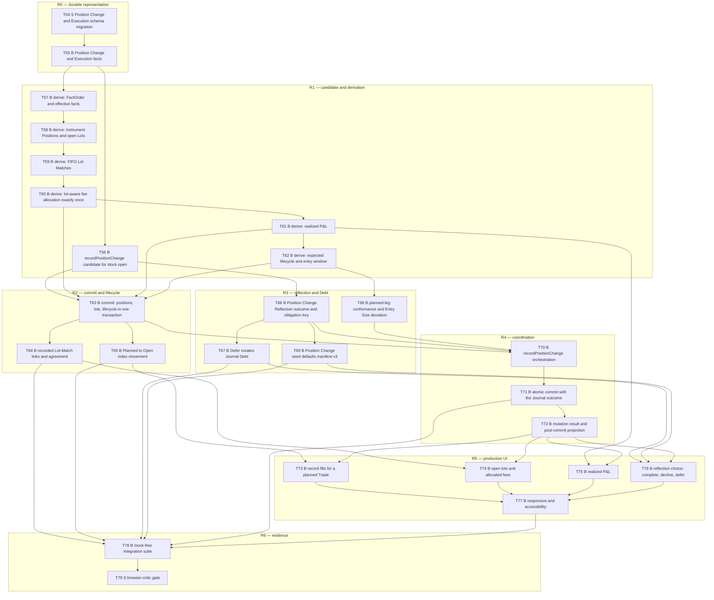

# D3 — Record my entry (long stock): task-level breakdown

Status: **draft for user review**, 2026-10-10. Not frozen. Phase 3 artifact for
`planning-protocol.md:61-135`.

Frozen inputs: `specs/` (read-only) and decisions D1–D6 in
[planning-decisions-2026-10-10.md](../planning-decisions-2026-10-10.md).
Deliverable scope and user stories: [vertical-deliverables.md](../vertical-deliverables.md) D3.

Task numbering continues D2's sequence (`T54`…). Cross-deliverable dependencies are written
`D1:T<n>` / `D2:T<n>`.

---

## 0. Scope, boundary, and what D3 deliberately does not do

### Advertised outcome

A trader records the fills that open their planned long stock position. The app derives the
position and cost basis exactly, allocates fees exactly once, and shows the open lots and
realized P&L. The Trade moves from `Planned` to `Open`. Recording the facts is never blocked by
having to write a reflection: the trader completes it, declines it, or defers it, and deferring
creates Journal Debt rather than a blank entry.

### In scope (from `vertical-deliverables.md:86-101`)

| Area | Included |
|---|---|
| Coordination | `TradeWorkflows.recordPositionChange` — the stock **open** variant |
| Calculation | `TradeAnalysis.derive`: Positions, open Lots, FIFO Lot Matches, fee allocation exactly once, realized P&L, expected lifecycle, Terminal Disposition when terminal |
| Facts | Position Change and Execution facts, membership, per-fact ownership; stored lifecycle `Planned`→`Open` with index movement |
| Reflection | The Position Change Reflection outcome: `Complete`, `Decline`, or `Defer`; `Defer` creates Journal Debt with the trigger-time definition snapshot; Source Position Change; one outcome per obligation key |
| Seeds | Manifest v3: Position Change Reflection Entry Type and Position Change Source |
| UI | Recording the fills; the lots, allocated fees, and realized P&L; the reflection choice; both viewports |
| Honesty | Installed Capability Manifest grows to advertise exactly D3's capability |

### Explicitly out of scope, and why it is safe

- **Closing, scaling out, and any exposure reduction.** D3 records *opening* fills only. A
  closing Execution is D8's terminal case; partial realization is also D8. The lifecycle therefore
  only ever moves `Planned`→`Open` here, never to `Closed`.
- **Options, spreads, Rolls, settlement** — D9–D14. D3's Planned Leg conformance is the Long
  Stock case only, so only the **Entry Size** Deviation is reachable (`AC-POS-005` completes at
  D12/D13 with the other three categories).
- **Correction and Rebuild** — D15/D16. D3's facts are append-only; `Replace`/`Void`/`Rebuild`
  arrive later, and D3 must not advertise them.
- **Marks and current valuation.** D3 shows realized P&L from facts only. There is no Mark, so no
  risk-to-stop, no current valuation, and no `evaluate` call. Anything that would need a price
  must render as absent, not as zero.
- **`abandonPlan`** (D8) and **`reviseManagement`** (D7).

### What D3 does *not* demonstrate, stated honestly

- `AC-POS-001` requires scaling opens, partial closes, and a final flat close. **D3 proves the
  opening half only** — two opening Executions at different prices and fees — and the close half
  completes at D8. The scenario cannot be claimed as passing here.
- `AC-LIFE-001`'s `Planned` step completes at D2; D3 proves the first `Open` step only.
- `AC-JOUR-003` (Debt is not an incomplete Entry) is D3's to prove for the Position Change
  Reflection deferral, and it is provable here in full.

---

## 1. The durable-representation risk in D3

D3 is the first deliverable that makes `TradeAnalysis.derive` load-bearing, and `derive` is the
single most-extended operation in the plan: D4 (Stop Discipline, replay), D12/D13 (multi-leg
aggregation), D18 (replay projections) all extend it. `vertical-deliverables.md:503-505` names
`TradeAnalysis.derive` as a shared resource that needs one owner at a time.

Two consequences the reviewer should weigh:

1. **The derivation output shape is a durable interface decision, not an internal one.** D3 should
   produce `DerivedTradeState` as the contract describes it (`trade-analysis.md:32-45`) even where
   D3 populates only part of it, so later deliverables extend rather than reshape it. The tasks
   below do that explicitly (T59, T60).
2. **Fee allocation and FIFO matching are the two places a later change would be migration-costly.**
   Both are fact-level and recorded, not derived-on-the-fly: `trade-record.md:7` makes recorded
   Lot-Match links authoritative. D3 must therefore record Lot Matches with the *same* commit that
   creates the Executions (T64), not recompute them on read.

---

## 2. Task graph

26 tasks in seven phases (T54–T79): 2 structural, 24 behaviour-bearing.

Three edges worth stating explicitly, because each is a deliberate choice:

- **T66 → T69** (reflection outcome before its seed defaults). The obligation key and the
  deferral snapshot must exist before the definition they snapshot is seeded, so the seed task is
  written against a real consumer rather than in the abstract. This is the same reasoning as D2's
  T44 → T46.
- **T62 → T68** (expected lifecycle and entry window before conformance). Entry Size shortfall is
  measured *at* the Entry Resolution Point, so conformance cannot be computed before the point is
  derived.
- **T63 → T70** (commit before orchestration). The commit path is built and proven against
  directly-applied candidates before the coordinator that drives it exists, which keeps T71's
  atomicity case writable without a UI.

### Shared-resource ownership

D3 is the third writer of the IndexedDB schema and the seed manifest, and the **first** owner of
`TradeAnalysis.derive`. Later deliverables extend `derive` and the seed manifest; D3 defines the
extension points (T57–T62) and the recorded-fact shapes (T55, T64).

---

## 3. Task detail

### Phase R0 — durable representation

#### T54 — `S` Position Change and Execution schema migration

Extends the durable Trade Record section with Position Change identity and membership, per-fact
ownership, and Execution facts, migrated from D2's schema version.

- **Blocking edges:** D1:T3 (test harness), D1:T9 (schema), D1:T10 (migration runner), D2:T36
  (the Trade Record section this extends).
- **Consumed by:** T55–T79.

**Exact verification**

| # | Command | Expected result |
|---|---|---|
| V54.1 | The schema self-test asserts the Position Change and Execution stores, key paths, and indexes | passes; matches the declared schema constant |
| V54.2 | A migration test opens a D2-version database containing a confirmed Trade with its Plan and Plan Reflection, migrates, and asserts every pre-existing identity, Entry, and lifecycle record survives | passes; nothing lost |
| V54.3 | The migrated database is opened at the D2 schema version | the open rejects as unsupported-newer rather than downgrading |
| V54.4 | A test asserts a cross-Trade Position Change can carry participation links to two Trades while each Execution holds exactly one owning Trade | passes; the constraint is enforced at the schema level, not only in application code |

**Migration treatment.** Additive: it creates stores and indexes and rewrites no existing record.
V54.2 is the compatibility proof for an already-in-use Workspace.

---

#### T55 — `B` Position Change and Execution facts

**Behaviour under test (seam: `TradeRecord.prepareChange` with a Position Change change, then
`getRecord`).**

- `describe("Position Change and Execution facts")`
  - `it should record one Position Change identity grouping two Executions and store the membership explicitly`
  - `it should assign each Execution exactly one owning Trade, even when the Position Change participates in more than one Trade`
  - `it should order facts by Economic Time and then by stable Recorded Sequence, so two same-time facts have a deterministic order`
  - `it should keep an existing fact's Recorded Sequence when its Economic Time later changes under correction`
  - `it should reject an Execution with no owning Trade, or the same Execution owned by two Trades, as a typed no-write result`
  - `it should record Save Time separately from Economic Time and never use Save Time for ordering`
  - `it should record the Position Change's one shared origin and decision identity`

**Red → green.** Case 1 fails because no Position Change is recorded. Implement; green. Case 3
fails because same-time facts order by insertion; introduce Recorded Sequence. Case 6's red is an
implementation that orders by Save Time — the trap `glossary.md:34` warns about, and one that would
only surface later under correction.

**Valid red evidence:** an Execution with ambiguous or duplicated ownership, non-deterministic
ordering for equal Economic Time, or Save Time used as the economic order.
**Not valid red:** the fixture assigning two Economic Times by accident.

**Blocking edges:** T54.
**Consumed by:** T56, T57.

---

### Phase R1 — candidate and derivation

#### T56 — `B` `recordPositionChange` candidate for the stock open variant

**Behaviour under test (seam: `TradeRecord.prepareChange` for a Position Change).**

- `describe("prepareChange for a stock open Position Change")`
  - `it should build a candidate position-changing fact set for two opening Executions on a Planned Trade`
  - `it should require and record the Planned Leg intent for every Execution, or an explicit Unplanned marker`
  - `it should reject a command that omits the Position Change Reflection disposition`
  - `it should reject a stale expected Trade revision with a typed no-write result`
  - `it should return before and candidate AnalysisInput facts plus a canonical digest`
  - `it should reserve no durable identity, so a discarded preparation leaves nothing behind`

**Red → green.** Case 1 fails because no candidate is built. Implement; green. Case 2 fails
because intent is optional. Case 6's red is an allocated identity leaking on discard.

**Valid red evidence:** a candidate written to storage, a missing intent silently defaulted to
planned, or a stale revision accepted.
**Not valid red:** the Planned Trade fixture not existing.

**Blocking edges:** T55.
**Consumed by:** T63, T66, T70.

---

#### T57 — `B` `derive`: `FactOrder` and effective facts

**Behaviour under test (seam: `TradeAnalysis.derive`).**

- `describe("derive effective facts")`
  - `it should select only effective, non-Voided versions of each fact identity`
  - `it should order the selected facts by Economic Time then Recorded Sequence`
  - `it should apply a corrected fact at its corrected Economic Time rather than its Save Time`
  - `it should honour the supplied economic cutoff, excluding facts after it`
  - `it should be pure, deriving the same result for the same input with no storage, clock, calendar, or reference-label access`
  - `it should never read a Mark, a provider, or another Trade`

**Red → green.** Case 1 fails because every version is used. Implement effective selection; green.
Case 3 fails because ordering follows Save Time. Case 5's red is a derivation that consults a
clock — which `trade-analysis.md:7` forbids and which would make the entry window
non-deterministic.

**Valid red evidence:** a Voided version included, a corrected fact ordered by Save Time, or a
derivation that depends on wall-clock time.
**Not valid red:** the fixture not including a second version.

**Blocking edges:** T55.
**Consumed by:** T58, T78.

**Extension note.** This task establishes the derivation *input* discipline. D4's Stop Discipline
replay and D18's replay call the same effective-fact selection, so it must live in one place
rather than being reimplemented per deliverable.

---

#### T58 — `B` `derive`: Instrument Positions and open Lots

**Behaviour under test (seam: `TradeAnalysis.derive`).**

- `describe("Instrument Positions and open Lots")`
  - `it should derive the signed net quantity for one exact Instrument from the effective opening Executions`
  - `it should create one open Lot per position-increasing fact, carrying its own basis quantity and unconsumed opening fee`
  - `it should allocate an opening fact's fee proportionally across the Lots it creates, not once to the first Lot`
  - `it should report NotApplicable rather than zero for a position calculation on a Trade with no position-changing fact`
  - `it should never substitute fill cost, zero, or a stale value for a figure it cannot compute`

**Red → green.** Case 1 fails because no position is derived. Implement net quantity; green. Case 3
fails because the whole fee lands on the first Lot. Case 4's red is a `0` returned where the
contract requires `NotApplicable` — the substitution `overview.md:171` forbids.

**Valid red evidence:** a fee assigned wholly to one Lot, a zero substituted for an unavailable
figure, or a lost fractional quantity.
**Not valid red:** the fixture asserting a float instead of the exact value layer.

**Blocking edges:** T57.
**Consumed by:** T59, T60, T78.

---

#### T59 — `B` `derive`: FIFO Lot Matches

**Behaviour under test (seam: `TradeAnalysis.derive`).**

- `describe("FIFO Lot Matches")`
  - `it should match a disposing quantity to the oldest open Lots first`
  - `it should link exact quantities without copying price or P&L onto the Lot Match`
  - `it should split a Match across two Lots when one Lot is insufficient, consuming the older Lot fully`
  - `it should leave the unmatched remainder of a partially consumed Lot open`
  - `it should record each Match as a stable link between the opening and disposing fact identities`

**Red → green.** Case 1 fails because no matching exists. Implement oldest-first; green. Case 2's
red is a Match carrying a copied price, which `trade-analysis.md:104` forbids because it creates a
second source of truth for P&L. Case 3 fails because a partial Lot is closed rather than split.

**Valid red evidence:** LIFO or arbitrary matching, price copied onto a link, or a partially
consumed Lot closed.
**Not valid red:** the fixture providing no disposing fact.

**Blocking edges:** T58.
**Consumed by:** T60, T61, T78.

**Scope note.** D3 exercises FIFO only with opening facts plus, in the integration suite, a test
fixture that provides a disposing quantity to prove the matching rule. Closing a Trade through the
UI is D8; `AC-POS-001` completes there.

---

#### T60 — `B` `derive`: lot-aware fee allocation exactly once

**Behaviour under test (seam: `TradeAnalysis.derive`).**

- `describe("fee allocation")`
  - `it should allocate a disposing fact's fee proportionally across its Lot Matches`
  - `it should include both the attributable opening and disposing fee portions in realized P&L`
  - `it should keep the unconsumed portion of an opening fee with its open Lot and reduce marked P&L rather than realized P&L`
  - `it should never count the same fee twice across opening, disposal, and displayed incurred totals`
  - `it should expose an incurred-fee total that is not subtracted again from an already net figure`
  - `it should report an unavailable allocation as Unavailable with the reason rather than guessing a split`

**Red → green.** Case 1 fails because the disposal fee is unallocated. Implement proportional
allocation; green. Case 4 fails when the opening fee is both consumed into P&L and shown as an
incurred total that is subtracted again — the double-count `trade-analysis.md:105` names outright.
This is the single highest-risk case in D3: it passes every naive assertion and is only caught by
a reconciliation that sums the parts against the whole.

**Valid red evidence:** a fee counted twice, an unconsumed opening fee wrongly realized, or a
guessed split where evidence is missing.
**Not valid red:** a fixture whose fee is zero, which would make the case vacuous.

**Blocking edges:** T59.
**Consumed by:** T61, T63, T74, T75, T78.

---

#### T61 — `B` `derive`: realized P&L

**Behaviour under test (seam: `TradeAnalysis.derive`).**

- `describe("realized P&L")`
  - `it should derive realized P&L from matched quantity, both attributable fee portions, and the exact prices of the matched facts`
  - `it should return a Value for realized-to-date even when a marked figure is unavailable`
  - `it should label a partial result a covered subtotal rather than presenting it as a total`
  - `it should keep realized-to-date, remaining-open, and marked figures independently returned`
  - `it should never reduce realized P&L by an unconsumed opening fee that remains with an open Lot`

**Red → green.** Case 1 fails because no P&L is derived. Implement; green. Case 2 fails because one
missing input suppresses the whole result — `AC-CALC-002`'s rule that valid figures remain
visible. Case 5 fails because the open fee is deducted early.

**Valid red evidence:** a total returned where only a covered subtotal is supportable, or a valid
figure suppressed by an unrelated unavailable one.
**Not valid red:** the exact-value comparison using a float tolerance.

**Blocking edges:** T60.
**Consumed by:** T63, T75, T78.

---

#### T62 — `B` `derive`: expected lifecycle and Entry Resolution Point

**Behaviour under test (seam: `TradeAnalysis.derive`).**

- `describe("expected lifecycle and entry window")`
  - `it should derive expected lifecycle Open when effective opening facts leave nonzero exposure`
  - `it should keep expected lifecycle Planned when the only position-changing facts were Voided`
  - `it should report derived/stored lifecycle disagreement as a structured integrity finding without repairing it`
  - `it should begin the Entry window at the first Position Change that establishes exposure`
  - `it should end the Entry window when every Planned Leg quantity is entered, or immediately before the first exposure-reducing Position Change, whichever comes first`
  - `it should return Planned Leg fulfillment as Unfilled for an untouched leg on an entered Trade`
  - `it should classify Terminal Disposition as NotApplicable while the Trade is not Closed`

**Red → green.** Case 2 fails because a Voided opening still counts. Case 4 fails because the
window starts at the Plan time rather than the first exposure. Case 7's red is a Terminal
Disposition fabricated for an Open Trade, which `glossary.md:80` reserves for Closed Trades.

**Valid red evidence:** a fabricated disposition, a window that starts before exposure, or an
untouched leg reported as anything but Unfilled/Not Entered.
**Not valid red:** the Planned Trade lacking opening facts.

**Blocking edges:** T61.
**Consumed by:** T63, T68, T78.

> **Entry Size deviation note.** `AC-POS-005` is **not** satisfied by D3. Entry Size excess is
> reachable here; the shortfall form needs the Entry Resolution Point (T62) and the other three
> Deviation categories arrive at D12/D13. T68 claims only what it proves.

---

### Phase R2 — commit and lifecycle

#### T63 — `B` Commit positions, Lots, and lifecycle in one transaction

**Behaviour under test (seam: `TradeRecord.applyPreparedChange`).**

- `describe("applyPreparedChange for a Position Change")`
  - `it should append the Position Change, its Executions, its membership, and the recorded Lot Matches in one commit`
  - `it should store the resulting Lifecycle State Open with its effective-fact digest and FactRevision binding`
  - `it should require a valid reconciliation for the exact candidate set and refuse to apply without one`
  - `it should write nothing when any participant fails, leaving no Execution visible after reopen`
  - `it should recheck every base revision and the digest, returning a typed no-write conflict when either changed`
  - `it should keep economical facts immutable, appending versions rather than editing an earlier one`

**Red → green.** Case 1 fails because nothing is applied. Implement the append; green. Case 4 fails
because Executions are written before the reconciliation step; move everything into one
transactional stage. Case 3 fails because apply proceeds without reconciliation.

**Valid red evidence:** Executions durable without their Lot Matches or lifecycle, or a partial
position change after a failed transaction.
**Not valid red:** the reconciliation fixture missing.

**Blocking edges:** T56, T60, T61, T62.
**Consumed by:** T64, T65, T70, T78.

---

#### T64 — `B` Recorded Lot-Match links and agreement

**Behaviour under test (seam: `TradeRecord.getRecord` and `TradeAnalysis.derive` agreement).**

- `describe("recorded Lot Matches")`
  - `it should persist the active Lot-Match links with the facts that justify them, not recompute them on read`
  - `it should report agreement when the recorded links equal the independently derived FIFO links`
  - `it should report a structured disagreement, without repairing it, when recorded links differ from derived links`
  - `it should keep an evidence-bound recorded link when the historical observation evidence is missing, reducing verification coverage rather than deleting the link`
  - `it should never let a read repair or create a Lot Match`

**Red → green.** Case 1 fails because matches are derived on read only. Persist them; green. Case 3
fails because a read recomputes and overwrites. Case 4's red is a link deleted because its evidence
is unavailable — `trade-record.md:147` forbids this and requires reduced coverage disclosure
instead.

**Valid red evidence:** a read that wrote, a disagreement silently corrected, or a retained
evidence-bound link deleted.
**Not valid red:** the fixture not recording links.

**Blocking edges:** T63.
**Consumed by:** T74, T78.

---

#### T65 — `B` `Planned` → `Open` lifecycle index movement

**Behaviour under test (seam: `TradeRecord.queryRecords` with `CurrentState` lifecycle filters).**

- `describe("lifecycle index movement")`
  - `it should remove the Trade from Planned membership and add it to Open membership in the same commit that stores the opening facts`
  - `it should leave the index unchanged when the Position Change is rolled back`
  - `it should return the Open Trade from an Open query without replaying Trade facts`
  - `it should answer the Open query from the index rather than issuing one storage query per Trade`

**Red → green.** Case 1 fails because the old membership persists. Implement the move inside
T63's transaction; green. Case 2 fails because a rollback leaves the move applied. Case 4's red is
an implementation that loads each Trade individually — the N+1 pattern
`trade-record.md:103` forbids and `AC-PERF-001` measures.

**Valid red evidence:** a Trade in both lifecycle memberships, a rolled-back move surviving, or a
per-Trade load on the list path.
**Not valid red:** the query filter constant not being exported.

**Blocking edges:** T63.
**Consumed by:** T73, T78.

---

### Phase R3 — reflection and Debt

#### T66 — `B` Position Change Reflection outcome and obligation key

**Behaviour under test (seam: `Journal.prepareEffects`, then `Journal.query` by obligation key).**

- `describe("Position Change Reflection obligation")`
  - `it should accept each of Complete, Decline, and Defer as the disposition for one Position Change`
  - `it should produce exactly one obligation whose key includes the Position Change, so retrying cannot duplicate an outcome`
  - `it should use a key distinct from the Close Review key, so the two obligations never merge`
  - `it should anchor the outcome to the originating Trade and use Source Position Change`
  - `it should reject a second outcome for the same obligation key with a typed no-write result`
  - `it should record an explicit decline as a JournalDecline rather than a blank Answer or a Void`

**Red → green.** Case 1 fails because no outcome is prepared. Implement Complete; green. Case 2
fails because a retry creates a second outcome. Case 6's red is a decline stored as an empty
answer, which `glossary.md:111` distinguishes and `AC-JOUR-005` tests.

**Valid red evidence:** two outcomes for one key, a decline indistinguishable from a blank answer,
or a Position Change Reflection merged with a Close Review obligation.
**Not valid red:** the Position Change fixture lacking a Trade.

**Blocking edges:** T56.
**Consumed by:** T67, T69, T70, T76, T78.

---

#### T67 — `B` `Defer` creates Journal Debt

**Behaviour under test (seam: `Journal.prepareEffects` with `Defer`, then `Journal.query` for
Debt).**

- `describe("Defer creates Journal Debt")`
  - `it should create one Outstanding Debt carrying its trigger-time Entry Definition snapshot`
  - `it should create no Journal Entry at all, so no blank or placeholder Entry exists`
  - `it should keep the factual Position Change durable independently of the deferral`
  - `it should preserve the Debt against a later definition revision, validating a later answer against the original snapshot`
  - `it should record the Debt's owning Trade, Anchor, origin, and settlement route`
  - `it should not create Debt from an abandoned form, because only a submitted disposition creates evidence`

**Red → green.** Case 1 fails because deferral writes nothing. Implement the Debt; green. Case 2 is
`AC-JOUR-003`'s core: the red is a placeholder Entry appearing alongside the Debt. Case 6 fails if
merely opening and abandoning the reflection form creates Debt — `Journal`'s "no abandoned form
creates Debt" rule (`trade-workflows.md:88`).

**Valid red evidence:** a placeholder Entry, a Debt whose snapshot follows a later definition
revision, or Debt created without a submitted disposition.
**Not valid red:** the Debt fixture missing a definition revision.

**Blocking edges:** T66.
**Consumed by:** T76, T78.

---

#### T68 — `B` Planned-leg conformance and the Entry Size deviation

**Behaviour under test (seam: `TradeAnalysis.derive`).**

- `describe("planned-leg conformance")`
  - `it should report the served Long Stock leg as FilledAsPlanned when the entered quantity matches the Planned Leg quantity`
  - `it should report PartiallyFilled when the entered quantity is below plan while the Trade remains open`
  - `it should record an Entry Size deviation when exposure exceeded the planned quantity at entry`
  - `it should record Entry Size shortfall at the Entry Resolution Point, and not before it`
  - `it should report NotVerifiable rather than assume conformance when required selection evidence is absent`
  - `it should never infer Unplanned Exposure from mismatched terms, because that requires the explicit Unplanned intent`
  - `it should report all mismatched exact terms for one served leg as one Planned-Leg Terms occurrence rather than several`

**Red → green.** Case 1 fails because no conformance is derived. Implement exact match; green.
Case 4 fails because shortfall is flagged immediately on a partially entered open Trade. Case 6's
red is a deviation inferred from a mismatched term — the specific inference
`trade-analysis.md:111` prohibits.

**Valid red evidence:** assumed conformance where evidence is absent, Unplanned inferred from a
term mismatch, or shortfall raised before the Entry Resolution Point.
**Not valid red:** the Planned Leg quantity fixture differing from the intent fixture.

**Blocking edges:** T62.
**Consumed by:** T70, T78.

**Scope honesty.** Only Entry Size is reachable in the Long Stock case. Unplanned Exposure and
Planned-Leg Terms arrive with the multi-leg work at D12/D13; D3 must not advertise the four-type
taxonomy.

---

#### T69 — `B` Position Change seed defaults, manifest v3

**Behaviour under test (seam: `Journal.seedDefaults`, then `Journal.getDefinitions` and a Source
query).**

- `describe("Position Change seed defaults")`
  - `it should seed the Position Change Reflection Entry Type under its stable product identity`
  - `it should seed its initial definition with the four contract prompts in order: Decision mode; Primary emotion; Decision confidence; Note`
  - `it should mark Decision mode required with exactly As Planned, Deliberate Adjustment, Reactive, Externally Imposed`
  - `it should mark Primary emotion required with exactly the contract options, and Decision confidence required as a 1–5 Scale`
  - `it should seed the Position Change Source identity`
  - `it should remain idempotent against a Workspace already seeded at v2, adding nothing twice and resetting no trader revision`
  - `it should not create a settlement-specific Entry Type, because settlement moments use Position Change Reflection`

**Red → green.** Case 1 fails because the type is unseeded. Implement; green. Case 6 fails because
a v2 Workspace gains a duplicate. Case 7's red is an `Expiration` or `Assignment` Entry Type
appearing — `journal.md:37` forbids it.

**Valid red evidence:** a duplicated or missing Entry Type, a wrong option list, a reset revision,
or an extra settlement-specific type.
**Not valid red:** the manifest version constant not being bumped.

**Blocking edges:** T66.
**Consumed by:** T76, T78.

---

### Phase R4 — coordination

#### T70 — `B` `recordPositionChange` orchestration

**Behaviour under test (seam: `TradeWorkflows.recordPositionChange`).**

- `describe("TradeWorkflows.recordPositionChange")`
  - `it should record one grouped stock open Position Change against a Planned Trade and return success`
  - `it should derive positions, Lots, matches, fees, realized P&L, lifecycle, and conformance for the candidate before committing`
  - `it should require exactly one Position Change Reflection disposition and reject a command that omits it`
  - `it should reject a command that identifies an Execution as serving no Planned Leg without the explicit Unplanned intent`
  - `it should preserve the frozen Plan Baseline unchanged, because recording entry never rewrites the Plan`
  - `it should never execute a trade or create an order, because a Position Change records facts only`
  - `it should reject a Position Change against a Trade that is not Planned with a typed no-write result`

**Red → green.** Case 1 fails because no command exists. Implement; green. Case 5 fails because
recording entry recomputes and overwrites the baseline. Case 7's red is accepting an entry against
an already-Open Trade, which D3 must refuse because scaling arrives at D8.

**Valid red evidence:** a modified Plan Baseline, a Position Change accepted on a non-Planned
Trade, or an omitted reflection disposition silently defaulted.
**Not valid red:** the Planned Trade fixture absent.

**Blocking edges:** T63, T66, T68.
**Consumed by:** T71, T72, T73, T78.

---

#### T71 — `B` Atomic commit with the Journal outcome

**Behaviour under test (seam: `TradeWorkflows.recordPositionChange`, with an injected failing
participant).**

- `describe("semantic atomicity of a Position Change")`
  - `it should commit the position facts, Lot Matches, lifecycle and index movement, and the Journal outcome together`
  - `it should roll back every Trade effect when the Journal participant rejects`
  - `it should roll back the Journal effect when the Trade participant rejects`
  - `it should leave no Debt, Entry, Execution, or index membership from a failed attempt`
  - `it should recover after a simulated interruption to the complete pre-commit or post-commit state, never a mixture`
  - `it should not require the reflection to be complete for the facts to be durable, because factual recording is never blocked by reflection`

**Red → green.** Case 1 fails because the Journal effect commits separately. Case 6's red is a
command refused because the reflection was deferred — the explicit invariant at
`trade-workflows.md:198`.

**Valid red evidence:** a durable Position Change without its reflection outcome, or a Debt without
its Position Change.
**Not valid red:** the injection not firing.

**Blocking edges:** T70.
**Consumed by:** T72, T78.

> **`planning-decisions` D3 verification item 5, second proof.** D2 proved the multi-store rollback
> with a Plan Reflection participant. D3 proves it again with a Position Change participant and a
> *Defer*, which stages a different effect shape (Debt rather than Entry). Both are needed, because
> a rollback that works for an Entry may not for a Debt.

---

#### T72 — `B` Mutation result and post-commit projection

**Behaviour under test (seam: `TradeWorkflows.recordPositionChange`'s accepted result).**

- `describe("recordPositionChange post-commit result")`
  - `it should return the committed Trade projection at its new FactRevision, showing Open`
  - `it should return the created Position Change, Execution, Lot Match, and Entry or Debt identities`
  - `it should return the Lifecycle State transition from Planned to Open`
  - `it should return the derived positions, Lots, allocated fees, and realized P&L bound to the exact committed facts`
  - `it should return the Journal outcome projection, whether the disposition was Complete, Decline, or Defer`
  - `it should let the caller render the saved outcome without calling getRecord or a Journal query`
  - `it should return the result only after every effect is durable, so a post-restart read agrees with it`

**Red → green.** Case 6 fails because the caller re-reads. Include the projections; green. Case 7
fails when the result is assembled from the candidate rather than the committed state. Case 7 is
the important one here: with Lot Matches involved, a candidate-derived projection can differ from
the committed one in fee allocation.

**Valid red evidence:** a required follow-up read, or a returned projection that disagrees with a
post-restart read of the same state.
**Not valid red:** a missing field on the result type.

**Blocking edges:** T71.
**Consumed by:** T73, T74, T75, T76, T78.

> **`AC-RESP-001`.** D2 covered the confirm-plan family; D3 covers the position-change family,
> which is the "bounded multi-subject workflow" the scenario's Given calls for.

---

### Phase R5 — production UI

#### T73 — `B` Record fills for a planned Trade

**Behaviour under test (seam: the production UI over `recordPositionChange`).**

- `describe("recording fills")`
  - `it should offer fill entry from a Planned Trade and require an explicit Save to record`
  - `it should accept two opening fills in one Position Change and show them as one decision`
  - `it should require a Planned Leg intent for each fill, offering only the legs the frozen Plan declares`
  - `it should require an Economic Time per fill and default nothing silently`
  - `it should show the Trade as Open with the recorded fills from the returned post-commit projection`
  - `it should preserve entered-but-unsaved values across a rejection`
  - `it should record nothing when the form is abandoned, asserted by unchanged revisions`
  - `it should refuse fill entry on a Trade that is not Planned, explaining why`

**Red → green.** Case 1 fails because no form exists. Implement; green. Case 4's red is a silently
defaulted Economic Time of "now", which would make the economic record depend on when the form was
opened. Case 7 fails if typing is captured.

**Valid red evidence:** a fill recorded without Save, a silently defaulted Economic Time, or two
fills from one decision stored as two Position Changes.
**Not valid red:** the route not registered.

**Blocking edges:** T65, T72.
**Consumed by:** T77, T79.

---

#### T74 — `B` Open lots and allocated fees

**Behaviour under test (seam: the production UI over the derived and recorded lot data).**

- `describe("open lots and allocated fees")`
  - `it should show each open Lot with its exact basis quantity and its unconsumed opening fee`
  - `it should show an allocated fee per Lot such that the displayed allocations sum to the recorded fee`
  - `it should label a partially consumed Lot as still open rather than closed`
  - `it should distinguish a covered subtotal from a total wherever only part of the position is covered`
  - `it should render allocated fees with their unit and sign, unrounded in the read model`
  - `it should show no invented fee or zero-fee placeholder where the allocated fee is unavailable`

**Red → green.** Case 1 fails because no lots are displayed. Implement; green. Case 2's red is
displayed allocations that do not reconcile to the recorded fee — the visible symptom of the
double-count T60 guards against at the derivation level. Case 6 fails when an unavailable fee
renders as `$0.00`.

**Valid red evidence:** displayed allocations not summing to the recorded fee, or an unavailable
fee rendered as zero.
**Not valid red:** the Trade having no lots.

**Blocking edges:** T64, T72.
**Consumed by:** T77, T79.

---

#### T75 — `B` Realized P&L presentation

**Behaviour under test (seam: the production UI over the derived realized P&L).**

- `describe("realized P&L")`
  - `it should show realized-to-date P&L for a Trade with matched quantity`
  - `it should keep realized, remaining-open, and marked figures distinguishable, and mark the last as unavailable rather than zero`
  - `it should show a covered subtotal labelled as such when only part of the position is realized`
  - `it should never show a current valuation, risk-to-stop, or reward-to-target, because no Mark exists`
  - `it should show the exact sign and unit on every monetary figure`
  - `it should explain an unavailable figure with its reason and the affected Instrument`

**Red → green.** Case 4's red is a valuation rendered from fill cost — the substitution
`ui-contract.md:94` explicitly forbids ("it never displays fill cost or zero as current
valuation"). Case 2 fails when the absent marked figure renders as `$0`.

**Valid red evidence:** fill cost or zero presented as a valuation, or an unavailable figure
without its reason.
**Not valid red:** the Trade having no realized quantity.

**Blocking edges:** T61, T72.
**Consumed by:** T77, T79.

---

#### T76 — `B` Reflection choice: complete, decline, defer

**Behaviour under test (seam: the production UI over the Journal Position Change Reflection path).**

- `describe("reflection choice")`
  - `it should offer Complete, Decline, and Defer for the Position Change Reflection`
  - `it should require the Decision mode, Primary emotion, and Decision confidence answers for Complete, and explain any missing one`
  - `it should record an explicit Decline without requiring an answer, and show the obligation as declined rather than outstanding`
  - `it should create Debt on Defer and show the obligation as outstanding with its trigger-time form`
  - `it should show the distinct obligation key so a retry is visibly the same obligation`
  - `it should record nothing until the trader submits one of the three dispositions`
  - `it should not block the factual Position Change on any reflection choice`
  - `it should render the exact Position Change Reflection definition revision and submit that revision`

**Red → green.** Case 3's red is a decline recorded as a blank answer. Case 7's red is a UI that
refuses to record the fills until the reflection is written — the product's central low-friction
promise, and the one a reviewer should most want proven.

**Valid red evidence:** a reflection answer stored without submission, a decline indistinguishable
from outstanding Debt, or facts blocked on reflection.
**Not valid red:** the definition not being seeded.

**Blocking edges:** T67, T69, T72.
**Consumed by:** T77, T79.

---

#### T77 — `B` Responsive layout and accessibility for D3's surfaces

**Behaviour under test (seam: the production UI at both viewport classes).**

- `describe("responsive and accessible entry recording")`
  - `it should use bottom navigation at narrow widths and a left sidebar at wide widths across the fill, lots, P&L, and reflection surfaces`
  - `it should switch layout live without reload and without losing route, selected Trade, or entered-but-unsaved fill values`
  - `it should expose equivalent fields, actions, validation, and Save/Cancel outcomes at every supported width`
  - `it should give every control an accessible name and understandable validation`
  - `it should group the reflection single choices as labelled radio groups and expose the obligation state programmatically`
  - `it should meet WCAG AA contrast with a visible focus indicator and logical focus order`
  - `it should move focus to the first invalid field, and announce the rejection, after a failed fill Save`
  - `it should support keyboard-only recording of fills and the reflection`
  - `it should never use color as the only carrier of availability, Debt, or Deviation cues`

**Red → green.** Case 2 fails because resize remounts and drops fill input — especially costly on
a form whose Economic Time default matters. Case 5's red is an obligation rendered only as a badge
with no programmatic state.

**Valid red evidence:** lost unsaved fill values on resize, a missing accessible name, or an
obligation state carried by color alone.
**Not valid red:** the axe harness failing to load.

**Blocking edges:** T73, T74, T75, T76.
**Consumed by:** T78.

---

### Phase R6 — evidence

#### T78 — `B` Mock-free integration suite for D3

Runs D3's complete capability through the production stack in a real browser, with no mock of any
application dependency, asserted against durable state after a reload.

**Integration cases** (seam: the running application).

- `describe("D3 end to end")`
  - `it should record two opening fills as one Position Change on a Trade confirmed in D2 and show the Trade as Open`
  - `it should persist the Position Change, Executions, Lot Matches, lifecycle and index membership across a full reload`
  - `it should derive positions, open Lots, allocated fees, and realized P&L with fee allocations summing to the recorded fee`
  - `it should leave the frozen Plan Baseline unchanged after entry`
  - `it should create exactly one Position Change Reflection outcome, and none when the form is abandoned`
  - `it should create Debt with the trigger-time snapshot on Defer, and no Journal Entry at all`
  - `it should roll back every Trade and Journal effect when a participant fails, asserted against real-engine store contents`
  - `it should reject a second entry Position Change on the now-Open Trade and leave revisions unchanged`
  - `it should report the Entry Size deviation for an over-sized entry and none for an exact match`

**Test infrastructure replacement, disclosed:** `fake-indexeddb` in the Node suites only, with the
same three fidelity gaps D1 disclosed; the multi-store rollback for a Position Change participant
(T71) is asserted against a real engine here as well, because the Debt effect shape differs from
D2's Entry shape. No replacement for IndexedDB, Cache Storage, the service worker, or the storage
estimate in this suite.

**Coverage limits D3 must state, not bury:**

- `AC-POS-001` — **partial**: opening, FIFO matching, and fee allocation proven; partial and final
  closing complete at D8.
- `AC-LIFE-001` — **partial**: the first `Open` step; `Closed` completes at D8.
- `AC-JOUR-007` — **partial**: the Position Change Reflection Entry Type and the Position Change
  Source.
- `AC-POS-005` — **partial**: Entry Size only; the other three Deviation categories are D12/D13.

**Blocking edges:** T64, T65, T67, T69, T71, T77.
**Note:** each of these is a *direct* dependency this suite exercises. Derivation behaviour it sets up (T57–T62) and tasks those depend on are declared by their own tasks and reachable transitively; listing them here would only duplicate the graph.
**Consumed by:** T79, and the cumulative suite.

---

#### T79 — `S` Independent browser-critic gate for D3

A fresh critic starts the runtime itself and exercises every D3 flow through the production UI in
both viewports, against the frozen `specs/` baseline and this breakdown. D1's gate procedure
(its T35) is the procedure; it is referenced rather than restated, and the test-first repair loop
is identical.

- **Blocking edges:** T78.
- **Consumed by:** the deliverable's completion.

**Exact verification of the gate itself**

| # | Check | Expected result |
|---|---|---|
| V79.1 | The critic's report covers every flow in §4 | one structured record per flow, each with pass/fail |
| V79.2 | The critic ran at both viewport classes | both recorded |
| V79.3 | Exact browser and OS versions are recorded | provenance present, never used as a decision input |
| V79.4 | If any flow failed, a new automated test fails for that defect before the fix | red run recorded, then the complete cumulative suites rerun green |

---

## 4. Browser-critic flow list for D3

Run in **narrow** and **wide** viewports, on a Workspace with a Trade confirmed in D2.

| # | Flow | Steps | Expected observable result |
|---|---|---|---|
| F1 | Record one fill | Enter one opening fill with quantity, price, fee, and Economic Time; Save | Trade shows Open; the fill appears with its exact values |
| F2 | Two fills, one decision | Enter two fills in one Position Change; Save | Both belong to one Position Change; two Executions, not two decisions |
| F3 | Intent required | Attempt to Save without a Planned Leg intent | Rejected, naming the missing intent; nothing recorded |
| F4 | Abandon records nothing | Fill the form, navigate away without Save | No Execution, no Position Change; revisions unchanged after reload |
| F5 | Economic Time is explicit | Attempt to Save without an Economic Time | Rejected rather than silently defaulting to now |
| F6 | Not Planned refuses | Open fill entry on an already-Open Trade | Refused with an explanation; nothing recorded |
| F7 | Open lots are exact | Inspect the lots after F2 | Each open Lot shows its basis quantity and unconsumed opening fee |
| F8 | Fee allocations reconcile | Sum the displayed allocated fees and compare to the recorded fee | They are equal; no fee appears twice |
| F9 | Realized P&L | Inspect realized P&L after F2 | Realized-to-date shown for matched quantity; nothing shown for open quantity |
| F10 | No invented valuation | Inspect the P&L panel | No current valuation, risk-to-stop, or reward-to-target; no `$0` where a figure is unavailable |
| F11 | Baseline untouched | Compare the frozen Plan Baseline before and after entry | Identical; 1R unchanged |
| F12 | Reflection: Complete | Complete the reflection with all three required answers | One outcome recorded; obligation no longer outstanding |
| F13 | Reflection: Decline | Decline the reflection explicitly | Shown as declined, not outstanding; no blank entry created |
| F14 | Reflection: Defer | Defer the reflection | Debt shown as outstanding with its trigger-time form; **no Journal Entry exists** |
| F15 | Facts never wait on writing | Defer in F14, then reload | The Position Change and the Trade's Open state are durable; only the obligation is outstanding |
| F16 | One outcome per obligation | Re-submit the reflection for the same Position Change | Rejected as the same obligation; no second outcome |
| F17 | Deviation: over-size | Record an entry exceeding the planned quantity | Entry Size deviation recorded and visible |
| F18 | Deviation: exact match | Record an entry matching the plan exactly | No Entry Size deviation; leg reported as filled as planned |
| F19 | Lifecycle index moved | Inspect the Planned and Open lists | The Trade is in Open only; it is gone from Planned |
| F20 | Live resize with unsaved fills | Begin a second fill, type, then narrow and widen without reload | Layout switches; typed fill values, route, and actions survive |
| F21 | Keyboard-only recording | Record a fill and complete a reflection using the keyboard only | Every control reachable; radio-group semantics; focus moves to the first invalid field on rejection |
| F22 | Reload durability | Reload after F1 | Executions, Lot Matches, lifecycle, index membership, and the reflection outcome all preserved |
| F23 | Installed capability honesty | Inspect the Installed Capability Manifest and navigation | Recording an entry is advertised; closing, scaling out, settlement, options, marks, review, reporting, backup, Restore, correction, and Roll are absent — not present as unavailable |

**Intentional non-defects the critic must not report:** no close or scale-out control (D8); no
options or spreads (D9–D14); no Roll (D14); no correction or Void (D15); no Manage stop/target
(D7); no Marks, Daily Review, or reports; installation affordance absent (D22).

---

## 5. Acceptance coverage for D3

| Scenario | D3 status | Covered by |
|---|---|---|
| AC-POS-001 | **Partial** — opening fills, positions, open Lots, FIFO matching, fee allocation exactly once | T55, T58–T61, T63, T64, T74, T78, F1, F2, F7, F8; closing completes at D8 |
| AC-LIFE-001 | **Partial** — the `Planned`→`Open` step and index movement | T62, T63, T65, T78, F19; `Closed` at D8 |
| AC-JOUR-003 | Planned, fully | T66, T67, T76, T78, F13, F14, F15 |
| AC-JOUR-005 | **Partial** — one outcome per obligation key for the Position Change Reflection | T66, T76, F16; Void-reopen at D17 |
| AC-JOUR-007 | **Partial** — the Position Change Reflection Entry Type and the Position Change Source | T69, T76; completes at D17 |
| AC-RESP-001 | **Partial** — the position-change mutation family | T72, T78 |
| AC-POS-005 | **Partial** — Entry Size only | T68, T78, F17, F18; other categories at D12/D13 |
| AC-LIFE-003 | **Partial** — lifecycle and Lot-Match agreement, no read-time repair | T62, T64, T78 |
| AC-CALC-002 | **Partial** — independent availability for realized P&L | T61, T75, F9, F10 |
| AC-UI-001, AC-UI-002 | **Partial** — D3's surfaces and states | T77, F20, F21 |
| AC-PERF-001 | **Not covered** — the no-N+1 index path is asserted at D3 scale only (T65) | T65; the mature-scale benchmark needs a later deliverable's data volume |

**Nothing in a "partial" row may be counted as passing.**

---

## 6. What counts as valid red evidence

D1's §6 rules apply verbatim. Three additions specific to D3, each because the case can otherwise
pass while proving nothing:

- **For T60 (fee allocation), a red caused by a zero-valued fee in the fixture is not valid.** The
  case must use a non-zero opening fee *and* a non-zero disposal fee, or the double-count cannot
  manifest. Assert the sum of the parts against the whole.
- **For T63 and T71 (atomicity), a red caused by the injected failure not firing is not valid.**
  Assert that the injection fired before asserting the rollback.
- **For T59 (FIFO), a red caused by the fixture containing only one Lot is not valid.** The
  split-across-Lots case needs at least two Lots with the oldest insufficient, or oldest-first
  matching is indistinguishable from any other order.

---

## 7. Open items and risks

1. **`derive`'s output shape is a durable interface decision.** D3 proposes building the full
   `DerivedTradeState` (`trade-analysis.md:32-45`) while populating only the D3-relevant members
   as `NotApplicable` or absent, so D4/D12/D13/D18 extend rather than reshape. If the reviewer
   prefers to grow the shape incrementally, that is a legitimate alternative with a real cost:
   later deliverables then change the type every earlier one consumes. **Recommendation: fix the
   shape now.**
2. **Recorded Lot Matches versus derived matching.** D3 records links at commit time
   (`trade-record.md:7`) and also derives expected links for agreement. If the reviewer wants
   matching to be purely derived in early deliverables, that contradicts the authoritative-facts
   rule and would reopen `trade-record.md:44`. Flagged rather than assumed.
3. **The `AC-LIFE-003` controlled disagreement fixture.** D3 needs to induce a stored-lifecycle
   *and* a recorded-Lot-Match disagreement to prove no read-time repair. `acceptance-contract.md:7`
   permits test-only mutation of private projections only for scenarios that explicitly exercise
   reconstruction. Whether lifecycle/Lot-Match disagreement qualifies should be confirmed, because
   the alternative is a second, deliberately-corrupting write path that would be worse.
4. **Entry Size excess at entry versus at the Entry Resolution Point.** `trade-analysis.md:111`
   says excess is recorded "as it occurs" while shortfall is recorded at Entry Resolution. D3
   implements exactly that, but it means an over-sized entry produces a Deviation immediately
   while an under-sized one does not until the window closes. Worth confirming that the asymmetry
   is intended to be visible to the trader, since it affects F17/F18.
5. **Deriving a terminal case in D3.** T59 and T62 are proven partly with a test fixture that
   supplies a disposing quantity, because FIFO cannot be exercised with opening facts alone. That
   fixture is a disclosed test-only construction and must not be reachable from the production graph.

---

## Related

- [vertical-deliverables.md](../vertical-deliverables.md) — D3 scope and user stories
- [D1-install-trust-set-up.md](D1-install-trust-set-up.md), [D2-confirm-first-plan.md](D2-confirm-first-plan.md)
- [planning-decisions-2026-10-10.md](../planning-decisions-2026-10-10.md) — D3 verification item 5
- `specs/design/trade-analysis.md`, `specs/design/trade-record.md`, `specs/design/trade-workflows.md`,
  `specs/design/journal.md`
- `specs/acceptance/acceptance-contract.md` — AC-POS-001/005, AC-LIFE-001/003, AC-JOUR-003/005/007,
  AC-CALC-002, AC-RESP-001
