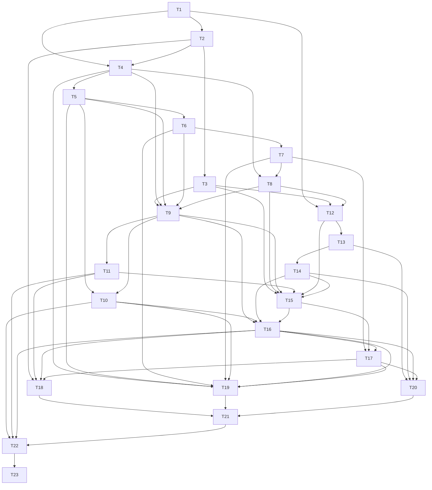

# D3 — Record my entry (long stock): task-level breakdown

Status: draft for user review. Not frozen. Phase 3 artifact for `planning-protocol.md:61-135`.

## 0. Scope, boundary, and what this deliverable deliberately does not do

### Advertised outcome

A trader who confirmed a Long Stock Plan in D2 can record the fills that open the planned position and
then see the exact Position, the open Lots, the allocated fees and the realized P&L. The stored
lifecycle moves `Planned` to `Open` with its current-state index membership in the same commit, and
the single Position Change Reflection for each recorded Position Change can be completed, explicitly
declined, or **deferred** — with `Defer` creating Journal Debt, so that recording facts is never
blocked by having to write. Every one of those outcomes is reachable through the production UI, is
committed through one IndexedDB multi-store transaction, and survives a restart.

`AC:` AC-POS-001, AC-LIFE-001 (Open), AC-JOUR-003.

This deliverable additionally claims bounded, honest **partial** evidence for AC-RESP-001,
AC-JOUR-001 and AC-UI-002 (see §5). It claims no other acceptance scenario, and a Partial row is not
a pass.

### In scope

| In-scope capability | Public boundary it is exercised through | Spec anchor |
|---|---|---|
| Stock-open Position Change fact model: one decision grouping one or more Executions with stable fact identity, `EconomicTime`, `RecordedSequence` | `TradeRecord.prepareChange` / `applyPreparedChange` | `trade-record.md:22-40`, `trade-record.md:58-70` |
| The stock-open variant of the mutating workflow, including its expected-revision and ownership validation | `TradeWorkflows.recordPositionChange` | `trade-workflows.md:84-92` |
| Effective-fact replay to signed Instrument Positions and open Lots | `TradeAnalysis.derive` | `trade-analysis.md:59-63`, `trade-analysis.md:103` |
| FIFO Lot Matches linking closing quantity to opening Lots, with no price or P&L on the link | `TradeAnalysis.derive` | `trade-analysis.md:104`, `glossary.md:59` |
| Lot-aware fee allocation, exactly once, across created and matched Lot quantities | `TradeAnalysis.derive` | `trade-analysis.md:105` |
| Realized P&L for the matched quantities, including both attributable fee portions | `TradeAnalysis.derive` | `trade-analysis.md:105` |
| Expected lifecycle, Entry window and Entry Resolution Point, Planned Leg fulfillment, and lifecycle agreement status | `TradeAnalysis.derive` | `trade-analysis.md:65-67`, `glossary.md:62-63` |
| Recorded active Lot-Match links, stored lifecycle and index membership staged in one transaction | `TradeRecord.applyPreparedChange` behind the Persistence/Transaction seam | `trade-record.md:7`, `trade-record.md:66-68`, `overview.md:127` |
| Recorded-versus-derived Lot-Match agreement, reported and never repaired | `TradeAnalysis.derive` integrity findings | `trade-analysis.md:63`, `overview.md:144` |
| `Planned` to `Open` lifecycle index movement used by bounded current reads | `TradeRecord.queryRecords(CurrentState)` | `trade-record.md:98-103`, `overview.md:133` |
| Position Change Reflection outcome: complete, decline, defer, with its own obligation key | `Journal.prepareEffects` / `applyPreparedEffects` | `journal.md:54-61`, `journal.md:135-141` |
| Manifest v3 seed growth: Position Change Reflection Entry Type and Position Change Source | `Journal.seedDefaults` | `journal.md:25-37`, `journal.md:194`, `vertical-deliverables.md:477-481` |
| Post-commit projection sufficient to render the saved outcome with no follow-up read | `PositionChangeResult.postCommit` | `trade-workflows.md:31-45`, `overview.md:194` |
| The fill form, the reflection choice, the Position/Lots/fees/realized-P&L presentation, and their responsive and accessible behaviour | Production UI (fill surface, reflection surface, Trade view) | `ui-contract.md:26-36`, `ui-contract.md:70-88`, `ui-contract.md:123-125` |
| Durable schema version 3 and its migration from the D2 baseline | `Persistence/Transaction` migration runner | `trade-record.md:143-149`, `overview.md:131`, `overview.md:133` |
| The write gate on the new mutation path | cross-cutting `RuntimeNotWritable` branch | `overview.md:177-186`, `planning-protocol.md:83` |

The Installed Capability Manifest is not extended with a new family name by this deliverable: the
variant it advertises is "record my entry for a long stock Plan", which is the stock-open member of
the already-declared `recordPositionChange` capability. The manifest's seed revision advances to
manifest v3 (`journal.md:194`).

### Explicitly out of scope, and why it is safe

- **Multi-leg and option variants of `recordPositionChange`** (D8–D12). The D3 command union contains
  only the stock-open variant, so no option Instrument is constructible through the D3 UI (the D2
  Strategy selector offers Long Stock only, `vertical-deliverables.md:79-82`). This is honest absence,
  not a fabricated domain `Unavailable` (`overview.md:19`). The derivation written here is general
  over Instruments, so D8–D12 extend it rather than reinterpret it.
- **Every settlement fact** — Assignment, Exercise, Expiration, and cash settlement (D8–D11). No
  settlement member exists in the D3 command union, no calendar inference exists anywhere, and
  `derive` never synthesizes a settlement as a zero-price Execution (`trade-analysis.md:61`).
- **Closing a Trade** (D6). The terminal stock exit, exactly one Close Reason when trader agency is
  present, Close Review with its own obligation key, Terminal Disposition, and the stored `Planned`
  to `Closed` transition all land at D6 (`vertical-deliverables.md:149-165`,
  `trade-workflows.md:90-92`). D3 rejects a terminal intent as a typed no-write validation result at
  the narrow command boundary, and its `derive` still computes the expected `Closed` state for a
  candidate snapshot, so D6 adds persistence and reason rules without reinterpreting any arithmetic
  D3 produced.
- **Scaling presentation beyond what this scenario needs** (D18/D19). D3 shows Position, open Lots,
  allocated fees and realized P&L for one Trade. Browse, replay, Outcomes, Exposure, Scorecard and
  Journal-field reporting are not installed and are not faked.
- **Roll** (D13). D3 writes no predecessor/successor lineage and confirms no successor Plan
  (`trade-workflows.md:114`).
- **Corrections** (D15). Recorded Lot Matches and recorded Deviations are written but never yet
  repaired. D3 therefore keeps the agreement path strictly read-only: disagreement is disclosed as a
  structured integrity finding and is never silently repaired (`trade-analysis.md:63`,
  `trade-record.md:157`).
- **Management Revision** (D14). The confirmed Plan's original management is consumed frozen. D3
  derives management-coverage observation requirements but evaluates no condition and writes no
  revision.
- **Daily Review and Market Data** (D4/D5/D18). D3's realized P&L needs no Mark, so it never reads
  Market Data and therefore adds no `Unavailable`-valuation path.

### What this deliverable deliberately does not demonstrate

- any Position Change other than stock opens and the partial reductions needed to prove FIFO;
- any settlement fact of any kind;
- any Management Revision or any condition evaluation;
- lifecycle beyond `Open` as *stored* state: `Closed` is derived only for candidate snapshots and is
  persisted at D6, and `Abandoned` belongs to D6;
- any recorded Deviation occurrence — the four Deviation categories arrive at D4 and D11/D12
  (`vertical-deliverables.md:129-130`, `vertical-deliverables.md:496-501`), so T10 reconciles
  Lot-Match agreement only;
- valuation, risk/reward, Expiration Payoff, replay, reporting, backup, verification, Restore,
  offline cold start, and installation;
- any repair of an agreement disagreement (see §8) and any correction of a recorded fact.

## 1. Decisions this breakdown introduces (needing alignment)

Each decision below is stated as it must be implemented so an engineer can execute it without asking
again. Decisions 1 and 2 are named under-specifications and are repeated in §8 for alignment; the
remainder are implementation decisions this breakdown makes and records.

**1. Lot Matches are recorded *and* derived, not derived only.**

- *Question.* `trade-record.md:7` says Trade Record persists "active Lot-Match links", and
  `trade-analysis.md:63` says `derive` reports disagreement with recorded lot links, but the
  acceptance contract deliberately leaves storage layouts unprescribed
  (`acceptance-contract.md:5`). Recorded-and-derived and derived-only are both textually available.
- *Decision.* Recorded-and-derived. `applyPreparedChange` stages the expected active Lot-Match links
  for the exact candidate set; `derive` independently recomputes the expected links from effective
  facts and returns a structured agreement status. A disagreement is disclosed, never repaired.
- *Consequence.* T9 persists links, T10 compares them, and the disagreement path becomes
  user-visible in the Trade view. A derived-only reading would delete T9's link staging and T10's
  comparison, and would leave the "recorded lot links" integrity finding with nothing to compare
  against. The recorded link carries exactly `{opening fact identity, disposing fact identity,
  matched Quantity, policy = FIFO}` and never a price, basis, fee or P&L value.
- *Status.* Flagged in §8 as a named under-specification needing user alignment before freeze.

**2. Fee allocation is lot-aware, exactly once, and settles cents deterministically.**

- *Question.* `trade-analysis.md:105` fixes the rule (an opening fact's actual fee is proportional
  across the Lot quantities it creates; its unconsumed portion stays with the Open Lot; a disposing
  fact's fee is proportional across its Lot Matches; realized P&L includes both attributable
  portions) but not the rounding or residual-settlement policy a cent-exact audit needs.
- *Decision.* Every allocation is computed in exact `decimal.js` arithmetic at full precision, each
  share is rounded half-up to the cent, and the residual (the actual fee minus the sum of the rounded
  shares) is added to the share with the largest exact unrounded amount, ties broken by the earliest
  `FactOrder` of the lot's creating fact (opening side) or of the matched opening Lot (disposal side).
  The sum of an allocation ALWAYS equals the recorded actual fee exactly.
- *Consequence.* T6's tables carry cent-exact expectations and every allocation asserts
  `sum(shares) = actual fee`. Rejected alternatives: storing unrounded rationals (defined outputs are
  inert exact decimals, `trade-analysis.md:7`), and rounding each share independently without a
  residual rule (the parts would not reconstruct the real fee, defeating "exactly once").
- *Status.* This breakdown's decision; the residual rule becomes load-bearing at D10/D11 when one
  settlement fact can create several Lots.

**3. `RecordedSequence` is assigned at commit for same-Economic-Time ties, and correction keeps it.**

- *Decision.* When a Position Change commits, each of its facts receives the next `RecordedSequence`
  within its Trade, assigned in the order the command submits its members; facts in different Trades
  are sequenced independently. A later `Replace` keeps the original sequence even if it changes
  Economic Time; a Rebuild assigns new sequences in the explicitly supplied reconstruction order.
- *Consequence.* `FactOrder = EconomicTime then RecordedSequence` (`trade-analysis.md:30`,
  `trade-record.md:29`) is stable across saves, collection order and lexical identity
  (`trade-record.md:38`). T2 tests the tie-break; T15 tests that a resubmitted command cannot
  re-sequence an existing fact.

**4. `Defer` snapshots the definition at trigger time and creates Debt, never a placeholder Entry.**

- *Decision.* The Defer disposition is carried explicitly by the submitted command
  (`trade-workflows.md:88`) and routed through `prepareEffects`, which snapshots the exact
  `EntryDefinition` revision rendered to the trader plus the Trade Anchor and the Position Change
  origin, and returns prepared Debt. `applyPreparedEffects` maps the candidate origin to the durable
  Position Change identity inside the shared transaction. No Entry, version, draft or decline is
  created, and no identity is reserved by preparation (`journal.md:137`, `journal.md:186`,
  `trade-record.md:40`).
- *Consequence.* T14 owns the Debt path and AC-JOUR-003's "no placeholder Entry" assertion; D5 owns
  answering the Debt and D4 owns the due-Debt blocker.

**5. The Position Change Reflection obligation key is distinct from the Close Review key.**

- *Decision.* The D3 key is `{entryType: PositionChange Reflection, origin: {kind: PositionChange,
  id}, anchor: TradeAnchor(originating TradeId)}`. Exactly one current outcome exists per key:
  a completed Entry, a `JournalDecline`, one Outstanding Debt, or a valid retirement
  (`journal.md:135`). D6 adds a different key for Close Review with Source Trade Close; the two are
  never merged (`trade-workflows.md:92`). A Daily Trade Review key, when it arrives at D4, adds the
  Trade and Review Date.
- *Consequence.* T12 owns key uniqueness and the outcome union; T20 owns the three-way disposition.

**6. The manifest v3 seed adds only the Position Change Reflection Entry Type and the Position Change
Source.**

- *Decision.* `Journal.seedDefaults` advances to manifest v3 by adding exactly two stable-keyed
  identities: the Position Change Reflection Entry Type with the initial definition at
  `journal.md:54-59` (Decision mode required Single Select, Primary emotion required Single Select,
  Decision confidence required 1–5 Scale, Note optional Text), and the Position Change Source. It
  rewrites no earlier revision, matches no mutable label, and creates no further Entry Type
  (`journal.md:194`, `vertical-deliverables.md:477-481`).
- *Consequence.* T13 owns the seed. D3 adds no settlement-specific Entry Type, because settlement
  moments use Position Change Reflection (`journal.md:37`).

**7. `derive` is extended, not re-implemented, and its D3 output is a strict subset of
`DerivedTradeState`.**

- *Decision.* D3's `derive` returns the effective ordered facts, Instrument Positions and open Lots,
  expected FIFO Lot Matches, allocated fees and remaining opening fees, realized result, expected
  lifecycle with agreement status, Entry window/Entry Resolution Point, Planned Leg fulfillment, and
  exact observation requirements (empty for the stock variant, since no Mark is needed). It returns
  no valuation, risk, payoff, Deviation or Terminal Disposition result, and it never reads storage,
  another module, a clock or a calendar (`trade-analysis.md:7`).
- *Consequence.* D4, D11 and D12 extend the same operation rather than adding a parallel one
  (`vertical-deliverables.md:516-521`), and the pure `derive` is the single formula authority behind
  every D3 assertion.

**8. The D3 Trade view reads through a narrow `getTradeDetail` subset, not through Trade Record
directly.**

- *Decision.* Position, open Lots, allocated fees, realized P&L, stored lifecycle and agreement are
  presented from a narrow `TradeViewsAndReporting.getTradeDetail` result — one coherent snapshot that
  calls `TradeRecord.getRecord(AnalysisInput)` and `TradeAnalysis.derive`
  (`trade-views-and-reporting.md:37-39`). The UI never calls `getRecord` plus `derive` itself and
  never assembles competing results (`overview.md:14`). D18 extends this same operation with
  valuation, risk/reward, payoff, replay and reporting.
- *Consequence.* T19 owns the narrow read and its presentation; the mutation path still renders from
  `PositionChangeResult.postCommit` and performs no follow-up read (`overview.md:196`). The
  capability manifest advertises only the detail subset that D3 actually assembles.

**9. The D3 command union is narrow, and an out-of-scope member is a typed validation rejection.**

- *Decision.* The installed variant accepts stock opens and non-terminal stock reductions that leave
  residual exposure. A command that would flatten the Position, dispose of option quantity, settle,
  or Roll is not constructible through the D3 UI; a direct attempt returns a typed no-write
  `Rejected` naming the unsupported variant. It is a validation outcome, never a domain
  `Unavailable` calculation and never a partial write (`overview.md:175`, `overview.md:19`).
- *Consequence.* T3 and T15 own the boundary; D6, D10 and D13 widen it without changing the D3
  member's meaning.

**10. Presentation logic is framework-free and tested with the pinned tools only.**

- *Decision.* View models (fill form model, reflection choice model, Position/Lots/fees/P&L
  formatting model, responsive mode model) are plain TypeScript with no React import, unit-tested
  with Vitest; DOM structure, responsive behaviour, keyboard completion and accessible names/roles
  are verified with Playwright plus axe-core, the only browser tooling the approved stack names
  (`planning-decisions-2026-10-10.md:170`). No component-testing library is invented.
- *Consequence.* Every `it should` case in a presentation task names a view-model or formatting seam
  as its public seam, and the corresponding browser behaviour is carried by T21's Playwright
  verification and T23's critic flows.

## 2. Task graph

This breakdown declares **23 tasks in 17 dependency layers** (grouped into 8 implementation phases in §3). Every edge below is a blocking edge in
the "blocks" direction: `T1` must be accepted before `T2` may start.



Three blocking edges are **cross-deliverable** and are declared in the task bodies but deliberately
**not** drawn above: `D1:T9` (the IndexedDB schema, object stores and schema-version baseline),
`D1:T10` (the migration runner with isolated candidate and atomic pointer flip) and `D2:T1` (the D2
durable schema and migration, which this deliverable migrates forward from). The diagram validator
reads only local `T<n>` endpoints, so a cross-deliverable endpoint in the diagram would be
unresolvable; the same rule is why no `D<n>:T<m>` reference appears in section 3's mermaid text.

### Declared blocking edges

Each row is the exact declaration that opens the matching task body in §3. "Consumed by" reverses the
same edges: it is the set of tasks whose `**Blocking edges:**` line names this task.

| Task | Blocking edges | Consumed by |
|---|---|---|
| T1 | D1:T9, D1:T10, D2:T1 | T2, T4, T12 |
| T2 | T1 | T3, T4, T18 |
| T3 | T2 | T9, T12, T15 |
| T4 | T1, T2 | T5, T8, T9, T19 |
| T5 | T4 | T6, T9, T10, T19 |
| T6 | T5 | T7, T9, T19 |
| T7 | T6 | T8, T17, T19 |
| T8 | T4, T7 | T9, T12, T15 |
| T9 | T3, T4, T5, T6, T8 | T10, T11, T15, T16 |
| T10 | T5, T9 | T16, T19, T22 |
| T11 | T9 | T15, T18, T22 |
| T12 | T1, T3, T8 | T13, T15 |
| T13 | T12 | T14, T20 |
| T14 | T13 | T15, T16, T20 |
| T15 | T3, T8, T9, T11, T12, T14 | T16, T17 |
| T16 | T9, T10, T14, T15 | T17, T18, T19, T20, T22 |
| T17 | T7, T15, T16 | T18, T19, T20 |
| T18 | T2, T11, T16, T17 | T21 |
| T19 | T4, T5, T6, T7, T10, T16, T17 | T21 |
| T20 | T13, T14, T16, T17 | T21 |
| T21 | T18, T19, T20 | T22 |
| T22 | T10, T11, T16, T21 | T23 |
| T23 | T22 | none (cross-deliverable only). |

### The eight dependency layers

The eight layers are the eight `### Phase` groups in §3. A task appears in layer *Lk* only when every
task that blocks it is in an earlier layer, so the layer order is a valid sequential execution order
for a single engineer:

| Layer | Tasks | Depends only on |
|---|---|---|
| L1 — durable schema and fact foundations | T1, T2 | cross-deliverable edges only |
| L2 — candidate command and replay core | T3, T4 | L1 |
| L3 — FIFO, fees, realized P&L, lifecycle derivation | T5, T6, T7, T8 | L1–L2 |
| L4 — agreement records, persistence and index movement | T9, T10, T11 | L2–L3 |
| L5 — reflection obligation and seed | T12, T13, T14 | L1–L3 |
| L6 — orchestration and the atomic boundary | T15, T16, T17 | L3–L5 |
| L7 — trader-facing surfaces | T18, T19, T20, T21 | L1–L6 |
| L8 — integration suite and critic gate | T22, T23 | L4–L7 |

Within a layer, tasks are independent *in interface terms*: their public seams are fixed by their
blocking tasks, so domain work (T5, T6, T7, T8) and persistence work (T9) can be built in either
order once L1–L2 are green. The T9 contract, not the order, is what saves a wrong index set from
becoming a migration-costly mistake.

### Verifying the graph itself

1. `node scripts/check-deliverable-breakdown.mjs plan/deliverable-breakdowns/D3-record-entry.md`
   must report no cycle, no undefined local endpoint, no diagram/declaration disagreement after
   transitive reduction, a verified `Exact verification` block on T1 and T23, and a task count of 23.
2. `node scripts/audit-breakdown-coverage.mjs` must report the D3 coverage rows and the §7
   verification rows as internally consistent, with every cited `T<n>` resolving to a task in this
   file and both *owned* rows citing at least one task.
3. Manual check for the two traps this format has: the file contains exactly one fenced `mermaid`
   block, and the literal arrow sequence used inside that block appears nowhere else — all other
   arrow prose in this document uses `→`.
4. Layer check: every task's `**Blocking edges:**` line names only tasks in a strictly earlier layer,
   except the three declared cross-deliverable edges on T1 and T23's single target in L8.
5. Consumer check: for every `T<n>` in the "Consumed by" column above there is at least one task in
   §3 whose `**Blocking edges:**` line names it, and the diagram contains the matching edge.

## 3. Task detail

Every task body opens with its two declarations exactly as §2 lists them. Behaviour-bearing tasks
carry `**Unit test cases**`, an `**Integration case**` and a `**Red/green evidence**` table; structural
tasks carry `**Exact verification**` and `**Depends on it:**` and invent no unit tests
(`planning-protocol.md:113`). Fixture `F1` is used throughout: Trade `TR-1`, Account `ACC-1`, Strategy
Long Stock, one Planned Leg `PL-1` = long 100.00 shares of exact Instrument `XYZ`, intended entry
10.00, original Stop 9.00 with the frozen monetary loss boundary 100.00, original Target 12.00, so
Original Planned Risk = 100.00 = 1R and Original Planned Reward = 200.00. `EX-1` buys 60.00 XYZ at
10.00 with fee 1.20; `EX-2` buys 40.00 XYZ at 10.50 with fee 0.80 at the same Economic Time; `EX-3`
sells 70.00 XYZ at 11.00 with fee 0.70. Fixture `F2` is the pure candidate snapshot that adds `EX-4`,
a sale of the remaining 30.00 XYZ at 9.00 with fee 0.30, which flattens the Position. All money,
price and quantity expectations in this document are exact decimals, never floating point
(`planning-decisions-2026-10-10.md:166`).

### Phase L1 — durable schema and fact foundations

#### T1 — `S` D3 durable schema and migration

- **Blocking edges:** D1:T9, D1:T10, D2:T1.
- **Consumed by:** T2, T4, T12.

**What this task builds.** Schema version 3 of the IndexedDB baseline that D1:T9 defined and D2:T1
advanced to version 2. It registers the D3 record kinds and indexes through the D1:T10 migration
runner (isolated candidate stores plus an atomic pointer flip, `overview.md:131`), and it changes no
existing store name, key path or index that D2 already wrote:

1. Trade Record record kinds: Position Change, Execution, Position Change membership, and the active
   recorded Lot-Match link (`trade-record.md:7`, `trade-record.md:44`, `trade-record.md:66`).
2. Indexes needed for bounded reads and for the graph's later tasks: effective facts by Trade ordered
   by Economic Time then `RecordedSequence`; active recorded Lot-Match links by Trade; and Journal
   obligation-key lookup for the Debt record kind (`trade-record.md:98-103`, `journal.md:135`).
3. Journal record kinds: the Position Change Reflection Debt record with its obligation key, and the
   seed-manifest revision record that T13 advances to v3.
4. No Position row, no P&L row and no derived-value cache: Position, Lots, fees and realized P&L stay
   derived (`glossary.md:56`, `overview.md:142`), and the only authoritative stored/indexed exception
   remains Lifecycle State (`trade-record.md:5`).

**Exact verification**

| # | Command | Expected result |
|---|---|---|
| V1.1 | `pnpm vitest run tests/integration/persistence/schema-v3-migration.test.ts` | The migration report reads `fromVersion: 2`, `toVersion: 3`, lists exactly the record kinds and indexes of items 1–3 above, reports `recordsRewritten: 0`, and a second run over the same database reports `no-op`. |
| V1.2 | `pnpm vitest run tests/integration/persistence/schema-v3-migration.test.ts -t "v2 dump is preserved"` | The v2 store/index dump taken before migration is byte-identical to the v2 content after migration for every pre-existing store; the only diff is the added v3 record kinds and indexes. |
| V1.3 | `pnpm vitest run tests/integration/persistence/schema-v3-migration.test.ts -t "abort leaves v2 usable"` | With an abort injected after the candidate store is created, the live pointer still resolves the v2 database, `Workspace.getStatus` reports the v2 schema, and a D2 confirm-Plan integration case still passes unchanged. |
| V1.4 | `pnpm vitest run tests/integration/d2/confirm-plan.integration.test.ts` | All D2 cases still pass against a migrated v3 database — no D2 behaviour regressed. |
| V1.5 | `pnpm typecheck` | Zero errors; the schema registry exposes the v3 record kinds and index names as typed constants so T2, T9 and T12 compile against them rather than against string literals. |
| V1.6 | `pnpm vitest run tests/integration/persistence/schema-v3-migration.test.ts -t "seed revision record"` | After migration the seed-manifest revision record reads `2`; before T13 runs, no v3 seed identity exists. |

The exact package versions behind `pnpm vitest`, `pnpm typecheck` and the browser tooling are
deliberately deferred to the Phase 6 version profile (`planning-decisions-2026-10-10.md:152-171`), so
these commands name scripts, not versions; the script names are the ones D1:T1 pins once.

**Depends on it:** nothing durable in D3 can be written or read back without it — T2 cannot encode a
Position Change fact, T9 cannot stage a recorded Lot Match or move the lifecycle index, and T12 cannot
persist a Debt record. A wrong index set here is a migration-costly change, which is why the index
list is verified by diff and not by inspection.

#### T2 — `B` Position Change and Execution facts with stable identity and `FactOrder`

- **Blocking edges:** T1.
- **Consumed by:** T3, T4, T18.

**Seam.** `TradeRecord.prepareChange(change)` for the stock-open `PositionChangeChange`, plus the
versioned record codec for Position Change, Execution and membership records. The seam is the
nonpersistent candidate: it returns before/candidate `AnalysisInput` records and a canonical digest
and reserves no durable identity (`trade-record.md:40`, `trade-record.md:62`).

**Unit test cases**

```text
describe("Position Change and Execution candidate facts through TradeRecord.prepareChange")
  it should return before and candidate AnalysisInput records plus a canonical digest, and write nothing, when a stock-open Position Change with one Execution is prepared
  it should assign no durable TradeFactId or Position Change identity in the returned candidate, when the same change is prepared twice
  it should order two Executions that share one EconomicTime by the RecordedSequence assigned at commit, when both are members of the same prepared change
  it should keep EconomicTime as the ordering key and Save Time out of FactOrder, when a later revision is saved with an earlier EconomicTime
  it should group several Executions under one shared Position Change identity with explicit membership, when the command submits them as one decision
  it should reject a change with a non-positive quantity, a negative fee, or zero members, returning one typed issue per offending member and no candidate identities
  it should reject a change that assigns one Execution identity to two Trades, returning a typed duplicate-ownership result and no candidate
  it should produce the same canonical digest for the same logical facts regardless of the order in which members are supplied in the collection
```

**Integration case.** Through the real stack — the production codec over the migrated v3 database,
with `fake-indexeddb` disclosed as the Node substitute for the browser engine — a stock-open
`PositionChangeChange` for `EX-1` is prepared with a valid expected Trade revision. The case asserts:
the returned candidate carries `EX-1` as a candidate reference and not a durable identity; the before
record equals the D2-committed `Planned` Trade snapshot; `prepareChange` performs no transaction that
touches the fact store; and after a full page-equivalent restart the store dump is unchanged, proving
`prepareChange` is nonmutating (`trade-record.md:62`).

**Red/green evidence**

| Case | Red command and the reason it must fail | Green command and expected result |
|---|---|---|
| P1 | `pnpm vitest run tests/unit/trade-record/position-change-facts.test.ts -t "write nothing"` — fails because `prepareChange` does not yet exist and the seam throws un-implemented | Same command — passes; the returned candidate has no durable identity and the store dump is unchanged |
| P2 | `… -t "no durable identity"` — fails because candidate references are currently filled with reserved durable ids | Same command — passes; two preparations of the same change return equal candidate references and equal digests |
| P3 | `… -t "RecordedSequence"` — fails because both same-time Executions currently sort as equal | Same command — passes; `FactOrder` yields `EX-1` then `EX-2` |
| P4 | `… -t "EconomicTime is not Save Time"` — fails because ordering currently uses insertion order | Same command — passes; the earlier-EconomicTime revision sorts first despite being saved later |
| P5 | `… -t "one Position Change identity"` — fails because members currently receive independent change identities | Same command — passes; both Executions project the same Position Change identity and membership |
| P6 | `… -t "non-positive quantity"` — fails because invalid quantities are currently accepted | Same command — passes; one typed issue per offending member and no candidate |
| P7 | `… -t "duplicate ownership"` — fails because one Execution can currently be placed in two Trades | Same command — passes; the typed duplicate-ownership result names both Trades |
| P8 | `… -t "canonical digest"` — fails because the digest currently depends on collection order | Same command — passes; both orders return the identical digest |

### Phase L2 — candidate command and replay core

#### T3 — `B` `recordPositionChange` candidate for the stock-open variant

- **Blocking edges:** T2.
- **Consumed by:** T9, T12, T15.

**Seam.** The stock-open command variant of `TradeWorkflows.recordPositionChange` at its
**candidate-building** stage: command validation, reference resolution and the call to
`TradeRecord.prepareChange`, with no transaction and no write (`trade-workflows.md:84-92`,
`trade-record.md:62`). This is the same seam T15 later wraps in orchestration; T3 is the part that
decides what the command *is*.

**Unit test cases**

```text
describe("stock-open recordPositionChange candidate building and validation")
  it should return before and candidate records for one Trade plus a canonical digest, when a single opening Execution names its Planned Leg, carries one disposition, and supplies the expected Trade revision
  it should reject an Execution that neither names a Planned Leg nor carries an intent, returning a typed issue naming that Execution and no candidate records
  it should reject an explicit Unplanned intent for this variant as not installed in this release, returning a typed validation result and writing nothing
  it should reject a change that would leave zero exposure with a typed result naming the closing variant, when the submitted quantity fully offsets the Position
  it should reject Assignment, Exercise, Expiration and cash-settlement members at the command boundary, returning one typed issue naming each unsupported member
  it should reject a stale expected Trade revision with a typed conflict carrying the current revision and the changed domains
  it should reject an Instrument that does not match the frozen Planned Leg exactly, and an Account or Instrument that does not resolve to an active reference
  it should reject a command carrying zero or two Position Change Reflection dispositions, returning a typed result naming the missing or duplicate disposition
```

**Integration case.** With the real reference resolution, real record store and real candidate
preparation — no mock of any application dependency — the case submits a stock-open command for
`EX-1` against the D2-committed `Planned` Trade and asserts: the returned candidate `AnalysisInput`
contains exactly one Position Change with one Execution owned by `TR-1`; the candidate digest is
stable across a repeated submission; a second submission with a deliberately stale Trade revision
returns the typed conflict; and the authoritative Trade Record revision is unchanged after both
attempts, proving the candidate stage is nonmutating.

**Red/green evidence**

| Case | Red command and the reason it must fail | Green command and expected result |
|---|---|---|
| C1 | `pnpm vitest run tests/unit/trade-workflows/record-position-change-candidate.test.ts -t "single opening Execution"` — fails because the variant is not implemented | Same command — passes; one candidate Position Change, one Execution, canonical digest |
| C2 | `… -t "names a Planned Leg"` — fails because a missing intent is currently accepted | Same command — passes; typed issue names the offending Execution |
| C3 | `… -t "Unplanned intent is not installed"` — fails because the explicit-unplanned intent is currently treated as valid | Same command — passes; typed validation result, no candidate |
| C4 | `… -t "would leave zero exposure"` — fails because a flattening change currently builds a candidate | Same command — passes; typed result names the closing variant |
| C5 | `… -t "settlement members"` — fails because unsupported members are currently ignored | Same command — passes; one typed issue per unsupported member |
| C6 | `… -t "stale expected Trade revision"` — fails because the revision is not yet checked | Same command — passes; conflict carries the current revision and changed domains |
| C7 | `… -t "exact Instrument"` — fails because a mismatched Instrument currently resolves | Same command — passes; typed rejection for the mismatch and for the inactive reference |
| C8 | `… -t "exactly one disposition"` — fails because a missing disposition currently defaults to Defer | Same command — passes; both the zero-disposition and duplicate-disposition commands are rejected |

#### T4 — `B` `derive`: effective-fact replay, Instrument Positions, and open Lots

- **Blocking edges:** T1, T2.
- **Consumed by:** T5, T8, T9, T19.

**Seam.** `TradeAnalysis.derive(input: TradeDerivationInput) → DerivationResult`, the pure
deterministic replay for one snapshot-consistent Trade at an explicit economic cutoff
(`trade-analysis.md:59-63`). It reads no storage, no clock and no calendar; all inputs are explicit
and all outputs are inert (`trade-analysis.md:7`).

**Unit test cases**

```text
describe("TradeAnalysis.derive effective-fact replay into Instrument Positions and open Lots")
  it should return one Instrument Position of +100.00 XYZ, when the snapshot's effective facts are EX-1 buying 60.00 and EX-2 buying 40.00
  it should return two open Lots in FactOrder with exact basis 10.00 and 10.50 and unconsumed opening fees 1.20 and 0.80, when both opening facts are effective
  it should order the two open Lots as EX-1 then EX-2 even when the snapshot supplies them in the opposite collection order, when both facts share one EconomicTime
  it should exclude a Voided version from replay and recompute the Position as +60.00 with one open Lot, when EX-2's effective version is a Void
  it should return a Position of +30.00 XYZ and a single remainder Lot of 30.00 at 10.50 with unconsumed opening fee 0.60, when EX-3 sells 70.00 against the two open Lots
  it should omit a fully consumed Lot entirely rather than returning it with quantity zero, when a disposing fact exactly exhausts that Lot
  it should return deeply equal DerivationResult values across repeated calls and touch no store, when the same snapshot and cutoff are passed twice
  it should return an empty Instrument Position set with expected lifecycle Planned, when the snapshot has no effective position-changing fact
```

**Integration case.** Through the real stack the case loads the D2-committed `Planned` Trade, applies
the T9/T2 candidate for `EX-1` and `EX-2` in a real transaction, then calls `derive` on
`TradeRecord.getRecord(AnalysisInput)` at the explicit cutoff after `EX-3`. It asserts the durable
round trip: the facts read back equal the committed facts, `derive` returns Position +30.00 XYZ with
one remaining Lot of 30.00 at 10.50 and unconsumed opening fee 0.60, and the derivation performs no
write and no Market Data call (the D3 variant requires no Mark, so no observation evidence is
requested).

**Red/green evidence**

| Case | Red command and the reason it must fail | Green command and expected result |
|---|---|---|
| D1 | `pnpm vitest run tests/unit/trade-analysis/derive-position.test.ts -t "+100.00 XYZ"` — fails because `derive` returns no Instrument Positions | Same command — passes; one Position of +100.00 XYZ |
| D2 | `… -t "two open Lots in FactOrder"` — fails because Lots are not derived | Same command — passes; exact basis and unconsumed fees for both Lots |
| D3 | `… -t "collection order"` — fails because ordering currently follows input order | Same command — passes; EX-1 precedes EX-2 in both orders |
| D4 | `… -t "Voided version"` — fails because Voided versions are currently replayed as effective | Same command — passes; Position +60.00 with one Lot |
| D5 | `… -t "EX-3 sells 70.00"` — fails because a disposal does not yet reduce the Position | Same command — passes; remainder Lot 30.00 at 10.50 with unconsumed fee 0.60 |
| D6 | `… -t "omit a fully consumed Lot"` — fails because exhausted Lots are returned with zero quantity | Same command — passes; the Lot is absent from the open-Lot set |
| D7 | `… -t "repeated calls"` — fails because replay currently caches mutable state between calls | Same command — passes; deep-equal results and no store access |
| D8 | `… -t "no effective position-changing fact"` — fails because replay currently throws on an empty fact set | Same command — passes; empty Positions with expected lifecycle Planned |

### Phase L3 — FIFO, fees, realized P&L, and lifecycle derivation

#### T5 — `B` `derive`: FIFO Lot Matches

- **Blocking edges:** T4.
- **Consumed by:** T6, T9, T10, T19.

**Seam.** `derive().expectedLotMatches` inside `TradeAnalysis.derive`. Each match is a stable link
joining one opening fact to one disposing fact for an exact matched quantity under the named policy
`FIFO`; it copies no price, basis, fee or P&L onto the link (`trade-analysis.md:104`,
`glossary.md:59`). The D3 matching policy is FIFO only; no other policy is installable.

**Unit test cases**

```text
describe("TradeAnalysis.derive FIFO Lot Match generation")
  it should return two links of 60.00 and 10.00 quantities, when EX-3 sells 70.00 against open Lots of 60.00 from EX-1 and 40.00 from EX-2 in FactOrder
  it should populate a link with exactly the opening fact identity, the disposing fact identity, the matched quantity and the policy, when any disposal is matched
  it should close the 60.00 Lot with no zero-quantity link or zero-quantity remainder, when a disposal consumes that Lot exactly
  it should return a typed incoherent-facts rejection rather than a negative Lot, when the disposal quantity exceeds the effective Position
  it should not match a disposal against an opening fact whose EconomicTime is later than the disposal, when a later opening fact exists in the snapshot
  it should return deeply equal link sets across repeated calls and across input collection orders, when the same facts are supplied twice
  it should order same-EconomicTime disposing facts by RecordedSequence for link emission while leaving the total matched quantity unchanged, when two disposals share one EconomicTime
  it should leave a matched-quantity remainder of 0.00 for the disposal, when every disposed share is matched to an opening Lot
```

**Integration case.** Through the real stack the case commits `EX-1`, `EX-2` and `EX-3` against the
migrated v3 database, reads the Trade back as `AnalysisInput`, and calls `derive`. It asserts the
exact link set `{(EX-1, EX-3, 60.00, FIFO), (EX-2, EX-3, 10.00, FIFO)}`, asserts that neither link
record contains a price, basis or P&L field, and asserts the durable fact store holds no P&L value —
the only durable link content is the four fields above. `fake-indexeddb` is disclosed as the Node
substitute; the identical assertion is repeated against the browser engine in T22.

**Red/green evidence**

| Case | Red command and the reason it must fail | Green command and expected result |
|---|---|---|
| F1 | `pnpm vitest run tests/unit/trade-analysis/derive-fifo-matches.test.ts -t "two links of 60.00 and 10.00"` — fails because no links are produced | Same command — passes; the exact two-link set |
| F2 | `… -t "exactly the four fields"` — fails because links currently copy basis onto the record | Same command — passes; only opening fact, disposing fact, quantity and policy |
| F3 | `… -t "consumes that Lot exactly"` — fails because an exactly consumed Lot leaves a zero-quantity link | Same command — passes; no zero-quantity link or remainder |
| F4 | `… -t "exceeds the effective Position"` — fails because an over-disposal currently produces a negative Lot | Same command — passes; typed incoherent-facts rejection |
| F5 | `… -t "later than the disposal"` — fails because matching currently ignores FactOrder | Same command — passes; the later opening fact is untouched |
| F6 | `… -t "repeated calls and input collection orders"` — fails because link order currently follows input order | Same command — passes; deep-equal link sets |
| F7 | `… -t "same-EconomicTime disposing facts"` — fails because same-time disposals currently emit in arbitrary order | Same command — passes; RecordedSequence orders emission and the total is unchanged |
| F8 | `… -t "remainder of 0.00"` — fails because the matched-quantity total is not yet asserted | Same command — passes; matched total equals the disposed quantity exactly |

#### T6 — `B` `derive`: lot-aware fee allocation exactly once

- **Blocking edges:** T5.
- **Consumed by:** T7, T9, T19.

**Seam.** The pure allocation function behind `derive().allocatedFees` — call it
`allocateFeeExactlyOnce(actualFee, shares)` — plus its use at both ends of the rule
(`trade-analysis.md:105`). An opening fact's actual fee is proportional across the Lot quantities it
creates; its unconsumed portion stays with the Open Lot; a disposing fact's fee is proportional
across its Lot Matches; realized P&L includes both attributable portions. The cent-residual rule is
decision 2 of §1.

**Unit test cases**

```text
describe("TradeAnalysis.derive lot-aware fee allocation through allocateFeeExactlyOnce")
  it should allocate the whole actual fee 1.20 to its single created Lot, when EX-1 opens 60.00 shares and is the only position-increasing fact for that Lot
  it should allocate the disposal fee 0.70 as 0.60 and 0.10 across the 60.00 and 10.00 matches, when EX-3's disposal fee is proportional to matched quantity
  it should allocate the consumed opening fee as 1.20 for the first match and 0.20 for the second, leaving 0.60 unconsumed on the Open Lot, when EX-3 consumes 60.00 of EX-1's Lot and 10.00 of EX-2's Lot
  it should allocate 0.50, 0.25 and 0.25 across created Lots of 2.00, 1.00 and 1.00 shares, when one actual fee of 1.00 is split proportionally
  it should allocate 0.34, 0.33 and 0.33 and settle the one-cent residual on the earliest-FactOrder Lot, when one actual fee of 1.00 is split across three equal 1.00-share Lots
  it should assert that the allocation shares sum exactly to the recorded actual fee, when any allocation is returned for either an opening or a disposing fact
  it should exclude every allocated fee from being subtracted twice, when realized P&L is computed from allocated portions rather than from a separately displayed incurred-fee total
  it should return a typed rejection for a nil-or-negative fee and attribute an opening fee only to its owning Trade, when fee validity or Trade ownership is violated
```

**Integration case.** Through the real stack the case commits `EX-1`, `EX-2` and `EX-3` and reads the
Trade back, then asserts the allocation table: opening allocations of 1.20 and 0.80 in full; consumed
opening portions of 1.20 and 0.20; unconsumed opening fee 0.60 on the open remainder Lot; disposal
allocation of 0.60 and 0.10 summing to 0.70. It then re-reads the same Trade after a restart and
asserts the identical table, proving fees are derived from durable facts rather than cached. The
three-equal-Lot residual fixture is a pure policy fixture: under strict FIFO one stock opening
Execution creates exactly one Open Lot, so the residual branch is unreachable through the D3 UI and
becomes load-bearing when one settlement fact can create several Lots at D10/D11. That limitation is
disclosed rather than hidden.

**Red/green evidence**

| Case | Red command and the reason it must fail | Green command and expected result |
|---|---|---|
| G1 | `pnpm vitest run tests/unit/trade-analysis/derive-fees.test.ts -t "whole actual fee 1.20"` — fails because no fee is attached to a Lot | Same command — passes; 1.20 on the single created Lot |
| G2 | `… -t "0.60 and 0.10"` — fails because disposal fees are currently charged in full to the first match | Same command — passes; proportional split by matched quantity |
| G3 | `… -t "leaving 0.60 unconsumed"` — fails because the unconsumed remainder is not tracked | Same command — passes; 1.20 and 0.20 consumed, 0.60 remains on the Lot |
| G4 | `… -t "0.50, 0.25 and 0.25"` — fails because the allocation seam does not exist | Same command — passes; exact proportional shares |
| G5 | `… -t "0.34, 0.33 and 0.33"` — fails because the residual is currently dropped, leaving 0.99 | Same command — passes; residual settled on the earliest-FactOrder Lot, sum 1.00 |
| G6 | `… -t "sum exactly to the recorded actual fee"` — fails because allocation totals are currently unasserted | Same command — passes; every allocation sums to its actual fee |
| G7 | `… -t "subtracted twice"` — fails because the incurred-fee total is currently subtracted again in realized P&L | Same command — passes; each fee enters the arithmetic exactly once |
| G8 | `… -t "nil-or-negative fee"` — fails because a negative fee is currently accepted | Same command — passes; typed rejection, and the owning-Trade restriction holds |

#### T7 — `B` `derive`: realized P&L

- **Blocking edges:** T6.
- **Consumed by:** T8, T17, T19.

**Seam.** `derive().realizedToDate` and its per-match components, plus `derive().remainingOpeningFees`
(`trade-analysis.md:37`, `trade-analysis.md:105`). Realized P&L covers only matched quantities and
includes both attributable fee portions; it is exact decimal money and never a JavaScript `number`.

**Unit test cases**

```text
describe("TradeAnalysis.derive realized P&L from matched quantities and allocated fees")
  it should return Value(62.90) as realizedToDate for TR-1, when EX-1 and EX-2 are open Lots and EX-3 sells 70.00 at 11.00 with fee 0.70
  it should report proceeds 660.00, basis 600.00, gross 60.00, opening fee 1.20, disposal fee 0.60 and net 58.20 for the 60.00-share match, when EX-3 consumes EX-1 fully
  it should report proceeds 110.00, basis 105.00, gross 5.00, opening fee 0.20, disposal fee 0.10 and net 4.70 for the 10.00-share match, when EX-3 consumes 10.00 of EX-2's Lot
  it should return Value(17.00) cumulatively with a net of minus 45.90 for the final match, when candidate fixture F2 adds EX-4 selling 30.00 at 9.00 with fee 0.30
  it should report 0.60 as remainingOpeningFees outside realizedToDate and exclude it from the realized sum, when EX-2's Lot retains an unconsumed opening fee
  it should include no projected future closing fee in any component, when the Trade still holds 30.00 shares after EX-3
  it should leave the expected lifecycle Open and exclude the unrealized 30.00 shares from realizedToDate, when only part of the Position has been disposed
  it should return NotApplicable with a stable reason rather than Value(0.00), when the Trade has never had an effective exposure-reducing fact
```

**Integration case.** Through the real stack the case records the two opens and the 70.00-share
partial reduction, then asserts the durable round trip: after restart, `derive` on the re-read
`AnalysisInput` returns exactly `Value(62.90)`, the 58.20 and 4.70 components, and
`remainingOpeningFees` of 0.60; the stored Lot Match links still carry no monetary field; and the
integers in the assertion suite are cent-exact decimals parsed from the same `decimal.js` value layer
D1:T6 defines. Candidate fixture F2 is exercised only as a pure snapshot, because the final flat
disposal is D6's persisted command.

**Red/green evidence**

| Case | Red command and the reason it must fail | Green command and expected result |
|---|---|---|
| H1 | `pnpm vitest run tests/unit/trade-analysis/derive-realized-pnl.test.ts -t "Value(62.90)"` — fails because realized P&L is not derived | Same command — passes; exact 62.90 |
| H2 | `… -t "net 58.20"` — fails because per-match components are absent | Same command — passes; all six components exact |
| H3 | `… -t "net 4.70"` — fails because the second match's opening-fee share is not allocated | Same command — passes; all six components exact |
| H4 | `… -t "Value(17.00)"` — fails because a losing final disposal is not yet accumulated | Same command — passes; cumulative 17.00 and match net minus 45.90 |
| H5 | `… -t "remainingOpeningFees"` — fails because the unconsumed fee is currently folded into realized P&L | Same command — passes; 0.60 reported separately and excluded |
| H6 | `… -t "no projected future closing fee"` — fails because the remainder currently accrues an estimated disposal fee | Same command — passes; no projected fee in any component |
| H7 | `… -t "exclude the unrealized 30.00 shares"` — fails because unrealized exposure is currently marked into the realized sum | Same command — passes; realized covers only matched quantity and lifecycle stays Open |
| H8 | `… -t "NotApplicable"` — fails because an untouched Trade currently returns Value(0.00) | Same command — passes; NotApplicable with the stable reason |

#### T8 — `B` `derive`: expected lifecycle, Entry Resolution Point, planned-leg conformance

- **Blocking edges:** T4, T7.
- **Consumed by:** T9, T12, T15.

**Seam.** `derive().expectedLifecycle`, `derive().lifecycleAgreement`, `derive().entryResolutionPoint`
and `derive().plannedLegFulfillment` (`trade-analysis.md:63-67`, `glossary.md:62-63`). Expected
lifecycle is `Planned`, `Open`, `Closed` or `Abandoned`; agreement compares it with stored lifecycle;
fulfillment is one of `Unfilled`, `PartiallyFilled`, `FilledAsPlanned`, `FilledWithDeviation`,
`NotEntered`, `NotVerifiable`. No Deviation occurrence is recorded in D3 — the four categories arrive
at D4 and D11/D12 — so this task derives conformance and lifecycle only.

**Unit test cases**

```text
describe("TradeAnalysis.derive expected lifecycle, agreement, Entry Resolution Point and Planned Leg fulfillment")
  it should return expected lifecycle Open with agreement Agree, when the D3-committed facts leave an Instrument Position of +100.00 XYZ and the stored lifecycle is Open
  it should return expected lifecycle Planned, when the snapshot has no effective position-changing fact
  it should return expected lifecycle Closed with an applicable terminal state, when candidate fixture F2 leaves flat exposure after real exposure existed
  it should return a structured disagreement naming stored against expected lifecycle and never repair it, when the effective facts leave +100.00 exposure while the stored lifecycle is Planned
  it should place the Entry Resolution Point immediately before the first exposure-reducing Position Change, when the window opened at the first exposure-establishing Position Change and EX-3 is the first reduction
  it should return an explicit unresolved Entry Resolution Point with reason EntryWindowOpen, when only 60.00 of the planned 100.00 is entered and no exposure-reducing fact exists
  it should return FilledAsPlanned for the single Planned Leg, when the entered quantity of exactly 100.00 XYZ matches the frozen leg quantity and exact Instrument
  it should return PartiallyFilled for a leg cut off by a reduction and NotEntered or NotVerifiable for the forward-guard cases, when a two-leg candidate snapshot closes its window on a reduction
```

**Integration case.** Through the real stack the case commits `EX-1`, `EX-2` and `EX-3`, reads the
Trade back, and asserts: expected lifecycle `Open`; lifecycle agreement `Agree` against the stored
`Open` value written by T9; the Entry Resolution Point equal to the exact instant immediately before
`EX-3`'s Economic Time 2026-01-06T14:00:00-05:00 with the window's opening Position Change identity
retained as evidence; and Planned Leg `PL-1` fulfillment `FilledAsPlanned` for 100.00 of 100.00 XYZ.
It then tests the pre-reduction state, where only 60.00 is entered, and asserts the explicit
unresolved resolution point instead of a fabricated one. Candidate fixture F2 asserts the pure
`Closed` expectation but is never persisted in D3.

**Red/green evidence**

| Case | Red command and the reason it must fail | Green command and expected result |
|---|---|---|
| J1 | `pnpm vitest run tests/unit/trade-analysis/derive-lifecycle.test.ts -t "Open with agreement Agree"` — fails because expected lifecycle is not derived | Same command — passes; Open and Agree |
| J2 | `… -t "expected lifecycle Planned"` — fails because an empty fact set currently yields Open | Same command — passes; Planned |
| J3 | `… -t "candidate fixture F2"` — fails because flat exposure currently yields Open | Same command — passes; Closed |
| J4 | `… -t "never repair it"` — fails because disagreement is currently thrown instead of reported | Same command — passes; structured disagreement with stored and expected values |
| J5 | `… -t "immediately before the first exposure-reducing"` — fails because no resolution point is produced | Same command — passes; exact endpoint and opening Position Change evidence |
| J6 | `… -t "EntryWindowOpen"` — fails because a closed resolution point is fabricated mid-entry | Same command — passes; explicit unresolved state with the stable reason |
| J7 | `… -t "FilledAsPlanned"` — fails because fulfillment is not derived | Same command — passes; 100.00 of 100.00 XYZ FilledAsPlanned |
| J8 | `… -t "PartiallyFilled"` — fails because cut-off windows currently resolve as FilledAsPlanned | Same command — passes; PartiallyFilled, plus NotEntered and NotVerifiable for the forward-guard snapshots |

### Phase L4 — agreement records, persistence, and index movement

#### T9 — `B` Persist Positions, recorded Lot Matches, and stored `Open` lifecycle in one transaction

- **Blocking edges:** T3, T4, T5, T6, T8.
- **Consumed by:** T10, T11, T15, T16.

**Seam.** `TradeRecord.applyPreparedChange(command)` running inside the coordinator-owned semantic
transaction (`trade-record.md:64-70`, `overview.md:127`). It stages the fact versions, the active
recorded Lot-Match links, the stored Lifecycle State and its current-state index membership together
and returns the durable-identity mapping plus the exact staged projections. Position, Lots, fees and
P&L are **not** persisted; the only stored exception remains Lifecycle State (`trade-record.md:5`),
so "Persist Positions" means persisting the agreement records that keep analysis and stored links
synchronized, never a derived number.

**Unit test cases**

```text
describe("TradeRecord.applyPreparedChange staging facts, recorded Lot Matches and stored Open lifecycle atomically")
  it should commit the Position Change facts, the Execution versions, the recorded Lot-Match links, the stored lifecycle Open and the lifecycle-index membership in one readwrite transaction, when a valid preparation and reconciliation are applied
  it should return a typed no-write result naming the missing member, when the DerivedTradeReconciliation does not cover the exact candidate set
  it should abort before staging any effect and report the current revision, when a base Trade revision or the canonical digest no longer matches
  it should leave both the lifecycle value and its justifying facts at their pre-command values, when the transaction aborts after staging
  it should stage no Trade effect at all, when the Journal participant in the same semantic transaction fails
  it should reserve no durable identity and expose no placeholder, when the candidate is prepared but not yet applied
  it should write no Position, Lot, fee or P&L value, when the committed store diff is inspected
  it should write a recorded link set exactly equal to the derived expected link set, and conflict instead of duplicating links, when the same command is applied twice
```

**Integration case.** Through the real stack — `fake-indexeddb` disclosed as the Node substitute for
the browser engine — one command records the two opening fills and the 70.00-share partial reduction
against the D2-committed `Planned` Trade. The case asserts, after a restart, that the fact store holds
the three Executions, the recorded links `{(EX-1, EX-3, 60.00, FIFO), (EX-2, EX-3, 10.00, FIFO)}`,
stored lifecycle `Open`, and Open index membership; that the Transaction seam reported `oncomplete`
only after every participant staged; and that abort injections (before staging, mid-staging, and at
the Journal participant) each leave the pre-command dump byte-identical with no orphan index entry.

**Red/green evidence**

| Case | Red command and the reason it must fail | Green command and expected result |
|---|---|---|
| K1 | `pnpm vitest run tests/integration/trade-record/apply-position-change.test.ts -t "one readwrite transaction"` — fails because `applyPreparedChange` writes nothing | Same command — passes; all five effect families visible together |
| K2 | `… -t "does not cover the exact candidate set"` — fails because an incomplete reconciliation is currently applied | Same command — passes; typed no-write result |
| K3 | `… -t "base Trade revision"` — fails because stale revisions are currently staged | Same command — passes; abort before staging with the current revision |
| K4 | `… -t "pre-command values"` — fails because the lifecycle value currently survives an abort | Same command — passes; both lifecycle and facts revert |
| K5 | `… -t "Journal participant fails"` — fails because Journal failure currently leaves Trade effects staged | Same command — passes; no Trade effect persists |
| K6 | `… -t "no placeholder"` — fails because candidates are currently readable before commit | Same command — passes; NotFound before commit, durable identity only after |
| K7 | `… -t "no Position, Lot, fee or P&L value"` — fails because a derived position row is currently written | Same command — passes; the store diff has facts, links, lifecycle and index only |
| K8 | `… -t "applied twice"` — fails because a repeated apply currently appends duplicate links | Same command — passes; identical link set and a typed conflict on the retry |

#### T10 — `B` Recorded Lot-Match agreement against derived links

- **Blocking edges:** T5, T9.
- **Consumed by:** T16, T19, T22.

**Seam.** `derive().lotMatchAgreement`, returning stable structured integrity findings that compare the
recorded active links with the expected FIFO links for the same snapshot (`trade-analysis.md:63`,
`overview.md:144`). It reports; it never repairs, and no read writes.

**Unit test cases**

```text
describe("TradeAnalysis.derive recorded Lot-Match agreement and integrity findings")
  it should return Agree with no finding, when the recorded active link set equals the derived expected link set for the same Trade revision
  it should return one Disagree finding naming the missing link triple, when the recorded link for the 10.00-share match is absent
  it should return one Disagree finding naming an unexpected recorded link, when a recorded link references an opening fact that no effective fact supports
  it should carry both quantities in one finding, when a recorded link's matched quantity differs from the derived quantity for the same fact pair
  it should exclude a recorded link whose opening or disposing fact resolves to a Superseded or Voided version and report the missing active link, when the fixture supplies historical identities
  it should leave the authoritative store byte-identical, when the same disagreeing Trade is read twice normally
  it should return deeply equal findings across repeated reads and across link storage order, when the same snapshot is derived twice
  it should emit one finding per mismatched link under a stable reason code rather than one aggregate finding, when several links disagree
```

**Integration case.** Through the real stack the case first commits a valid Trade and asserts
`Agree`. It then uses a controlled integrity fixture that removes exactly one recorded link through
the test-only mutation of a private projection that `acceptance-contract.md:7` permits solely for
scenarios that explicitly exercise reconstruction; the case asserts that `derive` reports the missing
triple, that the durable link store is otherwise unchanged, and that a subsequent normal read does not
re-add the link. Use of that fixture is disclosed here and the open question about inducing such
fixtures is carried in §8.

**Red/green evidence**

| Case | Red command and the reason it must fail | Green command and expected result |
|---|---|---|
| L1 | `pnpm vitest run tests/unit/trade-analysis/derive-lot-agreement.test.ts -t "Agree with no finding"` — fails because agreement is not computed | Same command — passes; Agree |
| L2 | `… -t "missing link triple"` — fails because an absent recorded link currently passes silently | Same command — passes; one finding naming the triple |
| L3 | `… -t "unexpected recorded link"` — fails because extra recorded links are currently ignored | Same command — passes; one finding naming the extra link |
| L4 | `… -t "both quantities"` — fails because quantity mismatches are currently unreported | Same command — passes; recorded and derived quantities both present |
| L5 | `… -t "Superseded or Voided"` — fails because historical identities are currently counted as active | Same command — passes; historical link excluded and the active link reported missing |
| L6 | `… -t "byte-identical"` — fails because the read path currently repairs the link | Same command — passes; dump unchanged after two reads |
| L7 | `… -t "repeated reads"` — fails because findings currently depend on storage order | Same command — passes; deep-equal and order-independent |
| L8 | `… -t "one finding per mismatched link"` — fails because disagreements are currently collapsed into one summary | Same command — passes; one stable-keyed finding per link |

#### T11 — `B` `Planned` to `Open` lifecycle index movement

- **Blocking edges:** T9.
- **Consumed by:** T15, T18, T22.

**Seam.** The current-state lifecycle index and `TradeRecord.queryRecords(CurrentState)` — the
authoritative index that bounded Open reads select from without replaying history
(`trade-record.md:98-103`, `overview.md:133`, `overview.md:273`).

**Unit test cases**

```text
describe("current-state lifecycle index movement for the Planned to Open transition")
  it should remove the Trade from the Planned partition and add it to the Open partition within one commit, when the opening Position Change is applied
  it should return the Trade from queryRecords with CurrentState Open, when the committed stored lifecycle is Open
  it should return no entry from queryRecords with CurrentState Planned, when the same Trade has moved to Open
  it should leave the index byte-identical to its pre-command dump in both partitions, when the commit aborts
  it should bind each index entry to the stable TradeId and the committed FactRevision, when any membership is written
  it should answer a bounded Open page from one storage query snapshot without one read per Trade, when the Open partition holds several Trades
  it should conflict without creating a duplicate index entry, when an identical command is retried
  it should store the lifecycle value and its index membership inseparably, when the transition is committed
```

**Integration case.** Through the real stack the case commits the opens, then asserts the index
partition contents before and after: `Planned` contained `TR-1` at the D2 revision and contains it no
longer, `Open` contains `TR-1` at the new `FactRevision`, and `queryRecords({currentState: Open})`
returns it in one page. It asserts with a persistence-seam query counter that the page was produced
by one index query rather than one read per Trade, which is the boundedness property this task owes
(`overview.md:273`); no timing measurement is claimed.

**Red/green evidence**

| Case | Red command and the reason it must fail | Green command and expected result |
|---|---|---|
| M1 | `pnpm vitest run tests/integration/trade-record/lifecycle-index.test.ts -t "within one commit"` — fails because the index is not yet moved | Same command — passes; Planned removed and Open added |
| M2 | `… -t "CurrentState Open"` — fails because the Open partition is empty | Same command — passes; the Trade is returned |
| M3 | `… -t "CurrentState Planned"` — fails because the stale Planned entry remains | Same command — passes; no Planned entry |
| M4 | `… -t "pre-command dump"` — fails because abort currently leaves an orphan Open entry | Same command — passes; both partitions unchanged |
| M5 | `… -t "stable TradeId and the committed FactRevision"` — fails because membership currently stores the previous revision | Same command — passes; new revision bound |
| M6 | `… -t "without one read per Trade"` — fails because membership currently loads each Trade | Same command — passes; one index query, query counter equal to one |
| M7 | `… -t "duplicate index entry"` — fails because a retry currently appends a second entry | Same command — passes; typed conflict and one entry |
| M8 | `… -t "inseparably"` — fails because the value and its membership currently commit in different transactions | Same command — passes; neither is observable without the other |

### Phase L5 — reflection obligation and seed

#### T12 — `B` Position Change Reflection outcome and its obligation key

- **Blocking edges:** T1, T3, T8.
- **Consumed by:** T13, T15.

**Seam.** `Journal.prepareEffects(request: JournalEffectRequest)` for one Position Change Reflection
obligation, plus obligation-key resolution (`journal.md:135-137`, `journal.md:184-188`). The
prepared effect is nonpersistent, reserves no identity, and binds a candidate Anchor and origin
(`journal.md:186`).

**Unit test cases**

```text
describe("Journal.prepareEffects for the single Position Change Reflection obligation")
  it should prepare one completed Entry with Source Position Change, a TradeAnchor to the originating Trade, the exact Position Change origin and the rendered definition snapshot, when the trader completes every required prompt
  it should prepare one JournalDecline carrying the optional reason and no Entry, when the trader explicitly declines
  it should prepare one Outstanding Debt candidate with no Entry, version or draft, when the trader defers
  it should key the obligation on the Position Change origin plus the originating Trade and not match the Close Review key, when both key shapes are present in the fixture
  it should return a typed conflict carrying the existing outcome identity, when a second outcome is prepared for a key that already has one
  it should reject a completed form that leaves Decision mode, Primary emotion or Decision confidence unanswered, naming each unanswered required prompt, while accepting Decline and Defer without answers
  it should reject a prepared effect that reassigns the workflow-created Anchor to a different Trade, when the same obligation key is re-prepared
  it should return before-and-candidate effects and reserve no durable identity, when the same request is prepared twice
```

**Integration case.** Through the real stack the case prepares the reflection effect for the
`EX-1` Position Change, applies it in the same transaction as T9's Trade effects, and asserts after
restart: exactly one completed Entry with Source Position Change, one Anchor (the Trade), the origin
resolved to the durable Position Change identity, and exactly one current outcome for the key. A
second run for the same key returns the typed conflict and a Journal query shows one outcome, not
two.

**Red/green evidence**

| Case | Red command and the reason it must fail | Green command and expected result |
|---|---|---|
| N1 | `pnpm vitest run tests/unit/journal/prepare-position-change-reflection.test.ts -t "one completed Entry"` — fails because `prepareEffects` has no Position Change variant | Same command — passes; Entry with Source, Anchor, origin and snapshot |
| N2 | `… -t "one JournalDecline"` — fails because decline is not represented | Same command — passes; decline with optional reason and no Entry |
| N3 | `… -t "no Entry, version or draft"` — fails because Defer currently prepares a blank Entry | Same command — passes; a Debt candidate only |
| N4 | `… -t "not match the Close Review key"` — fails because keys are currently compared by Entry Type alone | Same command — passes; the two key shapes are distinct |
| N5 | `… -t "existing outcome identity"` — fails because duplicate outcomes are currently accepted | Same command — passes; typed conflict carrying the existing identity |
| N6 | `… -t "unanswered required prompt"` — fails because requiredness is not yet enforced | Same command — passes; each missing required prompt named, Decline and Defer accepted |
| N7 | `… -t "reassigns the workflow-created Anchor"` — fails because the Anchor is currently reusable | Same command — passes; typed rejection |
| N8 | `… -t "reserve no durable identity"` — fails because preparation currently reserves identities | Same command — passes; two preparations return equal candidates and no write |

#### T13 — `B` Manifest v3 seed: Position Change Reflection Entry Type and Source

- **Blocking edges:** T12.
- **Consumed by:** T14, T20.

**Seam.** `Journal.seedDefaults(command: SeedJournalDefaults)` — Workspace-only, idempotent,
stable-keyed and atomic (`journal.md:194`), executed as the v3 step of the D1 seed path.

**Unit test cases**

```text
describe("Journal.seedDefaults manifest v3 growth")
  it should add exactly the Position Change Reflection fixed Entry Type and the Position Change Source, when seeding runs against a v2 Workspace
  it should store the initial definition at the exact prompt order, stable prompt identities, kinds, requiredness and option sets of journal.md:54-59, when the v3 seed commits
  it should return the existing identities and rewrite no revision, when seeding runs a second time
  it should preserve the Plan Reflection definition, the Plan Confirmation Source and every trader revision, when the v3 seed runs on a workspaced that a trader has already revised
  it should create no additional Entry Type and no settlement-specific type, when the fixed-identity count is compared before and after
  it should return a typed SeedConflict and write nothing, when an incompatible stable key history is present
  it should leave neither the new Entry Type nor the new Source durable, when a failure is injected part-way through the seed
  it should advance the seed-manifest revision record to v3 only on success, when the seed transaction completes
```

**Integration case.** Through the real stack the case starts from the D2-committed v2 Workspace,
seeds v3, restarts, and asserts the normalized identity/definition manifest: seven fixed Entry Types
present (the seven exist because D1 seeded all seven identities — D3 adds the *initial definition* for
Position Change Reflection and the Source), the Position Change Reflection definition equal to
`journal.md:54-59` field-for-field, the Position Change Source present, a repeated seed reporting
idempotent success, and the trader-revised Plan Reflection definition untouched.

**Red/green evidence**

| Case | Red command and the reason it must fail | Green command and expected result |
|---|---|---|
| O1 | `pnpm vitest run tests/integration/journal/seed-v3.test.ts -t "exactly the Position Change Reflection"` — fails because the v3 seed step does not exist | Same command — passes; two identities added |
| O2 | `… -t "exact prompt order"` — fails because the definition is not yet seeded | Same command — passes; field-for-field equality with the contract |
| O3 | `… -t "rewrite no revision"` — fails because repeat seeding currently re-appends definitions | Same command — passes; idempotent success |
| O4 | `… -t "preserve the Plan Reflection definition"` — fails because the seed currently resets earlier definitions | Same command — passes; D1/D2 and trader revisions intact |
| O5 | `… -t "no additional Entry Type"` — fails because the seed currently inserts an extra type | Same command — passes; exactly one new type identity |
| O6 | `… -t "SeedConflict"` — fails because incompatible history is currently overwritten | Same command — passes; no writes and a typed conflict |
| O7 | `… -t "failure is injected part-way"` — fails because the seed currently commits the Entry Type without the Source | Same command — passes; neither identity durable |
| O8 | `… -t "revision record to v3"` — fails because the revision record is not yet advanced | Same command — passes; v3 only after success |

#### T14 — `B` `Defer` creates Journal Debt with the trigger-time definition snapshot

- **Blocking edges:** T13.
- **Consumed by:** T15, T16, T20.

**Seam.** `Journal.prepareEffects` returning the Defer outcome, and `Journal.applyPreparedEffects`
staging the Debt inside the shared semantic transaction (`journal.md:137`, `journal.md:184-188`).
`Defer` snapshots the definition at trigger time and creates one Outstanding Debt; it never creates a
blank or partial Entry (`trade-workflows.md:47`, `glossary.md:109`).

**Unit test cases**

```text
describe("Journal Defer creating trigger-time Debt through prepareEffects and applyPreparedEffects")
  it should create exactly one Outstanding Debt carrying the exact trigger-time definition snapshot — prompt wording, option labels, order and requiredness — and create no Entry, version or draft, when the trader defers a Position Change Reflection
  it should carry the TradeAnchor, the Position Change origin, the due semantics and the settlement route on the Debt, when the prepared effect is applied
  it should leave the Debt's snapshot revision and labels unchanged, when a later reviseDefinition publishes a new form for future Entries
  it should leave the Journal Entry count unchanged and show no incomplete Entry in a timeline query, when Defer commits
  it should commit the factual Position Change even though the only Journal effect is Debt, when the same transaction stages both
  it should return a typed conflict and leave the completed Entry intact, when Defer is attempted for a key that already has a completed outcome
  it should map the candidate origin to the durable Position Change identity only at apply, reserving nothing before, when prepareEffects is called twice
  it should create no Debt and no prepared effect, when the reflection form is abandoned without a submitted disposition
```

**Integration case.** Through the real stack the case records `EX-3` with the Defer disposition in one
semantic transaction, then asserts after restart: the durable Position Change and Executions exist;
stored lifecycle is still `Open` (the partial reduction does not close the Trade); a Journal query
returns exactly one Outstanding Debt with the snapshotted definition revision and the Position Change
origin; the Entry count is unchanged from before the command; and no query returns a placeholder or
draft. The case then publishes a new definition revision and re-reads the Debt to prove the snapshot
is frozen.

**Red/green evidence**

| Case | Red command and the reason it must fail | Green command and expected result |
|---|---|---|
| P1 | `pnpm vitest run tests/unit/journal/defer-debt.test.ts -t "exact trigger-time definition snapshot"` — fails because Defer currently writes nothing | Same command — passes; one Debt with the frozen snapshot and no Entry |
| P2 | `… -t "due semantics and the settlement route"` — fails because the Debt lacks Anchor, origin and route fields | Same command — passes; all four fields present |
| P3 | `… -t "later reviseDefinition"` — fails because the Debt currently re-reads the latest definition | Same command — passes; snapshot revision and labels unchanged |
| P4 | `… -t "no incomplete Entry"` — fails because Defer currently leaves a blank Entry in the timeline | Same command — passes; Entry count unchanged |
| P5 | `… -t "commit the factual Position Change"` — fails because debt staging currently blocks the Trade commit | Same command — passes; facts durable with Debt |
| P6 | `… -t "already has a completed outcome"` — fails because a second outcome is currently accepted | Same command — passes; typed conflict, completed Entry intact |
| P7 | `… -t "reserving nothing before"` — fails because `prepareEffects` currently reserves a Debt identity | Same command — passes; equal candidates twice, identity only at apply |
| P8 | `… -t "abandoned without a submitted disposition"` — fails because an abandoned form currently creates Debt | Same command — passes; no effect, no Debt |

### Phase L6 — orchestration and the atomic boundary

#### T15 — `B` `recordPositionChange` orchestration for the stock-open variant

- **Blocking edges:** T3, T8, T9, T11, T12, T14.
- **Consumed by:** T16, T17.

**Seam.** `TradeWorkflows.recordPositionChange(command: PositionChangeCommand) → PositionChangeResult`
for the stock-open variant (`trade-workflows.md:84-92`, `trade-workflows.md:94-112`). It is the only
ordinary public interface for this mutation; it resolves references, uses nonpersistent candidates,
delegates calculation to Trade Analysis, and commits Trade, lifecycle/index, Lot Match and Journal
effects atomically.

**Unit test cases**

```text
describe("stock-open recordPositionChange orchestration end to end")
  it should run reference resolution, candidate preparation, derivation, prepared Journal effects, one transaction and the post-commit result in that order, writing nothing before the transaction begins
  it should record exactly one Position Change Reflection outcome, when the submitted Position Change groups several Executions from one decision
  it should return a typed no-write conflict naming the stale participant, when any expected revision no longer matches
  it should return the cross-cutting RuntimeNotWritable branch before any write, when Runtime Readiness is not Writable
  it should roll back every staged Trade and Journal effect and return an infrastructure failure, when the Journal participant rejects inside the transaction
  it should contain every affected Trade's post-commit projection and the created Journal outcome, when the command succeeds
  it should reject a command whose derived exposure would be flat before opening the transaction, when the submitted quantity fully offsets the Position
  it should use the disposition carried by the command rather than any UI preselection, when the trader submitted Decline while the form preselected Defer
```

**Integration case.** Through the real stack the case invokes `recordPositionChange` once for `EX-1`
and asserts the full durable outcome and the returned result in one call: stored lifecycle `Open`,
Open index membership, the committed Entry for the completed reflection, the result bound to the new
`FactRevision`, and — instrumented at the seam — no `TradeRecord.getRecord`, `TradeRecord.queryRecords`
or `Journal.query` call performed to render the success. The same case then runs the command with the
Journal participant failing and asserts an unchanged dump.

**Red/green evidence**

| Case | Red command and the reason it must fail | Green command and expected result |
|---|---|---|
| Q1 | `pnpm vitest run tests/unit/trade-workflows/record-position-change.test.ts -t "writing nothing before the transaction"` — fails because orchestration is not implemented | Same command — passes; the ordered sequence and no early write |
| Q2 | `… -t "exactly one Position Change Reflection outcome"` — fails because each Execution currently produces its own outcome | Same command — passes; one outcome for the decision |
| Q3 | `… -t "stale participant"` — fails because stale revisions are currently applied | Same command — passes; typed no-write conflict |
| Q4 | `… -t "RuntimeNotWritable"` — fails because the branch is not yet returned | Same command — passes; no write attempted |
| Q5 | `… -t "infrastructure failure"` — fails because a Journal rejection currently leaves Trade effects | Same command — passes; full rollback and failure classification |
| Q6 | `… -t "post-commit projection"` — fails because the result currently carries no derivation | Same command — passes; all affected Trades and the Journal outcome present |
| Q7 | `… -t "would be flat"` — fails because a flattening command currently reaches the transaction | Same command — passes; rejected before the transaction |
| Q8 | `… -t "disposition carried by the command"` — fails because the UI default currently overrides the submitted disposition | Same command — passes; the submitted Decline wins |

#### T16 — `B` Atomic commit of Trade facts and the Journal outcome

- **Blocking edges:** T9, T10, T14, T15.
- **Consumed by:** T17, T18, T19, T20, T22.

**Seam.** The Persistence/Transaction seam's semantic-commit operation as the workflow uses it: one
IndexedDB multi-store `readwrite` transaction whose commit is `oncomplete` and whose rollback is
`onabort` (`planning-decisions-2026-10-10.md:164`, `overview.md:127`). No participant writes outside
it and no partial commit exists.

**Unit test cases**

```text
describe("one atomic commit spanning Trade facts, recorded links, lifecycle index and the Journal outcome")
  it should make every participant's staged effect visible only after oncomplete, when the transaction commits
  it should restore every store to its pre-command dump, when onabort is raised by any participant
  it should recheck every base revision and canonical digest at apply time, when the candidate changed between preparation and apply
  it should expose no durable identity or placeholder for any participant, when the transaction has not committed
  it should read back the complete consistent effect set after a restart, when the commit succeeded
  it should write nothing and return a typed conflict, when a second command prepared against the same base revision commits first
  it should perform exactly one multi-store commit rather than several per-store commits, when any accepted command runs
  it should classify an abort as an infrastructure failure rather than a trader validation rejection, when the store fails mid-commit
```

**Integration case.** Through the real stack the case records the two opens and one reduction, then
enumerates the durable effect families in a single dump: fact versions, recorded Lot-Match links,
stored lifecycle `Open`, Open index membership and the Journal Entry or Debt. It injects aborts at
each participant boundary (fact staging, link staging, index movement, Journal staging) and asserts
the dump is byte-identical to the pre-command dump in every case, including after restart. It asserts
one commit was performed via a transaction counter, and it repeats the same durability-critical
assertions against the browser engine in T22 with the `fake-indexeddb` fidelity gaps disclosed.

**Red/green evidence**

| Case | Red command and the reason it must fail | Green command and expected result |
|---|---|---|
| R1 | `pnpm vitest run tests/integration/workflows/atomic-commit.test.ts -t "only after oncomplete"` — fails because effects currently become visible during staging | Same command — passes; all-or-nothing visibility |
| R2 | `… -t "pre-command dump"` — fails because an abort currently leaves staged rows | Same command — passes; dump byte-identical for four abort points |
| R3 | `… -t "recheck every base revision"` — fails because apply currently trusts the prepared digest | Same command — passes; typed abort naming the changed participant |
| R4 | `… -t "no durable identity or placeholder"` — fails because candidate identities are currently readable pre-commit | Same command — passes; NotFound before commit |
| R5 | `… -t "complete consistent effect set after a restart"` — fails because a restart currently loses the Journal outcome | Same command — passes; every effect family present and coherent |
| R6 | `… -t "second command prepared against the same base revision"` — fails because the second commit currently wins silently | Same command — passes; typed conflict and no write |
| R7 | `… -t "exactly one multi-store commit"` — fails because the workflow currently commits per store | Same command — passes; transaction counter equals one |
| R8 | `… -t "infrastructure failure"` — fails because abort currently returns a validation rejection | Same command — passes; typed infrastructure failure with no durable effect |

#### T17 — `B` Mutation result and post-commit projection

- **Blocking edges:** T7, T15, T16.
- **Consumed by:** T18, T19, T20.

**Seam.** `PositionChangeResult` carrying `TradeMutationSuccess` (`trade-workflows.md:31-45`,
`overview.md:192-196`): affected `TradeId`s and new `FactRevision`s, created or revised fact
identities, Lifecycle State transitions, Entry/Debt/decline identities, post-commit committed Trade
projections with their command-required derivation, and the created or revised Journal outcome
projections.

**Unit test cases**

```text
describe("PositionChangeResult bound to committed revisions with the post-commit projection")
  it should bind every returned projection to the new committed FactRevision of its Trade, when the command succeeds
  it should carry the durable-identity mapping from each candidate reference to its committed identity, when the result is returned
  it should embed each affected Trade's committed projection together with the derivation the command had to establish, when the result is returned
  it should embed the created or revised Journal outcome projection for the obligation key, when the disposition was Complete, Decline or Defer
  it should be sufficient to render the saved outcome with zero Trade Record or Journal read calls, when the UI renders from the result alone
  it should contain no unrelated list or report projection, when the result's affected-scope metadata is inspected
  it should carry the current revision and the changed domains and no partial projection, when the command fails as a conflict
  it should include exactly one cross-cutting RuntimeNotWritable branch with every failed readiness check, when the session is not Writable
```

**Integration case.** Through the real stack the case records one opening fill, then renders the saved
outcome exclusively from the returned `PositionChangeResult` while a seam-level instrument counts zero
`getRecord`, `queryRecords` and Journal query calls. It asserts the projection's Position +60.00 XYZ,
one open Lot 60.00 at 10.00 with fee 1.20, expected lifecycle `Open` with agreement `Agree`, and the
created Entry — all bound to the same `FactRevision` the store now serves. The case then re-runs with
a stale revision and asserts the conflict payload carries the current revision and changed domains
with no projection bodies.

**Red/green evidence**

| Case | Red command and the reason it must fail | Green command and expected result |
|---|---|---|
| S1 | `pnpm vitest run tests/unit/workflows/position-change-result.test.ts -t "committed FactRevision"` — fails because the result is not yet revision-bound | Same command — passes; every projection bound to the new revision |
| S2 | `… -t "durable-identity mapping"` — fails because candidate references are not translated | Same command — passes; each candidate maps to its durable identity |
| S3 | `… -t "derivation the command had to establish"` — fails because the result carries no derivation | Same command — passes; Position, Lot, fee and lifecycle values present |
| S4 | `… -t "Journal outcome projection"` — fails because the result omits the Entry | Same command — passes; the outcome projection is present |
| S5 | `… -t "zero Trade Record or Journal read calls"` — fails because rendering currently triggers a read-back | Same command — passes; instrumented read count is zero |
| S6 | `… -t "no unrelated list or report projection"` — fails because the result currently embeds a Trade list | Same command — passes; only affected identities and scopes |
| S7 | `… -t "current revision and the changed domains"` — fails because the conflict currently returns an empty result | Same command — passes; conflict payload complete, no projection bodies |
| S8 | `… -t "RuntimeNotWritable branch"` — fails because the branch is missing from the result union | Same command — passes; every failed readiness check present |

### Phase L7 — trader-facing surfaces

#### T18 — `B` Record fills for a planned Trade

- **Blocking edges:** T2, T11, T16, T17.
- **Consumed by:** T21.

**Seam.** The fill surface's framework-free view model (`presentation/fill/FillFormModel`) and its
command adapter, which builds the stock-open `recordPositionChange` command. The view model owns
field state, exact-decimal parsing, validation text and the submitted command; it performs no domain
calculation and joins no records (`overview.md:14`).

**Unit test cases**

```text
describe("fill form model submitting the stock-open recordPositionChange command")
  it should render the committed planned Trade's single Planned Leg as a fixed Instrument and expose quantity, price, fee and Economic Time as exact-decimal text fields, when the planned Trade is loaded
  it should build one command with one Position Change, one Execution, the named Planned-Leg intent and the explicitly chosen disposition, when every field is valid and the trader saves
  it should return typed field errors and submit no command, when quantity is zero or negative, fee is negative, or a decimal field cannot be parsed exactly
  it should report Loading and expose no enabled Save action until the committed Trade revision is available, when the planned Trade is still being read
  it should report Error with a retry action instead of an Empty state, when the Trade read fails
  it should preserve every entered value and name the review required, when the command returns a conflict carrying a newer Trade revision
  it should submit no command and store nothing, when the trader cancels or navigates away without Save
  it should re-initialize the remaining planned quantity from the post-commit projection and issue no read-back, when the first fill has just committed
```

**Integration case.** Through the real stack the case drives the fill surface against the
D2-committed `Planned` Trade: it enters 60.00 shares at 10.00 with fee 1.20, submits, and asserts the
production command adapter called `recordPositionChange` once with the Planned-Leg intent, that the
durable outcome matches §0's advertised outcome, and that rendering the success used only the
`PositionChangeResult`. It then enters the second fill at 10.50 with fee 0.80 and asserts two open
Lots appear without any read-back, and finally that cancel on a third attempt leaves the store
untouched.

**Red/green evidence**

| Case | Red command and the reason it must fail | Green command and expected result |
|---|---|---|
| T1 | `pnpm vitest run tests/unit/presentation/fill-form-model.test.ts -t "fixed Instrument"` — fails because the form model does not exist | Same command — passes; the leg Instrument is fixed and fields are decimal text |
| T2 | `… -t "one Position Change, one Execution"` — fails because the model currently submits no command | Same command — passes; command carries intent and disposition |
| T3 | `… -t "typed field errors"` — fails because invalid input currently submits | Same command — passes; errors returned and no command |
| T4 | `… -t "expose no enabled Save action"` — fails because Save is currently enabled during Loading | Same command — passes; Loading with Save disabled |
| T5 | `… -t "Error with a retry action"` — fails because a failed read currently renders Empty | Same command — passes; Error with retry |
| T6 | `… -t "preserve every entered value"` — fails because a conflict currently clears the form | Same command — passes; values preserved and the required review named |
| T7 | `… -t "cancels or navigates away"` — fails because cancel currently submits a draft command | Same command — passes; nothing submitted or stored |
| T8 | `… -t "re-initialize the remaining planned quantity"` — fails because the model currently re-reads the Trade | Same command — passes; remaining 40.00 from the projection, zero reads |

#### T19 — `B` Open lots, allocated fees, and realized P&L presentation

- **Blocking edges:** T4, T5, T6, T7, T10, T16, T17.
- **Consumed by:** T21.

**Seam.** The narrow `TradeViewsAndReporting.getTradeDetail` subset for the D3 surfaces plus the
framework-free formatting view model (`presentation/trade/PositionLotsViewModel`). The read
assembles one coherent snapshot, delegates all arithmetic to `derive`, and never repairs or
recalculates (`trade-views-and-reporting.md:37-39`, `trade-views-and-reporting.md:166`).

**Unit test cases**

```text
describe("trade detail subset presenting Position, open Lots, allocated fees and realized P&L")
  it should present Position +100.00 XYZ with two open Lots of 60.00 at 10.00 and 40.00 at 10.50 and their unconsumed fees 1.20 and 0.80, when the two opening fills are committed
  it should present one remainder Lot of 30.00 at 10.50 with unconsumed fee 0.60 and realized P&L Value(62.90), when the 70.00-share partial reduction is committed
  it should break realized P&L into the two matches with gross, both fee portions and net 58.20 and 4.70, when the realized breakdown is expanded
  it should render Position rows and Lot Match rows as distinct concepts that are never merged, when the detail is presented
  it should render Value, Unbounded, Unavailable and Not Applicable distinctly and never substitute 0.00 for NotApplicable realized P&L, when each calculation state is supplied
  it should retain unrounded values internally while displaying 2-decimal money with explicit sign and tabular numerals, when the formatting model renders any value
  it should show a lifecycle disagreement as its own indicator separate from the lifecycle and the Reason concepts, when the snapshot disagrees
  it should return ChangedDuringAssembly with safe context instead of a torn view, when an underlying revision changes mid-assembly
```

**Integration case.** Through the real stack the case reads the committed Trade through
`getTradeDetail`, asserting the exact decimals above, that the read performed no write, that the Lot
Match rows carry no monetary fields, and that the same values are produced after a restart. It then
asserts narrow-mode and wide-mode rendering expose equivalent information and actions from the same
view model output.

**Red/green evidence**

| Case | Red command and the reason it must fail | Green command and expected result |
|---|---|---|
| U1 | `pnpm vitest run tests/unit/presentation/position-lots-view-model.test.ts -t "two open Lots"` — fails because no detail subset exists | Same command — passes; both Lots with exact fees |
| U2 | `… -t "remainder Lot of 30.00"` — fails because the reduction is not reflected | Same command — passes; remainder and Value(62.90) |
| U3 | `… -t "two matches with gross"` — fails because the breakdown is absent | Same command — passes; both matches with all components |
| U4 | `… -t "never merged"` — fails because Lot Match rows currently render as Position rows | Same command — passes; two distinct row kinds |
| U5 | `… -t "never substitute 0.00"` — fails because NotApplicable currently renders as 0.00 | Same command — passes; four states rendered distinctly |
| U6 | `… -t "unrounded values internally"` — fails because formatting currently rounds the stored value | Same command — passes; exact value retained, display rounded only |
| U7 | `… -t "its own indicator"` — fails because disagreement currently replaces the lifecycle label | Same command — passes; separate indicator |
| U8 | `… -t "ChangedDuringAssembly"` — fails because a mid-assembly change currently returns a mixed view | Same command — passes; explicit changed result with safe context |

#### T20 — `B` Reflection choice: complete, decline, or defer

- **Blocking edges:** T13, T14, T16, T17.
- **Consumed by:** T21.

**Seam.** The reflection surface's framework-free view model
(`presentation/reflection/ReflectionChoiceModel`) plus the disposition member of the submitted
command. The submitted command always carries the disposition explicitly
(`trade-workflows.md:88`); the UI never decides it.

**Unit test cases**

```text
describe("reflection choice model and its explicit disposition")
  it should offer Complete, Decline and Defer as three explicit choices and submit the chosen one, when the trader saves
  it should block Complete and name each unanswered required prompt, when Decision mode, Primary emotion or Decision confidence is unanswered
  it should submit a decline disposition carrying the optional reason and no answers, when the trader declines
  it should submit a defer disposition and leave the factual Trade recording to complete in the same transaction, when the trader defers
  it should create no Debt, Entry, decline or draft, when the reflection form is abandoned without Save
  it should never place a preselected Defer into the command unless the trader chose it, when the form is submitted with Complete selected
  it should show the existing outcome and offer no second outcome, when the obligation key already has one
  it should keep the disposition inside the same recordPositionChange command rather than a separate Journal call, when any of the three outcomes is submitted
```

**Integration case.** Through the real stack the case records the 70.00-share reduction three times
in isolation (fresh fixture each time) with Complete, Decline and Defer respectively and asserts:
Complete stores one Entry with Source Position Change and the snapshot; Decline stores one decline and
no Entry; Defer stores one Outstanding Debt and no Entry; all three leave the factual Trade facts
durable and the stored lifecycle `Open`; and each outcome is the only current outcome for its key.

**Red/green evidence**

| Case | Red command and the reason it must fail | Green command and expected result |
|---|---|---|
| V1 | `pnpm vitest run tests/unit/presentation/reflection-choice-model.test.ts -t "three explicit choices"` — fails because the model does not exist | Same command — passes; the chosen disposition is submitted |
| V2 | `… -t "block Complete"` — fails because an unanswered required prompt currently completes | Same command — passes; each missing prompt named |
| V3 | `… -t "optional reason"` — fails because decline is not represented | Same command — passes; decline with reason and no answers |
| V4 | `… -t "leave the factual Trade recording to complete"` — fails because Defer currently blocks the Trade commit | Same command — passes; facts commit with the Debt |
| V5 | `… -t "abandoned without Save"` — fails because abandonment currently creates Debt | Same command — passes; nothing created |
| V6 | `… -t "preselected Defer"` — fails because the default currently overrides the choice | Same command — passes; Complete submitted |
| V7 | `… -t "offer no second outcome"` — fails because a second outcome is currently offered | Same command — passes; existing outcome shown |
| V8 | `… -t "same recordPositionChange command"` — fails because the model currently calls a separate Journal path | Same command — passes; one command carries the disposition |

#### T21 — `B` Responsive layout and accessibility for D3's surfaces

- **Blocking edges:** T18, T19, T20.
- **Consumed by:** T22.

**Seam.** The framework-free responsive/accessibility model
(`presentation/layout/ViewportModeModel`, `presentation/a11y/accessibleNames`) plus the Playwright and
axe-core verification of the rendered D3 surfaces. Layout follows live viewport width, not device
identity, and both arrangements expose equivalent information, fields, actions and validation
(`ui-contract.md:26-36`).

**Unit test cases**

```text
describe("responsive mode and accessibility model for the fill, reflection and trade detail surfaces")
  it should switch between single-column with bottom navigation and left sidebar with main content at the disclosed breakpoint, when the viewport width crosses it live
  it should preserve route, selected Trade, filter state and every unsaved fill-form value, when the mode switches
  it should expose an accessible name and validation text for every control in the D3 surfaces, when names are built
  it should expose radio-group semantics under a labelled fieldset for Single Select prompts and toggle semantics for filter chips, when roles are assigned
  it should carry sign and unit in the accessible text of every presented money, price and quantity value, when a value is formatted
  it should define a logical focus order and place focus on the first invalid field after a rejected save, when validation fails
  it should expose equivalent fields, actions, validation and Save or Cancel outcomes in both modes, when the same record is presented at either width
  it should report zero axe-core violations on the fill, reflection and trade detail surfaces at both widths, when the browser accessibility audit runs
```

**Integration case.** Through the real browser the case opens the D3 surfaces at a narrow width and a
wide width, resizes live while the fill form holds unsaved values, and asserts the values survive,
the same actions are reachable, keyboard-only completion works for the fill and reflection workflows,
and the axe-core audit returns zero violations. The framework-free model assertions run under Vitest;
the DOM and accessibility assertions run under Playwright, which is the only browser tooling the
approved stack fixes, so no component-testing library is introduced.

**Red/green evidence**

| Case | Red command and the reason it must fail | Green command and expected result |
|---|---|---|
| W1 | `pnpm vitest run tests/unit/presentation/viewport-mode.test.ts -t "crosses it live"` — fails because the mode model does not exist | Same command — passes; both modes selected by width |
| W2 | `… -t "every unsaved fill-form value"` — fails because a mode switch currently drops form state | Same command — passes; all state preserved |
| W3 | `… -t "accessible name and validation text"` — fails because names are not yet built | Same command — passes; every control named |
| W4 | `… -t "radio-group semantics"` — fails because chips currently expose button semantics only | Same command — passes; correct roles for both chip kinds |
| W5 | `… -t "sign and unit in the accessible text"` — fails because formatting omits units | Same command — passes; sign and unit present |
| W6 | `… -t "focus on the first invalid field"` — fails because focus is not managed | Same command — passes; logical order and focus placement |
| W7 | `… -t "equivalent fields, actions, validation"` — fails because narrow mode currently omits the fee field | Same command — passes; equivalence in both modes |
| W8 | `pnpm playwright test tests/browser/d3-axe.spec.ts` — fails because the D3 surfaces are not yet audited | Same command — passes; zero axe-core violations at both widths |

### Phase L8 — integration suite and critic gate

#### T22 — `B` Mock-free integration suite for D3

- **Blocking edges:** T10, T11, T16, T21.
- **Consumed by:** T23.

**Seam.** The cumulative D3 integration suite. Every case traverses the production code paths and
every layer the capability uses, with real persistence behaviour and durable-state assertions; the
only permitted substitution is the disclosed `fakeIndexedDB` implementation in Node
(`planning-protocol.md:115-122`).

**Unit test cases**

```text
describe("cumulative D3 integration suite over the real application stack")
  it should record two opening fills and a partial reduction through recordPositionChange and assert Position, open Lots, allocated fees, realized Value(62.90), stored Open lifecycle, index membership and one Journal outcome per Position Change
  it should leave the factual Position Change durable with exactly one Outstanding Debt and no Entry, when the reflection is deferred
  it should store exactly one decline and no Entry, when the reflection is declined
  it should restore every store to its pre-command dump after aborts injected at four participant boundaries, and read back consistently after restart
  it should return identical exact decimals for Position, Lots, fees and realized P&L after a restart, when nothing is cached in memory
  it should pass the durability-critical recorded-link, lifecycle-index and fee assertions against the real browser engine, with every fakeIndexedDB fidelity gap disclosed in the suite output
  it should leave the D1 and D2 cumulative suites green, when the full suite runs after D3
  it should construct no stub, mock or canned response for Trade Record, Journal, Trade Analysis, Reference Catalog, Market Data or the persistence seam, when the test module graph is inspected
```

**Integration case.** The suite itself is the integration case: it runs the same fixture at three
levels — pure `derive` on the candidate snapshot, the fake-indexeddb-backed Node stack, and the real
browser engine — and compares them value for value. Durable state is asserted by re-opening the
database in a new runtime instance, not by reading an in-memory cache. The disclosed substitutions
are `fake-indexeddb` for the browser IndexedDB instance and the injected fixed `Clock`; both are
recorded in the suite's machine-readable summary, and neither bypasses an application layer.

**Red/green evidence**

| Case | Red command and the reason it must fail | Green command and expected result |
|---|---|---|
| X1 | `pnpm vitest run tests/integration/d3/record-entry.test.ts -t "two opening fills and a partial reduction"` — fails because the suite has no D3 case yet and the workflow does not exist | Same command — passes; the full durable outcome |
| X2 | `… -t "deferred"` — fails because Defer currently writes no Debt | Same command — passes; one Debt and no Entry |
| X3 | `… -t "declined"` — fails because decline is not yet staged | Same command — passes; one decline and no Entry |
| X4 | `… -t "aborts injected at four participant boundaries"` — fails because abort handling is absent | Same command — passes; byte-identical dumps and consistent restart |
| X5 | `… -t "after a restart"` — fails because values are currently served from a cache | Same command — passes; identical exact decimals |
| X6 | `pnpm playwright test tests/browser/d3-durability.spec.ts` — fails because the real-engine assertions do not exist | Same command — passes; recorded links, index and fees match the Node results |
| X7 | `pnpm vitest run tests/integration/cumulative.test.ts` — fails because the D1/D2 suites do not yet run together with D3 | Same command — passes; all cumulative cases green |
| X8 | `… -t "no stub, mock or canned response"` — fails because the suite currently stubs Journal | Same command — passes; module-graph assertion finds no substitute |

#### T23 — `S` Independent browser-critic gate for D3

- **Blocking edges:** T22.
- **Consumed by:** none (cross-deliverable only).

**What this task is.** A fresh critic agent starts the runtime itself and exercises every §4 flow
through the production UI at both a narrow and a wide viewport, then returns a structured per-flow
report of browser actions, observed result and pass or fail (`planning-protocol.md:124-135`). It
writes no implementation. Every defect it finds is first reproduced by an automated test before any
production change, and after a fix a further fresh critic repeats the complete D3 flow list.

**Exact verification**

| # | Command | Expected result |
|---|---|---|
| V23.1 | Start the runtime from the worktree root with the workspace dev script, which reads `DEV_PORT` from the gitignored `.env.local` (5177) rather than a hardcoded port | The production UI is reachable at `http://127.0.0.1:5177` and Runtime Readiness reports `Writable`; the exact script name is the one D1:T1 pins at Phase 6 |
| V23.2 | `pnpm playwright test tests/browser/d3-critic-flows.spec.ts --project=chromium` | All nine §4 flows pass at both the narrow and the wide viewport; the structured report is written under `test-results/d3-critic/` with one entry per flow and viewport |
| V23.3 | `pnpm playwright test tests/browser/d3-axe.spec.ts --project=chromium` | Zero axe-core violations on the fill, reflection and trade detail surfaces at both widths |
| V23.4 | Restart the runtime, re-open the Trade recorded in flow 4, and reload the page | Position, open Lots, allocated fees, realized P&L, stored lifecycle `Open`, the index entry and the Journal outcome are identical to the pre-restart values, and no placeholder Entry appears for the deferred flow |
| V23.5 | Re-run V23.2 and V23.3 after any critic-found fix, with a newly spawned critic agent | A fresh critic reports every D3 flow passing; the fix was preceded by a failing automated test through the most specific seam |
| V23.6 | `pnpm playwright test tests/browser --project=chromium` | The cumulative D1–D3 browser flows pass together; the automated suites, not the critic, carry regression responsibility for earlier deliverables |

**Depends on it:** the deliverable is not complete without a passing fresh-critic report
(`planning-protocol.md:131-135`). Flows 2–8 in §4 are the observable proof that the advertised
outcome is reachable through the production UI; without this task the acceptance evidence would rest
only on automated suites, which cannot demonstrate real keyboard, resize and rendering behaviour.

## 4. Browser-critic flow list for D3

Every flow below is run at **both** a narrow viewport (single-column with bottom navigation) and a
wide viewport (left sidebar with centered main content). The breakpoint is the implementation's
disclosed one (`ui-contract.md:26-32`); the critic records the exact widths used as evidence
provenance. The critic starts the runtime itself (V23.1) and carries no regression responsibility for
D1 and D2 flows — the automated suites do (`planning-protocol.md:126`).

| # | Flow | Steps | Expected observable result (at both viewports) |
|---|---|---|---|
| 1 | Open the Trade view for a confirmed planned Trade | Start the runtime; open the Trade confirmed in D2 | The view shows stored lifecycle `Planned`, the frozen Plan and Planned Leg, one positive 1R, and an entry action; no Position, Lot, fee or realized P&L value is displayed as if it existed, and no `Open` index membership is claimed |
| 2 | Record a single opening fill | Open the fill surface from flow 1; enter 60.00 shares at 10.00 with fee 1.20, Economic Time 2026-01-05T10:00; choose Complete for the reflection; Save | One confirmation; the Trade view shows Position +60.00 XYZ, one open Lot of 60.00 at 10.00 with allocated fee 1.20, expected and stored lifecycle `Open`, and one Position Change Reflection Entry with Source Position Change; no follow-up read is required to render it |
| 3 | Record a second opening fill at a different price and fee | Repeat the fill with 40.00 shares at 10.50 and fee 0.80 at the same Economic Time; Save | Position +100.00 XYZ with two open Lots ordered by `FactOrder` — 60.00 at 10.00 with fee 1.20 and 40.00 at 10.50 with fee 0.80 — and a second reflection outcome for the second Position Change; realized P&L is absent, not 0.00 |
| 4 | Record a partial closing fill | Record a sale of 70.00 XYZ at 11.00 with fee 0.70; Save | FIFO Lot Matches show 60.00 against the first Lot and 10.00 against the second; realized P&L reads 62.90 with the two fee portions broken out; the open remainder is 30.00 at 10.50 with unconsumed fee 0.60; the Trade remains `Open` and the lifecycle index still reports it as `Open` |
| 5 | Complete a reflection | Record a fill and choose Complete with all three required prompts answered | Exactly one Entry is saved for that Position Change with the exact definition snapshot, Source Position Change and the Trade Anchor; the fill's success is rendered from the command result with no Journal query |
| 6 | Explicitly decline a reflection | Record a fill, choose Decline with an optional reason, Save | One visible decline for that obligation, no Entry and no Debt; the Trade facts are unchanged by the decline |
| 7 | Defer a reflection | Record a partial reduction, choose Defer, Save | The factual Position Change is durable, stored lifecycle stays `Open`, exactly one Outstanding Debt exists carrying the trigger-time definition snapshot and the Position Change origin, and no placeholder or blank Entry is visible anywhere in the Journal |
| 8 | Abandon a form | Open the fill surface and the reflection surface, type and select values, then navigate away without Save; also abandon a reflection choice without submitting | No Trade fact, Entry, decline, Debt or draft is created; the Journal and Trade revisions are unchanged, including after a restart |
| 9 | Live resize with an unsaved fill form | Begin a fill, leave values unsaved, resize slowly from wide to narrow and back | Layout switches between sidebar and bottom navigation without reload; route, selected Trade, filter state, every unsaved field, validation text and available actions survive; no value is lost or reformatted differently |

### Intentional non-defects

A critic must **not** report any of the following for D3, because they are either absent future
capability or deliberate scope:

- no option, multi-leg, spread, or Roll fill is offered (`vertical-deliverables.md:32-35`);
- no settlement flow exists: no Assignment, Exercise, Expiration or cash settlement, and no calendar
  inference anywhere;
- no close or abandon action exists, so no Close Reason, no Close Review and no Terminal Disposition
  is displayed — a partial reduction legitimately leaves the Trade `Open`, and the lifecycle index
  reporting `Open` is correct, not a defect;
- no correction, Void, Rebuild, Edit-history or Deviation occurrence is installed (D15, D11/D12);
- no Management Revision, valuation, risk/reward, Stop/Target status, Entry Quality figure, payoff,
  replay, report, Mark, backup or Restore surface exists (D4, D14, D18, D19, D20, D21);
- an explicit Unplanned intent and a terminal exit are rejected with a typed validation result rather
  than being silently accepted — that honesty is the intended behaviour (`overview.md:19`);
- realized P&L shown as `Not Applicable` for a Trade with no disposal is correct and must not be
  reported as a missing zero.
- The documented false positives from `plan/handoff-deepseek-v41-flash-2026-10-11.md:295-313` apply:
  result-union shapes are deliberately not prescribed, and diagram or call order differences from
  interface signatures are not defects (`trade-analysis.md:126`).

## 5. Acceptance coverage for D3

The table below carries one row per scenario this deliverable claims. **A Partial row is not a pass.**
It records the bounded slice D3 can demonstrate today and names the deliverable that completes the
rest: D2 owns the `Planned` step, D4 owns the due-Debt blocker and the review-side update member, D5
owns Debt resolution, D6 owns the disposing facts that reach `Closed` and the Close Review key, D17
completes the remaining Entry Types and Sources, D18 owns chart gaps, and D21 owns destructive
Restore. No row here is a bare `Covered` claim: a scenario whose whole Then clause needs a later
capability is Partial, and AC-POS-001 is Partial because its disposing-Execution command path and
final flat closure arrive at D6, which is the row that carries the scenario complete.

| Scenario | Status | Tasks and evidence |
|---|---|---|
| AC-POS-001 | Partial — the opening path through the command and the whole derivation of Positions, open Lots, FIFO Lot Matches, lot-aware fee allocation and realized P&L proven at the pure `derive` seam; the disposing-Execution command path, partial realization leaving the Trade `Open`, and the final flat exposure reaching `Closed` land at D6. | Each fill owned by one Trade, Position and open Lots exact, FIFO Lot Matches linking exact quantities, opening and disposal fees allocated exactly once, and no price or P&L copied onto a Lot Match; the disposing command path and the closure transition are D6's, whose cumulative suite carries the complete scenario: T4, T5, T6, T7, T9, T10, T11, T16, T17, T19, T22, T23. |
| AC-LIFE-001 | Partial — the `Open` step, its index membership, and the position facts that justify it; the `Planned` step is D2's and the disposing facts that reach `Closed` land at D6. | T9, T11, T18, T22. |
| AC-JOUR-003 | Partial — the factual Position Change succeeds with exactly one Outstanding Debt carrying its trigger-time form snapshot and no placeholder Entry; the due-Debt blocker and the resolution paths land at D4 and D5. | T12, T13, T14, T20, T22. |
| AC-RESP-001 | Partial — `recordPositionChange` supplies the bounded multi-subject member of the contract, returning every affected Trade's post-commit projection and the created Journal outcome with no follow-up read; the update member lands at D4. | T16, T17, T22. |
| AC-JOUR-001 | Partial — the reflection form stores nothing unless the trader explicitly completes, declines or defers, and abandoning it creates no Debt and no draft. | T20, T22. |
| AC-UI-002 | Partial — Loading, Ready, Empty, Error, validation and conflict states across the fill, lot, fee and reflection surfaces, with Lot Match and Position never conflated; chart-gap and destructive-Restore states land at D18 and D21. | T18, T19, T20, T21, T22. |

## 6. What counts as valid red evidence

This restates `planning-protocol.md:104-111` for this deliverable, and the exact commands belong to
the stack approved as planning decision D3 (`planning-decisions-2026-10-10.md:170`; exact versions are
pinned at Phase 6).

**Valid red.** One test at a time, added through the identified public seam of the task, run before
the production behaviour exists, and observed to fail *because that behaviour is absent or
incorrect*. The red command for a unit case is
`pnpm vitest run tests/unit/<area>/<file>.test.ts -t "<case substring>"`; for a fake-indexeddb-backed
integration case it is `pnpm vitest run tests/integration/<area>/<file>.test.ts -t "<case substring>"`;
for a real-engine case it is `pnpm playwright test tests/browser/<file>.spec.ts`. Green is the same
command passing, together with every already-green case in that task's `describe` group, with no other
command changing in between. Valid red also requires the failing assertion to name the seam — for
example a `Value(62.90)` mismatch from `derive().realizedToDate` or a missing recorded-link finding
from `derive().lotMatchAgreement`. Every no-write expectation compares authoritative before/after
dumps rather than asserting the absence of a call (`acceptance-contract.md:21`).

**Not valid red.** A test that passes immediately; a test that fails for syntax, type, module
resolution, configuration, missing fixture, or an unrelated pre-existing defect; a red produced by
deleting a layer, bypassing the persistence seam, or having a mock fabricate the absence of the
behaviour; a red that asserts a private method call or an internal shape rather than the public seam;
a test that reaches its seam only after another task's production change; a red recorded without the
command, the observed failure text and the revision it ran at.

**Recorded outcome format.** Each case records one row of: case id; the public seam; the red command;
the observed red failure text and the assertion diff; the revision or commit hash; the green command;
the observed green result; and the path of the machine-readable artifact if the runner produced one.
A task is not complete until every planned `it should` case in its `describe` group has such a row
(`planning-protocol.md:111`).

**Structural tasks.** T1 and T23 are purely structural and carry `**Exact verification**` instead of
red/green (`planning-protocol.md:113`). Their tables above are the reproducible verification; a
structural task invents no `describe`/`it should` cases, and a red/green table for them would be
invented evidence.

**Critic-found defects.** Every defect the T23 critic reports is a testing failure first
(`planning-protocol.md:129`). The fix starts by adding or strengthening the most specific automated
test — unit, integration, or browser — that reproduces the reported defect through the public seam,
running it and confirming it fails for that defect, then making the smallest production change and
re-running the complete cumulative unit and integration suites. The plan document itself is checked
separately with `node scripts/check-deliverable-breakdown.mjs` and
`node scripts/audit-breakdown-coverage.mjs`, both of which must report zero failures and zero warnings.

## 7. planning-decisions D3 verification items inside this deliverable

The nine verification items recorded under decision D3 in
`plan/planning-decisions-2026-10-10.md:198-214` are resolved across the breakdown set. D3 claims the
two below; the others are owned or explicitly deferred elsewhere, as the closing line states.

| Item | Where it is resolved | Status |
|---|---|---|
| 8 | T21, T22 and T23 drive keyboard-only completion of the fill and reflection workflows plus axe-core checks. | Owned |
| 9 | T22 repeats the durability-critical proofs against a real engine and discloses every `fake-indexeddb` fidelity gap the Position, Lot-Match and fee assertions rely on. | Owned |

Items 1, 2, 3, 4, 6 and 7 are owned or explicitly deferred in D1's §7 mapping table and item 5 is
owned by D2; this deliverable re-exercises them without claiming new ownership.

## 8. Open items and risks

**1. Whether Lot Matches are recorded *and* derived, or derived only — needs alignment.** This is
decision 1 of §1 and the brief's named under-specification. D3 commits to recorded-and-derived
because `trade-record.md:7` persists "active Lot-Match links" and `trade-analysis.md:63` reports
disagreement against recorded links, but `acceptance-contract.md:5` leaves storage layouts
unprescribed, so the derived-only reading remains textually available. The decision is user-visible:
under recorded-and-derived the Trade view can disclose an integrity disagreement; under derived-only
the disagreement path has nothing to compare and T9's link staging plus T10's comparison disappear.
The decision must be confirmed before freeze because it changes the task graph, not just the prose.

**2. Whether inducing a stored-lifecycle disagreement qualifies under `acceptance-contract.md:7`
remains open, and AC-LIFE-003 is deliberately not claimed by this deliverable.** T10's controlled
integrity fixture removes one recorded link through the test-only mutation of a private projection
that `acceptance-contract.md:7` permits only for scenarios that explicitly exercise reconstruction;
that use is disclosed here. Whether the same technique may induce a stored-lifecycle disagreement for
a future AC-LIFE-003 fixture is unresolved, and this breakdown does not answer it.

**3. The fee rounding and residual policy is decided here and needs review.** Decision 2 of §1 fixes
half-up rounding plus a largest-share residual assigned by earliest `FactOrder`. No fixture in the
trader-visible D3 scenario exercises the residual branch, because strict FIFO means one stock opening
Execution creates exactly one Open Lot; the branch is proven with a pure policy fixture and becomes
load-bearing when one settlement fact can create several Lots at D10/D11. A reviewer who prefers a
different residual rule changes T6's and T7's expectations, though not the `F1` values.

**4. The D3 presentation read is a narrow subset of a later operation.** Decision 8 of §1 ships a
partial `getTradeDetail` at D3 that D18 extends. The Installed Capability Manifest must advertise only
the subset D3 actually assembles (Position, open Lots, allocated fees, realized P&L, stored lifecycle,
agreement), never valuation, risk, payoff or replay. D3's view model must not depend on field names
D18 may extend; the seam between the two is the read coordinator's result shape.

**5. The lifecycle index binding is decided here, but D1 owns the index shape.** T11 binds each index
entry to the stable `TradeId` and the committed `FactRevision`. If D1's index carries only the
identity, the revision binding has to be added by a later migration; that is a migration-costly
change, so the requirement is recorded here explicitly.

**6. The pinned version profile is deferred.** Decision D3 fixes the stack but not the versions
(`planning-decisions-2026-10-10.md:152`). Every command in this document names a script
(`pnpm vitest`, `pnpm playwright`, `pnpm typecheck`) and never a version; the script names and the dev
server port come from D1's pinned toolchain task and `.env.local` (`DEV_PORT=5177`). This breakdown
cannot be executed end to end until that profile exists.

**7. The `fake-indexeddb` fidelity gap is disclosed, and its real-engine counterpart is named.** Node
integration cases substitute `fake-indexeddb` for the browser-owned IndexedDB instance
(`planning-decisions-2026-10-10.md:170`, `planning-protocol.md:118-122`). The gap is not a licence to
weaken assertions: T22 repeats every durability-critical proof — recorded Lot-Match links, lifecycle
index membership, fee allocation persistence and abort rollback — against the real browser engine
through Playwright, and T23 exercises it through the production UI. The gaps that must be disclosed in
the suite output are at minimum: transaction scheduling and auto-commit timing differences;
`structuredClone` behaviour for `decimal.js` value objects crossing the store boundary; abort and
error event shapes; and index key ordering for equal keys. Any assertion that depends on one of those
behaviours is marked as a fake-indexeddb-only assertion and paired with its real-engine counterpart.

**8. The D3 command boundary makes AC-POS-001 Partial, and D6 completes it.** D3 rejects a terminal
exit as a typed validation result, so D3's durable assertions stop at `Open` and no disposing-Execution
command path exists here. Positions, open Lots, FIFO Lot Matches, lot-aware fee allocation and
realized P&L are proven at the pure `derive` seam against constructed disposal facts — real evidence,
but not the scenario: *partial realization leaves the Trade `Open`* and *final flat exposure closes
it* cannot both be exercised through the production UI until D6 delivers the closing variant. §5
therefore records AC-POS-001 as Partial, and D6 carries it as the complete row. **A Partial row is
not a pass**, and neither is a Covered row whose last step is a later deliverable's without that
deliverable's evidence — which is exactly why this row is Partial rather than a completing claim.

**9. Coverage this deliverable cannot demonstrate yet** is exactly the content of the Partial rows in
§5: the `Planned` step and the `Open`-index-seeded reads D2 owns; the due-Debt blocker and Debt
resolution at D4/D5; the update member of AC-RESP-001 at D4; chart-gap and destructive-Restore states
at D18/D21; and the remaining Entry Types and Sources at D17.

**10. No performance claim is made, and boundedness is asserted instead.** The acceptance contract's
performance scenario is owned by no deliverable and no deliverable's `AC:` line names it, so the gap
is disclosed rather than hidden. D3's contribution is boundedness evidence only: Open selection uses
the authoritative lifecycle index in one storage query snapshot (T11), and the mutation returns its
post-commit projection without a per-Trade read-back (T17). No latency figure is asserted anywhere in
this document.

**11. Residual risks.** T1 is the highest-risk structural task: a wrong index set is a
migration-costly change, which is why its verification compares dumps rather than inspecting names.
The `NotEntered` and `NotVerifiable` fulfillment values and the `Closed` lifecycle expectation are
exercised only against candidate snapshots at D3; if D11/D12 change the fulfillment vocabulary's
meaning, the D3 forward-guard cases must be revisited. The three-equal-Lot fee fixture is a policy
fixture that must not be mistaken for a reachable D3 flow.
