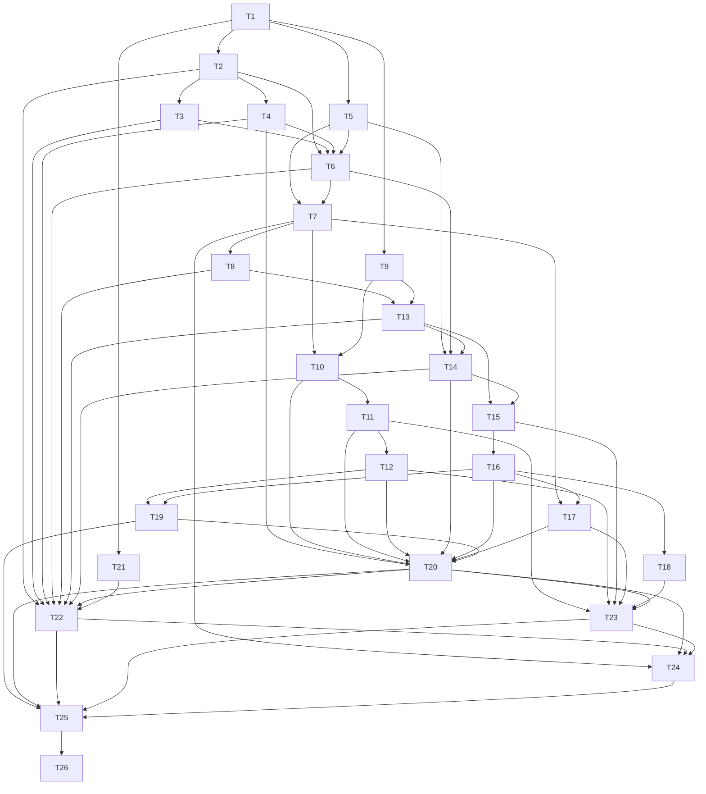

# D4 — Do my daily review: task-level breakdown

Status: draft for user review. Not frozen. Phase 3 artifact for `planning-protocol.md:61-135`.

## 0. Scope, boundary, and what this deliverable deliberately does not do

### Advertised outcome

The signature ritual, and the spine the rest of the product hangs from (`vertical-deliverables.md:103-131`). A trader opens today's review, or an exact earlier completed session, and sees the trades they must think about in a stable, attention-ranked order **with reasons rather than a score** (`daily-review.md:30-32`). The day's missing closing prices come first, so every position is valued honestly (`daily-review.md:21-28`). For the Trade in front of them the trader sees what they are risking to their stop and their incremental reward on current facts (`trade-analysis.md:71-83`). They hold with one tap plus one explicit Save; any Stop breach is recorded once per continuous episode (`trade-analysis.md:95`); and the review reports an honest completion state, including `CompleteWithUnavailableMarks` when an acknowledgment stands in for an exact Mark (`daily-review.md:146-156`).

The boundedness condition is a first-class part of this outcome and bites here harder than anywhere else in D1–D7: `overview.md:273` and `delivery-contract.md:122` forbid normal startup and Open selection from replaying every historical Trade or issuing one storage query per Trade. D4 satisfies that as **index membership plus a bounded batch plus an asserted query count** — never as a duration. No latency figure is stated anywhere in this file, and the performance acceptance scenario is owned by no deliverable; §8 discloses the gap.

### In scope

| Area | Public seam(s) this deliverable operates | Why it belongs to D4 |
|---|---|---|
| Manual observation writes | `MarketData.save` with the initial-Mark, valuation-override, correction-with-reason, acknowledgment-assert, and acknowledgment-withdraw intentions (`market-data.md:53-69`) | "Enter the day's missing closing prices first" is the trader's first act, and every later honesty claim depends on Manual precedence being real. |
| Expected evidence | Expected Mark Date from the versioned session calendar, and the three-way Expected-Mark Status with Stale context (`market-data.md:37,42-51`) | A prior completed session must read as normal Available evidence, not Stale (`AC-MARK-001`). |
| Snapshot-bound frames | `MarketData.query` `ResolveFrames` returning an opaque `MarketDataSnapshotId` plus evidence digest, and the `ExpectedSnapshot` transaction-time check (`market-data.md:86-96`) | Save must be able to refuse a stale binding with refreshed evidence (`AC-REV-005`). |
| Honest recovery | `MarketData.recover` with no provider installed: current Missing keys become Manual Mark tasks, with safe `NotConfigured` context and no fabricated domain `Unavailable` (`market-data.md:116-118,135`) | The review must be usable before any provider exists, and capability absence must not masquerade as missing data (`overview.md:19`). |
| Cutoff eligibility | `TradeRecord.queryRecords` in `StateAtEconomicCutoff(Open)` mode with a bounded `AnalysisInput` batch (`trade-record.md:97-103`) | Eligibility is Open-at-cutoff under corrected facts, not current Open membership (`daily-review.md:19`). |
| Derivation and evaluation | `TradeAnalysis.derive`, `evaluate`, `replay` for exact observation requirements, valuation, risk to stop, incremental reward, coverage, and Stop-Discipline episodes (`trade-analysis.md:59-95`) | The review's numbers and its one Deviation category come from the pure module, never the UI (`overview.md:12,14`). |
| Review reads | `DailyReview.open` and `DailyReview.getTrade`: normative family order, attention bands, shared Mark resolution, bound view state, Hold preselection (`daily-review.md:21-70`) | This is the ritual itself. |
| Action Save | `DailyReview.save` `SaveTradeAction` with the five bindings, the `ReviewChanged`/`Conflict` mapping, Intent rules, and atomic Stop-Discipline reconciliation (`daily-review.md:78-125`, `planning-decisions-2026-10-10.md:104-129`) | "One tap plus one explicit Save" and "recorded once per episode" are the two hardest correctness claims in D4. |
| Completion | Derived `Complete`, `CompleteWithUnavailableMarks`, `Incomplete` (`daily-review.md:146-156`) | Completion is the trader's trust signal, and it is derived, never stored. |
| Seed growth | Daily Trade Review Entry Type and Daily Review Source (`journal.md:35,81-89,194`) | The Action has no Entry Type to be saved under without it. |
| Presentation | Review overview, task families, Trade walk, Manual Mark entry, Action form, responsive and accessible surfaces (`ui-contract.md:26-36,70-99,123-125`) | Every capability must be reachable and operable through the production UI (`planning-protocol.md:214`). |
| Integration and gate | Mock-free integration suite through the real stack, then the independent browser-critic gate (`planning-protocol.md:115-135`) | A deliverable is not complete without a passing fresh-critic report. |

### Explicitly out of scope, and why it is safe

| Not in D4 | Where it lands | Why D4 is safe without it |
|---|---|---|
| Answering or declining Debt, and in-review journal writing | D5 | `getDebt` is a service D4 reads for ordering and completion; D4 reports due Debt as a blocker and never settles it. `daily-review.md:72-76,125` describes the whole answer/decline path, which D5 owns. |
| Settlement Due *resolution* | D10 | `daily-review.md:127-143` says only Trade Workflows may record Expiration, Assignment, Exercise, or cash settlement. D4 must report the blocker and stay incomplete; presenting it and routing it is enough. |
| The other three Deviation categories | D11/D12 | `trade-analysis.md:111` fixes exactly four categories and `vertical-deliverables.md:129-131` records that D4 introduces Stop Discipline only, so no Planned-Leg Terms, Entry Size, or Unplanned Exposure reconciliation exists here. |
| Provider recovery | D8 | `market-data.md:135` makes provider integration optional and requires honest `NotConfigured` with Manual tasks. D8 installs an adapter and nothing in D4 changes shape when it arrives. |
| Reports | D19 | `daily-review.md:5` says Daily Review owns no report. |
| Multi-leg and non-stock structures | D11/D12 | D4 exercises single-Instrument exposure; `AC-CALC-002` is Partial for exactly this reason (see §5). |
| Correction and Rebuild workflows | D15/D16 | D4 consumes corrected facts and restates eligibility from them; it never authors a correction (`daily-review.md:19`). |
| Backup and Restore | D7/D20/D21 | D4's stores are included in the workspace export/restore sections, but D4 adds no backup surface. |
| Installation and update UX | D22 | `planning-decisions-2026-10-10.md:240-269` keeps installation and update presentation out of the foundation releases. |

### What this deliverable deliberately does not demonstrate

- **Multi-leg structures.** No spread, condor, or multi-Instrument risk/reward. Single-Instrument exposure only.
- **Any provider-backed Mark.** With no adapter installed, every Mark in D4 is Manual or absent, and `recover` returns `NotConfigured` context. The provider-refresh precedence path (`market-data.md:63,120`) is exercised for its Manual-sticky half only; the provider half is D8's.
- **`Complete` for a date whose required Mark has only an acknowledgment.** That date is `CompleteWithUnavailableMarks`, always (`daily-review.md:152`).
- **The reversal clause as an operated flow.** `daily-review.md:156` allows Voiding an Action or correcting facts to make a previously complete date incomplete again; D4 derives completion from facts, so the derivation is already correct, but Voiding an Action is not installed until D17 and the correction workflow is D15/D16. `AC-REV-006` is Partial here for that reason.
- **Any performance measurement.** No latency figure, no benchmark, no performance-scenario claim. Boundedness is demonstrated structurally: cutoff index membership (T1, T9), a bounded `AnalysisInput` batch (T9), and an asserted storage query count on the ordinary path (T9, T25).

## 1. Decisions this breakdown introduces (needing alignment)

These are the choices a reader could reasonably make differently. Each names the evidence it rests on and the tasks it constrains. Where a decision is a branch-local reading of an under-specified sentence, §8 says so.

**1. `ReviewChanged` versus `Conflict` follows decision PD2 exactly.** `ReviewChanged` is review-scope — the assembled Review view lost coherence — and `Conflict` is subject-scope — a binding supplied with this one command no longer matches (`planning-decisions-2026-10-10.md:104-113`). Every stale binding is reported rather than the first (`:117-119`); review-scope dominates the result name when both scopes are stale (`:120-121`); there is no third result name and the Market-evidence path returns `Conflict` carrying refreshed frames and the new `MarketDataSnapshotId` (`:122-123`); `ResolveReviewDebt` follows the same mapping (`:124-125`). Validation is a separate `Rejected` category and `NeedsTradeWorkflow` stays orthogonal (`:126-129`). This constrains T17's result union and T23's conflict presentation. **Alignment point:** the base sentence is under-specified (`daily-review.md:110` names two results for five trigger kinds, and the diagram at `:112-121` shows a third unnamed outcome), so D2 is a reading, not a quotation. §8 reports it as such.

**2. Attention bands return reasons and inputs, never a stored severity or discipline score.** The five bands are factual/management blocker, boundary reached, evidence limited, quantified pressure, then routine (`daily-review.md:30`). The spec's ordering rule inside a band is pressure descending, then Last Activity descending, then stable Trade identity (`daily-review.md:32`); decision PD14 replaces the first term with boundary proximity, as the alignment point below explains. Comparability is the spec's: monetary Ongoing Risk to Stop when it is a Value, otherwise evaluable Worst-Case Ongoing Risk; Incremental Reward to Target when it is a Value, otherwise evaluable Maximum Incremental Reward; positive or Unbounded risk with zero or nonpositive reward ranks Highest, finite risk against Unbounded reward ranks Zero, and missing inputs are Not Comparable (`daily-review.md:32`). This constrains T13 and T14 (banding and ordering) and T22 (rendering). **Alignment point, settled by decision PD14.** The spec fixes the band *order*, the task-family order and the comparison *rules*, but not what separates band 4 from band 5. This breakdown places a comparable Trade in band 4 when its distance to either selected monetary boundary is at most `nearBoundaryFraction` (default 0.25) of the `Target − Stop` span, and in band 5 when it sits in the middle of that span; the fraction is a named, disclosed input and is never stored as a per-Trade score, a severity, or a band. Ordering inside a band is by distance to the nearest boundary ascending, then Last Activity descending, then stable identity. That ordering **deviates from `daily-review.md:32`'s "comparable pressure sorts descending"**: risk to Stop plus reward to Target is a constant span, so the frozen sentence orders nearest-Target-first and buries a Trade that is approaching its Stop. The band list, the task-family order, the comparability rule, the Highest and Zero clamps, and boundary-reached retention are unchanged. The deviation is branch-local and disclosed in §8 item 2.

**3. Hold is preselected only in returned unsaved view state; selection alone is not evidence.** `daily-review.md:70` and `journal.md:89` both say preselection lives in returned view state, and `journal.md:239` adds that selection alone is not evidence. This constrains T15 (the view state and the fact that `getTrade` writes nothing) and T23 (rendering and the one visible Save). **Alignment point:** a critic may see Hold already selected and conclude a Hold was recorded. §4 lists this as an intentional non-defect.

**4. The cutoff-eligibility index and its membership rule.** The index answers "which Trades were Open at this exact completed-session cutoff under corrected facts" (`daily-review.md:19`, `trade-record.md:101`). Membership is expressed as recorded half-open Lifecycle intervals per Trade, keyed by effective economic time and bound to the `FactRevision` that produced them: a Review cutoff equal to `effectiveFrom` is a member, a cutoff equal to `effectiveTo` is not. The query is one indexed range selection followed by one bounded `AnalysisInput` batch read, and T9 asserts that query count rather than any duration. This constrains T1 (index shape), T9 (query), and T25 (query-count assertion). **Alignment point:** `trade-record.md:103` requires a complete bounded `AnalysisInput` batch and forbids one child/Trade load per result, but does not name an index key. The half-open interval form is this breakdown's choice; it is disclosed in §8 as an implementation-shaping decision that a migration would be expensive to reverse.

**5. `recover` returns honest `NotConfigured` context while no provider is installed, and current-date Missing keys become Manual Mark tasks.** `market-data.md:135` forbids reporting the domain as unavailable merely because a capability was never delivered, and `market-data.md:118` makes current-date Missing keys Manual-resolution tasks while historical gaps stay visible and nonblocking. This constrains T8 and T22. **Alignment point:** `NotConfigured` is diagnostics, not a resolution value. The Expected-Mark Status vocabulary stays exactly Available, Missing, AcknowledgedUnavailable (`market-data.md:37`).

**6. The Daily Trade Review obligation key includes Trade and Review Date, so a retry edits the same Entry under expected revision instead of duplicating it.** `journal.md:135` fixes the key and `daily-review.md:123` fixes the retry semantics; the Action's moment time is the Review cutoff while authored time is the actual Save time (`daily-review.md:84`). This constrains T16 and T19. **Alignment point:** "one Entry per (Trade, Review Date)" is also what makes the one-tap Hold path idempotent under a double-submit; T16 tests it directly rather than leaving it to the UI.

Decisions this breakdown does **not** introduce: no new `DailyReview` operation (`daily-review.md:8-15` fixes four), no stored Review Session, stage, progress, or completion flag, no new Deviation category, and no change to any frozen product semantics.

## 2. Task graph

This breakdown declares **26 tasks in 16 dependency layers**. A task's layer is one below its deepest prerequisite, so the longest prerequisite chain spans 16 tasks. §3 groups the same tasks into nine implementation phases for readability; those phases are a presentation grouping and are deliberately **not** a topological layering, so a phase can contain a task that another task in the same phase depends on. Cross-deliverable prerequisites are listed separately below and are not drawn in the diagram.

### Declared blocking edges

Each row repeats the declaration in the task body. Read the second column as "this task requires the tasks in the first column"; the diagram draws the same relation with the prerequisite at the tail and the dependent task at the head of the arrow.

| Prerequisite(s) | Task | Type | Consumed by |
|---|---|---|---|
| D1:T9, D1:T10, D2:T1, D3:T1 | T1 D4 durable schema and migration: observation stores, cutoff index, review definitions | S | T2, T5, T9, T21 |
| T1 | T2 `MarketData.save`: initial and overriding Manual Mark | B | T3, T4, T6, T22 |
| T2 | T3 `MarketData.save`: valuation override versus correction-with-reason classification | B | T6, T22 |
| T2 | T4 `MarketData.save`: assert and withdraw an unavailable acknowledgment | B | T6, T20, T22 |
| T1, D1:T5 | T5 Expected Mark Date from the versioned session calendar | B | T6, T7, T14 |
| T2, T3, T4, T5 | T6 Expected-Mark Status resolution and Stale context | B | T7, T14, T22 |
| T5, T6 | T7 `MarketData.query` `ResolveFrames` with `MarketDataSnapshotId` and `ExpectedSnapshot` | B | T8, T10, T17, T24 |
| T7, D1:T7 | T8 `MarketData.recover` with no provider: `NotConfigured` and Manual tasks | B | T13, T22 |
| T1, D1:T15 | T9 `StateAtEconomicCutoff(Open)`: cutoff index membership and bounded `AnalysisInput` batch | B | T10, T13 |
| T7, T9 | T10 `derive`: exact observation requirements and derivation under corrected facts | B | T11, T20 |
| T10 | T11 `evaluate`: valuation, Ongoing Risk to Stop, Incremental Reward, coverage | B | T12, T20, T23 |
| T11 | T12 `replay`: Stop-Discipline episodes and stable fingerprints | B | T19, T20, T23 |
| T8, T9 | T13 `DailyReview.open`: the normative task-family order and attention bands | B | T14, T15, T22 |
| T5, T6, T13 | T14 `DailyReview.open`: shared Mark resolution and the stable attention-ranked Trade walk | B | T15, T20, T22 |
| T13, T14 | T15 `DailyReview.getTrade`: bound view state and Hold preselection | B | T16, T23 |
| T15 | T16 `DailyReview.save` `SaveTradeAction` with the five required bindings | B | T17, T18, T19, T20 |
| T7, T16 | T17 `DailyReview.save`: `ReviewChanged` and `Conflict` with refreshed evidence | B | T20, T23 |
| T16 | T18 `DailyReview.save`: Intent required for Exit/Roll/Adjust and never executing a trade | B | T23 |
| T12, T16 | T19 Atomic Stop-Discipline reconciliation | B | T20, T25 |
| T4, T10, T11, T12, T14, T16, T17, T19 | T20 Completion derivation: `Complete`, `CompleteWithUnavailableMarks`, `Incomplete` | B | T22, T23, T24, T25 |
| T1 | T21 Manifest v4 seed: Daily Trade Review Entry Type and Daily Review Source | B | T22 |
| T2, T3, T4, T6, T8, T13, T14, T20, T21 | T22 Review overview and task-family presentation | B | T24, T25 |
| T11, T12, T15, T17, T18, T20 | T23 Trade walk, Manual Mark entry, and Action form presentation | B | T24, T25 |
| T7, T20, T22, T23 | T24 Responsive layout and accessibility for D4's surfaces | B | T25 |
| T19, T20, T22, T23, T24, D1:T3, D1:T11 | T25 Mock-free integration suite for D4 | B | T26 |
| T25 | T26 Independent browser-critic gate for D4 | S | none (cross-deliverable only). |

Nine cross-deliverable edges are declared in task bodies and deliberately **not** drawn. The diagram validator reads only local endpoints, and the cross-deliverable ids are resolved against the sibling breakdowns when the whole set is validated together.

| Cross-deliverable edge | What D4 consumes from it | Why D4 can rely on it |
|---|---|---|
| D1:T9 | The IndexedDB schema, object stores, and schema-version baseline, including the authoritative `lifecycleIndex` store D4 extends | D4's observation stores and cutoff index are further stores on that baseline, and `overview.md:133` makes lifecycle index membership an authoritative, atomically maintained fact. |
| D1:T10 | The migration runner with isolated candidate stores and the atomic pointer flip | `planning-protocol.md:77` requires migration treatment for every durable schema change, and D1 owns the runner D4's migration steps through. |
| D2:T1 | D2's durable schema and migration step | D4's migration must not invalidate the persisted Plan shape D2 already wrote. |
| D3:T1 | D3's durable schema and migration step | A review at an exact earlier date reads the Position Change facts and Debt D3 already wrote. |
| D1:T5 | The versioned U.S. session calendar and its session-policy revision (`planning-decisions-2026-10-10.md:168`) | Expected Mark Date is the latest completed regular session, derived from the calendar and the injected Clock, never from the host clock (`market-data.md:51`). |
| D1:T7 | The browser-host capability port and its typed capability-absence convention (`NotExposed` rather than a thrown error) | `recover` must report a capability that was never delivered as an honest typed outcome inside a Ready view, not as an error state (`market-data.md:135`, `overview.md:19`). D1's file does not name a Pricing Provider port, although D8 installs the adapter; §8 item 11 records that mismatch. |
| D1:T15 | Lifecycle index membership and bounded cutoff queries | T9 extends exactly that read path for corrected historical eligibility and adds the bounded `AnalysisInput` batch; it does not invent a second query surface (`trade-record.md:101-103`). |
| D1:T3 | The unit and integration test harness, including the disclosed-substitution registry for `fake-indexeddb` | `planning-protocol.md:115-122` requires mock-free integration through the real stack with every replacement disclosed. |
| D1:T11 | The atomic multi-store transaction seam, including the counted storage and transaction requests | T25's atomic-commit, rollback, and query-count assertions are all observed through that seam (`overview.md:127`). |



### Verifying the graph itself

`scripts/check-deliverable-breakdown.mjs` parses the `**Blocking edges:**` line of every task in §3 and the mermaid block above, then compares the two as **transitive reductions** rather than raw edge sets, because a task may legitimately declare a direct prerequisite that the diagram already implies through a chain. Agreement therefore means the two representations impose the same order, not that they contain the same number of lines. The same script checks that every task header declares a type, that every edge endpoint is a declared task, that neither graph contains a cycle, that every task appears in the diagram, and that every `S` task body states an exact verification.

Because the parser reads everything after the first mermaid fence up to the next top-level heading, no arrow token may appear anywhere else in this file. None does: every arrow in the prose of this document is written as `→`, `to`, or `then`.

Cross-deliverable edges resolve against the sibling files in `plan/deliverable-breakdowns/`; a bare `T<n>` that is not a task in this file would be a failure, which is why every cross-deliverable citation here is written `D<n>:T<m>`.

## 3. Task detail

Task bodies are ordered by the nine phase groups of §2. Each body starts with the two declarations the task-graph validator reads: `**Blocking edges:**` (its prerequisites) and `**Consumed by:**` (tasks that list it as a prerequisite). Behaviour-bearing tasks then give their TDD cases, the mock-free integration case they contribute, and per-case red/green evidence. Structural tasks give exact verification instead (`planning-protocol.md:113`).

Command form. Tests are Vitest under `pnpm exec vitest run <file> -t "<case>"`; browser verification is Playwright under `pnpm exec playwright test <spec> --project=narrow|wide`. The stack is fixed by decision PD3 (`planning-decisions-2026-10-10.md:150-171`): TypeScript strict, Vite, React, IndexedDB behind the Persistence/Transaction seam, decimal.js for Money/Price/Quantity, an injected Clock plus a versioned U.S. session calendar, Vitest with `fake-indexeddb` for Node tests, Playwright for browser tests. **Exact versions and the package-manager pin are deliberately not invented here** — decision PD3 defers them to the Phase 6 version profile (`planning-decisions-2026-10-10.md:152-153`), and §8 discloses that. Test file paths below are the plan's proposed module-to-path mapping; if D1's breakdown fixes a different directory name, the mapping is mechanical and the commands are otherwise unchanged. Every command in this file is written for the pinned profile once it exists; none of them invents a tool the stack decision has not already fixed.

### Phase P1 — durable schema and the cutoff index

#### T1 — `S` D4 durable schema and migration: observation stores, cutoff index, review definitions

- **Blocking edges:** D1:T9, D1:T10, D2:T1, D3:T1.
- **Consumed by:** T2, T5, T9, T21.

This task extends D1's IndexedDB schema with the durable shapes D4 needs and proves the migration is compatible with what D2 and D3 already persisted. It adds three things on top of D1:T9's store baseline. First, the observation-chain shape inside D1's `marketData` store: one chain per `ObservationKey` for Mark revisions, Daily Bar revisions, and acknowledgment revisions, each holding immutable versions, an effective head, and the source/classification fields `market-data.md:26-40,53-69` requires. Second, the cutoff-eligibility index over recorded Lifecycle intervals, added to the authoritative `lifecycleIndex` store D1:T9 declared, which is the index `trade-record.md:101-103` names as the `StateAtEconomicCutoff` read path. Third, the D4 definition rows for the Daily Trade Review Entry Type and the Daily Review Source that T21 seeds (`journal.md:35,81-89,194`).

The cutoff index is the boundedness mechanism, so its shape is load-bearing and is restated as decision 4 of §1. Each entry is `(TradeId, effectiveFrom, effectiveTo, storedLifecycle, FactRevision)`, half-open on the right: a Review cutoff exactly equal to `effectiveFrom` is a member and a cutoff exactly equal to `effectiveTo` is not. Membership is not *current* State — correcting a past fact rewrites the interval and therefore restates membership for earlier cutoffs (`daily-review.md:19`). The index changes in the same transaction as the facts that justify it (`trade-record.md:155`) and a rebuild from facts must reproduce it exactly (`overview.md:133`).

This task writes no trader-visible behaviour. It is schema, migration, and the migration's verification.

**Exact verification**

| # | Command | Expected result |
|---|---|---|
| V1.1 | `pnpm exec vitest run src/persistence/schema/d4-schema.test.ts` | Creating the database from empty produces the per-key Mark, Daily Bar, and acknowledgment revision chains inside the `marketData` store plus the cutoff-eligibility index on `lifecycleIndex`, with exactly the store names, key paths, and index keys the schema module declares; the test fails before the D4 schema exists. |
| V1.2 | `pnpm exec vitest run src/persistence/migration/d4-migration.test.ts` | Migrating a database at D3's persisted version preserves every existing record, adds the D4 stores empty, and a second migration run at the new version is a no-op that rewrites nothing. |
| V1.3 | `pnpm exec vitest run src/persistence/indexes/cutoff-index.test.ts` | The cutoff index returns exactly the Trades whose recorded `Open` interval covers the cutoff, including the boundary pair: a cutoff equal to `effectiveFrom` is a member and a cutoff equal to `effectiveTo` is not. |
| V1.4 | `pnpm exec vitest run src/market-data/storage/observation-stores.test.ts` | One key holds independent Mark, Bar, and acknowledgment chains inside the `marketData` store; appending a revision leaves earlier revisions readable and moves only that chain's effective head; an exact Mark and an acknowledgment coexist with effective Mark status Available (`market-data.md:42-47`). |
| V1.5 | `pnpm exec vitest run src/persistence/indexes/cutoff-index.rebuild.test.ts` | Rebuilding the cutoff index from persisted facts reproduces it exactly for a fixed set of cutoffs, which is the invalidation/rebuild obligation of `overview.md:133`. |
| V1.6 | `pnpm exec vite build --mode production` | The production bundle builds with the migration registered on the runtime open path; the build fails if the migration is not registered, so an offline release cannot ship a schema the application cannot open. |

**Depends on it:** every durable D4 seam — the Manual Mark, classification, and acknowledgment writes (T2, T3, T4), Expected Mark Date/Status and frames (T5, T6, T7), the cutoff-eligible `AnalysisInput` batch (T9), and the seed (T21) — has no store or index to read or write without it. The migration also protects D2's and D3's persisted data, which the trader already relies on.

### Phase P2 — Manual Mark intents, Expected Mark Date, and Expected-Mark Status

#### T2 — `B` `MarketData.save`: initial and overriding Manual Mark

- **Blocking edges:** T1.
- **Consumed by:** T3, T4, T6, T22.

`save` accepts exactly five intentions (`market-data.md:55-61`). This task implements the first two — record an initial Manual Mark, and record a deliberate Manual valuation override — at the `MarketData.save` public seam. Every write uses the current resolution revision and appends immutable history; a Manual Mark becomes effective, and once effective evidence is Manual, later provider closes neither replace it nor become hidden Mark revisions, although independently useful Daily Bars may still refresh (`market-data.md:63`). An accepted `MarketDataSaveResult` returns the complete effective resolution for every directly changed key, its new revision, the saved-intention/audit classification, and the exact accepted command binding, so the caller does not query the saved key merely to discover the observation it just recorded (`market-data.md:67`).

The task does not decide the classification rules (T3) and does not touch acknowledgments (T4). Provider-refresh behaviour is exercised only for the Manual-sticky half, because no provider exists in D4.

**Unit test cases**

```text
describe("MarketData.save at the observation-store seam: initial and overriding Manual Marks")
  it should return Available with the new resolution revision and the initial-Manual-Mark classification when a Manual Mark is recorded for a key with no prior observation
  it should return Available at the new Manual revision and keep the previous provider revision readable in history when a Manual Mark overrides a provider-sourced Mark
  it should return a typed no-write rejection and leave the revision chain unchanged when the command's expected resolution revision is stale
  it should keep the effective resolution on the Manual revision and append no hidden Mark revision when a provider close for the same key arrives after the Manual Mark, while a valid Daily Bar for that key may still refresh (market-data.md:63)
  it should return the effective resolution, revision, and classification of every directly changed key in one result when a command changes more than one key, so no follow-up query is needed
  it should keep save time and observation time distinct on the appended revision, with save time never replacing the observation's economic meaning (market-data.md:69)
```

**Integration case.** Invoke `MarketData.save` through the production Market Data coordinator against a real `fake-indexeddb` store, then close and reopen the database. The integration asserts the durable effective head and the appended revision chain for the changed key, plus the returned classification, and asserts that no Pricing Provider call was made. Disclosed substitution: `fake-indexeddb` for browser IndexedDB.

**Red/green evidence**

| Case | Red command and the reason it must fail | Green command and expected result |
|---|---|---|
| Initial Manual Mark | `pnpm exec vitest run src/market-data/save/manual-mark.test.ts -t "no prior observation"` — fails because `save` has no Manual intention, so no `MarketDataSaveResult` can carry Available | same command — passes with Available, revision 1, classification initial Manual Mark |
| Override a provider Mark | `pnpm exec vitest run src/market-data/save/manual-mark.test.ts -t "overrides a provider-sourced Mark"` — fails because the override intention is unimplemented and the provider revision is not retained | same command — passes with the Manual revision effective and the provider revision still readable |
| Stale expected revision | `pnpm exec vitest run src/market-data/save/manual-mark.test.ts -t "expected resolution revision is stale"` — fails because revision checking is absent, so the write silently succeeds | same command — passes with a typed no-write result and an unchanged chain |
| Manual is sticky | `pnpm exec vitest run src/market-data/save/manual-mark.test.ts -t "after the Manual Mark"` — fails because provider refresh logic does not consult Manual precedence | same command — passes with the Manual revision still effective and no hidden Mark revision appended |

**Depends on it:** T3 classifies the two writes this task makes, T4 asserts and withdraws acknowledgments against the same revision protocol, T6 resolves status from the chain, and T22 renders the Manual Mark form and its post-save resolution.

#### T3 — `B` `MarketData.save`: valuation override versus correction-with-reason classification

- **Blocking edges:** T2.
- **Consumed by:** T6, T22.

A deliberate valuation override and a correction of believed-wrong recorded evidence are distinct saved intentions (`market-data.md:65`). Only the correction automatically contributes Mark correction metadata and a Correction Footprint; choosing a Manual valuation over a provider observation is not automatically treated as an error in history (`market-data.md:65`). This task makes that distinction observable in the returned result and durable in the immutable chain, so a later reader can tell why a price changed without guessing. The correction intention carries a reason; a blank reason is a typed rejection, because `market-data.md:59` names "correct a believed-wrong Mark with a reason" as one intention.

**Unit test cases**

```text
describe("MarketData.save classification at the audit-history seam: override versus correction")
  it should classify a Manual valuation written over a provider observation as a deliberate valuation override and attach no Mark correction metadata when the result is returned
  it should classify a write as a correction and attach Mark correction metadata carrying the supplied reason when the trader corrects a believed-wrong recorded Mark
  it should return a typed no-write rejection when a correction is submitted with a blank reason, leaving the revision chain unchanged
  it should report the two intentions distinguishably in the returned result and in InspectObservations history even when both write the same price to the same key
  it should bind correction metadata to the corrected revision identity so a later ordinary Manual write does not inherit or erase it
  it should leave the provider-sourced revision readable and unmarked as an error when the override intention is chosen (market-data.md:65)
```

**Integration case.** Record a provider-sourced Mark through the production path, then correct it with a reason through `MarketData.save`, then read the chain back with `MarketData.query` in `InspectObservations` mode after reopening the store. The integration asserts both revisions are present with their classifications, that the effective head is the corrected revision, and that the correction metadata names the corrected revision and the reason. Disclosed substitution: `fake-indexeddb`.

**Red/green evidence**

| Case | Red command and the reason it must fail | Green command and expected result |
|---|---|---|
| Override carries no error mark | `pnpm exec vitest run src/market-data/save/classification.test.ts -t "deliberate valuation override"` — fails because classification is not part of the save result | same command — passes with the override classification and no correction metadata |
| Correction carries metadata | `pnpm exec vitest run src/market-data/save/classification.test.ts -t "correction"` — fails because no correction intention exists and no metadata is written | same command — passes with correction classification, reason, and footprint |
| Blank reason rejected | `pnpm exec vitest run src/market-data/save/classification.test.ts -t "blank reason"` — fails because the reason is not validated, so an unexplained correction is accepted | same command — passes with a typed rejection and an unchanged chain |
| Same price, different meaning | `pnpm exec vitest run src/market-data/save/classification.test.ts -t "same price"` — fails because classification does not exist to distinguish the two writes | same command — passes with two distinguishable classifications in history |

**Depends on it:** T6 resolves status without treating a correction as a resolution change, and T22 labels the two writes differently in the Mark history it presents, which is what stops an override from reading as a mistake.

#### T4 — `B` `MarketData.save`: assert and withdraw an unavailable acknowledgment

- **Blocking edges:** T2.
- **Consumed by:** T6, T20, T22.

An acknowledgment explains why exact evidence cannot be supplied (`market-data.md:40`). It may be asserted only for a key that has no exact Mark, and it may be visibly withdrawn (`market-data.md:60-61`); saving an acknowledgment when an exact Mark already exists is refused (`market-data.md:63`). A later exact Mark supersedes the acknowledgment for effective status only, and the acknowledgment history remains visible (`market-data.md:63`). An acknowledgment is never a price: it resolves evidence work but cannot make a calculation a Value (`daily-review.md:154`), and it is displayed as a trader acknowledgment rather than a valuation (`ui-contract.md:94`).

**Unit test cases**

```text
describe("MarketData.save at the acknowledgment seam: assert and withdraw unavailability")
  it should return AcknowledgedUnavailable with the new resolution revision and optional Stale context when an acknowledgment is asserted for a key with no exact Mark
  it should return a typed no-write rejection when an acknowledgment is asserted for a key that already has an exact Mark, leaving the chain unchanged (market-data.md:63)
  it should keep the status AcknowledgedUnavailable and every dependent calculation Unavailable with no price substituted when the acknowledgment is the only exact-date evidence
  it should change effective status to Available while keeping the acknowledgment readable in history when an exact Mark arrives after an asserted acknowledgment (market-data.md:63, acceptance-contract.md:282-287)
  it should return the key to Missing with optional Stale context and mark the withdrawal visibly in history when a mistaken acknowledgment is withdrawn
  it should leave effective status Available and append only a visible withdrawal when an acknowledgment is withdrawn after an exact Mark has superseded it
  it should reject both the assert and the withdraw with a typed no-write result when the supplied expected revision is stale
```

**Integration case.** Through the production Market Data path, assert unavailability for a key, read it back after reopening the store, then withdraw it and read it back again; finally record an exact Manual Mark and read the status once more. The integration asserts durable status transitions AcknowledgedUnavailable, then Missing, then Available, with the full acknowledgment history present throughout and no Mark written by the acknowledgment itself. Disclosed substitution: `fake-indexeddb`.

**Red/green evidence**

| Case | Red command and the reason it must fail | Green command and expected result |
|---|---|---|
| Assert on an empty key | `pnpm exec vitest run src/market-data/save/acknowledgment.test.ts -t "no exact Mark"` — fails because the assertion intention does not exist | same command — passes with AcknowledgedUnavailable and a new revision |
| Assert refused when a Mark exists | `pnpm exec vitest run src/market-data/save/acknowledgment.test.ts -t "already has an exact Mark"` — fails because the precedence guard is absent and the acknowledgment is accepted | same command — passes with a typed no-write rejection |
| Acknowledgment is not a price | `pnpm exec vitest run src/market-data/save/acknowledgment.test.ts -t "only exact-date evidence"` — fails because nothing resolves acknowledgment status yet | same command — passes with status AcknowledgedUnavailable and dependent results Unavailable |
| Withdrawal is visible | `pnpm exec vitest run src/market-data/save/acknowledgment.test.ts -t "withdrawn"` — fails because withdrawal has no representation | same command — passes with status Missing and the withdrawal visible in history |

**Depends on it:** T6 resolves the acknowledgment branch of Expected-Mark Status, T20 must produce `CompleteWithUnavailableMarks` from exactly this evidence, and T22 renders the acknowledgment as an acknowledgment rather than a price.

#### T5 — `B` Expected Mark Date from the versioned session calendar

- **Blocking edges:** T1, D1:T5.
- **Consumed by:** T6, T7, T14.

During an active session the latest completed regular session is the Expected Mark Date (`market-data.md:51`). This task derives that date from the versioned U.S. session calendar supplied by D1:T5 and the injected Clock, and records which session-policy revision produced it, because a frame is bound to the session-policy revision as well as to the selected evidence revisions (`market-data.md:94`). The calendar is data, not a library behavior: a scheduled holiday is a day with no completed session, and a half day is a completed session for its date. When the calendar holds no completed session for the requested interval, this task returns a typed no-context result rather than inventing a date.

**Unit test cases**

```text
describe("Expected Mark Date at the session-calendar seam")
  it should resolve the Expected Mark Date to Monday when the injected clock reads noon Tuesday after a normal Monday session (market-data.md:51, acceptance-contract.md:268-273)
  it should resolve to the most recent completed session and not to the current date when the clock reads before the current session's close
  it should skip a scheduled holiday and resolve to the prior completed session when the most recent calendar date has no completed session
  it should treat a half day as a completed session for its own date, so that date may be the Expected Mark Date
  it should return the session-policy revision alongside the date and fail the frame binding when a frame is built against a different session-policy revision (market-data.md:94)
  it should return a typed no-context result rather than a fabricated date when the calendar contains no completed session at or before the requested instant
  it should read the instant only through the injected Clock, so the same clock and calendar always produce the same Expected Mark Date for a fixed request
```

**Integration case.** Through the production Market Data coordinator, build a frame request for a fixed instant with a pinned calendar and assert the Expected Mark Date in the returned frame, then rebuild the same request with a calendar revision that removes that session and assert the resulting typed no-context behaviour. The integration asserts the session-policy revision travels with the frame and that no storage read of Trades occurred. Disclosed substitution: `fake-indexeddb`; the calendar itself is the versioned data D1 ships, not a substitute.

**Red/green evidence**

| Case | Red command and the reason it must fail | Green command and expected result |
|---|---|---|
| Tuesday after Monday | `pnpm exec vitest run src/market-data/expected/expected-mark-date.test.ts -t "noon Tuesday"` — fails because no Expected Mark Date resolution exists | same command — passes with Monday |
| Before the close | `pnpm exec vitest run src/market-data/expected/expected-mark-date.test.ts -t "before the current session"` — fails because the resolution does not consult session completion | same command — passes with the prior completed session |
| Holiday | `pnpm exec vitest run src/market-data/expected/expected-mark-date.test.ts -t "scheduled holiday"` — fails because the calendar's absence of a session is not consulted | same command — passes with the prior completed session |
| No completed session | `pnpm exec vitest run src/market-data/expected/expected-mark-date.test.ts -t "no completed session"` — fails because the resolver has no typed no-context result | same command — passes with a typed no-context result, no invented date |

**Depends on it:** T6 resolves `Available` versus `Stale` only relative to the Expected Mark Date, T7 binds frames to the session-policy revision this task supplies, and T14 aggregates observation requirements by earliest relevant condition date against the same calendar.

#### T6 — `B` Expected-Mark Status resolution and Stale context

- **Blocking edges:** T2, T3, T4, T5.
- **Consumed by:** T7, T14, T22.

Resolution precedence is exhaustive and four-step (`market-data.md:42-47`): an exact-date Mark is Available even if an acknowledgment remains in history; without a Mark, an asserted acknowledgment is AcknowledgedUnavailable; otherwise the Mark is Missing; and in the last two cases the closest earlier Mark may appear **only** as Stale context. Stale means older than the Expected Mark Date; it is disclosed context that never enters a calculation (`market-data.md:49`). Fill cost, a Bar close from another date, provider failure, zero, or a carried Mark never fills an exact-date slot (`market-data.md:49`). The status vocabulary is exactly `Available | Missing | AcknowledgedUnavailable` (`market-data.md:37`), and Daily Bar resolution is a separate two-way value, because a Bar supplies range evidence and never valuation (`market-data.md:40`).

This is the task that makes `AC-MARK-001` true: a prior completed session is normal evidence, not stale.

**Unit test cases**

```text
describe("Expected-Mark Status at the resolution seam")
  it should return Available from the exact-date Mark when an exact Mark exists and an acknowledgment also remains in history (market-data.md:44)
  it should return AcknowledgedUnavailable carrying optional Stale context when no Mark exists and an acknowledgment has been asserted (market-data.md:45)
  it should return Missing carrying optional Stale context when neither an exact Mark nor an acknowledgment exists (market-data.md:46)
  it should return Missing with the Friday Mark as Stale context when Monday is the Expected Mark Date and no Monday evidence exists, and should not mark the Monday evidence Stale nor surface Friday as Stale context when the Monday exact Mark exists (market-data.md:47, acceptance-contract.md:268-273)
  it should return Unavailable for every calculation that depends on the slot and leave unaffected results visible when the only evidence for that slot is Stale context
  it should never let an older Mark produce Complete or CompleteWithUnavailableMarks for a date, because the older Mark cannot satisfy the expected slot (daily-review.md:154)
  it should keep Mark resolution and Daily Bar resolution independent, so a Bar on the expected date returns DailyBarResolution Available while Mark resolution stays Missing
  it should never substitute fill cost, a Bar close from another date, a provider failure, zero, or a carried Mark into an exact-date slot (market-data.md:49)
```

**Integration case.** Through the production Market Data coordinator, write a Manual Mark for the prior completed session and a Bar for a different date, then resolve the status for the expected date and for a date with no evidence; assert the three-way status, the Stale context identity, and the separation from Bar resolution after reopening the store. The integration also asserts that the resolved frame carries the exact revisions it used. Disclosed substitution: `fake-indexeddb`.

**Red/green evidence**

| Case | Red command and the reason it must fail | Green command and expected result |
|---|---|---|
| Prior session is Available | `pnpm exec vitest run src/market-data/expected/expected-mark-status.test.ts -t "prior completed session"` — fails because no status resolution exists to return Available | same command — passes with Available and no Stale context |
| Stale context only | `pnpm exec vitest run src/market-data/expected/expected-mark-status.test.ts -t "Stale context"` — fails because older evidence is not gathered as context | same command — passes with Missing plus the older Mark as Stale context |
| Acknowledgment branch | `pnpm exec vitest run src/market-data/expected/expected-mark-status.test.ts -t "AcknowledgedUnavailable"` — fails because the acknowledgment is not considered | same command — passes with AcknowledgedUnavailable and optional Stale context |
| Older Mark cannot complete | `pnpm exec vitest run src/market-data/expected/expected-mark-status.test.ts -t "older Mark"` — fails because nothing distinguishes an expected slot from any available evidence | same command — passes; the slot stays unsatisfied for completion purposes |
| Bar is not valuation | `pnpm exec vitest run src/market-data/expected/expected-mark-status.test.ts -t "Daily Bar resolution"` — fails because Bar and Mark resolutions are not separated | same command — passes with Bar Available and Mark Missing |

**Depends on it:** T7 binds frames to the statuses and stale-context revisions this task resolves, T14 attaches them to Trades in the walk, and T22 renders Missing, Stale, AcknowledgedUnavailable, and Unavailable as four distinct things (`ui-contract.md:56,94`).

### Phase P3 — frames, honest recovery, and cutoff eligibility

#### T7 — `B` `MarketData.query` `ResolveFrames` with `MarketDataSnapshotId` and `ExpectedSnapshot`

- **Blocking edges:** T5, T6.
- **Consumed by:** T8, T10, T17, T24.

A frame is bound to the normalized request, the session-policy revision, the selected evidence revisions, the stale-context revisions, and material absences, through an opaque `MarketDataSnapshotId` plus an evidence digest (`market-data.md:94`). `ExpectedSnapshot` is the transaction-time check Daily Review uses: if material evidence is unchanged the query answers `SnapshotUnchanged`; if a Mark, Bar, acknowledgment, or absence changed, the query returns current frames rather than blessing a stale reconciliation (`market-data.md:94,105-112`). Ranges enumerate completed regular sessions and emit explicit gaps; they never interpolate, carry forward, connect across absence, or fabricate a candle from a close-only Mark, and Candidate Manual Mark frames are visibly hypothetical and never count as committed evidence (`market-data.md:96`).

This task is the evidence half of `AC-REV-005`. It knows nothing about Trades and does not decide what a caller should do with a changed snapshot.

**Unit test cases**

```text
describe("MarketData.query ResolveFrames at the snapshot-binding seam")
  it should return frames carrying an opaque MarketDataSnapshotId and an evidence digest when a normalized request is resolved for a point or a completed-session range
  it should return SnapshotUnchanged when the same normalized request is re-queried with its ExpectedSnapshot and no Mark, Bar, acknowledgment, or absence has changed
  it should return SnapshotChanged with current frames and a new MarketDataSnapshotId when the Mark for a requested key changed between the two queries
  it should return SnapshotChanged when an acknowledgment was asserted or withdrawn between the two queries, even though the Mark is unchanged
  it should return SnapshotChanged when the set of material absences the frame covers changed between the two queries, not only when an evidence revision changed
  it should emit an explicit gap for an interior missing completed session and never interpolate, carry a value forward, bridge the gap, or fabricate a candle from a close-only Mark (market-data.md:96)
  it should mark Candidate Manual Mark frames visibly hypothetical and exclude them from the committed evidence the digest covers
  it should change the MarketDataSnapshotId when the session-policy revision changed, because the frame is bound to it (market-data.md:94)
```

**Integration case.** Through the production Market Data coordinator and a real `fake-indexeddb` store, resolve a two-session range with an interior missing date, capture the `MarketDataSnapshotId`, then write a Manual Mark for the missing date and re-query with the captured `ExpectedSnapshot`. The integration asserts the first result's gap, the second result's `SnapshotChanged` carrying refreshed frames and a new id, and the durable revision chain behind both. Disclosed substitution: `fake-indexeddb`.

**Red/green evidence**

| Case | Red command and the reason it must fail | Green command and expected result |
|---|---|---|
| Stable re-query | `pnpm exec vitest run src/market-data/query/resolve-frames.test.ts -t "ExpectedSnapshot"` — fails because no snapshot identity exists to compare | same command — passes with SnapshotUnchanged |
| Mark change detected | `pnpm exec vitest run src/market-data/query/resolve-frames.test.ts -t "Mark for a requested key changed"` — fails because the digest does not cover selected revisions | same command — passes with SnapshotChanged and current frames |
| Acknowledgment change detected | `pnpm exec vitest run src/market-data/query/resolve-frames.test.ts -t "acknowledgment was asserted or withdrawn"` — fails because acknowledgment revisions are not digested | same command — passes with SnapshotChanged |
| Explicit gaps | `pnpm exec vitest run src/market-data/query/resolve-frames.test.ts -t "explicit gap"` — fails because ranges are not implemented and nothing marks absence | same command — passes with a gap and no interpolation |
| Candidate frames hypothetical | `pnpm exec vitest run src/market-data/query/resolve-frames.test.ts -t "hypothetical"` — fails because Candidate Manual Mark frames are not distinguished | same command — passes with the candidate frame excluded from committed evidence |

**Depends on it:** T8's recovery result must return the same snapshot-bound frames, T10's evaluation consumes one frame for all its Trades, T17's `Conflict` must carry the refreshed frames and the new `MarketDataSnapshotId`, and T24 renders gap-versus-point distinction for any D4 evidence graphic.

#### T8 — `B` `MarketData.recover` with no provider: `NotConfigured` and Manual tasks

- **Blocking edges:** T7, D1:T7.
- **Consumed by:** T13, T22.

Provider integration is optional. With none installed or configured, recovery returns Missing tasks and safe `NotConfigured` context; it does not report the domain as unavailable merely because a capability was never delivered (`market-data.md:135`). Current-date Missing keys become Manual-resolution tasks while historical gaps remain visible and nonblocking (`market-data.md:118`). Unsupported Instruments, failures, and partial responses are transient diagnostics only; they create no Mark, acknowledgment, provider-performance fact, or Journal evidence (`market-data.md:118`). The result contains the normalized snapshot-bound frames and `MarketDataSnapshotId`, current resolutions, gaps, and diagnostics whether or not evidence was added, so the caller does not issue a second query to learn the recovery outcome (`market-data.md:116`).

Because D4 installs no adapter, this task is the whole of recovery in this deliverable. The honest absence is a capability statement, not a data-quality statement (`overview.md:19`).

**Unit test cases**

```text
describe("MarketData.recover at the no-provider seam")
  it should return NotConfigured diagnostics alongside the current resolutions and snapshot-bound frames when recovery runs with no provider installed (market-data.md:135)
  it should list every current-date Missing key as a Manual Mark task while leaving historical gaps visible and nonblocking (market-data.md:118)
  it should keep the Expected-Mark Status vocabulary unchanged, so an unconfigured provider yields Missing and not a fabricated domain Unavailable (market-data.md:37)
  it should write nothing to the Mark, Daily Bar, acknowledgment, or Journal stores when no provider is installed
  it should express the absence as a safe diagnostic that a UI can present as "enter this closing price", never as an error state that hides the review
  it should include the MarketDataSnapshotId, current resolutions, gaps, and diagnostics in its single result so the caller issues no second query to learn the outcome (market-data.md:116)
  it should keep AcknowledgedUnavailable keys eligible for later factual recovery without creating or changing any acknowledgment itself
```

**Integration case.** Through the production Market Data coordinator, run `recover` for a review date with an installed-but-disabled configuration and with no provider at all, against a real `fake-indexeddb` store holding one acknowledged key and two empty current-date keys. The integration asserts the same resolutions in both runs, a `NotConfigured` diagnostic in both, two Manual Mark tasks, the acknowledged key still recoverable, and byte-identical store contents before and after. Disclosed substitution: `fake-indexeddb`.

**Red/green evidence**

| Case | Red command and the reason it must fail | Green command and expected result |
|---|---|---|
| Honest NotConfigured | `pnpm exec vitest run src/market-data/recovery/recover-no-provider.test.ts -t "no provider installed"` — fails because recovery is unimplemented and there is no result to carry diagnostics | same command — passes with NotConfigured context plus current resolutions |
| Manual tasks for current Missing | `pnpm exec vitest run src/market-data/recovery/recover-no-provider.test.ts -t "Manual Mark task"` — fails because Missing keys are not classified into tasks | same command — passes with one task per current-date Missing key |
| Historical gaps nonblocking | `pnpm exec vitest run src/market-data/recovery/recover-no-provider.test.ts -t "historical gaps"` — fails because gaps are not distinguished from current tasks | same command — passes with the historical gap visible and excluded from the current task list |
| Nothing written | `pnpm exec vitest run src/market-data/recovery/recover-no-provider.test.ts -t "write nothing"` — fails because the store comparison has nothing to compare until recovery exists | same command — passes with identical store contents and no Journal entry |

**Depends on it:** T13 places the Manual Mark family first in the normative task order, and T22 presents `NotConfigured` as an honest, safe condition with actionable Manual tasks rather than a broken view.

#### T9 — `B` `StateAtEconomicCutoff(Open)`: cutoff index membership and bounded `AnalysisInput` batch

- **Blocking edges:** T1, D1:T15.
- **Consumed by:** T10, T13.

This is where the boundedness condition of `overview.md:273` and `delivery-contract.md:122` is made real. `queryRecords` in `StateAtEconomicCutoff` mode answers "which Trades were Open at this exact completed-session cutoff under corrected facts" (`trade-record.md:101`), and `AnalysisInput` must be returned as a complete bounded batch so Open lists and Review do not issue one child/Trade load per result (`trade-record.md:103`).

**Membership rule.** A Trade is a member of the cutoff-eligible set when its recorded Lifecycle intervals — as written by the facts, with corrections applied at their original Economic Time — contain an interval of stored `Open` that covers the cutoff. The interval is half-open on the right: `effectiveFrom` is inclusive, `effectiveTo` is exclusive. The authoritative index is keyed on `(storedLifecycle, effectiveFrom)` and carries `effectiveTo` plus the `FactRevision` that produced the interval. A cutoff query is therefore one bounded range selection from that index followed by one bounded batch read of `AnalysisInput` for the selected membership. It never scans the fact store to decide membership, never replays a Trade's whole history, and never issues a read per returned Trade.

**Declared bound.** On the ordinary path one page of cutoff-eligible results costs exactly **two storage reads**: one index range selection and one bounded batch read. The number of index entries examined is bounded by the number of Trades that were ever recorded `Open` at or before the cutoff; it is never bounded by the number of position-changing facts, and it does not grow with the page size. This is stated as a **query count**, not a duration. Working scale for the assertion is the plan's target population (25,000 Trades, about 200,000 position-changing facts) — the same population `overview.md:268` names — but the test asserts counts at any size, not time.

**Unit test cases**

```text
describe("TradeRecord.queryRecords at the StateAtEconomicCutoff(Open) seam")
  it should return exactly the Trades whose recorded Open interval covers the cutoff, including a Trade that was Open at the cutoff and later Closed and excluding a Trade that is Open today but was not Open at the cutoff
  it should include a Trade when the cutoff equals its interval's effectiveFrom and exclude a Trade when the cutoff equals its interval's effectiveTo
  it should restate membership in both directions after a correction rewrites a past interval, without consulting any saved Review list, Review Session, or completion record
  it should return one complete bounded AnalysisInput page from a single query snapshot, so no follow-up getRecord call is issued for any returned Trade
  it should issue exactly two storage reads — one index range selection and one bounded batch read — for a page of results, asserted through the persistence seam's counted storage requests at both a one-result and a full-page page size
  it should examine a number of index entries bounded by the count of Trades ever recorded Open at or before the cutoff and issue zero fact-store reads to decide membership
  it should reject reuse of an opaque pagination cursor whose normalized query or query snapshot has changed, and return a typed no-write result instead of a mixed page
  it should combine bounded filters with AND across dimensions and OR within one dimension while still issuing the same two storage reads
```

**Integration case.** Through the production read coordinator against a real `fake-indexeddb` store seeded with D3's fact shapes plus one correction, open a review at an exact earlier cutoff, capture the returned `AnalysisInput` batch and the persistence seam's counted storage requests, apply a correction that changes that Trade's earlier state, and open the same cutoff again. The integration asserts the durable membership before and after, that the corrected Trade's membership changed, that no `getRecord` was issued per returned Trade, and that the ordinary-path counted storage requests equal exactly two. Disclosed substitution: `fake-indexeddb`; the real-engine counterpart is item 9 of the PD3 verification list.

**Red/green evidence**

| Case | Red command and the reason it must fail | Green command and expected result |
|---|---|---|
| Inside an interval | `pnpm exec vitest run src/trade-record/query/state-at-cutoff.test.ts -t "covers the cutoff"` — fails because cutoff mode is not implemented | same command — passes with exactly the covering Trades |
| Closed later, Open today | `pnpm exec vitest run src/trade-record/query/state-at-cutoff.test.ts -t "later Closed"` — fails because current membership is used instead of cutoff membership | same command — passes with the later-Closed Trade included and today's Open Trade excluded |
| Boundary pair | `pnpm exec vitest run src/trade-record/query/state-at-cutoff.test.ts -t "effectiveTo"` — fails because the interval comparison is absent | same command — passes with the left boundary inclusive and the right boundary exclusive |
| Correction restates membership | `pnpm exec vitest run src/trade-record/query/state-at-cutoff.test.ts -t "rewrites a past interval"` — fails because nothing rewrites index intervals from corrected facts | same command — passes with membership changed in both directions |
| Query count on the ordinary path | `pnpm exec vitest run src/trade-record/query/state-at-cutoff.test.ts -t "exactly two storage reads"` — fails because the batch read is absent, so one read per result is issued and the counter is not two | same command — passes with a read count of exactly two at both page sizes and zero fact-store reads |

**Depends on it:** T10 derives every returned Trade from one supplied batch, and T13 builds the eligible Trade walk from this set; if membership were current-state membership or the batch were per-Trade, `AC-REV-001` and the boundedness claim would both be false.

### Phase P4 — derivation, evaluation, and Stop-Discipline replay

#### T10 — `B` `derive`: exact observation requirements and derivation under corrected facts

- **Blocking edges:** T7, T9.
- **Consumed by:** T11, T20.

`derive` accepts one snapshot-consistent record and an explicit economic cutoff, uses only effective corrected facts at their original Economic Time ordered by Recorded Sequence for ties, and includes Execution, Assignment, Exercise, Expiration, and cash-settlement members without ever synthesizing settlement as a zero-price Execution (`trade-analysis.md:59-61`). It derives Positions, open Lots, FIFO Lot Matches, fee treatment, realized P&L, expected Lifecycle State, Terminal Disposition, Entry Resolution Point, actual-entry comparison, and fact-only Deviations, and it reports disagreements with stored lifecycle, recorded lot links, or recorded deviations as structured integrity findings rather than silently repairing them (`trade-analysis.md:63`). Its output carries the exact observation requirements that T14 aggregates and T7 resolves.

**Unit test cases**

```text
describe("TradeAnalysis.derive at the derivation seam")
  it should return the exact observation requirements aggregated per Instrument using the earliest relevant condition date when the record carries several conditions
  it should apply a corrected fact at its original Economic Time rather than at its save time and break a same-time tie by Recorded Sequence (trade-analysis.md:61)
  it should report a disagreement with stored Lifecycle State as a structured integrity finding and leave the supplied facts unmodified (trade-analysis.md:63, trade-record.md:157)
  it should report disagreements with recorded Lot Matches and recorded Deviation occurrences as structured findings rather than repairing either
  it should derive Terminal Disposition separately from stored lifecycle and from any Close Reason, and report it only when disposing facts are effective
  it should accept an explicit Assignment, Exercise, Expiration, or cash-settlement member as its own fact and never synthesize it as a zero-price Execution
  it should return Planned Leg fulfillment as one of the six documented values, including NotEntered for an untouched leg when a partially executed Trade ends and NotVerifiable when retained selection evidence is absent
  it should perform no storage read, clock read, or calendar read while deriving from the supplied record and cutoff (trade-analysis.md:7)
```

**Integration case.** Through the production coordinator, read a cutoff-eligible `AnalysisInput` batch from the real store, pass one record to `derive` at the Review cutoff, and assert the returned `DerivedTradeState` against the persisted facts, including one deliberately introduced stored-lifecycle disagreement and the resulting integrity finding with no repair written back. Disclosed substitution: `fake-indexeddb` for the record read.

**Red/green evidence**

| Case | Red command and the reason it must fail | Green command and expected result |
|---|---|---|
| Observation requirements | `pnpm exec vitest run src/trade-analysis/derive/derive.test.ts -t "earliest relevant condition date"` — fails because `derive` does not report requirements | same command — passes with one requirement per Instrument at the earliest relevant date |
| Original Economic Time | `pnpm exec vitest run src/trade-analysis/derive/derive.test.ts -t "original Economic Time"` — fails because facts are ordered by save time | same command — passes with corrected facts applied at their original time and ties by Recorded Sequence |
| Integrity finding | `pnpm exec vitest run src/trade-analysis/derive/derive.test.ts -t "structured integrity finding"` — fails because disagreement is not detected | same command — passes with the finding reported and stored state unchanged |
| Settlement is a fact | `pnpm exec vitest run src/trade-analysis/derive/derive.test.ts -t "zero-price Execution"` — fails because settlement members are unknown to the derivation | same command — passes with the settlement fact consumed as itself |

**Depends on it:** T11 evaluates the returned state against a resolved frame, and T20 asks for progress and completion from the same derived facts, so a wrong requirement set would make both wrong regardless of how good the evidence is.

#### T11 — `B` `evaluate`: valuation, Ongoing Risk to Stop, Incremental Reward, coverage

- **Blocking edges:** T10.
- **Consumed by:** T12, T20, T23.

`evaluate` accepts one `DerivedTradeState`, an exact observation frame, and any required historical condition evidence, and returns dated Mark-to-Market valuation with per-Instrument coverage; Ongoing Risk to each effective Stop, Worst-Case Ongoing Risk, Incremental Reward, and Plan-R conversions; per-condition Stop and Target status under independent OR semantics; Overrun when price or structure value has crossed a Stop without flattening the applicable Position; and Mark-dependent Deviation occurrences with the observation binding used (`trade-analysis.md:73-79`). Current calculations use only remaining open exposure, effective Management Revisions, and eligible
exact-date Marks; a stale observation is context, not valuation evidence (`trade-analysis.md:81`).
Conditions are evaluated as an ordered OR set under decision **PD9** rather than as one Stop and one
Target: every condition keeps its own status and basis, and the headline distance is the nearest
nonnegative monetary boundary and becomes zero once any Stop is crossed. D4 constructs no
`StructureValueCondition` — the kind is reserved in the type and not installed before D8 — so
`evaluate` returns a typed unsupported-condition result for one instead of computing an
underlying-price distance for it. Realized-to-date P&L, each remaining Instrument component, the remaining-open total, and Current Marked Trade P&L are independently returned, each carrying no fee: decision PD10 captures each Execution's actual fee as a fact and excludes it from every calculation, so `evaluate` returns no incurred-fee component and no fee-adjusted figure; a total is Unavailable if any required component lacks exact evidence while valid components and an explicitly labelled covered subtotal remain visible (`trade-analysis.md:83`, `overview.md:171`). Unavailable, Not Applicable, Value, and Unbounded stay distinct (`ui-contract.md:94`).

**Unit test cases**

```text
describe("TradeAnalysis.evaluate at the valuation and risk seam")
  it should return dated Mark-to-Market Valuation as a Value with per-Instrument coverage when every required slot has an exact-date Mark
  it should return the affected marked, risk, and reward results as Unavailable naming the exact Instrument and date while realized-to-date P&L remains a Value when one expected Mark is Missing (acceptance-contract.md:319-324)
  it should label a partial sum as a covered subtotal and never substitute fill cost, zero, or a Stale observation into it (overview.md:171)
  it should return Ongoing Risk to Stop from Monetary Ongoing Risk when it is a Value and from the evaluable Worst-Case Ongoing Risk otherwise, with the selected basis reported
  it should return an independent status and basis for every condition in an OR set of two underlying-price Stops and one Target, so that the farther Stop stays visible when the headline reports the nearer one
  it should return the headline risk as zero once any Stop in the set is crossed, while the uncrossed conditions remain visible with their own distances
  it should attribute Overrun to the specific crossed Stop condition and leave an uncrossed second Stop without an Overrun when two underlying-price Stops are OR alternatives and only one has been crossed
  it should return a typed unsupported-condition result naming the kind rather than an underlying-price distance when a StructureValueCondition reaches evaluate at D4, because that kind is reserved in the type and not installed before D8
  it should return Incremental Reward to Target with each underlying-price and structure-value condition keeping its own independent status
  it should return Overrun when price or structure value has crossed a Stop without flattening the applicable Position
  it should use only remaining open exposure, effective Management Revisions, and eligible exact-date Marks, so a retired condition does not contribute ongoing risk
  it should return each remaining Instrument component, the remaining-open total, and Current Marked Trade P&L independently, with a total Unavailable whenever one required component lacks exact evidence and a valid dollar result left visible when only its Plan-R conversion is unavailable
  it should return an identical marked P&L for two otherwise identical Trades whose Executions carry different recorded fees, because decision PD10 captures the fee fact and excludes it from every calculation
```

**Integration case.** Through the production path, derive one eligible Trade, resolve its frame with an exact Mark for one Instrument and a Missing expected slot for another, evaluate, and assert the result tree: realized-to-date Value, marked total Unavailable with the exact Instrument and date, the covered subtotal labelled, and no fill cost or zero anywhere in the marked figures. Disclosed substitution: `fake-indexeddb` for fact and observation reads.

**Red/green evidence**

| Case | Red command and the reason it must fail | Green command and expected result |
|---|---|---|
| Full-coverage valuation | `pnpm exec vitest run src/trade-analysis/evaluate/evaluate.test.ts -t "every required slot"` — fails because no valuation is produced | same command — passes with Value and per-Instrument coverage |
| Independent availability | `pnpm exec vitest run src/trade-analysis/evaluate/evaluate.test.ts -t "one expected Mark is Missing"` — fails because the evaluation does not distinguish components | same command — passes with realized Value, marked Unavailable naming Instrument and date, covered subtotal labelled |
| No substitution | `pnpm exec vitest run src/trade-analysis/evaluate/evaluate.test.ts -t "covered subtotal"` — fails because a missing component is silently treated as zero | same command — passes with no fill cost or zero in the covered subtotal |
| Risk basis selection | `pnpm exec vitest run src/trade-analysis/evaluate/evaluate.test.ts -t "Monetary Ongoing Risk"` — fails because no risk result exists | same command — passes with the monetary basis and the selected basis reported |
| Overrun | `pnpm exec vitest run src/trade-analysis/evaluate/evaluate.test.ts -t "crossed a Stop"` — fails because crossing is not detected | same command — passes with Overrun disclosed |

**Depends on it:** T12 replays the evaluated frames into Stop-Discipline episodes, T20 derives completion from coverage and availability, and T23 presents risk to stop and incremental reward with their availability states.

#### T12 — `B` `replay`: Stop-Discipline episodes and stable fingerprints

- **Blocking edges:** T11.
- **Consumed by:** T19, T20, T23.

Stop Discipline is derived as continuous episodes against the effective Stop revisions. An episode begins at the first exact observation demonstrating breach after activation or an observed unbreached state, and ends only with an exact unbreached observation or condition replacement/retirement; a preceding gap means "first observed", never a fabricated crossing date; stable episode fingerprints allow atomic create/retain/supersede/Void reconciliation without daily duplicates (`trade-analysis.md:95`). Stop Discipline is an occurrence/episode and not one duplicate fact per observed date
(`trade-analysis.md:112`). Episode fingerprints are keyed per Stop condition and not only per Trade,
because the effective condition set is plural under decision **PD9**: two OR alternative Stops can be
breached at once and must yield two concurrent episodes rather than one merged episode. `replay` accepts one corrected snapshot plus an ordered series of explicit Mark frames over a caller-specified lifetime, and it neither selects dates nor carries values through missing evidence (`trade-analysis.md:93`).

**Unit test cases**

```text
describe("TradeAnalysis.replay at the Stop-Discipline episode seam")
  it should return one episode with one stable fingerprint when exact observations demonstrate breach on consecutive marked dates
  it should begin the episode at the first observed exact breach and never at a fabricated crossing date when a gap precedes the first breaching observation
  it should end the episode at the first exact unbreached observation and not before
  it should return one episode per breached Stop condition with distinct fingerprints when two underlying-price Stops are OR alternatives and the same observation breaches both
  it should keep the second Stop's open episode open when one of two Stop conditions is replaced, rather than ending or superseding both
  it should return no episode for the unbreached Stop of an OR set while the other Stop's episode is open
  it should retain a single episode when an unmarked date falls between two breaching exact observations, because a gap neither ends nor restarts the episode
  it should supersede the existing episode and begin a new one when the effective Stop condition is replaced, rather than extending the old episode across the replacement
  it should return byte-identical fingerprints for two replays over the same frames and the same effective Stop revisions, so reconciliation can never create a daily duplicate
  it should keep a breaching observation of a retired condition out of the new condition's episode when management moved the stop
  it should return explicit gaps between points, never carry an observation through a missing date, and include the observation binding used by each episode so T19 can reconcile against the exact evidence that produced it
```

**Integration case.** Through the production path, replay one eligible Trade over a six-session frame series containing a gap, a three-session breach run, and a stop replacement, twice in a row. The integration asserts one fingerprint set across both runs, one episode per continuous breach, the supersede point, the gaps, and that no storage write occurred. Disclosed substitution: `fake-indexeddb` for fact and observation reads.

**Red/green evidence**

| Case | Red command and the reason it must fail | Green command and expected result |
|---|---|---|
| One continuous episode | `pnpm exec vitest run src/trade-analysis/replay/stop-discipline.test.ts -t "consecutive marked dates"` — fails because episode derivation does not exist | same command — passes with one episode and one fingerprint |
| Gap means first observed | `pnpm exec vitest run src/trade-analysis/replay/stop-discipline.test.ts -t "fabricated crossing date"` — fails because nothing tracks the first observation after a gap | same command — passes with the episode starting at the first observed breach |
| Gap does not end an episode | `pnpm exec vitest run src/trade-analysis/replay/stop-discipline.test.ts -t "unmarked date"` — fails because each observation is treated independently | same command — passes with a single retained episode |
| Replacement supersedes | `pnpm exec vitest run src/trade-analysis/replay/stop-discipline.test.ts -t "Stop condition is replaced"` — fails because effective Stop revisions are not consulted | same command — passes with a superseded episode and a new one |
| Fingerprint stability | `pnpm exec vitest run src/trade-analysis/replay/stop-discipline.test.ts -t "byte-identical fingerprints"` — fails because fingerprints are not stable across runs | same command — passes with identical sets across both replays |

**Depends on it:** T19 reconciles recorded occurrences against exactly these fingerprints, T20 treats an unreconciled deterministic occurrence as an incomplete obligation, and T23 shows the Stop breach the trader must act on.

### Phase P5 — the review read: normative order, shared evidence, and the bound view

#### T13 — `B` `DailyReview.open`: the normative task-family order and attention bands

- **Blocking edges:** T8, T9.
- **Consumed by:** T14, T15, T22.

The task-family order is normative (`daily-review.md:21-26`): unresolved current-date Missing Marks, then due Journal Debt, then settlement facts still due, then the attention-ranked eligible Trade walk. Attention uses transparent bands — factual/management blocker, boundary reached, evidence limited, quantified pressure, then routine — and returns reasons and inputs, never a stored severity or discipline score (`daily-review.md:30`). Within a Review view the order is stable; a fresh `open` may produce a new order (`daily-review.md:30`). Comparable Trades use monetary Ongoing Risk to Stop when it is a Value, otherwise the evaluable Worst-Case Ongoing Risk; reward uses Incremental Reward to Target when it is a Value, otherwise the evaluable Maximum Incremental Reward; positive or Unbounded risk with zero or nonpositive reward ranks Highest, finite risk against Unbounded reward ranks Zero, and missing inputs are Not Comparable; a boundary-reached status stays in its higher band even if risk distance has become zero; the spec's within-band sort is pressure descending, then Last Activity descending, then stable Trade identity (`daily-review.md:32`), and **decision PD14 replaces its first term** with distance to the nearest selected boundary ascending, because the spec's term is one-sided — risk to Stop plus reward to Target is the constant span, so it is nearest-Target-first and sorts a Trade approaching its Stop last. The only possible open-time write is provider observation recovery through Market Data; opening never creates a Review, Action, placeholder, Debt, Deviation, or behavioral evidence (`daily-review.md:38`).

**Unit test cases**

```text
describe("DailyReview.open at the task-family and attention-band seam")
  it should return the four task families in the normative Mark, Debt, settlement, Trade order when a review has tasks in every family
  it should return each eligible Trade's attention band together with the reasons and the inputs that produced it, and return no stored severity or discipline score field (daily-review.md:30)
  it should order comparable Trades within a band by pressure descending, then Last Activity descending, then stable Trade identity (daily-review.md:32)
  it should place a Trade with positive or Unbounded risk and zero or nonpositive reward in the Highest comparison and a Trade with finite risk against Unbounded reward in the Zero comparison, and label missing inputs Not Comparable
  it should keep a boundary-reached Trade in its higher band when its risk distance has become zero, rather than dropping it into quantified pressure
  it should return Empty only when there are no eligible Trades and no other required task, and return Ready when completed Reviews still have eligible Trades (daily-review.md:64)
  it should return one stable order for repeated calls against unchanged facts while allowing a fresh open to produce a new order
  it should perform no write other than provider observation recovery through Market Data, leaving Action, Debt, Deviation, placeholder, and Trade revision state unchanged (daily-review.md:38)
  it should place a comparable Trade whose distance to either selected boundary is within the configured fraction of the span in quantified pressure, and a Trade near the middle of the span in routine
  it should order Trades within a band by distance to the nearest boundary ascending, so a Trade approaching its Stop ranks above one the same distance from its Target, then by Last Activity descending and stable identity
  it should keep a boundary-reached Trade above every quantified-pressure Trade and below every factual-or-management blocker
  it should expose the near-boundary fraction as a named, disclosed input with a documented default and never store it as a per-Trade score or a band
```

**Integration case.** Through the production `DailyReview.open` against a real `fake-indexeddb` store holding a shared Missing Mark, one due Debt, one settlement-due Trade, and four eligible Trades with different risk/reward and Last Activity, assert the four families in order, the band and reasons for each Trade, the within-band order, and that the only durable change is the provider-observation attempt (none, in D4). Disclosed substitution: `fake-indexeddb`.

**Red/green evidence**

| Case | Red command and the reason it must fail | Green command and expected result |
|---|---|---|
| Normative family order | `pnpm exec vitest run src/daily-review/open/task-families.test.ts -t "normative"` — fails because `open` does not assemble families | same command — passes with Mark, Debt, settlement, Trade order |
| Reasons, not scores | `pnpm exec vitest run src/daily-review/open/task-families.test.ts -t "reasons"` — fails because no band is computed and no reasons are carried | same command — passes with band plus reasons and inputs and no score field |
| Comparison rules | `pnpm exec vitest run src/daily-review/open/task-families.test.ts -t "Not Comparable"` — fails because comparability is not evaluated | same command — passes with Highest, Zero, and Not Comparable as documented |
| Boundary band retention | `pnpm exec vitest run src/daily-review/open/task-families.test.ts -t "risk distance has become zero"` — fails because bands are recomputed from distance alone | same command — passes with the Trade retained in its higher band |
| Empty versus Ready | `pnpm exec vitest run src/daily-review/open/task-families.test.ts -t "Empty only when"` — fails because emptiness is not distinguished from a review with eligible Trades | same command — passes with Empty and Ready in their respective fixtures |
| Proximity band cut | `pnpm exec vitest run src/daily-review/open/task-families.test.ts -t "configured fraction"` — fails because the band is not derived from boundary distance | same command — passes with near-boundary Trades in quantified pressure and mid-span Trades in routine |
| Symmetric within-band order | `pnpm exec vitest run src/daily-review/open/task-families.test.ts -t "nearest boundary ascending"` — fails because the order still follows the frozen pressure-descending sort, so a near-Stop Trade sorts last | same command — passes with the near-Stop Trade above its mirror |
| Band ladder with a blocker | `pnpm exec vitest run src/daily-review/open/task-families.test.ts -t "above every quantified-pressure Trade"` — fails because the ladder is not asserted for a Trade that is both | same command — passes with the blocker first and the reached boundary second |

**Depends on it:** T14 walks the ordered Trade set this task produces, T15 returns one bound Trade from it, and T22 renders the order and the reasons without inventing a score.

#### T14 — `B` `DailyReview.open`: shared Mark resolution and the stable attention-ranked Trade walk

- **Blocking edges:** T5, T6, T13.
- **Consumed by:** T15, T20, T22.

`open` aggregates every exact Instrument requirement using the earliest relevant condition date and calls Market Data recovery in bounded batches, then assembles one coherent authoritative read of Trade, evidence, Journal outcomes/Debt, and labels (`daily-review.md:36`). One shared Mark therefore resolves once for all affected Trades (`acceptance-contract.md:231-236`), and the call count must not grow with the number of Trades. Acknowledged Unavailable evidence is resolved but disclosed; historical gaps are separately visible and do not block the current Review (`daily-review.md:28`). Provider absence or failure yields a Ready view with Manual Mark tasks and safe diagnostics, and completed Reviews with eligible Trades remain Ready (`daily-review.md:64`).

**Unit test cases**

```text
describe("DailyReview.open at the shared-evidence and Trade-walk seam")
  it should resolve one exact Instrument requirement once and share the resolved frame across every eligible Trade that requires it, rather than resolving per Trade
  it should aggregate each exact Instrument requirement at the earliest relevant condition date before recovery, bounded by that bound rather than by the Trade count
  it should issue one recovery call per bounded batch of requirements and never one recovery call per Trade
  it should attach saved Action outcomes and due Debt to the walk in bounded Journal batches and not one query per Trade
  it should resolve displayed labels through Reference Catalog rather than embedding labels in Trade facts
  it should place a Trade whose evidence is AcknowledgedUnavailable in the evidence-limited band with its context disclosed, and not drop it from the walk
  it should return one coherent authoritative read of Trade, evidence, Journal outcomes and Debt, and labels, or an explicit changed-during-assembly result, never a hybrid of two revisions (overview.md:190)
  it should resume from facts after a restart, returning the same saved outcomes and the same stable order without any Review Session, finish flag, or placeholder existing in storage
```

**Integration case.** Through `DailyReview.open` against a real `fake-indexeddb` store, open a review whose two eligible Trades share one Instrument, resolve the shared requirement, then restart the process and open the same exact date. The integration asserts one resolution for the shared Instrument (observable through the Market Data call log), the same order and saved outcomes after restart, and that no Review Session, stage, or progress record exists. Disclosed substitution: `fake-indexeddb`.

**Red/green evidence**

| Case | Red command and the reason it must fail | Green command and expected result |
|---|---|---|
| Shared Mark resolves once | `pnpm exec vitest run src/daily-review/open/shared-mark-walk.test.ts -t "share the resolved frame"` — fails because each Trade resolves its own evidence | same command — passes with one resolution for the shared Instrument |
| Bounded recovery batches | `pnpm exec vitest run src/daily-review/open/shared-mark-walk.test.ts -t "one recovery call per bounded batch"` — fails because recovery is called per Trade | same command — passes with one call for the batch |
| Acknowledged Trade retained | `pnpm exec vitest run src/daily-review/open/shared-mark-walk.test.ts -t "evidence-limited band"` — fails because acknowledged evidence is treated as unusable | same command — passes with the Trade retained and its context disclosed |
| No Review Session | `pnpm exec vitest run src/daily-review/open/shared-mark-walk.test.ts -t "after a restart"` — fails because the assembled view has no restart-stable source | same command — passes with identical order and outcomes and no session record |

**Depends on it:** T15 returns a bound Trade from this walk, T20 derives completion over the whole walk, and T22 renders it; a per-Trade resolution would also break the boundedness claim T9 makes for the read side.

#### T15 — `B` `DailyReview.getTrade`: bound view state and Hold preselection

- **Blocking edges:** T13, T14.
- **Consumed by:** T16, T23.

`getTrade` returns one bound eligible Trade with factual summary, labels, exact Mark frame and Stale context, valuation/risk/payoff results, replay and Deviation comparison, due routes, and Action form state; if the overview binding is no longer coherent it returns `ReviewChanged`, never a hybrid (`daily-review.md:68`). For a new Action, Hold is preselected only in returned view state; the visible Save button creates the one-click unchanged-Hold path; opening, selecting, or navigating away records nothing (`daily-review.md:70`). Exit, Roll, and Adjust require nonblank Intent, and Missing Action is never inferred as Hold (`journal.md:89`, `ui-contract.md:80`).

**Unit test cases**

```text
describe("DailyReview.getTrade at the bound view-state seam")
  it should return the bound Trade view with factual summary, resolved labels, the exact Mark frame and Stale context, valuation, risk and payoff results, replay and Deviation comparison, due routes, and Action form state when the Trade is still eligible
  it should return Hold preselected inside the Action form view state for a new Action (daily-review.md:70)
  it should write no Entry, Debt, Deviation, Trade fact, or completion record when the form is returned, merely displayed, or navigated away from (journal.md:182)
  it should return ReviewChanged rather than a partially bound Trade when the overview binding is no longer coherent (daily-review.md:68)
  it should return the Action form state as visibly incomplete with no Value when no Action exists and Hold has not been chosen, never as an inferred Hold
  it should return the exact EntryDefinition revision rendered for the form so a forward-only definition revision cannot silently replace the rendered form (ui-contract.md:76)
  it should return due routes for workflow-bound Debt and for Settlement Due without resolving either (daily-review.md:76,129)
  it should keep Exit, Roll, and Adjust form states marked as requiring Intent, distinct from a validation failure, until Save is attempted (journal.md:84)
```

**Integration case.** Through `DailyReview.getTrade` against a real `fake-indexeddb` store, request one eligible Trade twice with a navigation away in between, then request a Trade after an unrelated correction invalidates the overview binding. The integration asserts identical held view state across the first two calls, unchanged Journal and Trade Record contents, and `ReviewChanged` for the invalidated binding. Disclosed substitution: `fake-indexeddb`.

**Red/green evidence**

| Case | Red command and the reason it must fail | Green command and expected result |
|---|---|---|
| Bound view returned | `pnpm exec vitest run src/daily-review/get-trade/get-trade.test.ts -t "still eligible"` — fails because `getTrade` is unimplemented | same command — passes with the complete bound view |
| Hold preselected | `pnpm exec vitest run src/daily-review/get-trade/get-trade.test.ts -t "preselected"` — fails because the form state has no selection | same command — passes with Hold in view state only |
| Display records nothing | `pnpm exec vitest run src/daily-review/get-trade/get-trade.test.ts -t "navigated away"` — fails because the store comparison has no view to compare | same command — passes with unchanged Journal and Trade Record revisions |
| Incoherent binding | `pnpm exec vitest run src/daily-review/get-trade/get-trade.test.ts -t "no longer coherent"` — fails because coherence is not checked | same command — passes with ReviewChanged and no hybrid fields |

**Depends on it:** T16 saves against exactly this binding, including the rendered form revision, and T23 renders the form and the one visible Save.

### Phase P6 — the save path: bindings, staleness, Intent, and reconciliation

#### T16 — `B` `DailyReview.save` `SaveTradeAction` with the five required bindings

- **Blocking edges:** T15.
- **Consumed by:** T17, T18, T19, T20.

Saving an Action requires the exact Review view, Trade/Fact revision, evidence snapshot, obligation key, and rendered form revision (`daily-review.md:82`). The coordinator re-reads the Trade, re-resolves the normalized Market evidence, reruns derivation and replay, compares recorded versus expected Stop-Discipline occurrences, and then atomically stages any narrow Deviation reconciliation and the dated Journal Action (`daily-review.md:82`). The Action always has Source Daily Review, a Trade Anchor, and Daily Review origin `(Trade, Review Date)`; its moment time is the Review cutoff while authored time is the actual Save time; a retry or revision updates the same obligation/Entry identity under expected revision rather than creating a duplicate (`daily-review.md:84`). An accepted result returns the saved Action, any reconciled occurrences, the revised progress/completion result, and the next step under the same post-commit facts, so the caller continues without calling `open` or `getTrade` again (`daily-review.md:86`). A Daily Trade Review outcome is unique by Entry Type, Trade, and Review Date (`daily-review.md:123`).

**Unit test cases**

```text
describe("DailyReview.save SaveTradeAction at the five-binding seam")
  it should create exactly one dated Action Entry with Source Daily Review, a Trade Anchor, origin (Trade, Review Date), moment time equal to the Review cutoff, and authored time equal to the actual Save time when a complete binding is saved
  it should edit the same Entry identity under its expected revision instead of creating a second Entry when the same obligation key is saved twice
  it should create two Entries for two Review Dates of one Trade and two Entries for two Trades on one Review Date, because the obligation key includes both
  it should return a typed Rejected result and write nothing when any of the five required bindings is missing or malformed
  it should re-read the exact Trade revision, re-resolve the normalized Market evidence, and rerun derivation and replay before staging anything
  it should compare recorded versus expected Stop-Discipline occurrences from the rerun and stage the resulting reconciliation with the Action in one transaction
  it should return the saved Action, the reconciled occurrences, the revised progress and completion result, and the next step from the same post-commit facts without calling open or getTrade again (daily-review.md:86)
  it should leave Trade Record Position Change facts, Lot Matches, and stored Lifecycle State unchanged, because saving an Action records intent only, while carrying the exact EntryDefinition snapshot the form was rendered from into the saved Entry
```

**Integration case.** Through the production `DailyReview.save` against a real `fake-indexeddb` store, save a Hold Action for an eligible Trade and Review Date, close the database, reopen it, and read the Entry back through the Journal query path. The integration asserts one Entry at the expected identities, the recorded moment and authored times, the Source and Anchor, the returned post-commit progress, and that a second save of the same obligation key appends a version to the same Entry rather than creating another. Disclosed substitution: `fake-indexeddb`.

**Red/green evidence**

| Case | Red command and the reason it must fail | Green command and expected result |
|---|---|---|
| One dated Hold Entry | `pnpm exec vitest run src/daily-review/save/save-trade-action.test.ts -t "exactly one dated Action Entry"` — fails because `save` stages nothing | same command — passes with one Entry at the expected identities and times |
| Retry edits the same Entry | `pnpm exec vitest run src/daily-review/save/save-trade-action.test.ts -t "same obligation key"` — fails because obligation-key uniqueness is not enforced | same command — passes with a new version under the same Entry identity |
| Missing binding rejected | `pnpm exec vitest run src/daily-review/save/save-trade-action.test.ts -t "five required bindings"` — fails because bindings are not validated | same command — passes with Rejected and an unchanged store |
| Post-commit continuation | `pnpm exec vitest run src/daily-review/save/save-trade-action.test.ts -t "without calling open or getTrade again"` — fails because the result does not carry progress and next step | same command — passes with the full post-commit result |
| No trading fact | `pnpm exec vitest run src/daily-review/save/save-trade-action.test.ts -t "records intent only"` — fails because no save path exists to assert against | same command — passes with identical Trade Record revisions |

**Depends on it:** T17 evaluates the same bindings for staleness, T18 constrains the Intent rule at this seam, T19 stages the Deviation reconciliation this task prepares, and T20 asks for revised completion from the post-commit facts.

#### T17 — `B` `DailyReview.save`: `ReviewChanged` and `Conflict` with refreshed evidence

- **Blocking edges:** T7, T16.
- **Consumed by:** T20, T23.

If a Mark, acknowledgment, Daily Bar, Trade fact, or existing Action changed, Save returns `ReviewChanged` or `Conflict` and writes nothing (`daily-review.md:110`). Decision PD2 maps the five triggers onto two names and fixes the payload the trader needs: Review-view staleness is `ReviewChanged` with the refreshed Review binding and which items changed; Trade/Fact revision, evidence snapshot, obligation key, and rendered form revision are `Conflict` with, respectively, the current Trade revision and changed domains, the refreshed frames and new `MarketDataSnapshotId`, the existing outcome and its identity, and the current `EntryDefinition` revision (`planning-decisions-2026-10-10.md:107-113`). Every stale binding is reported rather than the first (`:117-119`); review-scope dominates the result name when both scopes are stale (`:120-121`); there is no third result name and the Market-evidence path returns `Conflict` carrying refreshed frames, which is what `AC-REV-005`'s "with refreshed evidence" requires (`:122-123`); `ResolveReviewDebt` follows the same mapping (`:124-125`); validation is a separate `Rejected` category and `NeedsTradeWorkflow` stays orthogonal (`:126-129`).

**Unit test cases**

```text
describe("DailyReview.save staleness at the ReviewChanged and Conflict seam")
  it should return ReviewChanged carrying the refreshed Review binding and the changed items when the assembled Review view binding is stale, and write nothing
  it should return Conflict carrying the current Trade revision and the changed domains when the supplied Trade or Fact revision no longer matches
  it should return Conflict carrying the refreshed frames and the new MarketDataSnapshotId when the evidence snapshot no longer matches (acceptance-contract.md:252-257)
  it should return Conflict carrying the existing outcome and its identity when the obligation key is already settled, so the caller can navigate rather than duplicate
  it should return Conflict carrying the current EntryDefinition revision when the rendered form revision is stale
  it should report every stale binding in one result rather than stopping at the first, and return ReviewChanged rather than Conflict when a review-scope binding and at least one subject-scope binding are stale together, while still enumerating every stale binding in the payload
  it should apply the same mapping to ResolveReviewDebt, and keep Rejected for a validation failure and NeedsTradeWorkflow for a workflow-routed Debt, neither of which is a Conflict
  it should leave Journal and Trade Record histories byte-identical after every stale result in this group
```

**Integration case.** Through the production `DailyReview.save` against a real `fake-indexeddb` store, prepare an Action, then mutate the store between preparation and Save in three separate runs: write a Mark, correct a Trade fact, and save a competing Action. The integration asserts Conflict with refreshed frames in the first, Conflict with the current Trade revision in the second, Conflict with the existing outcome identity in the third, no Action or Deviation write in any run, and the durable histories unchanged. Disclosed substitution: `fake-indexeddb`.

**Red/green evidence**

| Case | Red command and the reason it must fail | Green command and expected result |
|---|---|---|
| Review-scope staleness | `pnpm exec vitest run src/daily-review/save/staleness.test.ts -t "ReviewChanged"` — fails because the result union has no review-scope member | same command — passes with ReviewChanged and the changed items |
| Evidence staleness | `pnpm exec vitest run src/daily-review/save/staleness.test.ts -t "MarketDataSnapshotId"` — fails because the ExpectedSnapshot check is not wired into save | same command — passes with Conflict and refreshed frames |
| Every binding reported | `pnpm exec vitest run src/daily-review/save/staleness.test.ts -t "every stale binding"` — fails because the first mismatch short-circuits | same command — passes with the full list in one payload |
| Review scope dominates | `pnpm exec vitest run src/daily-review/save/staleness.test.ts -t "review-scope binding"` — fails because no result name is chosen when both scopes are stale | same command — passes with ReviewChanged and a complete payload |
| No write on conflict | `pnpm exec vitest run src/daily-review/save/staleness.test.ts -t "byte-identical"` — fails because conflicts are not produced, so there is nothing to compare | same command — passes with unchanged histories |

**Depends on it:** T20 rederives completion from post-commit facts and must not count a stale save as resolved, and T23 preserves safe user input and explains what must be reviewed again after a conflict (`ui-contract.md:45`).

#### T18 — `B` `DailyReview.save`: Intent required for Exit/Roll/Adjust and never executing a trade

- **Blocking edges:** T16.
- **Consumed by:** T23.

The initial Action options are Hold, Exit, Roll, and Adjust; Hold must remain available while the one-click capability is installed; Hold has optional Intent while the other three require Intent; "Watch Closely" is not an Action (`daily-review.md:160`). Saving any Action records intent only and may offer navigation to a Trade Workflow; it never executes or infers a Position Change (`daily-review.md:70`). Missing Action is never inferred as Hold (`daily-review.md:160`), and an Action or reflection never creates additional trading facts (`overview.md:231`).

**Unit test cases**

```text
describe("DailyReview.save Intent rules at the Action seam")
  it should save a Hold Action with a blank Intent and store the Entry with an unanswered optional Intent prompt
  it should save a Hold Action with nonblank Intent text and preserve that text in the Entry snapshot
  it should return a typed Rejected result and write nothing when Exit is saved with blank Intent (acceptance-contract.md:238-243)
  it should return a typed Rejected result and write nothing when Roll is saved with blank Intent
  it should return a typed Rejected result and write nothing when Adjust is saved with blank Intent
  it should save the intent text only, leaving Trade Record Position Changes, Lot Matches, and stored Lifecycle State unchanged, when Exit, Roll, or Adjust is saved with nonblank Intent
  it should return a next step that can navigate to the Trade Workflow responsible for the fact change without performing that change
  it should expose exactly Hold, Exit, Roll, and Adjust as selectable Action identities, with no "Watch Closely" option and Hold always available
```

**Integration case.** Through the production save path against a real `fake-indexeddb` store, save one Hold with blank Intent, then attempt Exit blank (rejected), then save Exit with Intent; assert one Entry for the Hold and one for the Exit, no Trade fact change from either, the recorded intent text, and the offered route to the Trade Workflow. Disclosed substitution: `fake-indexeddb`.

**Red/green evidence**

| Case | Red command and the reason it must fail | Green command and expected result |
|---|---|---|
| Hold with blank Intent | `pnpm exec vitest run src/daily-review/save/intent.test.ts -t "Hold"` — fails because the Intent rule is not evaluated | same command — passes with the Entry saved |
| Exit blank rejected | `pnpm exec vitest run src/daily-review/save/intent.test.ts -t "Exit is saved with blank Intent"` — fails because blank Intent is accepted | same command — passes with Rejected and no write |
| Intent saved, no fact | `pnpm exec vitest run src/daily-review/save/intent.test.ts -t "intent text only"` — fails because intent is stored as a Trade fact or not stored at all | same command — passes with intent in the Entry and identical Trade revisions |
| Option set | `pnpm exec vitest run src/daily-review/save/intent.test.ts -t "Watch Closely"` — fails because the option identities are not fixed | same command — passes with exactly four identities and Hold always present |

**Depends on it:** T23 renders requiredness from this rule and offers the Trade Workflow route without executing anything, which is what stops a one-tap UI from becoming a trade ticket.

#### T19 — `B` Atomic Stop-Discipline reconciliation

- **Blocking edges:** T12, T16.
- **Consumed by:** T20, T25.

Daily Review uses Trade Record's Deviation-reconciliation change variant only to reconcile Mark-detected Stop Discipline; that variant cannot change economic facts or Lifecycle State and requires exact Trade and Market Data bindings plus complete occurrence fingerprints (`trade-record.md:89`). Stable episode fingerprints let reconciliation create, retain, supersede, or Void an occurrence atomically without daily duplicates (`trade-analysis.md:95`), and the dated Action and the complete reconciliation commit together (`acceptance-contract.md:245-250`). Only one continuous episode is recorded, and no separate explanation Debt or Entry Type appears.

**Unit test cases**

```text
describe("DailyReview Stop-Discipline reconciliation at the atomic commit seam")
  it should stage a create for the new episode and the dated Action Entry in one transaction when a bound frame establishes one new Stop-Discipline occurrence (acceptance-contract.md:245-250)
  it should retain the existing recorded occurrence and stage no duplicate when the replayed fingerprint matches an occurrence already recorded
  it should supersede the recorded occurrence when the episode ended by condition replacement, keeping the prior occurrence addressable in history
  it should Void the recorded occurrence when corrected facts remove the breach, while leaving the previously recorded occurrence visible
  it should return a typed no-write conflict and stage nothing when the occurrence fingerprints are incomplete or do not match the prepared change
  it should reject a reconciliation candidate that changes an economic fact or Lifecycle State, because the reconciliation variant is not authorized to change either (trade-record.md:89)
  it should roll back the staged Trade effects when the Journal participant fails, leaving no partial occurrence and no Action (overview.md:15)
  it should record exactly one continuous episode when the same breach is observed on consecutive dates within one binding, and return the reconciled occurrences in the accepted result so the caller renders the outcome without a follow-up read
```

**Integration case.** Through the production save path against a real `fake-indexeddb` store, save an Action for a Trade with one newly observed breach; assert the Action Entry and the Deviation occurrence are both durable after a reopen. Then run a fault-injection variant where the Journal participant throws after Trade Record stages, and assert neither the occurrence nor the Entry is present and the prior revision is readable. Disclosed substitution: `fake-indexeddb`; the transaction boundary is the real `oncomplete`/`onabort` behavior D1:T10 provides.

**Red/green evidence**

| Case | Red command and the reason it must fail | Green command and expected result |
|---|---|---|
| Create with the Action | `pnpm exec vitest run src/daily-review/save/stop-reconciliation.test.ts -t "one transaction"` — fails because no reconciliation is staged | same command — passes with both effects durable |
| Retain, no duplicate | `pnpm exec vitest run src/daily-review/save/stop-reconciliation.test.ts -t "matches an occurrence already recorded"` — fails because fingerprints are not compared | same command — passes with one occurrence |
| Supersede and Void | `pnpm exec vitest run src/daily-review/save/stop-reconciliation.test.ts -t "condition replacement"` — fails because supersession is not modelled | same command — passes with the prior occurrence superseded and addressable |
| Rollback on Journal failure | `pnpm exec vitest run src/daily-review/save/stop-reconciliation.test.ts -t "Journal participant fails"` — fails because the staged effects are not rolled back together | same command — passes with neither effect present |
| Reconciliation cannot change facts | `pnpm exec vitest run src/daily-review/save/stop-reconciliation.test.ts -t "economic fact or Lifecycle State"` — fails because the variant accepts any candidate | same command — passes with a typed rejection and unchanged facts |

**Depends on it:** T20 treats an unreconciled deterministic occurrence as an incomplete obligation, so an occurrence that is created twice or lost would make the completion state lie; T25 carries the atomic-commit and rollback proof into the cumulative integration suite.

### Phase P7 — completion derivation

#### T20 — `B` Completion derivation: `Complete`, `CompleteWithUnavailableMarks`, `Incomplete`

- **Blocking edges:** T4, T10, T11, T12, T14, T16, T17, T19.
- **Consumed by:** T22, T23, T24, T25.

Completion is derived each time (`daily-review.md:148`). It is `Incomplete` while an eligible Trade lacks a saved Action, a required current Mark is Missing, due Debt remains, settlement or management is due, a deterministic Deviation awaits reconciliation, or integrity prevents a coherent result; `Complete` when every obligation is resolved with exact current Marks; and `CompleteWithUnavailableMarks` when all obligations are resolved but at least one required Instrument has only an explicit unavailable acknowledgment, listing the Instruments, Trades, and affected calculation families (`daily-review.md:150-152`). An older Mark cannot produce either completed state, and an acknowledgment resolves evidence work but cannot make a calculation a Value (`daily-review.md:154`). There is no finish gesture: closing and reopening finds saved Actions and Debt outcomes from facts (`daily-review.md:156`).

**Unit test cases**

```text
describe("DailyReview completion derivation at the derived-state seam")
  it should return Incomplete naming the eligible Trade and the exact Instrument when an eligible Trade has no saved Action or when a required current Mark is Missing (daily-review.md:150)
  it should return Incomplete when due Journal Debt remains at the Review cutoff, when settlement or management is due, or when a deterministic Deviation awaits reconciliation
  it should return Incomplete when an integrity finding prevents a coherent result, rather than reporting a completed state over incoherent facts
  it should return Complete only when every obligation is resolved and every required Instrument has an exact current Mark
  it should return CompleteWithUnavailableMarks listing the affected Instruments, Trades, and calculation families when every obligation is resolved but at least one required Instrument has only an explicit unavailable acknowledgment (daily-review.md:152)
  it should never return Complete or CompleteWithUnavailableMarks on the strength of an older Mark that does not satisfy the expected slot
  it should derive the same result from the same facts after a process restart, reading and writing no completion flag, stage, progress record, or Review Session
  it should keep an acknowledgment from turning an Unavailable calculation into a Value, so the completed-with-unavailable result still reports the unavailable families
```

**Integration case.** Through the production read and save paths against a real `fake-indexeddb` store, derive completion for a date in four states: missing Action, acknowledged Mark only, all resolved with exact Marks, and due Debt outstanding. The integration asserts the four results, the affected Instrument and calculation-family lists in the acknowledged case, and that a restart reproduces each result with no stored completion record. Disclosed substitution: `fake-indexeddb`.

**Red/green evidence**

| Case | Red command and the reason it must fail | Green command and expected result |
|---|---|---|
| Missing Action | `pnpm exec vitest run src/daily-review/completion/completion.test.ts -t "no saved Action"` — fails because completion is not derived | same command — passes with Incomplete naming the Trade |
| Missing current Mark | `pnpm exec vitest run src/daily-review/completion/completion.test.ts -t "required current Mark is Missing"` — fails because Mark status is not consulted | same command — passes with Incomplete |
| Acknowledged evidence | `pnpm exec vitest run src/daily-review/completion/completion.test.ts -t "CompleteWithUnavailableMarks"` — fails because the third state does not exist | same command — passes with the lists of Instruments, Trades, and calculation families |
| Older Mark cannot complete | `pnpm exec vitest run src/daily-review/completion/completion.test.ts -t "older Mark"` — fails because any available evidence is treated as sufficient | same command — passes with Incomplete |
| Restart stability | `pnpm exec vitest run src/daily-review/completion/completion.test.ts -t "after a process restart"` — fails because completion would be read from a record rather than derived | same command — passes with the same result and no completion record |

**Depends on it:** T22 presents the completion state, T23 shows the next step that makes it complete, T24 exposes the same state accessibly at both widths, and T25 asserts the whole derivation in the cumulative suite; `AC-REV-006` rests on every one of these cases.

### Phase P8 — the D4 seed and the presentation surfaces

#### T21 — `B` Manifest v4 seed: Daily Trade Review Entry Type and Daily Review Source

- **Blocking edges:** T1.
- **Consumed by:** T22.

The Action Save of T16 has no Entry Type to save under until this seed exists. Journal's `seedDefaults` is Workspace-only, idempotent, stable-keyed, and atomic; it creates fixed identities when absent and never resets trader revisions, matches mutable labels, rewrites history, or creates new Entry Types (`journal.md:194`). D4 grows the Installed Capability Manifest's seed set by exactly two rows: the Daily Trade Review Entry Type with the five initial Prompts and their requiredness rules (`journal.md:81-89`), and the Daily Review Source (`journal.md:35`). The obligation key this Entry Type writes under includes Trade and Review Date (`journal.md:135`) and its only disposition is `CompleteNow` (`journal.md:141`); neither is a seed field, and both are asserted here only in the sense that the seeded definition supports them.

The Intent prompt is the subtle one: "Why are you taking this action?" is optional for Hold and required for Exit, Roll, or Adjust through `RequireWhenOption` (`journal.md:84`), so the seed must carry a conditional rule, not a flat requiredness.

**Unit test cases**

```text
describe("Journal.seedDefaults under the D4 manifest: Daily Trade Review Entry Type and Daily Review Source")
  it should create exactly one Daily Trade Review Entry Type with its five initial Prompts in the documented order when the seed runs against a Workspace seeded at D3 (journal.md:83-87)
  it should normalize the Intent prompt's requiredness to RequireWhenOption on the Action selection so a Hold form accepts a blank Intent and an Exit, Roll, or Adjust form does not, when the seeded definition is read back
  it should create exactly one Daily Review Source under a stable product key when the seed runs, and Daily Trade Review Entries saved through it carry that Source automatically
  it should return the existing complete definition unchanged and write nothing when the identical normalized seed runs a second time
  it should write nothing and return SeedConflict when the stored key history is incompatible with the manifest's definition
  it should preserve a trader's revised future definition instead of resetting it when the seed runs after reviseDefinition has replaced the form
  it should leave the Entry Types and Sources seeded by D1 and D3 untouched, including their existing definition revisions
```

**Integration case.** Call `Workspace.initialize` (or the production seed entry point) twice against a real `fake-indexeddb`-backed store at D3's version, then read the definitions back through `Journal.getDefinitions`. The integration asserts durable state, not a return value: after the second call the store contains exactly one Daily Trade Review definition revision and one Daily Review Source, unchanged from the first call, and a Daily Trade Review Entry saved through the real Journal path carries Source Daily Review. Disclosed substitution: `fake-indexeddb` stands in for the browser's IndexedDB, and the real-engine counterpart is item 9 of the PD3 verification list (see §7 and §8).

**Red/green evidence**

| Case | Red command and the reason it must fail | Green command and expected result |
|---|---|---|
| Seed creates the Entry Type | `pnpm exec vitest run src/journal/seed/d4-seed.test.ts -t "creates exactly one Daily Trade Review Entry Type"` — fails because the manifest v4 seed rows do not exist, so no Definition is returned for the key | same command — passes with one Definition, five Prompts in order, stable Prompt identities |
| Conditional Intent requiredness | `pnpm exec vitest run src/journal/seed/d4-seed.test.ts -t "RequireWhenOption"` — fails because the seeded Intent prompt carries no conditional rule | same command — passes; a Hold response set validates with blank Intent and an Exit response set does not |
| Idempotent re-seed | `pnpm exec vitest run src/journal/seed/d4-seed.test.ts -t "second time"` — fails because the seed rows are absent, so the first run already differs from the expected single revision | same command — passes with the same definition revision before and after the second run and no writes observed |
| Trader revision preserved | `pnpm exec vitest run src/journal/seed/d4-seed.test.ts -t "after reviseDefinition"` — fails because without the seed there is no definition to revise | same command — passes with the trader's revision still effective after re-seed |

**Depends on it:** T22 presents the Action form, and T16 saves an Entry under the Daily Trade Review Entry Type; without the seed there is no definition revision to render or save against, and the Source would have to be invented at the call site, which `journal.md:35` forbids.


#### T22 — `B` Review overview and task-family presentation

- **Blocking edges:** T2, T3, T4, T6, T8, T13, T14, T20, T21.
- **Consumed by:** T24, T25.

Every data-bearing view distinguishes Loading, Ready, Empty, and Error, and these are presentation states rather than domain status values; Missing Marks, Debt, Deviations, settlement due, and Unavailable calculations appear under their own semantics and may coexist in one Ready view (`ui-contract.md:49-56`). A covered subtotal is labelled as such, Missing expected evidence shows the exact Instrument and date with optional older Stale context, and Acknowledged Unavailable is visibly a trader acknowledgment rather than a price (`ui-contract.md:94`). Attention is presented as reasons; nothing on the surface may look like a discipline score. `NotConfigured` from T8 is presented as an actionable Manual Mark task, never as a broken or empty review.

The unit seam here is the presentation model the page renders: a pure builder that turns the assembled `open` result into families, states, labels, and reasons. The rendered DOM behaviour is carried by T25's Playwright integration and T26's critic gate, which is disclosed rather than pretended.

**Unit test cases**

```text
describe("Review overview presentation model built from a DailyReview.open result")
  it should emit the four task families in the normative order with a visible count and the first actionable task per family when the open result contains tasks in every family
  it should emit each eligible Trade's band and its reasons as text with the inputs that produced them, and emit no numeric severity or discipline score anywhere in the model
  it should distinguish Missing, Stale, Acknowledged Unavailable, and Unavailable calculation as four separate presentations, never conflating a Stale context with current evidence (ui-contract.md:94)
  it should present a NotConfigured recovery diagnostic as a Manual Mark task with the exact Instrument and expected date, not as an Error state and not as a fabricated domain Unavailable
  it should present the completion state, including CompleteWithUnavailableMarks with its affected Instruments, Trades, and calculation families, and label a covered subtotal as covered
  it should emit Empty only for an open result with no eligible Trades and no other required task, and Ready when eligible Trades or other tasks remain
  it should emit Loading before an authoritative result and Error with retained recoverable context when the view cannot be assembled, never a false Empty
```

**Integration case.** Build the model from a real `DailyReview.open` result produced against a `fake-indexeddb` store, render it through the production page in the Playwright integration suite, and assert the visible family order, the reason text, the four distinct evidence presentations, and the completion wording. Disclosed substitution: `fake-indexeddb` for the store; the browser itself is real.

**Red/green evidence**

| Case | Red command and the reason it must fail | Green command and expected result |
|---|---|---|
| Family order rendered | `pnpm exec vitest run src/daily-review/ui/overview-model.test.ts -t "normative order"` — fails because no overview model exists | same command — passes with four families in order |
| Reasons, not a score | `pnpm exec vitest run src/daily-review/ui/overview-model.test.ts -t "reasons"` — fails because bands are not surfaced | same command — passes with reason text and inputs and no score field |
| Four evidence presentations | `pnpm exec vitest run src/daily-review/ui/overview-model.test.ts -t "four separate presentations"` — fails because Missing and Stale render identically | same command — passes with four distinguishable presentations |
| Honest NotConfigured | `pnpm exec vitest run src/daily-review/ui/overview-model.test.ts -t "Manual Mark task"` — fails because the diagnostic is rendered as an error | same command — passes with an actionable Manual Mark task |
| Empty versus Ready | `pnpm exec vitest run src/daily-review/ui/overview-model.test.ts -t "Empty only"` — fails because empty is inferred from a zero-length Trade list | same command — passes with Empty and Ready distinguished by required tasks |

**Depends on it:** T24 lays these surfaces out responsively and accessibly, and T25 drives them end to end; a surface that conflated Missing with Stale would make `AC-UI-002` and `AC-MARK-001` unverifiable through the UI.

#### T23 — `B` Trade walk, Manual Mark entry, and Action form presentation

- **Blocking edges:** T11, T12, T15, T17, T18, T20.
- **Consumed by:** T24, T25.

The Trade walk presents the attention order the coordinator produced, with reasons and the risk-to-stop and incremental-reward results for the Trade in front of the trader, each carrying its own availability state. Manual Mark entry posts one of T2's intentions and renders the returned effective resolution; the caller does not query the saved key to discover what it just recorded (`market-data.md:67`). A conflict or changed-evidence result preserves safe user input and explains what must be reviewed again (`ui-contract.md:45`), and cancel or navigation without Save records no behavioral evidence (`ui-contract.md:45,77`). Hold is rendered preselected as unsaved form state and one visible Save completes the fast path; Missing Action is visibly incomplete and never rendered as Hold (`ui-contract.md:80`).

**Unit test cases**

```text
describe("Trade walk, Manual Mark entry, and Action form presentation model")
  it should present the Trade walk in exactly the order the coordinator returned, with each Trade's band reasons and attention inputs visible and no client-side reordering
  it should present Ongoing Risk to Stop and Incremental Reward to Target with their own availability states, showing Unavailable with the exact Instrument and date rather than a blank or a zero
  it should render the Manual Mark entry form for one Instrument and expected date and render the effective resolution returned by MarketData.save without issuing a further query for that key (market-data.md:67)
  it should render the acknowledgment assert and withdraw affordances with the acknowledgment shown as a trader acknowledgment and never as a price
  it should render Hold preselected in unsaved form state with one visible Save, and mark a Missing Action form as incomplete rather than preselected
  it should make Intent required in the form only when Exit, Roll, or Adjust is selected, and surface the validation rejection without discarding the entered text
  it should preserve entered values and explain what must be reviewed again when save returns ReviewChanged or Conflict, and record nothing when the trader navigates away without Save (ui-contract.md:45)
```

**Integration case.** In the Playwright integration suite, drive the production page: open a review, enter a Manual Mark for the expected date, walk to a Trade, see the risk and reward figures with their availability, press the one visible Save on a preselected Hold, then repeat with Exit and blank Intent. Assert the visible resolution after the Mark, the one saved Action, the Intent validation message, and that a navigation away before Save produced no Entry. Disclosed substitution: `fake-indexeddb` for the store; the browser is real.

**Red/green evidence**

| Case | Red command and the reason it must fail | Green command and expected result |
|---|---|---|
| Server order preserved | `pnpm exec vitest run src/daily-review/ui/trade-walk-model.test.ts -t "order the coordinator returned"` — fails because the walk has no model | same command — passes with the coordinator's order unchanged |
| Availability shown | `pnpm exec vitest run src/daily-review/ui/trade-walk-model.test.ts -t "exact Instrument and date"` — fails because unavailable figures render as blanks | same command — passes with Unavailable naming Instrument and date |
| Manual Mark renders returned resolution | `pnpm exec vitest run src/daily-review/ui/trade-walk-model.test.ts -t "without issuing a further query"` — fails because the form re-reads the key after save | same command — passes with the returned resolution rendered and no follow-up read |
| Hold preselected, not recorded | `pnpm exec vitest run src/daily-review/ui/trade-walk-model.test.ts -t "unsaved form state"` — fails because the form has no selection state | same command — passes with Hold preselected and no Entry |
| Intent required only for Exit/Roll/Adjust | `pnpm exec vitest run src/daily-review/ui/trade-walk-model.test.ts -t "Exit, Roll, or Adjust"` — fails because requiredness is static | same command — passes with conditional requiredness |

**Depends on it:** T24 makes the same surfaces work at both widths and under keyboard control, and T25 asserts the whole ritual through the real UI; without this model the one-tap Hold path could not be verified as unsaved-state-only.

#### T24 — `B` Responsive layout and accessibility for D4's surfaces

- **Blocking edges:** T7, T20, T22, T23.
- **Consumed by:** T25.

Responsive layout follows live viewport width, not device identity: narrow view is single-column with bottom navigation, wide view uses a left sidebar with centered main content, and resizing while the application is open changes layout live without reload and without losing route, selected record, filter state, or entered-but-unsaved form values (`ui-contract.md:26-36`). Every supported width exposes equivalent information, fields, actions, validation, and Save/Cancel outcomes (`ui-contract.md:35`). The interface must maintain WCAG AA contrast, colour never carries meaning alone, links stay identifiable, and keyboard focus is visible and logical (`ui-contract.md:22`). Keyboard-only completion of core workflows plus axe-core checks is PD3 verification item 8, owned here and re-exercised at T26 (`planning-decisions-2026-10-10.md:213`).

The unit seam is the layout-and-focus resolver: a pure function of viewport width and view state that returns the arrangement, the focus order, and the accessible name/role/state bindings. Automated axe-core scanning runs at T25 and T26 against the real browser.

**Unit test cases**

```text
describe("Responsive layout and accessibility resolution for D4 surfaces")
  it should resolve a single-column arrangement with bottom navigation at a narrow width and a sidebar arrangement with centered main content at a wide width, from live viewport width alone
  it should keep route, selected Trade, filter state, and entered-but-unsaved Action form values identical across a live resize in both directions (ui-contract.md:34)
  it should expose the same fields, actions, validation messages, and Save and Cancel outcomes at both widths, so no action exists at only one width (ui-contract.md:35)
  it should resolve a logical focus order for the review surfaces and move focus to the first invalid field after a validation rejection and to the explanation after a conflict, without losing entered values
  it should bind an accessible name, role, and state to every D4 control, including radio-group semantics for the Action option chips and a labelled fieldset for each choice prompt (ui-contract.md:73)
  it should express every status that colour reinforces as text as well, so Missing, Stale, Acknowledged Unavailable, Unavailable, and complete-with-unavailable are never distinguished by colour alone (ui-contract.md:22)
  it should keep the Manual Mark entry and Action form operable with keyboard only through the whole ritual, with a visible focus indicator at every step
```

**Integration case.** In the Playwright suite, run the whole D4 ritual at the narrow project and again at the wide project, resize live between them with an Action form unsaved, and run axe-core against each D4 surface. The integration asserts equivalent visible content at both widths, preserved unsaved values across the resize, zero accessibility violations of the configured severity, and a complete keyboard-only pass. Disclosed substitution: `fake-indexeddb` for the store; the browser and axe-core are real.

**Red/green evidence**

| Case | Red command and the reason it must fail | Green command and expected result |
|---|---|---|
| Narrow and wide arrangements | `pnpm exec vitest run src/ui/responsive/d4-layout.test.ts -t "live viewport width"` — fails because layout does not consult width | same command — passes with the two documented arrangements |
| Live resize preserves state | `pnpm exec vitest run src/ui/responsive/d4-layout.test.ts -t "entered-but-unsaved"` — fails because the resolver drops form state | same command — passes with route, selection, filter, and values preserved |
| Focus after validation | `pnpm exec vitest run src/ui/responsive/d4-layout.test.ts -t "first invalid field"` — fails because no focus order is resolved | same command — passes with focus on the invalid field and values retained |
| Accessible names for option chips | `pnpm exec vitest run src/ui/responsive/d4-layout.test.ts -t "radio-group semantics"` — fails because chips expose no role or state | same command — passes with radio semantics inside a labelled fieldset |
| Keyboard-only ritual | `pnpm exec playwright test e2e/d4-accessibility.spec.ts --project=narrow` — fails because the flow needs a pointer | same command — passes with a complete keyboard pass and zero axe violations |

**Depends on it:** T25 runs the ritual in both projects, and T26's critic gate depends on keyboard-only completion and axe-core checks as the recorded evidence for PD3 verification item 8.

### Phase P9 — mock-free integration and the independent critic gate

#### T25 — `B` Mock-free integration suite for D4

- **Blocking edges:** T19, T20, T22, T23, T24, D1:T3, D1:T11.
- **Consumed by:** T26.

Every vertical deliverable defines automated integration tests that prove its complete functionality end to end through the real application stack, use no mocks, stubs, or canned responses for application dependencies, traverse the production code paths and every application layer the capability uses, use real persistence and infrastructure behavior, prove durable state as well as the visible result, and disclose every test-specific infrastructure replacement (`planning-protocol.md:115-122`). D4's replacements are `fake-indexeddb` in the Node integration tests (disclosed) and the real browser in Playwright. The suite joins the cumulative integration suite so it protects earlier deliverables as well (`planning-protocol.md:122`).

**Unit test cases**

```text
describe("D4 mock-free integration suite: the review ritual through the production stack")
  it should complete the whole ritual end to end — open a review, enter the missing Manual Mark, walk to an eligible Trade, press the one visible Save on the preselected Hold, and read the derived completion — through the production command surface with no mock standing in for an application dependency
  it should reopen an exact earlier completed date after a process restart and return the same saved Action outcomes, the same stable order, and no Review Session, stage, or completion record
  it should refuse a stale Save with refreshed evidence and leave both the Journal and Trade Record histories byte-identical, when evidence changes between form preparation and Save
  it should commit one new Stop-Discipline occurrence and its dated Action together, and leave neither behind when the Journal participant fails
  it should assert counted storage requests equal exactly two on the ordinary cutoff-eligibility path for both a one-result and a full-page page, with zero fact-store reads to decide membership
  it should return the post-commit state needed to continue the review from the save response alone, without calling open or getTrade again
  it should remain green alongside the cumulative suites for D1, D2, and D3 when the whole cumulative suite is run
```

**Integration case.** The suite itself is the integration case: `pnpm exec vitest run tests/integration/d4-review-ritual.test.ts` drives the production coordinators against a real `fake-indexeddb` store, and the paired Playwright spec drives the production page in a real browser. Both prove durable state by reopening the store or reloading the page before asserting. Disclosed substitutions: `fake-indexeddb` for the browser's IndexedDB, and no other replacement; no application layer is bypassed and no production contract is weakened.

**Red/green evidence**

| Case | Red command and the reason it must fail | Green command and expected result |
|---|---|---|
| Whole ritual | `pnpm exec vitest run tests/integration/d4-review-ritual.test.ts -t "whole ritual"` — fails because at least one coordinator path in the journey is unimplemented | same command — passes with one saved Action and a derived completion |
| Restart resumption | `pnpm exec vitest run tests/integration/d4-review-ritual.test.ts -t "after a process restart"` — fails because the reopened view has no fact-derived source | same command — passes with identical outcomes and no session record |
| Stale Save | `pnpm exec vitest run tests/integration/d4-review-ritual.test.ts -t "byte-identical"` — fails because the conflict path is not reachable end to end | same command — passes with refreshed evidence and unchanged histories |
| Atomic reconciliation | `pnpm exec vitest run tests/integration/d4-review-ritual.test.ts -t "Journal participant fails"` — fails because the fault injection has no transaction to abort | same command — passes with neither effect durable |
| Query count | `pnpm exec vitest run tests/integration/d4-review-ritual.test.ts -t "exactly two"` — fails because per-Trade reads are still issued somewhere on the path | same command — passes with two reads at both page sizes |

**Depends on it:** T26's critic gate runs only after this suite is green; a defect the critic finds is first reproduced here or in the most appropriate narrower suite (`planning-protocol.md:131`).

#### T26 — `S` Independent browser-critic gate for D4

- **Blocking edges:** T25.
- **Consumed by:** none (cross-deliverable only).

A deliverable is not complete without a passing fresh-critic report (`planning-protocol.md:135`). A fresh critic starts the runtime itself, uses a browser against the production UI, exercises every flow in §4 at both viewports, and returns a structured report per flow with the browser actions performed, the observed result, and a pass/fail status (`planning-protocol.md:128-131`). The critic does not modify the implementation. Every defect it finds is a testing failure first: the most appropriate test is added or strengthened, confirmed red for the reported defect, then fixed and the cumulative suites rerun (`planning-protocol.md:131`). A genuine ambiguity in the specification or plan is classified separately and paused for clarification rather than encoded in a test (`planning-protocol.md:133`).

This task is structural: it produces a recorded verification outcome, not new production behavior.

**Exact verification**

| # | Command | Expected result |
|---|---|---|
| V26.1 | `node scripts/check-deliverable-breakdown.mjs plan/deliverable-breakdowns/D4-daily-review.md` | The task graph is valid: 26 task headers, declared types and blocking edges, no cycles, diagram and prose imposing the same order, and an exact verification in every `S` body. (The coordinator runs this over the whole set once every file exists; here it must report zero failures for D4.) |
| V26.2 | `pnpm exec vitest run && pnpm exec playwright test` | The cumulative unit and integration suites, including D1's, D2's, and D3's, are green before the critic is spawned; a failure stops the gate rather than being handed to the critic. |
| V26.3 | `DEV_PORT="$(grep -oE '[0-9]+' .env.local)" pnpm exec vite --host 127.0.0.1 --port "$DEV_PORT" --strictPort` | The production runtime serves the production build on this worktree's assigned port (5177 in this checkout) and reports Runtime Readiness `Writable`, with no network dependency. The critic starts this themselves; the implementer does not pre-start it. |
| V26.4 | `pnpm exec playwright test e2e/d4-critic-flows.spec.ts --project=narrow` | Every flow F1–F14 in §4 executes in a narrow viewport, and each returns the expected observable result recorded in §4. |
| V26.5 | `pnpm exec playwright test e2e/d4-critic-flows.spec.ts --project=wide` | Every flow F1–F14 executes in a wide viewport with the same expected results and equivalent visible content. |
| V26.6 | `pnpm exec playwright test e2e/d4-accessibility.spec.ts --project=narrow --project=wide` | Keyboard-only completion of the whole ritual passes and axe-core reports zero violations of the configured severity on every D4 surface, which is the recorded evidence for PD3 verification item 8 (`planning-decisions-2026-10-10.md:213`). |
| V26.7 | `pnpm exec playwright test --reporter=json > plan/evidence/D4/critic-flows.json` then inspect that report | The fresh critic's structured report lists every §4 flow with the browser actions performed, the observed result, and a pass/fail status, with no failures and no implementation modifications. The path is this plan's evidence convention; the exact evidence location is pinned in Phase 6, so the command is recorded here in that convention rather than as a fixed filename. |

**Depends on it:** the deliverable's completion claim. Until a fresh critic reports every §4 flow passing, D4 is not complete, and any defect found must first become a failing automated test (`planning-protocol.md:131-132`). No later deliverable may treat D4 as accepted while this report is missing.

## 4. Browser-critic flow list for D4

A fresh critic starts the runtime itself (V26.3), then runs every flow below at **both** viewports — narrow (single-column, bottom navigation) and wide (sidebar, centered main content) — with equivalent information, fields, actions, validation, and Save/Cancel outcomes at each (`ui-contract.md:26-36`). A failing flow is a testing failure first (`planning-protocol.md:131`); the critic does not modify the implementation. Earlier deliverables' flows are not listed here because the cumulative automated suites, not the critic, carry regression responsibility for them (`planning-protocol.md:129`).

| # | Flow | Steps | Expected observable result | Viewports |
|---|---|---|---|---|
| F1 | Open the latest completed review | Start the runtime; open Daily Review; wait for an authoritative result | The review for the latest completed session appears in Ready state with the four task families in their normative order; the completion state is visible; no Review Session, stage, or make-progress control exists | Narrow and wide |
| F2 | Open an exact earlier completed date | Choose an exact earlier completed session; open it | The same ritual opens for that date; eligibility reflects Open-at-cutoff facts, so a Trade later closed still appears and a Trade opened later does not | Narrow and wide |
| F3 | Mark family first, one shared Mark for several Trades | Open a review whose eligible Trades share an Instrument with a Missing expected Mark | The Mark family is the first family; the shared Instrument and expected date appear once as a task, not once per Trade; resolving it once updates every affected Trade | Narrow and wide |
| F4 | Manual Mark entry for an expected date | In the Mark task, enter a closing price for the named Instrument and expected date and confirm | The displayed resolution becomes Available for that key with the entered price and its revision; the affected Trades' valuation updates; the surface shows the saved evidence without asking the trader to re-open the key | Narrow and wide |
| F5 | Acknowledge unavailability | On a key with no exact Mark, assert unavailability; then withdraw it | The status is shown as a trader acknowledgment, clearly not a price; dependent figures read Unavailable with the exact Instrument and date; withdrawing returns the key to Missing and the acknowledgment remains visible in history | Narrow and wide |
| F6 | Ordered Trade walk with reasons | Open a review with several eligible Trades | Trades appear in the stable attention order with a reason and the inputs for each band; nothing on the surface reads as a numeric score, severity, or discipline grade | Narrow and wide |
| F7 | Risk to stop and incremental reward | Select a Trade from the walk | The Trade in front of the trader shows Ongoing Risk to Stop and Incremental Reward with their own availability states, each with a textual equivalent and units; an unavailable figure names the Instrument and date and is not shown as zero | Narrow and wide |
| F8 | One-tap Hold plus explicit Save | Select a Trade with no existing Action; observe the form; press the single visible Save without changing anything | Hold is shown preselected as unsaved state before Save; pressing Save creates exactly one dated Daily Trade Review entry and the completion state updates; the trader can continue from the save response without reloading | Narrow and wide |
| F9 | Leave without Save | Open an Action form, change nothing, and navigate away | No Action exists afterwards for that Trade and date; the review remains incomplete for it; no draft, keystroke, or abandoned edit is recorded anywhere | Narrow and wide |
| F10 | Exit without and with Intent | Open the Action form, select Exit with blank Intent and press Save; then enter Intent and press Save | The blank-Intent attempt is rejected with the Intent field identified and the entered state preserved; the second attempt saves intent only, and the Trade's facts, Position, and Lifecycle State are unchanged | Narrow and wide |
| F11 | One Stop breach, one episode | Open a Trade whose bound evidence shows a breach today; save the Action; reopen the review the next day with the breach continuing | One Stop-Discipline occurrence is recorded, tied to the Action in the same commit; the next day's review does not create a second occurrence for the same continuous episode | Narrow and wide |
| F12 | Completion with an acknowledgment | Resolve every obligation for a date while one required Instrument has only an explicit acknowledgment | Completion reads `CompleteWithUnavailableMarks` and names the affected Instruments, Trades, and calculation families; it never reads `Complete`; the affected figures remain Unavailable | Narrow and wide |
| F13 | Restart and reopen | Restart the runtime and reopen the same exact date | The same saved Action outcomes and the same stable order appear, derived from facts; no Review Session, finish flag, or placeholder exists in storage or in the view | Narrow and wide |
| F14 | Live resize with unsaved Action form | Begin entering Intent on an Action form, then resize the viewport from narrow to wide and back without reloading | Layout follows the live width; the route, selected Trade, filters, and entered-but-unsaved values survive both resizes; every field and action remains present at both widths | Narrow and wide (the flow itself crosses both) |

### Intentional non-defects

A critic must not report any of the following for D4. Each is either deliberately absent here, deliberately deferred to a named later deliverable, or a documented false positive.

- **No provider recovery.** `recover` returns honest `NotConfigured` context with Manual Mark tasks (`market-data.md:135`). An absent provider is a capability statement, not a defect and not a data-quality error.
- **No Debt answering or declining.** Due Debt is reported and blocks completion; settling it is D5 (`daily-review.md:74-76`).
- **No settlement recording.** Settlement Due is reported as a blocker; recording Expiration, Assignment, Exercise, or cash settlement is a Trade Workflow and lands at D10 (`daily-review.md:127-131`).
- **No in-review journal writing beyond the Action.** Review Note and Trader Reflection writing arrive at D5.
- **No reports and no cross-Trade analysis.** D19.
- **Hold is not a Trade fact.** Selecting Hold, displaying it preselected, or saving it never executes an order, creates a Position Change, or changes Lifecycle State (`daily-review.md:70`). "No trade was placed" is correct behavior.
- **Preselected Hold is not a recorded Hold.** Preselection exists only in returned unsaved view state (`daily-review.md:70`); F8's before-Save observation legitimately shows a selection with nothing recorded.
- **Missing is not zero and Stale is not evidence.** A Missing expected Mark renders as Missing with the exact Instrument and date; a Stale context never appears as a current value; Acknowledged Unavailable never appears as a price (`ui-contract.md:94`).
- **No attention score.** Bands and reasons are returned; there is no stored severity or discipline score (`daily-review.md:30`). A surface without a number is correct.
- **No multi-leg or multi-Instrument risk/reward.** D11/D12.
- **No Voiding an Action or correction-driven completion reversal as an operated flow.** D15/D17; D4 derives completion from facts, so the state is already fact-driven, but the reversal gestures are not installed here.
- **No "Watch Closely" action.** It is expressly not an Action (`daily-review.md:160`).
- **No latency claim on screen or in the plan.** Boundedness is asserted as an index-bounded query and a query count (T9, T25), never as a duration.

## 5. Acceptance coverage for D4

Task ids in the third column are this deliverable's own. A **Partial** row is **not** a pass: it records that D4 satisfies the named part and that the remainder is carried elsewhere. `AC-REV-006`'s reversal clause (Voiding an Action, or correcting facts so a past date becomes incomplete again without erasing history) is carried by **D5** through obligation-resolution Void, with the correction alternative at **D15** and the general Journal Void surfaces at **D17**; `AC-REV-001`'s later-closed and corrected-membership fixtures arrive with **D6** and **D15**; `AC-CALC-002`'s multi-Instrument structure coverage completes with the multi-leg work at **D11**; `AC-RESP-001`'s bounded multi-subject member belongs to **D3** and **D6**; `AC-UI-002`'s chart-gap and destructive-Restore states land at **D18** and **D21**. The performance acceptance scenario is owned by no deliverable and is not claimed here; §8 discloses the gap and states the boundedness argument this deliverable does make.

| Scenario | Status | Tasks and evidence |
|---|---|---|
| AC-REV-001 | Partial — eligibility derived from corrected effective facts at an earlier completed-session cutoff rather than from current Open membership or a saved Review list, including a Trade opened after the cutoff correctly not appearing; the later-closed fixture arrives with D6 and the clause that a correction restates membership with D15. | Cutoff queries compared before and after, Review lists and bindings, and correction history; the corrected-membership and later-closed fixtures are D6's and D15's: T9, T13, T14, T22, T25, T26. |
| AC-REV-002 | Covered | Mark, Debt, settlement then Trade family order; one shared Mark resolution across affected Trades; saved outcomes resuming from facts after a stop and reopen; no Review Session, finish flag or placeholder: T13, T14, T15, T22, T25. |
| AC-REV-003 | Covered | Leaving the form records nothing and the Review stays incomplete; one Save creates exactly one dated Hold Entry; Exit, Roll or Adjust without Intent reject, and with Intent save intent only with no Trade fact: T15, T16, T18, T20, T23, T25. |
| AC-REV-004 | Covered | One new Stop-Discipline episode and the dated Action committing in one transaction, with create/retain/supersede/Void reconciliation, one continuous episode, and no separate explanation Debt or Entry Type: T12, T16, T19, T25. |
| AC-REV-005 | Covered | Every stale binding reported with refreshed evidence and no Action or Deviation write, binding only then re-accepted: T7, T17, T20, T25. |
| AC-REV-006 | Partial — `Complete`, `CompleteWithUnavailableMarks` and `Incomplete` derived each time, with a Missing current Mark keeping the date Incomplete and an older Mark unable to produce either completed state; the reversal clause is carried by D5, where Voiding the Action Entry through obligation-resolution Void reopens the obligation, and the correction alternative arrives with D15. | T4, T6, T14, T16, T17, T19, T20, T25. |
| AC-MARK-001 | Covered | The latest completed regular session is the Expected Mark Date, so a prior-session exact Mark reads Available rather than Stale, and Stale appears only as context when that evidence is absent: T5, T6, T22, T25. |
| AC-CALC-002 | Partial — independent availability across realized-to-date P&L, marked totals and risk results for single-Instrument exposure, with an unavailable figure never suppressing a valid one and no fill-cost, zero or Stale substitution; the multi-Instrument structure coverage completes with the multi-leg work at D11. | T4, T10, T11, T20, T23, T25. |
| AC-RESP-001 | Partial — `DailyReview.save` supplies the update member of the contract, returning the saved Action, the reconciled occurrences, the rederived progress and the next step without calling `open` or `getTrade` again; the multi-subject member is D3's and D6's. | T16, T17, T25. |
| AC-UI-002 | Partial — Loading, Ready with partial availability, Empty, Error, validation and conflict states across the review surfaces, with Missing, Stale, Acknowledged Unavailable and unavailable calculations never conflated; chart-gap and destructive-Restore states land at D18 and D21. | T22, T23, T24, T25. |

## 6. What counts as valid red evidence

Red and green follow `planning-protocol.md:104-111` and are recorded per planned `it should ...` case; no non-structural task is complete without recorded red and green commands and outcomes for **every** planned case (`:111`).

**Valid red.** One test at a time, added through the public seam named in its task before the production behaviour exists. Run it and confirm it fails **because the planned behaviour is absent or incorrect**. The recorded red includes the command, the case name, the seam, and the observed failure text.

**Not valid red.** A test that passes immediately. A test that fails for syntax, configuration, fixture, import, or an unrelated defect. A test that asserts a private method call or an implementation detail rather than an observable outcome at the seam. A batch of tests written before any of them is run. A failure produced by disabling a production check in order to make the test meaningful.

**Commands for this stack.** Node behaviour and integration cases run with `pnpm exec vitest run <file> -t "<case name>"`; browser cases run with `pnpm exec playwright test <spec> --project=narrow|wide`. Green is the smallest production change that satisfies the case, confirmed by re-running the identical command, which must then pass without breaking any already-green case in the same task. Refactoring after green is a separate review step and the affected cases are rerun and kept green (`planning-protocol.md:109-110`). The stack, including the `fake-indexeddb` replacement, is fixed by `planning-decisions-2026-10-10.md:150-171`; exact versions are pinned in Phase 6, so no version is asserted in a command here.

**Recorded outcome format.** For each case, the execution record carries: task id and case text; the seam; the red command and its observed failure; the green command and its observed pass; the exact pre/post authoritative revisions and stable identities; the exact Money, Quantity, Price, Economic Time, and Trading Date values where the case touches them; and restart/read-back evidence where durability or non-mutation is material (`acceptance-contract.md:11-19`). A no-write expectation records the relevant before and after authoritative state, not merely an absent visual change (`acceptance-contract.md:21`). Generated fixtures must be deterministic and disclosed.

**Structural tasks.** T1 and T26 are structural; they state exact verification instead of red/green (`planning-protocol.md:113`). T1's verification is a set of named commands with expected results; T26's is the critic gate's runtime, flow, and accessibility evidence.

**Critic-found defects.** Every implementation defect found by the browser critic is a testing failure first: the most appropriate unit, integration, or automated browser test is added or strengthened and confirmed to fail for the reported defect **before** the implementation changes, and then the complete cumulative unit and integration suites are rerun (`planning-protocol.md:131`). A finding that exposes a genuine specification or plan ambiguity is classified separately and paused for clarification rather than being encoded in a test (`planning-protocol.md:133`).

## 7. planning-decisions PD3 verification items inside this deliverable

| Item | Where it is resolved | Status |
|---|---|---|
| 2 | T9 gives the cutoff index membership and the bounded `AnalysisInput` batch, and T25 asserts a query count on the ordinary path rather than any duration; the latency targets themselves remain owned by no scheduled deliverable, whose scale work is deferred. | Deferred |
| 8 | T24, T25 and T26 drive keyboard-only completion of the whole review ritual plus axe-core checks. | Owned |

Items 1, 3, 4, 5, 6, 7 and 9 are owned or explicitly deferred in D1's §7 mapping table and item 5 is owned by D2; this deliverable re-exercises them without claiming ownership.

## 8. Open items and risks

**1. The `ReviewChanged` / `Conflict` mapping is a branch-local reading, and it should be reported as such.** `daily-review.md:110` names five trigger kinds and two result names with no mapping, and its third diagram (`:112-121`) shows a third, unnamed outcome. Decision PD2 (`planning-decisions-2026-10-10.md:82-146`) settles the mapping, and this breakdown treats it as binding, but it remains a reading of an under-specified sentence rather than a quotation. `AC-REV-005` is label-agnostic and requires only "changed/conflict with refreshed evidence" (`acceptance-contract.md:252-257`), so if the mapping is ever changed the acceptance outcome does not move; the trader-facing advice does. Any divergence from D2 in T17 must be raised rather than resolved silently.

**2. The within-band order deviates from `daily-review.md:32`, deliberately and branch-locally.** The spec fixes the band order (`daily-review.md:30`), the comparability rules and the within-band sort (`daily-review.md:32`). Decision PD14 replaces that sort: within a band, Trades are ordered by distance to the nearest selected monetary boundary ascending, then Last Activity descending, then stable identity, and band 4 holds comparable Trades within `nearBoundaryFraction` (default 0.25) of the `Target − Stop` span from either boundary. The replacement is needed because risk to Stop plus reward to Target is a constant span, so "comparable pressure sorts descending" is exactly nearest-Target-first and sorts a Trade one step from its Stop last; the product intent is a symmetric proximity model in which approaching either boundary raises review need. Consequences, stated rather than hidden: this branch's walk is **not comparable with the other seven implementations** on Trade ordering; `AC-REV-002` is unaffected because it pins only the task-family order (`acceptance-contract.md:235`); the band list, family order, comparability rule, Highest and Zero clamps and boundary-reached retention are untouched; and `specs/` is not edited, so the deviation must be disclosed wherever the plan is compared. The fraction is a named, disclosed input and is never a stored score, severity, or hidden sort key.

**3. `AC-REV-006` is Partial because the reversal path is not installed here.** Voiding an Action Entry is what makes a previously complete date incomplete again, and D4 installs no Void of any kind. The reversal is carried by D5, whose obligation-resolution Void is what AC-JOUR-005 requires and which reopens the Action obligation; the correction alternative is D15/D16, and the general Journal Void surfaces are D17. D4 does derive completion from facts, which is what makes the reversal correct when it arrives, but §5 says plainly that the scenario does not pass here rather than implying it does. A Partial row is not a pass.

**4. `AC-PERF-001` is owned by no deliverable, and no latency figure is claimed anywhere in this file.** `overview.md:266-271` and `delivery-contract.md:122` set the mature-scale targets and forbid all-history replay or one storage query per Trade; decision PD3 lists both latency targets at 25,000 Trades and about 200,000 position-changing facts as required verification before the plan is frozen (`planning-decisions-2026-10-10.md:202-203`), and the plan has deliberately not scheduled that measurement. D4's boundedness argument is therefore a **query-count** argument: cutoff eligibility is an index membership read plus one bounded `AnalysisInput` batch (T9), and the ordinary path is pinned at exactly two storage reads — asserted at both a one-result and a full-page page size, with zero fact-store reads to decide membership. The scale work is disclosed as deferred, not hidden, and the honest gap is that no timing evidence exists for this deliverable.

**5. The `fake-indexeddb` fidelity gap and its real-engine counterpart.** Almost every D4 integration case runs against `fake-indexeddb` rather than the browser-owned IndexedDB that ships. This is the disclosed, allowed substitution of `planning-protocol.md:120-121`; it must not bypass an application layer or weaken a production contract. Its known limits are transaction-abort timing, durability across a real process restart, and real index/scan behaviour under pressure. The counterpart is PD3 verification item 9 (`planning-decisions-2026-10-10.md:214`): durability-critical proofs must run against a real engine, and item 6 requires real-engine readiness on at least two engines. T19's rollback proof and T25's query-count assertion are the two cases most sensitive to that gap, and both must be repeated against a real engine before this deliverable's boundedness or atomicity claims are treated as established at scale.

**6. The pinned version profile is deferred.** Decision PD3 fixes the stack but defers exact versions to Phase 6 (`planning-decisions-2026-10-10.md:152-153`), and the package manager is not selected anywhere in this plan's inputs. The commands in this file are written against the fixed tooling (`vitest`, `playwright`, `vite`) with `pnpm` as the runner; when Phase 6 pins versions and the package manager, the runner token may change and the test-file paths may follow D1's final module-to-path mapping. Neither change weakens a case or an expected result.

**7. The cutoff index shape is an implementation-shaping decision with migration cost.** The half-open interval keyed on `(storedLifecycle, effectiveFrom)` with `effectiveTo` and the binding `FactRevision` is this breakdown's choice, because the spec names the read (`trade-record.md:101-103`) without naming the index. It is the one D4 decision a later migration would be expensive to reverse, and a wrong index set is exactly the change `plan/handoff-deepseek-v41-flash-2026-10-11.md:259-268` warns is migration-costly at scale. It is listed here so it can be challenged now rather than after D4 ships.

**8. Coverage this deliverable cannot demonstrate yet.** `AC-REV-001` cannot show a Trade closed after the cutoff or a correction restating membership; `AC-CALC-002` cannot show multi-Instrument structure availability; `AC-RESP-001` cannot show a bounded multi-subject workflow from D4 alone; `AC-UI-002` cannot show chart-gap or destructive-Restore states. Each is Partial in §5 with the owning deliverable named. In addition, no provider-backed Mark exists, so the Manual-sticky half of provider-refresh precedence is verified while the provider-refresh half is not, and `Complete` is never demonstrated for a date whose required Mark has only an acknowledgment, because that date is by definition `CompleteWithUnavailableMarks`.

**9. Stop Discipline is the only Deviation category in D4.** `trade-analysis.md:111` fixes four categories and `vertical-deliverables.md:129-131` records that the other three arrive at D11/D12. The reconciliation variant of `trade-record.md:89` is therefore exercised for exactly one category; its refusal to change economic facts or Lifecycle State (T19) is what keeps a later category from inheriting wrong assumptions, and that refusal is asserted rather than assumed.

**10. The presentation seams for T22, T23, and T24 are pure models, not DOM tests.** D4's unit cases at those three tasks assert the presentation model — families, states, availability, order, layout, focus order, accessible name/role/state bindings — while rendered DOM behaviour is carried by the Playwright integration in T25 and the critic gate in T26. This is a deliberate division, not an omission, but it means a rendering defect alone would not be caught by a unit test; it must be caught by the browser suite or the critic, and then reproduced as a testing failure first (`planning-protocol.md:131`).

**11. The brief pairs T8 with `D1:T7`, but D1's breakdown names `D1:T7` as the browser-host capability port, not a Pricing Provider port.** The id exists, so the task graph is valid, and T8 keeps the edge because the brief declares it. The capability D4 actually consumes through it is the typed capability-absence convention: a capability that was never delivered must be reported as a typed absent result rather than thrown, which is exactly what `market-data.md:135` requires of `recover` when no provider is installed. The Pricing Provider port itself is not installed by any deliverable before D8, which is consistent with D4's scope (provider recovery is out of scope here) but means the edge's rationale should be restated rather than assumed. This is reported rather than resolved: if `D1:T7` was intended to be the provider port, either the brief's edge or D1's task identity needs to change, and that is the coordinator's call.

**12. The condition set is plural per decision PD9, and structure-value conditions are absent.** D4
evaluates an ordered OR set with per-condition status, a nearest-boundary headline and per-condition
Overrun, and its Stop-Discipline fingerprints are keyed per condition so two OR alternative Stops yield
two concurrent episodes. `StructureValueCondition` is reserved in the condition type and not installed
before D8, so `evaluate` returns a typed unsupported-condition result rather than treating one as an
underlying-price boundary; that absence is disclosed here instead of being presented as a fabricated
`Not Applicable` calculation.
