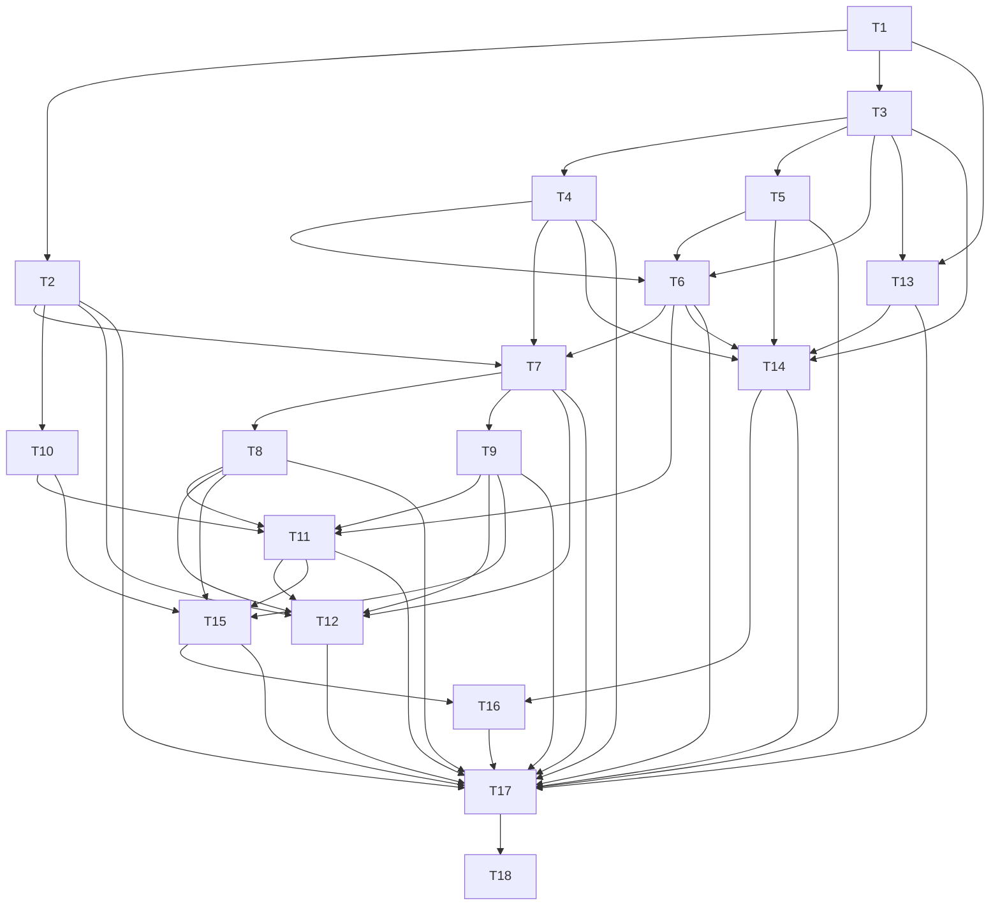

# D5 — Complete what my review owes: task-level breakdown

Status: draft for user review. Not frozen. Phase 3 artifact for `planning-protocol.md:61-135`.

## 0. Scope, boundary, and what this deliverable deliberately does not do

### Advertised outcome

A trader can write a journal entry about the position in front of them, right there in the review;
answer or explicitly decline the reflections they owe so that nothing quietly disappears; and see
plainly what is still outstanding, so that "done" means something today
(`plan/vertical-deliverables.md:132-147`).

The three user stories this deliverable closes (`plan/vertical-deliverables.md:134-140`):

1. write a journal entry about the position in front of them, in the review, so the thinking is
   captured at the moment it happens;
2. answer or explicitly decline the reflections they owe, so nothing quietly disappears;
3. be told plainly what is still outstanding, so the trader knows what "done" means today.

### In scope

| Capability | Contract it satisfies |
|---|---|
| `Journal.query` for Entries, Debt, declines, obligation keys, and the Timeline and Analysis projections | `journal.md:211-215` |
| `Journal.save` direct creation for Review Note and Trader Reflection only | `journal.md:161-165` |
| `Journal.save` Edit: a version under the same Entry identity using the original definition snapshot | `journal.md:129`, `journal.md:131` |
| `Journal.save` Addendum: a new Entry identity keeping the parent Anchor and the explicit parent link | `journal.md:129` |
| `Journal.save` Void: a visible reasoned version, nothing deleted | `journal.md:129` |
| One `JournalObligationKey` has exactly one current outcome, and Voiding the sole settlement reopens that Debt atomically | `journal.md:135-137` |
| `Journal.save` Debt resolution validated against the Debt's own original definition snapshot | `journal.md:137`, `journal.md:152-156` |
| Explicit `JournalDecline` as a distinct durable outcome, never a blank answer and never a Void | `journal.md:137`, `glossary.md:111` |
| `DailyReview.getDebt`: due paging in normative order, exact stored form, workflow routing | `daily-review.md:72-76` |
| `DailyReview.save` `ResolveReviewDebt`: answer, allowed decline, or `NeedsTradeWorkflow` with no write | `daily-review.md:78-86`, `daily-review.md:125` |
| Journal outcomes and Debt in the derived Review completion | `daily-review.md:146-156` |
| Manifest v5 seed: Review Note and Trader Reflection Entry Types | `journal.md:91-104`, `journal.md:194` |
| In-review writing and Debt-resolution presentation, responsive and accessible | `ui-contract.md:70-88`, `ui-contract.md:123-125` |

`AC:` AC-JOUR-001, AC-JOUR-003, AC-JOUR-005, AC-REV-002, AC-REV-006.

### Explicitly out of scope, and why it is safe

- **The standalone Journal timeline, and editing/voiding beyond what resolving an obligation needs.**
  D17 owns create/Edit/Addendum/Void across the journal and completes AC-JOUR-007's seven Entry
  Types. This deliverable implements the Edit/Addendum/Void *semantics* because obligation
  resolution, retry-under-expected-revision and Debt reopen cannot be built or proven without them
  (`journal.md:129`, `journal.md:135`); it does not install a standalone Journal surface, and its
  flow list contains no Journal navigation flow.
- **Workflow-routed Management Debt settlement.** D14 owns it. Here it must return the exact
  required route and refuse prose (`daily-review.md:76`, `daily-review.md:125`,
  `acceptance-contract.md:208-213`), which is a routing result, not a settlement.
- **Corrections.** D15 owns them, and corrections are what later make a past date Incomplete again.
  This deliverable proves the Reopen inversion for Void of a settlement Entry, which is the only
  reversal mechanism it owns; the correction-driven reversal stays with D15
  (`daily-review.md:156`).
- **Reports.** D19. The Analysis projection built here covers outcome coverage for one Entry Type
  population only, and is not a report family (`journal.md:215`).
- **Definition revision (`reviseDefinition`).** D17 owns prospectively changing definitions
  (`acceptance-contract.md:194-199`). This deliverable consumes the frozen definitions from D1,
  D2, D3 and D4 as given and never rewrites them.

### What this deliverable deliberately does not demonstrate

- Changing definitions prospectively: AC-JOUR-004 is D17's, and no flow here revises a definition.
- The Timeline and Analysis projections at full scope: only the filter and projection vocabulary the
  Debt/outcome surfaces consume is implemented, and §8 lists what is left unexercised.
- Any Trade workflow. Nothing in this deliverable writes a Trade fact, a Position Change, an
  Execution, a Mark or a Deviation.
- `AC-PERF-001` is owned by no deliverable and is never claimed here. Boundedness is argued as index
  membership, a bounded due-page batch and an asserted query count, never as a duration.

## 1. Decisions this breakdown introduces (needing alignment)

1. **The `Journal.query` obligation-key, Debt and decline projection contract.** `journal.md:213`
   lists the filter and projection vocabulary but fixes neither the shape of an obligation-key
   filter nor the projection that answers "what does this key currently owe?". This breakdown fixes
   both: one `outcome` member per returned key with the discriminated variants `Completed`,
   `Declined`, `OutstandingDebt` and `Retired`, each carrying the revision it was read at, plus
   stable reason codes. Filter dimensions are combined with AND and alternatives within one
   dimension with OR, exactly as `journal.md:213` states; filters are never a Boolean or full-text
   language. Tradeoff: a narrower query than the contract's full vocabulary is honest and testable,
   but any consumer wanting a dimension this deliverable did not implement must extend the seam
   rather than compose filters client-side.
2. **One `JournalObligationKey` has exactly one current outcome, and the identity is stable across
   retries.** A retry or revision updates the same identity under expected revision
   (`daily-review.md:84`, `daily-review.md:123`); a competing submission conflicts rather than
   duplicating. Voiding the sole Entry that settled Debt reopens that same Debt atomically
   (`journal.md:129`, `journal.md:135`). Tradeoff: reopen restores the *same* Debt identity with its
   original trigger-time snapshot rather than creating a fresh obligation, which keeps one-key-one-
   outcome true but means a reopened Debt's due time is its original due time, not a new one.
3. **Direct Journal creation is limited to Review Note and Trader Reflection.** Every
   workflow-required outcome (Plan Reflection, Position Change Reflection, Close Review, Daily Trade
   Review) passes through prepared effects and never direct `save` (`journal.md:163`,
   `journal.md:188`). Tradeoff: the direct `save` seam must reject a workflow-required type with a
   typed no-write result rather than trusting the UI to not offer it.
4. **The anchor-resolution reading from decision D1** (`planning-decisions-2026-10-10.md:12-78`):
   `Effective`, `Superseded` and `Voided` anchors all attach and carry their resolution status in
   the accepted result's projection; only `Unknown` is a typed no-write rejection naming the
   unresolved anchor. Edit and Addendum are never blocked because an anchor has since become
   Superseded or Voided. This is a branch-local reading of `journal.md:173-179` and is **not** a
   `specs/` amendment (§8).
5. **A Decline is a distinct durable outcome**, never a blank answer and never a Void
   (`journal.md:137`, `glossary.md:111`, `acceptance-contract.md:205`). One selection of an optional
   Prompt left `Unanswered` and one `JournalDecline` are different durable facts; the presentation
   contract in section 4 requires them to remain visually distinct.
6. **Workflow-routed Management Debt returns `NeedsTradeWorkflow` with the exact route and writes
   nothing** (`daily-review.md:76`, `daily-review.md:125`). Tradeoff: the route is returned as data
   (the owning Trade Workflow and the management requirement it must satisfy), not as prose, so a
   surface that later offers the route needs no Journal read to build it.
7. **The durable schema addition is one new schema version above D4's baseline, a new obligation-key
   store with a unique index, a decline store, and the Journal query indexes.** The exact number is
   mechanical and read from D1's schema-version baseline rather than invented here; the *transition*
   is what is verified (`N` to `N+1`, atomic, idempotent) rather than a hard-coded `N`. Tradeoff:
   the reader cannot read a literal version out of this document, which is deliberate because D1
   owns the baseline and D2 through D4 each raise it in turn (D2 `v2`, D3 `v3`, D4 `v4`,
   D5 `v5`, D6 `v6`).
8. **Test layout and seam naming.** Unit specifications live beside the module they exercise as
   `src/<module>/<subject>.spec.ts`; the mock-free integration suite is
   `tests/integration/<subject>.integration.spec.ts`; the browser flows of the critic gate are
   `tests/e2e/<subject>.spec.ts` run by Playwright against `pnpm dev`, which reads `DEV_PORT`
   from `.env.local` rather than hard-coding a port. Individual cases are selected with
   `vitest run <file> -t "<case name>"`, so every red and green command in section 3 is exactly
   reproducible without running the whole suite. Tradeoff: this fixes path and filter conventions
   that D1's harness must follow; D1 fixes the *harness*, and this breakdown consumes it rather than
   redefining it.

## 2. Task graph

This breakdown declares **18 tasks in 11 dependency layers** (grouped into 7 implementation phases in §3).

Behaviour-bearing tasks (`B`) are `T2`–`T17`; structural tasks (`S`) are `T1` and `T18`.
Each task body declares its prerequisites on its `**Blocking edges:**` line in the blocking
direction, so every line below reads "these block me". The diagram draws the same relation in the
blocking direction, from the prerequisite to the task it unblocks. The mermaid block in this section
is the single diagram in this document and is the exact edge set of the task table.

### Declared blocking edges

T1 — Blocking edges: D1:T9, D1:T10, D4:T1 · Consumed by: T2, T3, T13.
T2 — Blocking edges: T1 · Consumed by: T7, T10, T12, T17.
T3 — Blocking edges: T1 · Consumed by: T4, T5, T6, T13, T14.
T4 — Blocking edges: T3 · Consumed by: T6, T7, T14, T17.
T5 — Blocking edges: T3 · Consumed by: T6, T14, T17.
T6 — Blocking edges: T3, T4, T5 · Consumed by: T7, T11, T14, T17.
T7 — Blocking edges: T2, T4, T6 · Consumed by: T8, T9, T12, T17.
T8 — Blocking edges: T7 · Consumed by: T11, T12, T15, T17.
T9 — Blocking edges: T7 · Consumed by: T11, T12, T15, T17.
T10 — Blocking edges: T2 · Consumed by: T11, T15.
T11 — Blocking edges: T6, T8, T9, T10 · Consumed by: T12, T15, T17.
T12 — Blocking edges: T2, T7, T8, T9, T11 · Consumed by: T17.
T13 — Blocking edges: T1, T3 · Consumed by: T14, T17.
T14 — Blocking edges: T3, T4, T5, T6, T13 · Consumed by: T16, T17.
T15 — Blocking edges: T8, T9, T10, T11 · Consumed by: T16, T17.
T16 — Blocking edges: T14, T15 · Consumed by: T17.
T17 — Blocking edges: T2, T4, T5, T6, T7, T8, T9, T11, T12, T13, T14, T15, T16, D1:T3 · Consumed by: T18.
T18 — Blocking edges: T17 · Consumed by: none (cross-deliverable only).

### Verifying the graph itself



Cross-deliverable blocking edges (`D1:T9`, `D1:T10`, `D4:T1`, `D1:T3`) are declared in the task
bodies and deliberately **not** drawn, because the diagram validator reads only local `T<n>`
endpoints; `D1:T9` is D1's IndexedDB schema baseline, `D1:T10` its migration runner, `D4:T1` D4's
durable schema and migration, and `D1:T3` D1's unit and integration test harness with its disclosed
substitutions. Those four are already satisfied by the deliverable ordering, so they add no local
layer.

Run `node scripts/check-deliverable-breakdown.mjs plan/deliverable-breakdowns/*.md`. For this
graph it proves five things: every `T<n>` endpoint on every `**Blocking edges:**` line names a task
declared in this file; the four `D1:`-prefixed endpoints resolve against D1's task set once D1's
file exists; neither the prose graph nor the diagram graph contains a cycle; the prose and the
diagram agree after transitive reduction, so no edge is drawn that the task bodies do not impose and
no essential prose edge is missing from the diagram; and every structural task (`T1`, `T18`) carries
its exact verification. The declared order is a genuine dependency order: the longest prerequisite
chain, counted from T1 to T17, is 7 dependency layers, matching the sentence that opens this
section, and T18 is the one layer beyond it because the independent critic gate must be able to fail
independently of every task it observes.

## 3. Task detail

### Phase P1 — durable foundation

#### T1 — `S` D5 durable schema and migration: obligation keys, declines, Journal query indexes

- **Blocking edges:** D1:T9, D1:T10, D4:T1.
- **Consumed by:** T2, T3, T13.

D5 changes durable representation, so it carries its own migration (`planning-protocol.md:77`). The
migration is one isolated candidate store set applied above the D4 baseline and finished by the
atomic pointer flip that D1:T10 establishes; nothing in it writes to the live root. It adds: an
obligation-key store whose key is the stable obligation identity and which holds at most one current
outcome per key (`journal.md:135`); a decline store holding the durable `JournalDecline` facts that
`glossary.md:111` and `journal.md:137` require, each carrying its obligation key, Entry Type
identity, the definition snapshot it was rendered against, decline time and the automatic Source;
and the query indexes `Journal.query` needs for the Debt and entry projections of T2 —
obligation-key, Anchor, Entry Type plus status, due-time, moment interval, and the Trade-narrative
scope key (`journal.md:213`). The stores are versioned products of the schema, not a second
authority: the obligation-key store's current outcome is derivable by replaying Entry, settlement,
reopen and decline history, and the migration contains a rebuild path that proves it.

**Exact verification**

| # | Command | Expected result |
|---|---|---|
| V1.1 | `pnpm vitest run src/persistence/migrations/d5-obligation-and-decline.spec.ts -t "D5 schema migration"` | The migration case list is reported, every case passes, and the suite name names D5 explicitly. |
| V1.2 | `pnpm vitest run src/persistence/schema.spec.ts -t "D5 schema surface"` | The printed schema surface contains the obligation-key store, the decline store, and one index for each of obligation key, Anchor, Entry Type plus status, due time and moment time; the printed schema-version is exactly one above the version D4's migration leaves behind, and a second run reports no pending migration and no write. |
| V1.3 | `pnpm vitest run src/journal/query.spec.ts -t "obligation key is unique"` | A second write of a different outcome under an already-present obligation key is refused as a typed write conflict, and reading the key returns the first outcome unchanged. |
| V1.4 | `pnpm vitest run src/persistence/transaction.spec.ts -t "D5 migration atomicity"` | An injected failure part-way through the candidate migration leaves the live root byte-identical at the pre-migration schema version; the obligation-key store, the decline store and the new indexes are absent, and reads continue to work. |
| V1.5 | `pnpm vitest run src/persistence/migrations/d5-obligation-and-decline.spec.ts -t "obligation outcome is rebuildable"` | Deleting the obligation-key store's contents and replaying Entry, settlement, reopen and decline history reconstructs the same current outcome for every key, proving the store is a rebuildable product and not a second authority. |
| V1.6 | `pnpm vitest run src/journal/query.spec.ts -t "D5 indexes are populated by restore"` | After a D5 snapshot is restored into an empty candidate and the pointer flips, every index query named in V1.2 returns the same identities and order as the pre-export workspace. |
| V1.7 | `pnpm vitest run src/persistence/migrations/d5-obligation-and-decline.spec.ts -t "D5 migration is idempotent"` | Running the migration twice in one session applies it once; the second run reports no pending work, writes nothing, and every index and store count is unchanged. |

**Depends on it:** every behavioural task in this deliverable writes through these stores and reads
through these indexes; without the schema surface, `Journal.query`'s obligation-key projection (T2),
the direct-create path (T3) and the manifest v5 seed (T13) are unverifiable, and D6's Close Review
obligation key has nowhere to live.

### Phase P2 — the Journal query and direct creation

#### T2 — `B` `Journal.query`: entries, Debt, declines, obligation keys, Timeline and Analysis projections

- **Blocking edges:** T1.
- **Consumed by:** T7, T10, T12, T17.

`journal.md:213` fixes the query vocabulary: Entries, Debt and declines; exact identities;
obligation keys; Anchors; Trade narrative scope; Entry Type, Source, origin, status, due-through,
moment interval and stable Prompt/Option/Tag filters; and Timeline, Analysis or Full History
projections. `journal.md:215` fixes what two of those projections mean. This task implements the
subset those sentences require *plus* everything the Debt and outcome surfaces of T10, T14 and T15
read, and it returns the obligation-key outcome projection decision 1 fixes. Filters combine with
AND across dimensions and OR within one dimension, and a filter the implementation does not support
is a typed rejection rather than a silent no-op.

**Unit test cases**

```text
describe("Journal.query returns the effective Timeline projection for a directly created Entry")
  it should return the effective version of a Review Note Entry with its Entry Type, exactly one Anchor, automatic Source and moment time when the query names that Entry identity
  it should mark an Edited Entry with a discreet Edited indicator and still return the effective version, not the superseded one, when the query projects Timeline
  it should return a Voided Entry's visible reasoned version and its Void indicator rather than omitting the identity when the query projects Timeline for that identity

describe("Journal.query answers what one obligation key currently owes")
  it should return exactly one outcome member for a key whose obligation is completed, carrying the settled Entry identity and the revision it was read at, when the query filters by that obligation key
  it should return an OutstandingDebt outcome with the Debt's trigger-time definition snapshot and due time when the key's current outcome is one Outstanding Debt
  it should return a Declined outcome carrying the decline identity and its rendered definition snapshot when the key's current outcome is an explicit decline
  it should return a Retired outcome naming the retirement evidence when the key's Debt retired because its originating fact was Voided
  it should return no outcome member for a key that was never created, rather than a fabricated empty outcome, when the query filters by that key

describe("Journal.query filters combine with AND across dimensions and OR within one")
  it should return only Entries matching both the named Entry Type and the named Anchor when two dimensions are supplied together
  it should return the union of two Entry Types, each once, when one dimension supplies two alternatives
  it should reject an unsupported filter dimension as a typed no-read result naming the dimension when the query supplies one

describe("Journal.query pages due Debt in the normative order")
  it should return only Outstanding Debt whose due time is at or before the supplied due-through instant when the query filters due-through
  it should order workflow-bound management Debt before Journal-only Debt and then by oldest due time and stable identity when both kinds are due
  it should return a bounded page whose size is the requested bound and expose the continuation cursor when more due Debt exists than the bound
```

**Integration case.** Through the production IndexedDB stack with D1's real transaction seam and no
mocked module, seed the D1, D2, D3 and D4 definitions, drive `confirmPlan`, then
`recordPositionChange` with `Defer`, then call `Journal.query` with the Position Change Reflection
obligation key. Assert the returned outcome is one `OutstandingDebt` whose definition snapshot is
the trigger-time revision, and assert the durable state after restart by reopening the workspace and
repeating the same query. `fake-indexeddb` substitutes for the browser-owned IndexedDB instance;
nothing else is substituted, and the disclosure of that gap is in §8.

**Red/green evidence**

| Case | Red command and the reason it must fail | Green command and expected result |
|---|---|---|
| Timeline effective version | `pnpm vitest run src/journal/query.spec.ts -t "effective Timeline projection"` — `Journal.query` does not exist yet, so the import fails to resolve and the case cannot even reach an assertion | `pnpm vitest run src/journal/query.spec.ts -t "effective Timeline projection"` — passes |
| Obligation-key outcome | `pnpm vitest run src/journal/query.spec.ts -t "answers what one obligation key currently owes"` — the obligation-key filter is unimplemented, so the case reports an unsupported dimension | `pnpm vitest run src/journal/query.spec.ts -t "answers what one obligation key currently owes"` — passes |
| AND/OR filter combination | `pnpm vitest run src/journal/query.spec.ts -t "AND across dimensions and OR within one"` — the filter reducer treats every dimension as OR, so the both-dimensions case returns a superset | `pnpm vitest run src/journal/query.spec.ts -t "AND across dimensions and OR within one"` — passes |
| Due-Debt ordering | `pnpm vitest run src/journal/query.spec.ts -t "pages due Debt in the normative order"` — the due-time index from T1 is not consulted, so management Debt sorts by identity instead of first | `pnpm vitest run src/journal/query.spec.ts -t "pages due Debt in the normative order"` — passes |

#### T3 — `B` `Journal.save` direct create for Review Note and Trader Reflection

- **Blocking edges:** T1.
- **Consumed by:** T4, T5, T6, T13, T14.

`journal.md:163` limits voluntary direct creation to Review Note and Trader Reflection, and
`journal.md:91-104` fixes both initial definitions exactly. Creation validates the exact definition
revision it renders, exactly one committed Anchor, the automatic Source snapshot, the definition's
rules, the stable Prompt and Option identities, and expected revision. It resolves Anchors through
Trade Record and receives one of `Effective`, `Superseded`, `Voided` or `Unknown`; decision 4 fixes
what each means. The accepted result returns the complete effective Entry at its new revision so the
caller renders it without a query (`journal.md:165`, `overview.md:194`). Merely rendering or editing
locally invokes nothing (`journal.md:182`).

**Unit test cases**

```text
describe("Journal.save creates a Review Note under the exact rendered Entry Definition")
  it should append one immutable Entry version carrying the exact Prompt wording and option labels of the submitted definition revision when the form is submitted with both Prompts answered as the definition requires
  it should set the Source snapshot automatically to the surface that initiated the writing and reject a caller-supplied Source when the command carries one
  it should reject a missing required response for "What did you observe?" as a typed no-write validation result naming that Prompt when the form omits it
  it should leave the Journal unchanged when the same command is submitted twice with the same expected revision and the second submission names the revision already committed

describe("Journal.save creates a Trader Reflection with optional answers left Unanswered")
  it should save with the required "What's on your mind?" answered and Primary emotion and Energy stored as Unanswered when the trader answers only the required Prompt
  it should store the Energy snapshot as a 1-to-5 Scale value with its bound wording when the trader selects 1
  it should not create any Debt, decline or obligation-key outcome merely because a Trader Reflection was saved when the save succeeds

describe("Journal.save refuses direct creation outside the two voluntary Entry Types")
  it should reject a direct save naming the Plan Reflection Entry Type as a typed no-write result directing the caller to prepared effects when the command uses the direct-create variant
  it should reject a direct save naming the Close Review Entry Type as a typed no-write result naming the exact required route when the command uses the direct-create variant

describe("Journal.save attaches the Anchor according to its resolution status")
  it should append the Entry and carry the anchor's Effective resolution status in the accepted result when the Trade Anchor resolves Effective
  it should append the Entry and carry the Superseded status alongside the current label when the Trade Anchor resolves Superseded
  it should append the Entry and carry the Voided status when the Execution Anchor resolves Voided
  it should write nothing and name the unresolved Anchor when the Anchor resolves Unknown
  it should accept each of the three Journal Anchor forms, Standalone, Trade and one specific Execution, and store exactly one of them per Entry
```

**Integration case.** With the real stack, create a Trader Reflection anchored to an Execution that
was Voided earlier through D1's and D3's real paths, then read the entry back after a restart.
Assert the durable Entry carries the Voided anchor's stable identity, exactly one Anchor, the
automatic Source, and that the accepted result already carried the Voided resolution status without a
follow-up query. The Anchor resolution traverses Trade Record's real `resolveAnchors`; only the
IndexedDB instance is substituted.

**Red/green evidence**

| Case | Red command and the reason it must fail | Green command and expected result |
|---|---|---|
| Exact definition snapshot | `pnpm vitest run src/journal/save-create.spec.ts -t "exact rendered Entry Definition"` — direct create is unimplemented, so the appended snapshot is absent | `pnpm vitest run src/journal/save-create.spec.ts -t "exact rendered Entry Definition"` — passes |
| Optional answers remain Unanswered | `pnpm vitest run src/journal/save-create.spec.ts -t "optional answers left Unanswered"` — the initial implementation coerces a missing optional answer into a decline, which the case observes as a decline outcome | `pnpm vitest run src/journal/save-create.spec.ts -t "optional answers left Unanswered"` — passes |
| Refuses workflow-required types | `pnpm vitest run src/journal/save-create.spec.ts -t "outside the two voluntary Entry Types"` — the create path accepts any Entry Type identity, so the workflow-required save succeeds and the case fails on the missing rejection | `pnpm vitest run src/journal/save-create.spec.ts -t "outside the two voluntary Entry Types"` — passes |
| Anchor resolution statuses | `pnpm vitest run src/journal/save-create.spec.ts -t "according to its resolution status"` — the result omits the resolution status, so the Superseded and Voided cases fail on the missing projection | `pnpm vitest run src/journal/save-create.spec.ts -t "according to its resolution status"` — passes |

### Phase P3 — Edit, Addendum and Void

#### T4 — `B` `Journal.save` Edit: a version under the same identity using the original snapshot

- **Blocking edges:** T3.
- **Consumed by:** T6, T7, T14, T17.

`journal.md:129` fixes Edit: it appends a version under the same Journal Entry identity and uses the
Entry's *original* definition snapshot, not the current one. `journal.md:131` fixes what may change:
for a directly authored Entry, Edit may correct an erroneous Anchor or moment time, while Entry Type,
original definition snapshot, Source, originating-fact association, first-authored time,
Debt-settlement identity and Addendum parentage are immutable. The retry-under-expected-revision rule
in `daily-review.md:84` is the same seam.

**Unit test cases**

```text
describe("Journal.save Edit appends a version under the same Journal Entry identity")
  it should keep the Entry identity stable and add one version when a directly created Entry is edited
  it should validate and store the edit against the Entry's original definition snapshot even when the Entry Type's current definition has since been revised
  it should reject an edit whose expected revision is stale as a typed conflict naming the current revision and write no version

describe("Journal.save Edit refuses to change immutable Entry members")
  it should leave the Entry Type, original definition snapshot, Source and first-authored time unchanged when the trader edits only a response
  it should reject an attempt to change the Entry Type identity as a typed no-write validation result
  it should reject an attempt to change the Debt-settlement identity or the Addendum parent as a typed no-write validation result

describe("Journal.save Edit may correct an erroneous Anchor or moment time on a directly authored Entry")
  it should store the corrected Anchor and carry the new anchor's resolution status in the accepted result when a directly authored Entry's Anchor is corrected
  it should reject a reassignment of the Anchor on an Entry whose Anchor was created by a workflow as a typed no-write result
  it should return the complete effective Entry at its new revision from the accepted result so the caller renders it without a query
```

**Integration case.** Create a Review Note, edit it twice through the real save seam, then restart
and read the full version chain through the real query seam. Assert one stable Entry identity with
three versions, that every version validates against the original definition revision, and that the
Timeline projection shows the effective version plus the Edited indicator. No module is mocked; the
IndexedDB instance is the disclosed substitution.

**Red/green evidence**

| Case | Red command and the reason it must fail | Green command and expected result |
|---|---|---|
| Same identity, new version | `pnpm vitest run src/journal/save-edit.spec.ts -t "same Journal Entry identity"` — Edit is unimplemented, so the second save creates a new identity and the case observes two identities | `pnpm vitest run src/journal/save-edit.spec.ts -t "same Journal Entry identity"` — passes |
| Original snapshot wins | `pnpm vitest run src/journal/save-edit.spec.ts -t "original definition snapshot"` — the implementation validates against the latest revision, so the revised-definition case rejects a legal edit | `pnpm vitest run src/journal/save-edit.spec.ts -t "original definition snapshot"` — passes |
| Immutable members | `pnpm vitest run src/journal/save-edit.spec.ts -t "refuses to change immutable Entry members"` — the update merges the command over the stored version, so an Entry Type change is accepted | `pnpm vitest run src/journal/save-edit.spec.ts -t "refuses to change immutable Entry members"` — passes |
| Anchor correction rules | `pnpm vitest run src/journal/save-edit.spec.ts -t "erroneous Anchor or moment time"` — the implementation rejects every Anchor change, including the legal direct-author correction | `pnpm vitest run src/journal/save-edit.spec.ts -t "erroneous Anchor or moment time"` — passes |

#### T5 — `B` `Journal.save` Addendum: a new identity keeping the parent Anchor and link

- **Blocking edges:** T3.
- **Consumed by:** T6, T14, T17.

`journal.md:129` fixes Addendum: a new Entry with the parent's preserved Anchor, the *current*
completed definition, its actual new Source and time, and an explicit parent link. `journal.md:131`
adds that an Addendum does not inherit the parent's workflow origin as if the later thought occurred
during that original event. Decision 4 adds that an Addendum is never blocked because the parent's
Anchor has since become Superseded or Voided; it inherits the preserved Anchor and carries the
status.

**Unit test cases**

```text
describe("Journal.save Addendum creates a new Entry that keeps the parent Anchor")
  it should create a new Entry identity, not a new version, whose Anchor equals the parent's Anchor when an Addendum is saved
  it should record an explicit parent link to the parent Entry identity and surface a detectable cycle refusal when a chain would close on itself
  it should stamp the Addendum's own Source and moment time rather than copying the parent's when the Addendum is saved from the review

describe("Journal.save Addendum uses the current completed definition")
  it should render and validate the Addendum against the Entry Type's current definition revision, not the parent's original snapshot, when the two differ
  it should keep the parent's original definition snapshot and responses unchanged when the Addendum is saved

describe("Journal.save Addendum does not inherit the parent's workflow origin")
  it should store no originating-fact association on an Addendum whose parent carried one when the Addendum is created directly
  it should carry the parent Anchor's current resolution status, including Superseded or Voided, in the accepted result when the parent Anchor no longer resolves Effective
```

**Integration case.** Defer a Position Change Reflection in D3's real path, complete it, then add an
Addendum to that completed Entry from the review with the real save seam. Assert after restart that
the parent's Anchor and origin association are unchanged, the Addendum is a distinct identity with a
parent link and no copied workflow origin, and the Timeline projection renders the parent-to-Addendum
relationship. Only the IndexedDB instance is substituted.

**Red/green evidence**

| Case | Red command and the reason it must fail | Green command and expected result |
|---|---|---|
| New identity, preserved Anchor | `pnpm vitest run src/journal/save-addendum.spec.ts -t "keeps the parent Anchor"` — the addendum path is unimplemented, so the save is rejected as an unknown variant | `pnpm vitest run src/journal/save-addendum.spec.ts -t "keeps the parent Anchor"` — passes |
| Current definition | `pnpm vitest run src/journal/save-addendum.spec.ts -t "current completed definition"` — the implementation reuses the parent's snapshot, so a Prompt the current definition added is missing from the Addendum | `pnpm vitest run src/journal/save-addendum.spec.ts -t "current completed definition"` — passes |
| No inherited origin | `pnpm vitest run src/journal/save-addendum.spec.ts -t "does not inherit the parent's workflow origin"` — the implementation copies the whole parent association, so the Addendum carries an origin it never had | `pnpm vitest run src/journal/save-addendum.spec.ts -t "does not inherit the parent's workflow origin"` — passes |
| Anchor status carried | `pnpm vitest run src/journal/save-addendum.spec.ts -t "resolution status"` — the result omits the status, so a Voided parent Anchor yields no status in the accepted projection | `pnpm vitest run src/journal/save-addendum.spec.ts -t "resolution status"` — passes |

#### T6 — `B` `Journal.save` Void: visible reasoned version, nothing deleted

- **Blocking edges:** T3, T4, T5.
- **Consumed by:** T7, T11, T14, T17.

`journal.md:129` fixes Void: it adds a visible reasoned version and never deletes earlier versions,
Addenda, Anchor or origin. `glossary.md:108` requires the reason. `ui-contract.md:102` requires that
old identities remain navigable and visible audit is never hidden behind a technical log. Void is
also the *only* reversal mechanism this deliverable owns, so its interaction with Debt settlement is
what T7 and T11 build on.

**Unit test cases**

```text
describe("Journal.save Void appends a visible reasoned version")
  it should append a Void version carrying the required reason and the actual authored time when a saved Entry is Voided
  it should keep every earlier version, every Addendum and the Anchor reachable after the Void when the Journal is read again
  it should reject a Void that supplies no reason as a typed no-write validation result
  it should leave the Entry's Entry Type, original definition snapshot and first-authored time unchanged by the Void

describe("Journal.save Void is a version, not a deletion")
  it should return the Voided version as the effective version in the Timeline projection with a Void indicator when the Entry is read after the Void
  it should keep the full version chain readable in the Full History projection, including the version that settled Debt, when the Entry is read after the Void

describe("Journal.save Void names what it voids without disturbing the rest of the history")
  it should void only the named Entry identity and leave every sibling Entry of the same obligation untouched when the command names one identity
  it should reject a Void naming an already-Voided Entry as a typed no-write result rather than stacking a second Void
```

**Integration case.** Complete a Position Change Reflection through the real prepared-effects path,
Void that settlement Entry through the real save seam, then restart and query the full history.
Assert the Void version is visible with its reason, the settlement version is still readable, and the
Trade-side facts are untouched, proving nothing was deleted. Only the IndexedDB instance is
substituted.

**Red/green evidence**

| Case | Red command and the reason it must fail | Green command and expected result |
|---|---|---|
| Visible reasoned Void | `pnpm vitest run src/journal/save-void.spec.ts -t "visible reasoned version"` — the Void variant is unimplemented, so no version is appended and the case finds the Entry still effective | `pnpm vitest run src/journal/save-void.spec.ts -t "visible reasoned version"` — passes |
| Nothing deleted | `pnpm vitest run src/journal/save-void.spec.ts -t "a version, not a deletion"` — the implementation removes the effective version from the chain, so the settlement version disappears from Full History | `pnpm vitest run src/journal/save-void.spec.ts -t "a version, not a deletion"` — passes |
| Reason required | `pnpm vitest run src/journal/save-void.spec.ts -t "supplies no reason"` — the implementation defaults an empty reason, so the no-write case fails on a committed Void | `pnpm vitest run src/journal/save-void.spec.ts -t "supplies no reason"` — passes |
| Scoped to one identity | `pnpm vitest run src/journal/save-void.spec.ts -t "without disturbing the rest of the history"` — the implementation voids by obligation key, so a sibling Entry is Voided too | `pnpm vitest run src/journal/save-void.spec.ts -t "without disturbing the rest of the history"` — passes |

### Phase P4 — obligation keys, snapshot-validated resolution and decline

#### T7 — `B` One current outcome per obligation key, and Void of the sole settlement reopens the Debt

- **Blocking edges:** T2, T4, T6.
- **Consumed by:** T8, T9, T12, T17.

`journal.md:135` states the invariant this task owns: one `JournalObligationKey` has exactly one
current outcome, being a completed Entry, an explicit decline, one Outstanding Debt, or a valid
retirement. `journal.md:137` fixes the retirement evidence. `journal.md:129` fixes the reopen rule:
Voiding the only Entry that settled Debt atomically reopens that same Debt. `daily-review.md:84` and
`daily-review.md:123` fix retry behaviour: a retry or revision updates the same identity under
expected revision rather than creating a duplicate. This is the task the uniqueness obligation keys,
reopen-on-Void and concurrency cases belong to, so it carries the upper end of the case range.

**Unit test cases**

```text
describe("An obligation key holds exactly one current outcome across every outcome kind")
  it should return exactly one Completed outcome carrying the settled Entry identity when completion is the only outcome recorded for the key
  it should return exactly one OutstandingDebt outcome when Defer is the only outcome recorded for the key
  it should return exactly one Declined outcome when an explicit decline is the only outcome recorded for the key
  it should return exactly one Retired outcome naming the retirement evidence when the key's Debt retired rather than being settled
  it should return no outcome for a key that has never been created, and create nothing merely by asking

describe("A second outcome for the same key conflicts rather than duplicating")
  it should reject a completion submitted against an already-settled key as a typed conflict carrying the existing outcome identity and the revision it was read at
  it should reject a decline submitted against a key that already carries an Outstanding Debt as a typed conflict, leaving the Debt outstanding
  it should reject a Defer submitted against a key that already carries a completed Entry as a typed conflict, leaving the Entry effective
  it should leave the key's outcome and every Journal revision unchanged after each rejected second outcome

describe("A retry updates the same identity under expected revision")
  it should update the same settlement Entry identity when a retry arrives with the current expected revision rather than appending a second settlement
  it should reject a retry whose expected revision is stale as a typed conflict naming the current revision and write no version
  it should keep exactly one current outcome for the key after any accepted sequence of retries

describe("Voiding the sole settlement Entry reopens that same Debt atomically")
  it should return the key to OutstandingDebt with the Debt's original trigger-time definition snapshot when the only settlement Entry is Voided
  it should restore the same Debt identity, not create a fresh obligation, when the reopen happens
  it should return the reopen transition inside the accepted Void result so the caller renders it without a query
  it should leave the key Retired and write nothing when the sole settlement Entry is Voided after ownership evidence already retired the Debt

describe("Concurrent submissions around one key cannot both commit")
  it should commit exactly one of two concurrent submissions carrying the same expected revision and return a typed conflict for the other
  it should leave one completed outcome and one visible conflict, and no duplicate Entry identity, after the losing submission is retried against the fresh revision
```

**Integration case.** Against the real stack: defer a Position Change Reflection through D3's
`recordPositionChange`, resolve it through the real save seam, then Void that settlement Entry. Call
`Journal.query` by obligation key before, between and after, and repeat after a restart. Assert the
sequence OutstandingDebt, Completed, OutstandingDebt with the *same* Debt identity and the same
trigger-time snapshot, that the Void result already carried the reopen transition, and that the
underlying Trade facts never changed. Only the IndexedDB instance is substituted.

**Red/green evidence**

| Case | Red command and the reason it must fail | Green command and expected result |
|---|---|---|
| One outcome per key | `pnpm vitest run src/journal/obligation-key.spec.ts -t "exactly one current outcome"` — the projection is not built, so the query returns zero outcome members for a completed key | `pnpm vitest run src/journal/obligation-key.spec.ts -t "exactly one current outcome"` — passes |
| Second outcome conflicts | `pnpm vitest run src/journal/obligation-key.spec.ts -t "conflicts rather than duplicating"` — the implementation appends a second outcome, so the key returns two and the case fails on cardinality | `pnpm vitest run src/journal/obligation-key.spec.ts -t "conflicts rather than duplicating"` — passes |
| Retry same identity | `pnpm vitest run src/journal/obligation-key.spec.ts -t "retry updates the same identity"` — the retry takes the create path, so the case observes two settlement identities | `pnpm vitest run src/journal/obligation-key.spec.ts -t "retry updates the same identity"` — passes |
| Reopen on Void | `pnpm vitest run src/journal/obligation-key.spec.ts -t "reopens that same Debt atomically"` — the Void path does not touch the obligation key, so the key stays Completed and the case fails | `pnpm vitest run src/journal/obligation-key.spec.ts -t "reopens that same Debt atomically"` — passes |
| Concurrent submissions | `pnpm vitest run src/journal/obligation-key.spec.ts -t "cannot both commit"` — the expected-revision guard is missing on the settle path, so both submissions commit | `pnpm vitest run src/journal/obligation-key.spec.ts -t "cannot both commit"` — passes |

#### T8 — `B` `Journal.save` Debt resolution validated against the Debt's original snapshot

- **Blocking edges:** T7.
- **Consumed by:** T11, T12, T15, T17.

`journal.md:137` fixes that Answering a Debt creates an Entry, and that later definition changes do
not alter what is owed. `journal.md:152-156` shows the transaction: `save(ResolveDebt with answer)`
then `Validate against Debt's original snapshot` then `Entry saved and Debt settled`.
`acceptance-contract.md:194-199` requires the Debt answer to be validated and stored against the
definition that was in force when the Debt was created. This task owns that validation and the
settle-together atomicity, so it carries the upper end of the case range.

**Unit test cases**

```text
describe("Journal.save settles a Debt against the Debt's own original definition snapshot")
  it should validate the submitted responses against the Debt's trigger-time definition revision, not the Entry Type's current revision, when the two differ
  it should store the settled Entry carrying the Debt's original Prompt wording, order and option labels when the Debt predates a definition revision
  it should reject a response that answers a Prompt the Debt's snapshot never had as a typed no-write validation result naming that Prompt
  it should reject a missing required response for a Prompt the Debt's snapshot required even when the current definition made it optional

describe("Journal.save settles the Debt and creates the Entry in one atomic step")
  it should leave both the Debt outstanding and the Journal unchanged when the response fails validation
  it should mark the Debt settled and return the settled Entry identity in the same accepted result, with no follow-up query, when the response is valid
  it should record the settlement link on the Entry so the reopen path can find it when the Entry is later Voided
  it should reject a resolution whose expected revision does not match the Debt's current revision as a typed conflict naming the current revision

describe("Journal.save will not settle a Debt whose answer must also create a Trade fact")
  it should return the exact required Trade Workflow route and write nothing when the Debt requires the owning workflow to establish management
  it should leave the outstanding list, the Journal revisions and the Trade facts unchanged after that routing refusal

describe("Journal.save refuses direct resolution of a Debt that a workflow must complete")
  it should reject an attempt to answer a Management Debt with prose alone as a typed no-write result naming the required route
  it should reject an attempt to answer a Daily Trade Review obligation through the resolve-Debt variant as a typed no-write result naming the correct seam
```

**Integration case.** Create a Position Change Reflection Debt under D3's definition revision, then
revise nothing but render the *current* form for the same Entry Type, and submit the old form's
answer through the real `Journal.save`. Assert the settled Entry's stored snapshot is the old
revision with the old labels, that the Debt moved from Outstanding to settled in the same commit,
and that after a restart the debt page is empty for that key. Only the IndexedDB instance is
substituted.

**Red/green evidence**

| Case | Red command and the reason it must fail | Green command and expected result |
|---|---|---|
| Original snapshot validation | `pnpm vitest run src/journal/resolve-debt.spec.ts -t "original definition snapshot"` — the implementation validates against the current revision, so the old-form answer is rejected and the case fails | `pnpm vitest run src/journal/resolve-debt.spec.ts -t "original definition snapshot"` — passes |
| Settle together, atomically | `pnpm vitest run src/journal/resolve-debt.spec.ts -t "one atomic step"` — settling and Entry creation are written in two separate transactions, so the injected failure case leaves a settled Debt with no Entry | `pnpm vitest run src/journal/resolve-debt.spec.ts -t "one atomic step"` — passes |
| Workflow route refusal | `pnpm vitest run src/journal/resolve-debt.spec.ts -t "must also create a Trade fact"` — the implementation accepts prose and settles the Management Debt, so the case fails on the missing route | `pnpm vitest run src/journal/resolve-debt.spec.ts -t "must also create a Trade fact"` — passes |
| Direct-resolution refusal | `pnpm vitest run src/journal/resolve-debt.spec.ts -t "workflow must complete"` — the variant dispatches on obligation key without checking the route, so a Daily Trade Review obligation is settled through the wrong seam | `pnpm vitest run src/journal/resolve-debt.spec.ts -t "workflow must complete"` — passes |

#### T9 — `B` Explicit Decline as a distinct durable outcome

- **Blocking edges:** T7.
- **Consumed by:** T11, T12, T15, T17.

`journal.md:137` fixes that declining creates a distinct `JournalDecline`. `glossary.md:111` fixes
what a Decline is and what it is not: a durable statement that an allowed obligation was explicitly
not answered, never a blank answer and never a Void. `acceptance-contract.md:205` requires exactly
one explicit decline outcome per key and no duplication. Only the Entry Types whose workflow policy
permits it may be declined (`journal.md:188` lists Position Change Reflection and Close Review);
Plan Reflection, Management Revision and Daily Trade Review require completion. This task carries the
decline-specific case set, so it sits at the upper end of the case range.

**Unit test cases**

```text
describe("Journal.save records an explicit decline as its own durable outcome")
  it should create one JournalDecline carrying the obligation key, the Entry Type identity and the rendered definition snapshot when an allowed Debt is declined
  it should store the decline with its own stable identity and decline time, separate from any Entry identity, when the decline is accepted
  it should return the Declined outcome in the accepted result so the caller renders it without a query

describe("A decline is never a blank answer and never a Void")
  it should leave an unanswered optional Prompt stored as Unanswered, and record no decline, when the trader saves an optional Prompt untouched
  it should be distinguishable from a Void in the Timeline projection, which must show no Void indicator for a declined obligation
  it should be distinguishable from an unanswered Prompt in the Analysis projection, which must count the two differently

describe("Declining is allowed only where the workflow policy permits it")
  it should accept a decline for a Position Change Reflection obligation and for a Close Review obligation when their policy permits it
  it should reject a decline for a Plan Reflection or Management Revision obligation as a typed no-write result naming the completion requirement
  it should reject a decline for an already-declined key as a typed conflict carrying the existing decline identity, rather than stacking a second decline
  it should leave the outstanding list and the Journal revisions unchanged after each rejected decline

describe("A declined obligation removes the blocker without erasing history")
  it should remove the obligation from the outstanding set once the decline commits while keeping the decline readable in the Timeline projection
  it should keep the underlying Debt's trigger-time snapshot readable as the decline's rendered definition even after the decline commits
```

**Integration case.** Through the real stack, defer a Close Review obligation in D6's path (or a
Position Change Reflection in D3's, whichever is present when this deliverable runs), then decline it
through the real `Journal.save`, restart, and read both the outstanding set and the Timeline. Assert
exactly one `JournalDecline`, no Entry, no Void, an empty outstanding set for that key, and that the
decline renders with the historical Prompt and option labels. Only the IndexedDB instance is
substituted.

**Red/green evidence**

| Case | Red command and the reason it must fail | Green command and expected result |
|---|---|---|
| Decline as durable outcome | `pnpm vitest run src/journal/decline.spec.ts -t "its own durable outcome"` — the decline store from T1 is unused and the path settles nothing, so the key stays outstanding | `pnpm vitest run src/journal/decline.spec.ts -t "its own durable outcome"` — passes |
| Decline is not a blank answer | `pnpm vitest run src/journal/decline.spec.ts -t "never a blank answer and never a Void"` — the implementation persists a decline for every unanswered Prompt, so the untouched-optional case reports a decline | `pnpm vitest run src/journal/decline.spec.ts -t "never a blank answer and never a Void"` — passes |
| Policy limits | `pnpm vitest run src/journal/decline.spec.ts -t "where the workflow policy permits"` — the path accepts a decline for every Entry Type, so the Plan Reflection case commits | `pnpm vitest run src/journal/decline.spec.ts -t "where the workflow policy permits"` — passes |
| Removes blocker, keeps history | `pnpm vitest run src/journal/decline.spec.ts -t "removes the blocker without erasing history"` — the decline is written but the obligation-key store is not updated, so the key remains outstanding | `pnpm vitest run src/journal/decline.spec.ts -t "removes the blocker without erasing history"` — passes |

#### T10 — `B` `DailyReview.getDebt`: due ordering and workflow-routed Debt

- **Blocking edges:** T2.
- **Consumed by:** T11, T15.

`daily-review.md:72-76` fixes this operation: it pages global due Debt or loads one exact stored
form; due means Outstanding with due time at or before the Review cutoff; it is not restricted to
Open Trades; workflow-bound management Debt sorts before Journal-only Debt, then by oldest due time
and stable identity; missing Daily Trade Review Actions are absence-derived and never converted to
Debt. `journal.md:141` fixes the rest: a Daily Trade Review absence is derived and creates neither
Debt nor an implicit Hold.

**Unit test cases**

```text
describe("DailyReview.getDebt pages due Debt at or before the Review cutoff")
  it should return debt whose due time precedes the cutoff and omit debt due after it when the request pages one exact Review Date
  it should include Debt whose originating Trade is no longer Open when that Debt is still Outstanding, because the page is global rather than restricted to Open Trades
  it should return a bounded page with a continuation cursor when more due Debt exists than the requested bound

describe("DailyReview.getDebt orders workflow-bound management Debt first")
  it should return management Debt before Journal-only Debt even when the Journal-only Debt is older when both are due
  it should order the Journal-only remainder by oldest due time and then by stable identity when several are due
  it should return the same order on two consecutive calls for one review binding, and permit a fresh open to return a different order

describe("DailyReview.getDebt loads one exact stored form against its own snapshot")
  it should return the exact stored form and the historical Prompt wording and option labels captured when the Debt was created when the request names one Debt identity
  it should not re-render that form from the Entry Type's current definition revision when the two differ

describe("A missing Daily Trade Review Action is absence, not Debt")
  it should report the missing Action as absence-derived and never convert it into an Outstanding Debt when the Trade has no Action for the Review Date
  it should not return an implicit Hold in place of the missing Action, because selection alone is not evidence
```

**Integration case.** With D4's review open against the real stack, create one management Debt
through D10's prepared-effects path when available and one Journal-only Position Change Reflection
Debt through D3's deferral, then call `DailyReview.getDebt` for one exact Review Date and page it.
Assert the order, the bounded page size, the exact stored form of the management Debt, and that no
Debt was manufactured for a Trade with no Action. Only the IndexedDB instance is substituted.

**Red/green evidence**

| Case | Red command and the reason it must fail | Green command and expected result |
|---|---|---|
| Due-through paging | `pnpm vitest run src/daily-review/get-debt.spec.ts -t "at or before the Review cutoff"` — `getDebt` is unimplemented, so the call resolves nothing and the case fails on an empty page | `pnpm vitest run src/daily-review/get-debt.spec.ts -t "at or before the Review cutoff"` — passes |
| Management Debt first | `pnpm vitest run src/daily-review/get-debt.spec.ts -t "orders workflow-bound management Debt first"` — the implementation sorts only by due time, so the older Journal-only Debt comes first | `pnpm vitest run src/daily-review/get-debt.spec.ts -t "orders workflow-bound management Debt first"` — passes |
| Exact stored form | `pnpm vitest run src/daily-review/get-debt.spec.ts -t "one exact stored form"` — the form is re-rendered from the current definition, so the historical labels are missing | `pnpm vitest run src/daily-review/get-debt.spec.ts -t "one exact stored form"` — passes |
| Missing Action is not Debt | `pnpm vitest run src/daily-review/get-debt.spec.ts -t "absence, not Debt"` — the implementation materialises a Debt for the missing Action, so the case observes an Outstanding Debt | `pnpm vitest run src/daily-review/get-debt.spec.ts -t "absence, not Debt"` — passes |

### Phase P5 — resolution route and review completion

#### T11 — `B` `DailyReview.save` `ResolveReviewDebt`: answer, decline, or `NeedsTradeWorkflow`

- **Blocking edges:** T6, T8, T9, T10.
- **Consumed by:** T12, T15, T17.

`daily-review.md:78-86` fixes the command family and its bindings; `daily-review.md:125` fixes the
three outcomes of this member: resolving Journal-only Debt creates an Entry and settles the Debt
together, records an allowed explicit decline, or returns `NeedsTradeWorkflow` with no write.
`daily-review.md:86` fixes the accepted result: the saved outcome, the revised progress and
completion result, and the next step under the same post-commit facts, so the caller continues
without calling `open` again. Decision D2 in `planning-decisions-2026-10-10.md:82-146` fixes the
staleness mapping this command follows: `ReviewChanged` is review-scope, `Conflict` is subject-scope,
every stale binding is reported rather than the first, and there is no third result name.

**Unit test cases**

```text
describe("DailyReview.save resolves a Journal-only Debt against its snapshot")
  it should return the settled Entry projection and the revised completion state in one accepted result when the Debt is a Journal-only obligation and the answer is valid
  it should validate the answer against the Debt's trigger-time snapshot rather than the current definition revision when the two differ
  it should return the next step under the same post-commit facts so the caller continues without opening the review again

describe("DailyReview.save records an allowed explicit decline")
  it should return the Declined outcome and the revised completion state when the obligation's policy permits a decline
  it should remove the obligation from the outstanding set and re-derive completion honestly when the decline commits
  it should reject a decline for an obligation whose policy requires completion as a typed no-write validation result

describe("DailyReview.save refuses workflow-routed Debt with the exact route")
  it should return NeedsTradeWorkflow naming the owning Trade Workflow and the management requirement it must satisfy when the Debt requires management
  it should write no Entry, no decline, no settlement and no Debt transition when that routing result is returned, and report every affected revision unchanged
  it should not accept prose in place of the required workflow even when the prose would satisfy every Prompt of the stored form

describe("DailyReview.save reports every stale binding under the decision D2 mapping")
  it should return ReviewChanged carrying the refreshed review binding and which items changed when the assembled review view itself lost coherence
  it should return Conflict enumerating every stale subject binding, not only the first, when the obligation key, the rendered form revision and the expected Debt revision are all stale
  it should return Conflict carrying the refreshed frames and the new market data snapshot identity when only the evidence binding is stale
  it should write nothing and leave the Debt outstanding and the completion state unchanged after any stale result
```

**Integration case.** Against the real stack, open the review with one due Journal-only Debt,
resolve it through `DailyReview.save`, then decline a second due Debt of a permitted type, then
attempt a workflow-routed Management Debt and assert nothing was written. Assert after a restart that
the first is settled with its original snapshot, the second carries one decline, the third is still
outstanding with its exact route, and that no call to `open` or `getTrade` was needed to render any
of the three results. Only the IndexedDB instance is substituted.

**Red/green evidence**

| Case | Red command and the reason it must fail | Green command and expected result |
|---|---|---|
| Journal-only resolution | `pnpm vitest run src/daily-review/resolve-review-debt.spec.ts -t "resolves a Journal-only Debt"` — the command member is unimplemented, so the review refuses the call | `pnpm vitest run src/daily-review/resolve-review-debt.spec.ts -t "resolves a Journal-only Debt"` — passes |
| Allowed decline | `pnpm vitest run src/daily-review/resolve-review-debt.spec.ts -t "records an allowed explicit decline"` — the implementation routes every Debt through settlement, so a permitted decline is rejected | `pnpm vitest run src/daily-review/resolve-review-debt.spec.ts -t "records an allowed explicit decline"` — passes |
| Workflow routing | `pnpm vitest run src/daily-review/resolve-review-debt.spec.ts -t "refuses workflow-routed Debt"` — the implementation settles the Management Debt from prose, so the case fails on a committed write | `pnpm vitest run src/daily-review/resolve-review-debt.spec.ts -t "refuses workflow-routed Debt"` — passes |
| Stale bindings | `pnpm vitest run src/daily-review/resolve-review-debt.spec.ts -t "reports every stale binding"` — the guard returns on the first stale binding and names the wrong scope, so the review-scope case returns `Conflict` | `pnpm vitest run src/daily-review/resolve-review-debt.spec.ts -t "reports every stale binding"` — passes |

#### T12 — `B` Journal outcomes and Debt in the derived Review completion

- **Blocking edges:** T2, T7, T8, T9, T11.
- **Consumed by:** T17.

`daily-review.md:146-156` fixes derived completion: `Incomplete` while any required obligation is
unresolved, including due Debt, and the two completed states; `daily-review.md:141` fixes that Debt
due at review time blocks Review completion but never blocks factual trade recording. This task adds
the Journal and Debt contributions to the blocker set and their honest derivation after a resolution,
a decline, a Void or a reopen. It owns no completion flag: completion is derived each time.

**Unit test cases**

```text
describe("Derived Review completion counts due Debt as a blocker")
  it should report Incomplete naming the outstanding Debt when the only unresolved obligation is one due Debt
  it should report Complete when every obligation is resolved with exact Marks and no due Debt remains
  it should report CompleteWithUnavailableMarks, not Complete, when every obligation is resolved but one required Instrument has only an unavailable acknowledgment

describe("Resolving or declining Debt changes completion without erasing history")
  it should move the date from Incomplete to the honest completed state when the last due Debt is settled
  it should move the date from Incomplete to the honest completed state when the last due Debt is declined
  it should never erase a settled Entry or a decline from the history when completion is re-derived after a later change
  it should make an already complete past date Incomplete again when a settlement Entry for a due obligation is Voided, without erasing the Voided version

describe("Journal blockers never block factual trade recording")
  it should allow a factual Position Change to commit while a reflection Debt for an earlier Position Change is still outstanding
```

**Integration case.** Against the real stack, open one exact Review Date with a due Journal-only
Debt, observe `Incomplete` with the Debt named, resolve it, observe the honest completed state,
then Void the settlement Entry and observe the date return to `Incomplete` with the reopened Debt
named. Restart between the Void and the final derivation to prove the result is derived from durable
facts rather than from session state. Only the IndexedDB instance is substituted.

**Red/green evidence**

| Case | Red command and the reason it must fail | Green command and expected result |
|---|---|---|
| Debt blocks completion | `pnpm vitest run src/daily-review/completion.spec.ts -t "counts due Debt as a blocker"` — the completion reducer ignores Journal obligations, so a date with due Debt reports Complete | `pnpm vitest run src/daily-review/completion.spec.ts -t "counts due Debt as a blocker"` — passes |
| Resolution changes completion | `pnpm vitest run src/daily-review/completion.spec.ts -t "changes completion without erasing history"` — the reducer memoises the first derived state, so the settled case still reads Incomplete | `pnpm vitest run src/daily-review/completion.spec.ts -t "changes completion without erasing history"` — passes |
| Reopen inverts completion | `pnpm vitest run src/daily-review/completion.spec.ts -t "already complete past date Incomplete again"` — the reopen transition from T7 is not consulted by the reducer, so the date stays complete | `pnpm vitest run src/daily-review/completion.spec.ts -t "already complete past date Incomplete again"` — passes |
| Recording never blocked | `pnpm vitest run src/daily-review/completion.spec.ts -t "never block factual trade recording"` — the guard rejects a Position Change while any Journal obligation is due | `pnpm vitest run src/daily-review/completion.spec.ts -t "never block factual trade recording"` — passes |

#### T13 — `B` Manifest v5 seed: Review Note and Trader Reflection Entry Types

- **Blocking edges:** T1, T3.
- **Consumed by:** T14, T17.

`journal.md:91-104` fixes both initial definitions exactly, including which Prompts are required,
the Primary emotion option set with its stable Option identities, and the Energy Scale bounds where
1 is very low and 5 is very high. `journal.md:194` fixes the seed contract: Workspace-only,
idempotent, stable-keyed and atomic, matching stable product keys and never resetting trader
revisions. This deliverable's seed growth is exactly these two Entry Types; the Sources they use
already exist (`journal.md:35`), so no Source is added. The seven Entry Types complete at D17, which
this deliverable must not pre-empt.

**Unit test cases**

```text
describe("The manifest v5 seed creates the Review Note Entry Type with its exact initial definition")
  it should create the Review Note Entry Type under its stable product key when the seed runs against a workspace seeded through v4
  it should store exactly two ordered Prompts, "What did you observe?" required Text and "What follow-up is needed?" optional Text, when the seeded definition is read back
  it should create no Debt and no obligation merely because a Review Note Entry Type exists

describe("The manifest v5 seed creates the Trader Reflection Entry Type with its exact initial definition")
  it should store "What's on your mind?" as required Text, Primary emotion as optional Single Select with exactly the eight canonical options in their stable order, and Energy as an optional 1-to-5 Scale when the seeded definition is read back
  it should keep the Energy Scale bound wording that 1 is very low and 5 is very high in the stored definition

describe("Seeding is idempotent and never rewrites trader revisions")
  it should add no new Entry Type and change no revision when the seed runs a second time
  it should leave a trader-revised Review Note definition untouched when the seed runs after that revision
  it should create only the missing known identities atomically and report SeedConflict with no writes when a stable key has incompatible history
```

**Integration case.** Run the real `Journal.seedDefaults` against a workspace already seeded
through D1 and D4, then read the seven fixed Entry Type identities and the two new definitions back
through the real definition read seam, run the seed again, and compare every revision and Prompt
identity before and after. Assert the second run writes nothing. Only the IndexedDB instance is
substituted.

**Red/green evidence**

| Case | Red command and the reason it must fail | Green command and expected result |
|---|---|---|
| Review Note definition | `pnpm vitest run src/journal/seed-v5.spec.ts -t "Review Note Entry Type"` — the v5 seed is not wired into the manifest, so the Entry Type is absent after seeding | `pnpm vitest run src/journal/seed-v5.spec.ts -t "Review Note Entry Type"` — passes |
| Trader Reflection definition | `pnpm vitest run src/journal/seed-v5.spec.ts -t "Trader Reflection Entry Type"` — the option list is seeded short, so the case fails on the missing canonical options | `pnpm vitest run src/journal/seed-v5.spec.ts -t "Trader Reflection Entry Type"` — passes |
| Idempotence | `pnpm vitest run src/journal/seed-v5.spec.ts -t "idempotent and never rewrites trader revisions"` — the seed rewrites the definition on every run, so the trader-revised case observes a reset | `pnpm vitest run src/journal/seed-v5.spec.ts -t "idempotent and never rewrites trader revisions"` — passes |

### Phase P6 — presentation and responsive behaviour

#### T14 — `B` In-review Journal writing presentation

- **Blocking edges:** T3, T4, T5, T6, T13.
- **Consumed by:** T16, T17.

`ui-contract.md:70-80` fixes forms and evidence capture: every control has an accessible name and
understandable validation; Single-choice Prompt chips behave as a radio group under a labelled
fieldset; the UI renders the exact Entry Definition revision loaded for a form and submits stable
Prompt and Option identities; a forward-only configuration revision does not silently replace a
rendered form; opening, focusing, typing, selecting or abandoning a form is not saved evidence; a
successful explicit Save returns clear confirmation plus the revision-bound post-commit state needed
to continue without another read. `ui-contract.md:88` fixes that a Journal timeline shows Entry Type,
exactly one Anchor, Source, moment and authored time, Edit and Void indicators, Addendum
relationships and Debt and decline status without inventing incomplete Entries, with historical
Prompt and option labels still visible.

**Unit test cases**

```text
describe("The in-review writing form renders the exact loaded Entry Definition revision")
  it should render exactly the Prompts, options and requiredness of the definition revision handed to it and submit only stable Prompt and Option identities when the trader saves
  it should keep the rendered revision and its unsaved answers when a newer definition revision becomes available while the form is open

describe("Prompt chips expose radio-group semantics and validation")
  it should expose each Single-choice Prompt as a radio group under a labelled fieldset with a programmatic name when the form is presented
  it should show an understandable validation message naming the required Prompt and writing nothing when Save is pressed with a required answer missing

describe("Leaving the form stores nothing")
  it should store no Entry, version, Debt, decline, draft or keystroke evidence when the trader opens the form, types, resizes, navigates away and returns
  it should report an unchanged Journal query before and after a restart when no explicit Save occurred

describe("A saved in-review Entry renders its outcome without a follow-up read")
  it should render the confirmed Entry with its Entry Type, exactly one Anchor, Source and times from the accepted save result alone
  it should show the Edit indicator for an edited Entry and the Void indicator with its reason for a Voided Entry, and never render a declined obligation as a Void
  it should show the historical Prompt wording and option labels of an Entry created under an older definition revision when that Entry is displayed
  it should offer the Addendum action on a saved Entry and render the parent relationship after an Addendum is saved
```

**Integration case.** With the review open against the real stack, write a Review Note about the
position in front of the trader, save it once, edit it, add an Addendum to it, and Void it, driving
only production UI code paths and the real save seam. Assert after a restart each state renders from
durable facts with the right indicator, and that opening a second form, typing and navigating away
left the Journal query byte-identical. Only the IndexedDB instance is substituted.

**Red/green evidence**

| Case | Red command and the reason it must fail | Green command and expected result |
|---|---|---|
| Exact rendered revision | `pnpm vitest run src/ui/in-review-writing.spec.tsx -t "exact loaded Entry Definition revision"` — the component is absent, so the render finds no form | `pnpm vitest run src/ui/in-review-writing.spec.tsx -t "exact loaded Entry Definition revision"` — passes |
| Radio-group semantics | `pnpm vitest run src/ui/in-review-writing.spec.tsx -t "radio-group semantics"` — Prompt chips are plain buttons with no fieldset or group role, so the role query fails | `pnpm vitest run src/ui/in-review-writing.spec.tsx -t "radio-group semantics"` — passes |
| Nothing stored on leave | `pnpm vitest run src/ui/in-review-writing.spec.tsx -t "Leaving the form stores nothing"` — the form autosaves on blur, so the unchanged-query assertion fails | `pnpm vitest run src/ui/in-review-writing.spec.tsx -t "Leaving the form stores nothing"` — passes |
| Outcome without a read | `pnpm vitest run src/ui/in-review-writing.spec.tsx -t "without a follow-up read"` — the component issues a query after save, so the case observes an extra read | `pnpm vitest run src/ui/in-review-writing.spec.tsx -t "without a follow-up read"` — passes |

#### T15 — `B` Debt and Decline resolution presentation

- **Blocking edges:** T8, T9, T10, T11.
- **Consumed by:** T16, T17.

`ui-contract.md:49-56` fixes the view states and states explicitly that Journal Debt, Deviations,
settlement due, partial Plan fulfillment, Missing Marks and unavailable calculations appear under
their own semantics and may coexist in one Ready view. `ui-contract.md:88` requires Debt and decline
status to be shown without inventing incomplete Entries. `daily-review.md:76` requires the exact
required route to be presented for workflow-routed Debt. `glossary.md:111` requires a Decline to be
readable as an explicit decision rather than a blank.

**Unit test cases**

```text
describe("The outstanding list shows what is still owed and shrinks when it is resolved")
  it should list each due Debt once with its trigger-time form snapshot summary, its due time and its kind when the review has due Debt
  it should remove a Debt from the outstanding list and update the completion state when that Debt is answered
  it should remove a Debt from the outstanding list when it is explicitly declined and show the decline as its own durable outcome
  it should report the exact required route, and offer no prose form, when a workflow-routed Management Debt is selected

describe("Debt, decline and Void are never rendered as each other")
  it should render an outstanding Debt with its own status and no Void indicator when the obligation is still owed
  it should render a decline as an explicit decision with its own label and no Void indicator when the obligation was declined
  it should render a Voided obligation with its reason and Void indicator when the settlement Entry was Voided, and not as an outstanding Debt until the reopened Debt is returned by the read

describe("The resolution surface distinguishes Loading, Ready, Empty, Error, validation and conflict states")
  it should show Loading and never a false Empty state while the Debt page has not produced an authoritative result
  it should show Empty with an explanation of why nothing is due when the page succeeds with no due Debt
  it should show Error with safe recoverable context when the page cannot be assembled, rather than false emptiness
  it should preserve the entered answers and explain what must be reviewed again when a conflict or changed-evidence result is returned
```

**Integration case.** Against the real stack, open the review with one outstanding Debt, one
declined obligation and one Voided settlement whose Debt reopened; render all three and assert the
three presentations differ in label, status and indicator while sharing one Ready view. Then resolve
the outstanding Debt through the UI and assert the list shrank and the completion state changed from
the same accepted result. Only the IndexedDB instance is substituted.

**Red/green evidence**

| Case | Red command and the reason it must fail | Green command and expected result |
|---|---|---|
| Outstanding list shrinks | `pnpm vitest run src/ui/debt-resolution.spec.tsx -t "shrinks when it is resolved"` — the surface is absent, so no list renders | `pnpm vitest run src/ui/debt-resolution.spec.tsx -t "shrinks when it is resolved"` — passes |
| Never rendered as each other | `pnpm vitest run src/ui/debt-resolution.spec.tsx -t "never rendered as each other"` — the surface maps every non-Entry obligation to the Debt badge, so a decline renders as Debt | `pnpm vitest run src/ui/debt-resolution.spec.tsx -t "never rendered as each other"` — passes |
| View states | `pnpm vitest run src/ui/debt-resolution.spec.tsx -t "Loading, Ready, Empty, Error, validation and conflict"` — the surface renders Empty while loading, so the loading case observes a false Empty | `pnpm vitest run src/ui/debt-resolution.spec.tsx -t "Loading, Ready, Empty, Error, validation and conflict"` — passes |

#### T16 — `B` Responsive layout and accessibility for D5's surfaces

- **Blocking edges:** T14, T15.
- **Consumed by:** T17.

`ui-contract.md:26-37` fixes responsive behaviour: narrow view is single-column with bottom
navigation; wide view uses a left sidebar with centered main content; resizing while the application
is open changes layout live without reload and without losing route, selected record, filter state or
entered-but-unsaved form values; every supported width exposes equivalent information, fields,
actions, validation and Save/Cancel outcomes. `ui-contract.md:22` fixes WCAG AA contrast and that
colour never carries meaning alone. `ui-contract.md:123-125` fixes keyboard-only completion,
programmatic names, roles and states, logical focus after navigation or validation, readable zoom and
reflow, and non-colour status cues.

**Unit test cases**

```text
describe("D5's writing and Debt surfaces preserve state across a live viewport change")
  it should keep the route, the selected Debt and the entered-but-unsaved answers when the viewport narrows and widens without a reload
  it should expose the same fields, actions, validation messages and Save and Cancel outcomes in the narrow and the wide arrangement

describe("D5's surfaces are completable with the keyboard alone")
  it should let a trader reach the writing form, fill every Prompt, save and return focus to the saved Entry using only the keyboard
  it should let a trader reach the Debt list, answer one Debt, decline another and return focus logically after each validation message

describe("D5's surfaces carry accessible names, roles, states and non-colour cues")
  it should expose an accessible name for every control and the required or optional state of each Prompt when the form is presented
  it should convey Debt, decline and Void status by text as well as colour when the outstanding list is presented
```

**Integration case.** Run the production UI in a browser at one narrow and one wide viewport against
the real stack, complete one writing flow and one Debt-resolution flow with keyboard input only, and
resize live with an unsaved form open. Assert the entered answers and selected Debt survived the
resize, that focus order after validation is logical, and that the automated semantic and contrast
checks pass for the exercised states. This case uses the real browser engine; `fake-indexeddb` plays
no part in it, which is one reason it is required (`planning-decisions-2026-10-10.md:214`).

**Red/green evidence**

| Case | Red command and the reason it must fail | Green command and expected result |
|---|---|---|
| Live resize preserves state | `pnpm vitest run src/ui/d5-responsive.spec.tsx -t "preserve state across a live viewport change"` — the layout remounts on width change, so the unsaved answers are lost | `pnpm vitest run src/ui/d5-responsive.spec.tsx -t "preserve state across a live viewport change"` — passes |
| Keyboard completion | `pnpm vitest run src/ui/d5-accessibility.spec.tsx -t "keyboard alone"` — the Prompt chips are not focusable, so the keyboard flow cannot complete | `pnpm vitest run src/ui/d5-accessibility.spec.tsx -t "keyboard alone"` — passes |
| Names, roles and cues | `pnpm vitest run src/ui/d5-accessibility.spec.tsx -t "accessible names, roles, states and non-colour cues"` — the Debt status is conveyed only by colour, so the text-alternative assertion fails | `pnpm vitest run src/ui/d5-accessibility.spec.tsx -t "accessible names, roles, states and non-colour cues"` — passes |

#### T17 — `B` Mock-free integration suite for D5

- **Blocking edges:** T2, T4, T5, T6, T7, T8, T9, T11, T12, T13, T14, T15, T16, D1:T3.
- **Consumed by:** T18.

`planning-protocol.md:115-122` fixes what this suite must be: no mocks, stubs or canned responses
for application dependencies; the production code paths and every application layer used by the
capability; real persistence with durable state proven as well as the visible result; and every
test-specific infrastructure replacement disclosed without weakening the production contract. This
task joins the cumulative integration suite so that together with the cumulative unit suite it
protects previously accepted deliverables. It is also the task that repeats the durability-critical
proofs against a real engine and discloses every `fake-indexeddb` fidelity gap the Debt, decline and
reopen assertions rely on (§8).

**Unit test cases**

```text
describe("The D5 integration suite traverses the real stack end to end")
  it should settle a Debt through DailyReview.save and prove the durable settled Entry and settled Debt after a workspace reopen when the answer is valid
  it should record a decline through DailyReview.save and prove exactly one durable decline and no Entry after a workspace reopen
  it should Void a settlement Entry and prove the reopened Debt with its original trigger-time snapshot survives a workspace reopen
  it should refuse a workflow-routed Management Debt and prove every participant revision unchanged, including after a reopen

describe("The D5 integration suite carries the cumulative regression")
  it should re-run D1's, D2's, D3's and D4's committed integration cases against the same build and report them passing
  it should assert no application dependency was mocked, stubbed or answered from a canned response anywhere in the suite

describe("The D5 integration suite names its substitutions")
  it should print the disclosed infrastructure substitution and the fidelity gaps the Debt, decline and reopen assertions rely on when the suite runs
  it should run the durability-critical reopen case against a real browser engine in addition to the substituted Node engine
```

**Integration case.** This task *is* the suite. It runs the complete D5 journey through the
production stack: seed v5, create a Review Note and a Trader Reflection in the review, edit, add an
Addendum, Void; defer, resolve, decline and reopen obligations; page due Debt and resolve it through
`DailyReview.save`; and derive completion before and after. Every case asserts durable state after a
workspace reopen, none replaces a domain module, and the one disclosed substitution is D1's
behaviorally compatible `fake-indexeddb` instance for the Node runs, which the real-engine case
deliberately does not use.

**Red/green evidence**

| Case | Red command and the reason it must fail | Green command and expected result |
|---|---|---|
| Real-stack settlement | `pnpm vitest run tests/integration/d5-review-debt.integration.spec.ts -t "traverses the real stack end to end"` — the suite file does not exist yet and no D5 journey is wired, so nothing passes | `pnpm vitest run tests/integration/d5-review-debt.integration.spec.ts -t "traverses the real stack end to end"` — passes |
| Cumulative regression | `pnpm vitest run tests/integration -t "cumulative regression"` — the cumulative runner is not joined, so it reports no result for D1 through D4 | `pnpm vitest run tests/integration -t "cumulative regression"` — passes with the earlier deliverables' cases present |
| Substitution disclosure | `pnpm vitest run tests/integration/d5-review-debt.integration.spec.ts -t "names its substitutions"` — the suite prints no substitution record, so the disclosure assertion fails | `pnpm vitest run tests/integration/d5-review-debt.integration.spec.ts -t "names its substitutions"` — passes |

### Phase P7 — the independent critic gate

#### T18 — `S` Independent browser-critic gate for D5

- **Blocking edges:** T17.
- **Consumed by:** none (cross-deliverable only).

`planning-protocol.md:124-135` fixes this gate: a fresh critic starts the application runtime itself,
uses a browser against the production UI, exercises every planned browser flow for this deliverable,
and returns a structured report with actions, observed result and pass/fail per flow. The critic does
not modify the implementation. Every defect it finds is also a testing failure, so before any fix
the main agent adds or strengthens the most appropriate test, confirms it fails for the reported
defect, then fixes and reruns the cumulative suites. This gate is the last task of the deliverable
and no task depends on it locally.

**Exact verification**

| # | Command | Expected result |
|---|---|---|
| V18.1 | `pnpm test:unit` | The cumulative unit suite passes with 0 failures, including every D5 case in section 3. |
| V18.2 | `pnpm test:integration` | The cumulative mock-free integration suite passes with 0 failures and prints its disclosed `fake-indexeddb` substitution record. |
| V18.3 | `pnpm dev` in one terminal, then `pnpm exec playwright test tests/e2e/d5-critic-gate.spec.ts --project=narrow` | Every D5 flow in §4 that is runnable without manual judgement passes at the narrow viewport, and the run reports the flows it exercised. |
| V18.4 | `pnpm exec playwright test tests/e2e/d5-critic-gate.spec.ts --project=wide` | The same flows pass at the wide viewport, including the live resize case that starts narrow and widens with an unsaved form open. |
| V18.5 | `pnpm exec playwright test tests/e2e/accessibility.spec.ts --grep "D5"` | The axe-core checks over D5's writing and Debt surfaces report no violations at WCAG AA for the exercised states. |
| V18.6 | `git status --short plan/deliverable-breakdowns/D5-complete-review-debt.md` and a manual comparison of the running build against this document's §4 flow list | The critic's structured report names every §4 flow with a pass or fail, and for each failure gives reproducible browser steps, expected versus actual behaviour and screenshot, console or server evidence. |
| V18.7 | The critic's report re-read against §4's `Intentional non-defects` list | Every reported defect is either a genuine departure from a flow's expected result or is reclassified as an intentional non-defect; no finding is self-certified by the implementer. |
| V18.8 | `node scripts/check-deliverable-breakdown.mjs plan/deliverable-breakdowns/*.md` and `node scripts/audit-breakdown-coverage.mjs` | Both validators report `0 failure(s), 0 warning(s)` once all seven breakdown files exist. |

**Depends on it:** the deliverable cannot be declared complete at all without it
(`planning-protocol.md:135`). Without T18 the writing and Debt-resolution flows have no independent
observation, no critic-discovered defect is proven to be a testing failure first, and AC-JOUR-001,
AC-JOUR-003, AC-JOUR-005, AC-REV-002, AC-REV-006, AC-RESP-001 and AC-UI-002 have no browser-level
evidence for the surfaces this deliverable adds.

## 4. Browser-critic flow list for D5

Every flow is run at **narrow** and **wide**; the viewport column states the pair. Flows 1 to 6
require a workspace already carried forward from D1 to D4, because this deliverable adds no
onboarding, no plan confirmation, no position recording and no review opening. A critic starts the
runtime itself and is a fresh agent for each verification attempt (`planning-protocol.md:126-135`).

| # | Flow | Viewports | Steps | Expected observable result |
|---|---|---|---|---|
| 1 | Open the review with outstanding Debt | narrow, wide | Start the runtime, seed a workspace with at least one due Journal-only Debt and one workflow-routed management Debt, then open the review for the date that owes them | The review opens Ready with both obligations listed under their own Debt semantics; the management Debt shows the exact required Trade Workflow route and offers no prose form; no placeholder Entry appears anywhere |
| 2 | Page the due Debt in its normative order | narrow, wide | Page the due Debt list to its end | Workflow-bound management Debt appears before Journal-only Debt; the Journal-only remainder is ordered oldest due time first and then by stable identity; the page is bounded and the continuation cursor reaches the end exactly once |
| 3 | Open the exact stored form of one Debt and answer it against its original snapshot | narrow, wide | Open the stored form of a Debt created before a definition revision, confirm the Prompt wording and option labels, answer every required Prompt, Save | The form renders the historical labels and order, Save settles the Debt and creates the Entry together, the confirmation shows the saved Entry, and a reload shows the same labels because the Entry stores its own snapshot |
| 4 | Explicitly decline a Debt and see a distinct durable outcome | narrow, wide | Open an obligation whose policy permits decline, choose Decline, Save | The obligation leaves the outstanding list, is rendered as an explicit decision with its own label, shows no Void indicator and shows no Entry, and a reload preserves exactly one decline |
| 5 | Write a Review Note and a Trader Reflection from the review | narrow, wide | From the position in the review, open Review Note, answer its Prompts, Save; then open Trader Reflection, answer only the required Prompt, Save | Two Entries exist with the automatic Source of the surface that initiated them, exactly one Anchor each, the correct Entry Type, and the optional answers stored as Unanswered; no Debt is created by either save |
| 6 | Attempt direct resolution of a workflow-routed Debt | narrow, wide | Open the management Debt and attempt to answer it with prose only | The attempt returns `NeedsTradeWorkflow` with the exact required route and writes nothing; the outstanding list, the Journal history and every Trade fact are unchanged after a reload |
| 7 | See the outstanding list shrink and the completion state change | narrow, wide | Resolve one due Debt, then decline another, watching the outstanding list and the completion indicator after each Save | After each Save the list is shorter by exactly that obligation and the completion state is honestly re-derived; the resolved Entry and the decline both remain visible in the Timeline projection |
| 8 | Restart and confirm saved outcomes resume | narrow, wide | Stop the runtime, start it again, reopen the same exact Review Date | The settled Entry, the decline, the still-outstanding management Debt and its route are all present from durable facts; no Review Session, finish flag, draft or placeholder exists; completion is re-derived rather than remembered |
| 9 | Open a form, type, and leave without Save | narrow, wide | Open the writing form, type an answer, open the Debt list, return to the form, then navigate away without Save; reload | The entered view state may survive within the active workflow, but an unchanged Journal query before and after the reload proves no Entry, version, Debt, decline, draft or keystroke evidence was stored |
| 10 | Void a settlement Entry and see the Debt reopen | narrow, wide | Open a settled obligation, Void its settlement Entry with a reason, then look at the outstanding list and the completion state | The Void version is visible with its reason, the earlier settlement version is still readable in Full History, the same Debt reappears as Outstanding with its original trigger-time labels, and a past complete date becomes Incomplete again |
| 11 | Live narrow/wide resize with the writing form unsaved | narrow first, then widened live, then narrowed again | With the writing form open and answers typed, resize the viewport between the narrow and wide arrangements without reload | Layout changes live; the route, the selected Debt, the typed answers, the validation messages and the Save and Cancel actions all survive unchanged at both widths |
| 12 | Keyboard-only completion and accessibility of D5's surfaces | narrow, wide | Complete flow 5 and flow 4 using only the keyboard, then run the automated semantic and contrast checks over the exercised states | Focus order is logical after navigation and after each validation message; every control has an accessible name; Prompt chips expose radio-group semantics under a labelled fieldset; Debt, decline and Void status are conveyed by text as well as colour; the accessibility checks report no violation at WCAG AA for those states |

### Intentional non-defects

A critic must **not** report any of the following for this deliverable.

- **No standalone Journal timeline.** D17 owns Journal navigation and the full create/Edit/Addendum/
  Void surfaces. Reaching the in-review writing form from the review is the whole advertised route
  here, and a missing top-level Journal destination is absent capability, not a defect.
- **No definition revision.** `reviseDefinition` and prospective definition changes are D17's.
  A form that keeps rendering the revision it was loaded with is correct behaviour
  (`ui-contract.md:76`), not a stale-form defect.
- **No Management Revision workflow.** D14 owns it. A workflow-routed Management Debt offering only
  its route and refusing prose is the required behaviour (`daily-review.md:76`).
- **No correction.** D15 owns it. That a correction cannot yet make a past date Incomplete again is a
  deliberate boundary; the Void-driven reversal in flow 10 is the only inversion in scope.
- **Only four of the seven Entry Types are seeded and reachable here.** Plan Reflection,
  Position Change Reflection, Review Note and Trader Reflection are seeded through D1 to D5; Close
  Review arrives at D6 and the remaining types at D17. Their absence is not a seed defect.
- **No report, no Analysis surface at full scope.** The Analysis projection built here feeds outcome
  coverage and is not a report family; D19 owns reports.
- **No Trade workflow anywhere in D5.** Answering or declining an obligation never creates a Trade
  fact, and a critic must not read the absence of such a write as a missing integration.
- **Documented false positives carried from the plan.** `StateAtEconomicCutoff(Open)` and
  `queryRecords(Open at cutoff)` are the same read and not a duplication; a Diagram argument or call
  order differing from an interface signature is not a defect because sequences are data
  dependencies (`trade-analysis.md:126`); result unions are deliberately not structurally defined in
  `specs/` (`acceptance-contract.md:5`).

## 5. Acceptance coverage for D5

A **Partial** row is not a pass. It records that this deliverable builds and verifies part of the
scenario and that the remainder is owned elsewhere; only AC-JOUR-001, AC-JOUR-003, AC-JOUR-005,
AC-REV-002 and AC-REV-006 are this deliverable's headline scenarios, and of those AC-REV-002 and
AC-REV-006 remain Partial because D4's Mark family precedes the Debt family and because the
correction-driven reversal arrives with D15. AC-JOUR-003 is claimed here as the completing owner only
because D3's Defer and D4's due-banking blocker precede it; §8 states that inheritance explicitly
rather than implying D5 alone satisfies it.

| Scenario | Status | Tasks and evidence |
|---|---|---|
| AC-JOUR-001 | Covered | Opening, typing, selecting, resizing and navigating away from a Review or Journal form stores no Entry, version, Action, Debt, decline, draft or keystroke evidence, proven by an unchanged Journal query before and after restart: T3, T4, T5, T6, T14, T15, T17. |
| AC-JOUR-003 | Covered | With the Defer path from D3 and the due-Debt blocker from D4 already in place, this deliverable exercises the whole scenario end to end: the factual Position Change stands, exactly one Outstanding Debt carries its trigger-time form snapshot, no placeholder Entry exists, due Debt blocks Review completion, and it never blocks later factual recording: T2, T7, T8, T10, T11, T12, T17. |
| AC-JOUR-005 | Covered | Exactly one current outcome per obligation key across completion, explicit decline, outstanding Debt and valid retirement; retries and concurrent submissions conflict rather than duplicating; Voiding the sole settlement Entry reopens the original Debt atomically: T6, T7, T8, T9, T11, T17. |
| AC-REV-002 | Partial — the Debt family's saved outcomes resume from facts and take their normative place in the ordered walk, while the Mark family that precedes them is D4's. | T2, T10, T12, T17. |
| AC-REV-006 | Covered | `Complete` and `CompleteWithUnavailableMarks` derived from facts, a Missing current Mark keeping the date Incomplete, and reversal without erasing history: resolving or declining Debt removes it from the blocker set, Voiding the Action is ordinary `Journal.save` Void, which this deliverable installs, and a past date becomes Incomplete again. The correction-based alternative in the same clause arrives with D15. | T6, T7, T8, T9, T11, T12, T17. |
| AC-RESP-001 | Partial — `Journal.save` and `ResolveReviewDebt` add creation and update members that return the settled outcome projection, including any Debt settlement or reopen transition, without a follow-up query. | T3, T8, T11, T17. |
| AC-UI-002 | Partial — Loading, Ready, Empty, Error, validation and conflict states for the in-review writing and Debt surfaces, with historical Prompt and option labels preserved and Debt, decline and Void never rendered as each other. | T14, T15, T16, T17. |

## 6. What counts as valid red evidence

For every behaviour-bearing task in this deliverable, red is recorded per case, one case at a time,
before the production behaviour exists (`planning-protocol.md:104-111`). For this stack that means:

- **Red command.** `pnpm vitest run <spec file> -t "<the case name>"`, or for the integration and
  gate tasks the commands named in T17 and T18. The case is added first and run alone.
- **Red must fail because the planned behaviour is absent or incorrect.** A valid red failure reads
  as a missing operation, a missing projection member, an absent rejection, a wrong cardinality, a
  wrong order or a wrong durable state. The exact reason for each case is recorded in the red column
  of that task's evidence table.
- **Not valid red.** A case that passes immediately; a failure caused by a syntax error, a missing
  import, a broken test configuration, a fixture that does not compile, an unrelated failing test, or
  an assertion on a private implementation detail. In particular, a case that fails merely because
  the spec file does not exist yet is not accepted as red for its behaviour: the harness task D1:T3
  must already be green, and the case must be added and observed to fail on its own assertion.
- **Green.** `pnpm vitest run <spec file> -t "<the case name>"` after the smallest production change,
  expected to pass, and re-run together with the task's already-green cases so a fix cannot break an
  earlier case. Refactoring after green is a separate review step and reruns the affected cases.
- **Recorded outcome format.** Each case keeps its red command, the observed red failure reason, its
  green command and the observed green result, in the red and green columns of that task's table.
  The unit case names in section 3 are the stable identifiers used by the `-t` filter.
- **Structural tasks have exact verification instead of red and green.** `T1` and `T18` are
  structural: they state numbered, exactly reproducible commands with observable expected results,
  and no invented unit cases (`planning-protocol.md:113`).
- **Every critic-found defect is a testing failure first.** Before any implementation change, the
  most appropriate unit, integration or automated browser test is added or strengthened, run, and
  confirmed to fail for the reported defect; only then is the fix implemented and the complete
  cumulative unit and integration suites rerun (`planning-protocol.md:131`).

## 7. planning-decisions D3 verification items inside this deliverable

| Item | Where it is resolved | Status |
|---|---|---|
| 8 | T16, T17 and T18 drive keyboard-only completion of the writing and Debt-resolution workflows plus axe-core checks. | Owned |
| 9 | T17 repeats the durability-critical proofs against a real engine and discloses every `fake-indexeddb` fidelity gap the Debt, decline and reopen assertions rely on. | Owned |

Then items 1, 2, 3, 4, 6 and 7 are owned or explicitly deferred in D1's §7 mapping table and item 5
is owned by D2; this deliverable re-exercises them without claiming new ownership.

## 8. Open items and risks

- **`AC-JOUR-003` is claimed here as the completing owner, and that is an inheritance claim.** D3
  supplies the factual Position Change and the `Defer` that creates exactly one Outstanding Debt with
  its trigger-time snapshot; D4 supplies the due-Debt blocker in derived completion. D5 adds only the
  resolution, decline and reopen paths and the read that surfaces the outstanding set. If D3 or D4
  changes what Defer persists or what blocks completion, this claim must be re-read rather than
  assumed to still hold.
- **`AC-REV-002` and `AC-REV-006` remain Partial.** AC-REV-002's Mark family is D4's, and AC-REV-006's
  reversal by correcting facts arrives with D15. A Partial row is not a pass, and neither scenario is
  presented as complete after this deliverable.
- **The Delete/reopen interaction depends on decision D1's anchor-status reading.** That reading is
  recorded in `plan/planning-decisions-2026-10-10.md:12-78` and is **branch-local**: it is a
  behavioural interpretation of `journal.md:173-179` and is not a `specs/` amendment. Reopen-on-Void
  inherits the same dependence, because the Void that reopens a Debt is the same visible-version
  mechanism whose anchor status the decision fixes. If the reading is to bind every implementation
  branch, it must become a `specs/adr/` amendment, which has not been done.
- **`fake-indexeddb` fidelity gap.** Decision D3 records the substitution (`planning-decisions-2026-10-10.md:170`)
  and D1's harness discloses it. The specific gaps the Debt, decline and reopen assertions rely on
  are: transaction abort and rollback timing after an injected failure; whether an aborted
  multi-store transaction leaves no partial obligation-key or decline write; index ordering stability
  for the due-time and obligation-key indexes across a reopen; and durability of the reopen
  transition across a simulated restart. `T17` repeats the durability-critical reopen case against a
  real browser engine, and `T16` runs entirely in a real engine, so the gap is narrowed rather than
  papered over.
- **The deferred pinned version profile.** The stack set is fixed by decision D3
  (`planning-decisions-2026-10-10.md:150-171`) but the exact version numbers are pinned at Phase 6
  and are not invented here. Every command in section 3 assumes only the fixed set: TypeScript strict,
  Vite, React, Vitest, `fake-indexeddb`, and Playwright against `pnpm dev` reading `DEV_PORT`.
- **The schema-version number is deliberately not written down.** D1 owns the baseline and D2 through
  D6 each raise it; `T1`'s verification therefore asserts the `N` to `N+1` transition and its
  idempotence rather than a literal version.
- **`Journal.query` is implemented narrower than its full contract.** `journal.md:213` lists Stable
  Prompt, Option and Tag filters and the Full History and Analysis projections; this deliverable
  implements the dimensions and projections its own surfaces read plus the ones the Debt and outcome
  contracts require, and rejects unsupported dimensions as typed no-read results. The remainder is
  needed by D17 and D19 and is not claimed here.
- **A reopened Debt keeps its original due time.** Decision 2's reading makes reopen restore the same
  Debt identity with its original trigger-time snapshot; `journal.md:129` says the Debt is reopened
  but does not state whether a new due time is assigned. This breakdown chooses the same identity and
  therefore the same due time, and flags it as needing alignment because the alternative would give
  one key two Debt identities.
- **A criterion no deliverable can demonstrate yet.** The Timeline and Analysis projections at full
  scope, definition revision, corrections and reports are all outside this deliverable; §0 and the
  section 4 intentional non-defects state that rather than hiding it.
- **One more inherited dependency.** The debt surface's completion contribution depends on D4's
  derived completion states; if D4 later changes how a completed state is named or shaped, `T12`
  must be re-read against it. No latency figure and no `AC-PERF-001` claim appears anywhere in this
  document; boundedness here is a bounded due page, index membership and an absence of per-record
  reads.
