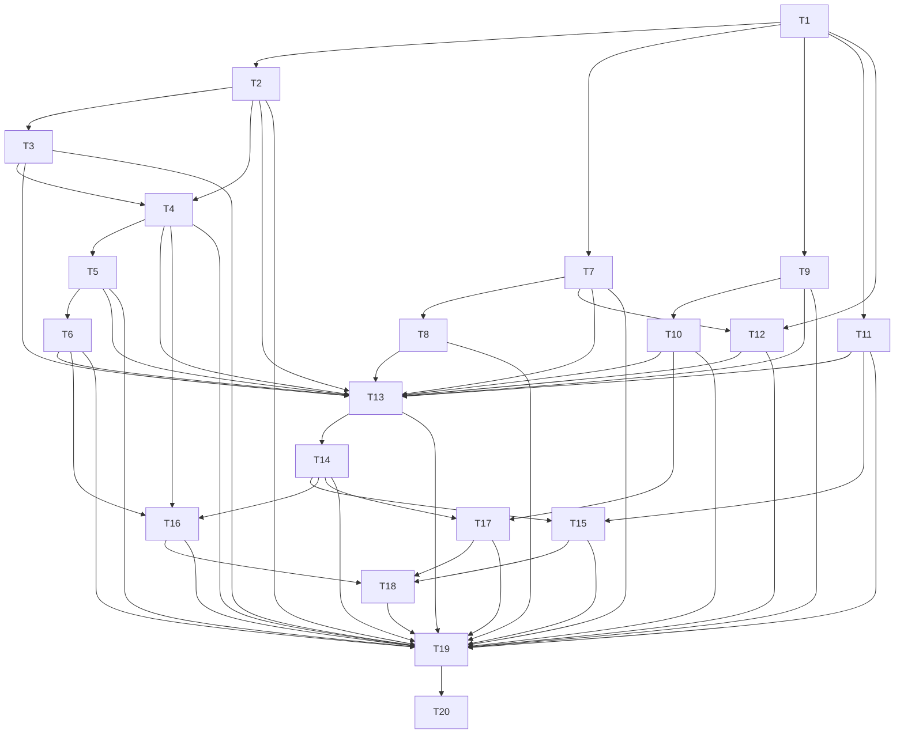

# D6 — End a long stock trade: task-level breakdown

Status: draft for user review. Not frozen. Phase 3 artifact for `planning-protocol.md:61-135`.

## 0. Scope, boundary, and what this deliverable deliberately does not do

### Advertised outcome

A trader can close a long stock position and give exactly one reason when the exit was their
decision; see how the trade actually ended, derived, separately from the reason they gave;
reflect on the close or defer it without closure waiting on writing; and abandon a plan that
never filled so dead plans do not pollute the record.

Concretely, D6 installs four user-facing capabilities through the production UI. **Close with a
reason:** `TradeWorkflows.recordPositionChange` gains the terminal closing variant for a Long
Stock Trade, and the command is rejected with a typed no-write result unless it carries exactly
one active Close Reason (`trade-workflows.md:90`, `trade-record.md:158`). **See how it ended,
derived:** `TradeAnalysis.derive` produces Terminal Disposition from the effective disposing
facts, independently of the stored Lifecycle State and of the trader's Close Reason
(`trade-analysis.md:5`, `glossary.md:65`), and Trade Detail presents all three as separate
concepts (`ui-contract.md:86`). **Reflect on the close, or defer it:** a terminal Position Change
also carries a Close Review obligation under its own obligation key, distinct from the Position
Change Reflection key (`journal.md:92`, `journal.md:135`); completing, explicitly declining, or
deferring it to Journal Debt commits in the same transaction as the closing facts, and none of
the three blocks closure (`journal.md:79`, `trade-workflows.md:90`). **Abandon a plan that never
filled:** `TradeWorkflows.abandonPlan` sets stored lifecycle to `Abandoned` and retires applicable
Plan-related Debt, with no Close Reason and no Terminal Disposition, for a confirmed Plan with no
effective real position-changing fact (`trade-workflows.md:82`, `glossary.md:80`), re-deriving
eligibility from effective facts on every attempt, so that a visibly Voided data-entry-only false
Execution would restore eligibility (`glossary.md:78`). The Void command itself is a Correction and
arrives at D15; D6 proves the derivation that restoration depends on and discloses the restoration
clause rather than claiming it (§8).

The durable schema work this requires is a new fact-store and lifecycle-index revision plus a
manifest v6 seed, and it is a task inside this deliverable rather than a migration deliverable
(`planning-protocol.md:61-135`, `handoff-deepseek-v41-flash-2026-10-11.md:233`).

### In scope

| Area | What D6 actually builds | Where the authority is |
|---|---|---|
| Durable representation | Close Reason association, Abandonment Reason association, terminal-disposition derivation inputs, the reason taxonomies and their protection policy, migration from the D1 schema revision | `trade-record.md:44`, `reference-catalog.md:39`, `reference-catalog.md:102-118` |
| Terminal closing command | `recordPositionChange` terminal variant for one Long Stock Trade: one decision, one explicit Economic Time, expected Trade revision, agency, exactly one Close Reason | `trade-workflows.md:21-23`, `trade-workflows.md:86-92` |
| Terminal reason cardinality | Exactly one active Close Reason when trader agency is present; nothing manufactured when it is absent; typed no-write rejection naming the cardinality defect | `trade-workflows.md:90`, `trade-record.md:158` |
| Terminal Disposition | Derived from effective disposing facts, quantity-aware where quantities exist, mixed mechanisms preserved, applicable only to `Closed` | `trade-analysis.md:108`, `glossary.md:65`, `glossary.md:80` |
| Expected lifecycle | `derive` returns expected Lifecycle State `Closed` for a flat Trade that had real exposure, with agreement status against stored lifecycle | `trade-analysis.md:108`, `trade-record.md:156` |
| Stored lifecycle and index | `Open` to `Closed` in the same atomic commit as its justifying facts; `Open` index membership removed and terminal membership gained in that commit | `trade-record.md:155`, `acceptance-contract.md:52` |
| Close Review | Its own `JournalObligationKey`; Complete, Decline, or Defer; Defer creates Debt with the trigger-time definition snapshot and never a blank Entry | `journal.md:79`, `journal.md:135-137`, `journal.md:188` |
| Abandonment | `abandonPlan` command, active Abandonment Reason requirement, Plan Debt retirement, eligibility re-derivation over effective facts | `trade-workflows.md:82`, `acceptance-contract.md:55-60` |
| Manifest v6 seed | Five Close Reasons, five Abandonment Reasons, the Close Review Entry Type, the Trade Close Source; stable product keys; idempotent repeat seeding | `reference-catalog.md:102-118`, `journal.md:25-35`, `journal.md:194` |
| Atomic commit | One IndexedDB multi-store transaction covering facts, lifecycle/index, Lot Match, Deviation, lineage, and Journal outcomes, behind the persistence-level write gate | `trade-record.md:64-68`, `planning-decisions-2026-10-10.md:177` |
| Result and projection | `PositionChangeResult` / `AbandonPlanResult` carrying the post-commit Trade projection, the derived disposition, and the Journal outcome with no follow-up read | `trade-workflows.md:31-45`, `overview.md:26` |
| Surfaces | Close position form, Abandon plan flow, Trade Detail's three separate concepts, responsive and accessible behavior | `ui-contract.md:22`, `ui-contract.md:28-35`, `ui-contract.md:86` |
| Verification | A mock-free integration suite over the real stack and an independent browser-critic gate | `planning-protocol.md:115-135` |

### Explicitly out of scope, and why it is safe

- **Option and multi-leg closing** (D8, D9, D10, D13). D6's terminal variant is scoped to one
  Long Stock Trade with a single Instrument. The command shape is already bounded-set shaped
  (`trade-workflows.md:85-86`), so adding option members later changes no D6 fact meaning.
- **Settlement-driven closure** (D10 and later). Assignment, Exercise, Expiration, and cash
  settlement are explicit settlement facts (`trade-workflows.md:197`) that D6 does not record.
  D6's non-agency path is exercised only far enough to prove that no Close Reason is
  manufactured; the settlement facts themselves arrive with D10.
- **Roll** (D13). The `Rolled` Close Reason seeds here because it is one of the five canonical
  reasons (`reference-catalog.md:102-108`), but no Roll workflow, lineage, or successor Plan
  exists in D6. This ordering choice is disclosed in §8.
- **Corrections** (D15). D6 implements no Replace, Void, or Rebuild of its own;
  `previewCorrection` and `commitCorrection` remain absent (`trade-workflows.md:154-164`). The one
  abandonment-eligibility clause that needs a visibly Voided fact therefore also lands at D15 and
  is disclosed in §8 rather than assumed here.
- **Reports** (D19). Nothing in D6 aggregates across Trades; Terminal Disposition is a per-Trade
  derived value.
- **Backup and Restore** (D7, D19-D22). D6 adds durable state, so it adds a migration step, but
  it does not extend the backup artifact or claim a `CompletedBackupReceipt`
  (`workspace.md:119`).
- **Metrics and any performance statement.** No latency target is asserted, measured, or implied
  anywhere in this deliverable. D6 only asserts boundedness shapes (index membership, a bounded
  batch, an asserted query count) and discloses the untested scale gap in §8.

### What this deliverable deliberately does not demonstrate

- **The exactly-eleven Strategy cardinality of AC-REF-001.** That scenario completes at D12.
  D6 seeds reasons and two Journal definitions and must not pre-empt, anticipate, or partially
  justify the Strategy seed set. §5 records AC-REF-001 as Partial for exactly this reason.
- **AC-POS-004's non-agency half.** The scenario pairs a terminal trader-directed exit with a
  terminal non-agency settlement. The non-agency settlement requires explicit settlement facts
  that arrive at D10. D6 fully covers the trader-directed half and the "none is manufactured"
  half only as a validation property of the terminal command path; it does not demonstrate a
  real settlement-driven closure. The `Partial` status on that row in §5 does not hide this: §8
  restates it in plain language and names D10.
- **AC-LIFE-003.** Disagreement-cannot-pass-as-Ready is an open under-specification in this
  branch's plan; D6 neither claims it nor constructs an integrity fixture for it. It is raised in
  §8.
- **AC-PERF-001.** Not claimed by this or any deliverable; disclosed in §8.
- **Any claim about the pinned version profile.** Vitest, `fake-indexeddb`, Playwright, and
  axe-core are the approved tools (`planning-decisions-2026-10-10.md:184`), but the exact pinned
  versions are deferred to Phase 6 (`planning-decisions-2026-10-10.md:166`). Every command in this
  file is written against the approved tool names and repo-relative paths, with version-dependent
  behaviour called out where it matters rather than invented.

## 1. Decisions this breakdown introduces (needing alignment)

These six decisions are branch-local readings required to make D6 executable. Each states the rule
this breakdown will implement, the authority it rests on, and the alternative it rejects. None
reopens frozen product semantics, and none is promoted into `specs/`.

**1. Trader agency is established by the submitted command, not inferred from the absence of a
settlement fact.** The terminal Position Change command carries an explicit agency member. When
agency is present, exactly one active Close Reason is required. When agency is absent (the
settlement path, which lands at D10), no Close Reason is required and none is manufactured, and
the same command must not silently accept a supplied reason either. *Authority:*
`trade-workflows.md:90` ("A terminal change requires exactly one Close Reason only when trader
agency is present"); `glossary.md:23` ("A trader-declared Trade fact explaining why a terminal
Position Change with trader agency closed the Trade"). *Rejected alternative:* inferring agency
from "no settlement member was submitted". That reading makes a missing settlement fact look like
a trader decision and would manufacture or omit a required reason depending on data the trader
did not supply. *Consequence for the schema:* agency is a stored property of the terminal
Position Change, not a derived property recomputed by readers, so a later reader cannot reach a
different cardinality conclusion than the committing command did.

**2. Terminal Disposition is derived from effective disposing facts and is never stored as
trader-authored content.** `derive` returns it; Trade Record stores only the inputs (the
effective facts) and the stored Lifecycle State. The trader's Close Reason and the Terminal
Disposition travel in separate members of the accepted result and render in separate regions of
Trade Detail. *Authority:* `trade-analysis.md:5` (analysis "derives Terminal Disposition and
expected Lifecycle State"); `trade-analysis.md:108` ("Terminal Disposition is derived separately
and may contain mixed mechanisms"); `ui-contract.md:86`; `glossary.md:220` (the permitted label
"Closed via" never means Close Reason). *Rejected alternative:* storing a disposition summary on
the Trade snapshot for read convenience. That would create a second authority for a derived
value, require reconciliation on every correction, and let the stored summary drift from the
facts it summarizes. *Consequence:* `TerminalDisposition` is applicable only to `Closed`; an
`Abandoned` Trade returns `NotApplicable` with a stable reason (`glossary.md:80`).

**Settled shape.** `TerminalDisposition` is a result union, not a bare set:
`Applicable(members: TerminalDispositionMember[]) | NotApplicable(stableReason, structuredDetails)`,
following the convention `trade-analysis.md:28` already uses for other calculations, because
`glossary.md:80` requires `NotApplicable` for an Abandoned Trade. A member is
`{ mechanism, sourceFactIdentity, instrument, disposedQuantity }`. `mechanism` is drawn from
`MechanismKind`, the closed five-kind vocabulary `Execution | Expiration | Assignment | Exercise |
CashSettlement` taken from `adr/0003-authoritative-lifecycle-and-derived-disposition.md:7`,
declared once by Trade Analysis and named as shared with Option Disposition Timing (`glossary.md:67`)
and the D19 report field (`performance-analysis.md:99`), so the same idea never acquires a second
vocabulary. `instrument` is per member because Assignment changes it; `sourceFactIdentity` names the
disposing fact, so a later correction or Void can be pointed at it; `disposedQuantity` is an exact
positive magnitude, because the frozen text says "quantities" and direction is already carried by
mechanism and instrument — a long closed by selling 100 and a short closed by buying 100 both
dispose of 100. Members are ordered by `FactOrder` (`trade-analysis.md:30`), so the value is a
deterministic function of the effective facts rather than of the order in which facts were supplied.
`Mixed` is **not** a carried member: it is the predicate `members.length > 1`, for the same reason
the rejected alternative above fails. A Roll's closing leg therefore derives mechanism `Execution`
while its Close Reason is `Rolled`; the two concepts legitimately differ there, which is the
separation the frozen text requires. The shape is a derivation output only and is never stored, so a
later deliverable extending it changes consumers and tests rather than requiring a migration.

**3. `abandonPlan` eligibility is re-derived from effective facts on every attempt.** The rule is
"does any effective real position-changing fact exist right now", evaluated inside the same
prepared change that would abandon. A data-entry-only false Execution that has been visibly
Voided restores eligibility, and an effective real Execution permanently removes it even if
another real Execution later offsets it. Prior existence of a fact never decides eligibility, and
no cached eligibility flag is stored. *Authority:* `glossary.md:78`; `trade-workflows.md:82`
("Applies only to a confirmed Plan with no effective real position-changing fact"); the
invariant at `trade-workflows.md:196`. *Rejected alternative:* a stored `hasEverHadExecution`
flag. It is simpler and wrong: Void must restore eligibility, so a monotone flag cannot express
the rule. *Consequence:* D3's Execution fact store is a blocking dependency (T9 declares
`D3:T2`), because eligibility is decided from that store's effective-fact projection rather than
from any stored flag. `derive` implements the effective-versus-Voided distinction here so that
D15's Void can restore eligibility without a later schema change, but D6 installs no Void command
and no Void surface.

**4. Close Review uses its own obligation key, distinct from the Position Change Reflection
key.** A terminal Position Change creates two obligations, not one: exactly one Position Change
Reflection outcome keyed per Position Change, and one Close Review outcome keyed per terminal
Trade-close obligation. Neither key can settle the other, and neither outcome is merged into the
other's Entry. *Authority:* `journal.md:92` ("A terminal Close Review uses Source Trade Close, a
Trade Anchor, and its distinct obligation key; it is never merged with the Position Change
Reflection"); `journal.md:135` ("Position Change Reflection and Close Review use different
keys"). *Rejected alternative:* reusing the Position Change Reflection key with a different Entry
Type. That would let one submitted disposition satisfy two obligations and would make the
one-outcome-per-obligation invariant (`glossary.md:197`) unsatisfiable under retry. *Consequence:*
the accepted close result carries both outcomes, and a retry of one may not disturb the other.

**5. Deferring or declining Close Review never blocks closure, and the reflection outcome commits
in the same transaction as the closing facts.** The order is: validate the closing facts and the
reason cardinality, prepare the Trade change, prepare the Journal effects (Complete, Decline, or
Defer-to-Debt), then commit both participants together. A Journal participant failure aborts the
Trade participant. *Authority:* `trade-workflows.md:90` ("Closure never waits for Close Review;
that reflection is completed, declined, or represented by Debt in the same transaction");
`trade-workflows.md:198` ("Factual recording is never blocked merely because reflection is
deferred"); `trade-record.md:68` ("A Journal-participant failure rolls back the staged Trade
effects"). *Rejected alternative:* committing closure first and writing the reflection
afterwards. That produces a durable closed Trade with a missing obligation if the second write
fails, which is exactly the placeholder state `journal.md:47` forbids. *Consequence:* T13 is the
one atomic-commit task and every other closing task funnels into it.

**6. The manifest v6 seed adds the five Close Reasons, the five Abandonment Reasons, the Close
Review Entry Type and the Trade Close Source, matching stable product keys on repeat seeding.**
Seeding is idempotent, never matches by mutable label, never overwrites a trader rename, never
reactivates a legitimately retireable seed, and returns `SeedConflict` with no write on
incompatible known keys. *Authority:* `reference-catalog.md:102-118`; `reference-catalog.md:122`;
`journal.md:194`; `acceptance-contract.md:390`. *Rejected alternative:* seeding by label match.
The spec forbids it explicitly ("label text is never identity", `reference-catalog.md:31`), and
it would silently rewrite a trader rename on the next launch. *Consequence:* the seed task owns
its own stable key table, and the repeat-seed case is a first-class unit test rather than an
afterthought.

## 2. Task graph

This breakdown declares **20 tasks in 12 dependency layers** (grouped into 7 implementation phases in §3).

### Declared blocking edges

Every task body in §3 declares its blocking edges and its consumers verbatim. Read together, the
declared edges form these seven layers:

- **Layer 0** — durable representation and seed inputs that nothing inside D6 blocks: T1.
- **Layer 1** — the terminal command and the independent obligation that hangs off it: T2, T7,
  T9, T11, T12.
- **Layer 2** — terminal-reason cardinality and derived disposition: T3, T4, T8, T10.
- **Layer 3** — expected and stored lifecycle: T5.
- **Layer 4** — the stored lifecycle transition that depends on agreement: T6.
- **Layer 5** — the single atomic commit and the mutation result that returns its post-commit
  projection: T13, T14.
- **Layer 6** — the trader-facing surfaces and the mock-free suite that exercises them end to
  end: T15, T16, T17, T18, T19.
- **Layer 7** — the independent browser-critic gate: T20.

Cross-deliverable dependencies are declared in the task bodies and are deliberately not drawn:
`D1:T9` and `D1:T10` (the schema and migration runner T1 extends), `D3:T1` (the Trade Record
durable stores T1 extends), `D3:T3` (the stock-open variant of `recordPositionChange` whose
preparation T2 generalises), `D3:T8` (the `derive` implementation T5 extends), `D3:T11` (the
lifecycle index T6 moves membership in), `D3:T2` (the Execution fact store whose
effective-fact projection T9 and T10 evaluate eligibility from), `D5:T1` (the Journal obligation/Debt machinery T7 extends), and `D1:T3`
(the transaction seam T19 proves durability against).

**Blocking edges** and **Consumed by** are declared per task in §3. A task's blocking edges are the
tasks that must be complete and green before it starts; its consumers are the tasks that cannot
start until it is complete and green. Diagram direction is "blocks", so a diagram line
drawn as `T1` to `T2` and the declaration `- **Blocking edges:** T1.` on T2 state the same fact
from the two ends.



### Verifying the graph itself

1. `node scripts/check-deliverable-breakdown.mjs plan/deliverable-breakdowns/D6-end-long-stock-trade.md`
   parses the 20 task headers, compares the declared edges against the drawn edges as transitive
   reductions, and must report `0 failure(s), 0 warning(s)`. Run it once all seven breakdown files
   exist, because the nine cross-deliverable edges above resolve against the sibling files.
2. `node scripts/audit-breakdown-coverage.mjs` re-reads the §5 coverage table and the §7 mapping
   table, confirms each cited task id exists in this file, and must also report
   `0 failure(s), 0 warning(s)`.
3. Manual cycle check: the only terminal node is T13 (eleven prerequisites, two consumers) and the
   only sink is T20. No task declares a task that transitively depends on it, so no mutual
   blocking pair exists and the checker emits no mutual-blocking warning.
4. Layer agreement check: for every task, its layer index above equals one plus the maximum layer
   index of its declared blocking edges. T20 is the only task with no local blocking edge, which
   is why the checker's isolation warning does not fire (it is consumed by nothing, but it is
   reached from T19).

## 3. Task detail

### Phase L0 — durable representation and seed inputs

#### T1 — `S` D6 durable schema and migration: Close/Abandonment facts, disposition inputs, manifest v6

- **Blocking edges:** D1:T9, D1:T10, D3:T1.
- **Consumed by:** T2, T7, T9, T11, T12.

**What this task builds.** One durable schema revision on top of the D1 store and the D3 fact
stores, plus the migration that carries an existing Workspace from the previous revision to it.
Concretely, the revision adds:

1. a Close Reason association store, keyed by the terminal Position Change identity and holding
   exactly one active Close Reason reference plus its expected-revision binding
   (`trade-record.md:44`, `reference-catalog.md:39`);
2. an Abandonment Reason association store, keyed by Trade identity, holding one active
   Abandonment Reason reference for an `Abandoned` Trade;
3. the terminal-disposition derivation inputs as fact members on the Position Change record: the
   explicit agency member, the disposing mechanism kind per member, and the disposed quantity per
   member, so `derive` can reconstruct mixed mechanisms without guessing
   (`trade-analysis.md:108`, `trade-record.md:61`);
4. the reason taxonomies' protection-policy fields (`SeededValuesRemainSelectable`, the
   `Rolled` workflow-semantic role bit) on the Reference Catalog record
   (`reference-catalog.md:39`, `reference-catalog.md:26`);
5. the manifest v6 seed-state row for the four additions named in decision 6, using the stable
   product key table and never mutable labels (`reference-catalog.md:122`, `journal.md:194`).

The migration is mechanical and forward-only: it creates the new stores and indexes, backfills
the seed-state row for Workspaces seeded at v5 or earlier, and leaves every existing fact,
identity, sequence, and lifecycle binding untouched. A Workspace that already carries a v6
seed-state row is left unchanged. A Workspace whose stored revision is newer than the installed
one is refused rather than migrated (`workspace.md:110`).

**Exact verification**

| # | Command | Expected result |
|---|---|---|
| V1.1 | `pnpm vitest run tests/persistence/migration-d6.spec.ts` | After `pnpm install` and the Phase 6 version pin, the new revision's migration suite passes: a v5 fixture Workspace gains the Close Reason store, the Abandonment Reason store, the extended Position Change member shape, the taxonomy protection fields, and the v6 seed-state row, and every pre-existing fact identity, Recorded Sequence, and lifecycle binding is byte-identical before and after. Once the pinned versions are recorded in the plan, the command names them in the evidence line; the command itself and the assertion set do not change with the pin. |
| V1.2 | `node scripts/check-deliverable-breakdown.mjs plan/deliverable-breakdowns/D6-end-long-stock-trade.md` | The T1 header is parsed as type `S`, its declared cross-deliverable edges `D1:T9`, `D1:T10` and `D3:T1` resolve against the sibling breakdown task sets, and the run reports `0 failure(s)` for this file with no missing-`Exact verification` failure. |
| V1.3 | `pnpm vitest run tests/persistence/schema-shape.spec.ts -t "d6 revision"` | The declared store and index set for the D6 revision matches the migration's actual output: store names, key paths, and index key paths are equal as sets, with no extra store and no missing index. |
| V1.4 | `pnpm vitest run tests/persistence/migration-idempotence.spec.ts -t "v6 seed state"` | Running the migration twice against the same fixture produces one v6 seed-state row and a second run that reports no change; no fact revision advances on the second run. |
| V1.5 | `pnpm vitest run tests/persistence/migration-newer-revision.spec.ts` | A fixture whose stored revision is newer than the installed revision returns a typed refusal with no write, and the fixture's stores are unchanged after the attempt. |
| V1.6 | `pnpm vitest run tests/persistence/migration-failure-atomicity.spec.ts` | With an injected failure partway through the migration, no partially migrated state becomes visible; the Workspace still opens at its prior revision, and the staged new stores hold no effective rows. |

**Depends on it:** every other D6 task. Without this revision there is no place to store a Close
Reason or an Abandonment Reason, no agency member to validate cardinality against, and no seed
state for the two taxonomies, so T2's terminal variant, T9's abandonment command, and T11's seed
are all unimplementable; the deliverable's closure flow would be unverifiable end to end.

### Phase L1 — the terminal command and its independent obligations

#### T2 — `B` `recordPositionChange` terminal closing variant for long stock

- **Blocking edges:** T1, D3:T3.
- **Consumed by:** T3, T4, T13, T19.

**Public seam under test.** `TradeWorkflows.recordPositionChange(command: PositionChangeCommand)
-> PositionChangeResult` for the terminal variant of a one-Instrument Long Stock Trade
(`trade-workflows.md:13`). The command states ownership, Planned-Leg intent, allocation, one
Position Change Reflection disposition, exactly one explicit Economic Time, the expected Trade
revision, the explicit agency member, and the bounded member set for the decision
(`trade-workflows.md:21-23`, `trade-workflows.md:86`). The variants that are *not* this one —
open, partial reduce, option settlement, multi-Trade — keep their existing D3 behavior and are
regression-covered, not redesigned.

**Unit test cases**

```text
describe("TradeWorkflows.recordPositionChange terminal closing variant for a long stock Trade")
  it should return a PositionChangeResult whose receipt names the affected TradeId and its new FactRevision when a flat-out closing decision is submitted with one active Close Reason, expected revision, and explicit agency
  it should leave the Trade Open and return a typed non-terminal rejection when the submitted members reduce exposure without reaching zero
  it should return a typed no-write rejection naming the Trade revision when the expected Trade revision is stale, and write no Position Change, Close Reason, lifecycle change, or Journal outcome
  it should return a typed no-write rejection naming the missing economic time when the command carries no explicit Economic Time rather than substituting the current clock
  it should reject a terminal decision that spans more than one Trade in this variant with a typed unsupported-scope result, and write nothing
  it should keep a terminal decision's Position Change Reflection obligation at exactly one outcome keyed to the originating Trade when the closing decision contains several disposing Executions
  it should treat an exposure-reducing decision that still leaves a nonzero Instrument Position as non-terminal so that no Close Reason is required and no Terminal Disposition becomes applicable
  it should reject a Stock closing decision whose declared Instrument does not match the Trade's confirmed Planned Leg Instrument, and write nothing
```

**Integration case.** A mock-free integration test starts the real stack (persistence seam,
Trade Record, Trade Analysis, Journal, Reference Catalog, Trade Workflows), confirms a Long Stock
Plan through `confirmPlan`, opens it through `recordPositionChange`'s D3 stock-open variant, then
submits the terminal variant with one active Close Reason and an explicit Economic Time. It
asserts durable state after the call: the Position Change fact with its disposing members, the
Close Reason association, the new stored Lifecycle State, the new `FactRevision`, and the Journal
outcome all exist and are bound to that revision; and a restart of the persistence instance reads
the same rows. The only disclosed infrastructure substitution is `fake-indexeddb` in place of a
browser-owned IndexedDB instance (`planning-decisions-2026-10-10.md:184`); the test traverses
every layer and asserts durable rows rather than only the returned object. T19 repeats the same
proof against a real browser engine.

**Red/green evidence**

| Case | Red command and the reason it must fail | Green command and expected result |
|---|---|---|
| Terminal decision with one reason | `pnpm vitest run tests/workflows/record-position-change-terminal.spec.ts -t "flat-out terminal"` — fails because the terminal branch is absent, so the submitted closing member is treated as an ordinary reduction and no `Closed` transition, no Close Reason row, and no terminal Journal outcome is produced | Same command — the test passes, and the returned receipt names the new `FactRevision` |
| Partial reduction stays Open | `pnpm vitest run tests/workflows/record-position-change-terminal.spec.ts -t "still nonzero"` — fails because without the terminal branch nothing distinguishes terminal from non-terminal exposure, so a partial reduction is never classified and the lifecycle expectation is unassertable | Same command — the Trade is still `Open` and the result is typed non-terminal |
| Stale revision | `pnpm vitest run tests/workflows/record-position-change-terminal.spec.ts -t "stale revision"` — fails because the expected-revision guard on the terminal variant does not exist, so the command writes | Same command — typed no-write rejection and a before/after durable-state comparison that is unchanged |
| Missing economic time | `pnpm vitest run tests/workflows/record-position-change-terminal.spec.ts -t "explicit economic time"` — fails because nothing enforces the explicit-time rule on this path | Same command — typed rejection and no fact written |
| Cross-Trade scope | `pnpm vitest run tests/workflows/record-position-change-terminal.spec.ts -t "single Trade scope"` — fails because the variant accepts the bounded set shape without narrowing it | Same command — typed unsupported-scope result and no write |
| One reflection outcome | `pnpm vitest run tests/workflows/record-position-change-terminal.spec.ts -t "one reflection outcome"` — fails because the reflection obligation is not yet prepared on this path | Same command — exactly one outstanding obligation keyed to the originating Trade |
| Wrong Instrument | `pnpm vitest run tests/workflows/record-position-change-terminal.spec.ts -t "planned leg instrument"` — fails because the Instrument check is not applied to the terminal variant | Same command — typed rejection and no write |

#### T3 — `B` Exactly one active Close Reason when trader agency is present

- **Blocking edges:** T2.
- **Consumed by:** T4, T13, T19.

**Public seam under test.** The terminal variant's reason-cardinality validation, observed through
the public `recordPositionChange` result rather than any private validator
(`trade-workflows.md:90`, `trade-record.md:158`). The rule has three observable halves: presence of
agency requires exactly one active reason; absence of agency forbids a supplied reason and
manufactures none; and a reason that is not currently selectable for a new selection is rejected
(`reference-catalog.md:47`, `reference-catalog.md:39`).

**Unit test cases**

```text
describe("terminal Close Reason cardinality under trader agency")
  it should return a typed no-write rejection naming the Close Reason cardinality when a trader-directed terminal command carries no Close Reason
  it should return a typed no-write rejection naming the Close Reason cardinality when a trader-directed terminal command carries two Close Reasons
  it should accept exactly one active Close Reason and bind it to the terminal Position Change identity so a later read of that fact resolves the same reason
  it should return a typed no-write rejection naming the inactive reference when the submitted Close Reason is retired, without silently substituting another seeded reason
  it should return a typed no-write rejection naming the inactive reference when the submitted Close Reason is not a reason identity at all, for example a settlement mechanism name or a Strategy identity
  it should record a terminal non-agency settlement member with no Close Reason and manufacture none, so the stored Trade has no Close Reason association
  it should return a typed no-write rejection naming the unexpected reason when a non-agency terminal command nevertheless supplies one, so agency is never inferred either way
  it should accept the seeded Rolled reason on a long stock exit because the protection policy keeps every seeded taxonomy value selectable, while requiring no Roll lineage for that exit
```

**Integration case.** A mock-free integration test submits three terminal commands against three
otherwise identical open Long Stock Trades: one with no reason, one with two reasons, and one
with exactly one active reason. It asserts that the first two leave the durable state of their
Trades unchanged at the same `FactRevision` (including no lifecycle row, no index membership
change, and no Journal outcome), and that the third commits a Close Reason association bound to
the terminal Position Change. The `Rolled` case is included to prove that the reason is a
selectable catalog value at this revision and not a Roll workflow. Disclosed substitution:
`fake-indexeddb`.

**Red/green evidence**

| Case | Red command and the reason it must fail | Green command and expected result |
|---|---|---|
| No reason | `pnpm vitest run tests/workflows/close-reason-cardinality.spec.ts -t "no reason"` — fails because the cardinality check does not exist, so a trader-directed terminal command closes the Trade with no reason | Same command — typed rejection naming the cardinality, and the Trade is unchanged |
| Two reasons | `pnpm vitest run tests/workflows/close-reason-cardinality.spec.ts -t "two reasons"` — fails because nothing counts the supplied reasons, so the second silently wins | Same command — typed rejection and no write |
| Exactly one | `pnpm vitest run tests/workflows/close-reason-cardinality.spec.ts -t "exactly one active reason"` — fails because the association is not stored even when the command is well formed | Same command — the reason resolves from the stored fact |
| Retired reason | `pnpm vitest run tests/workflows/close-reason-cardinality.spec.ts -t "retired reason"` — fails because new-selection eligibility is not resolved for the reason reference | Same command — typed rejection naming the inactive reference |
| Non-agency path | `pnpm vitest run tests/workflows/close-reason-cardinality.spec.ts -t "non-agency"` — fails because the agency member is not yet consumed, so a settlement member is treated as an ordinary disposal | Same command — no Close Reason association exists and none is manufactured |
| Unexpected reason on non-agency | `pnpm vitest run tests/workflows/close-reason-cardinality.spec.ts -t "unexpected reason"` — fails because the command currently tolerates a stray reason | Same command — typed rejection and no write |
| Rolled without a Roll | `pnpm vitest run tests/workflows/close-reason-cardinality.spec.ts -t "Rolled without a Roll"` — fails because the reason reference is not resolved against the protected-taxonomy policy | Same command — the close commits with `Rolled` and no lineage is required or created |

#### T4 — `B` Terminal Disposition derived from effective disposing facts

- **Blocking edges:** T2, T3.
- **Consumed by:** T5, T13, T16, T19.

**Public seam under test.** `TradeAnalysis.derive(input: TradeDerivationInput) -> DerivationResult`,
specifically the `Terminal Disposition when terminal` member of `DerivedTradeState`
(`trade-analysis.md:41`, `trade-analysis.md:5`). The derived value names the complete set of
mechanisms and quantities by which exposure ended, preserves mixed mechanisms, is applicable only
to a `Closed` Trade, and is returned independently of the trader's Close Reason and of the stored
Lifecycle State (`glossary.md:65`, `glossary.md:80`, `trade-analysis.md:108`). It is the
`Applicable(members) | NotApplicable(stableReason, structuredDetails)` union of §1 decision 2, whose
members are `{ mechanism, sourceFactIdentity, instrument, disposedQuantity }` ordered by `FactOrder`
with `mechanism` drawn from the shared `MechanismKind` vocabulary, and whose `Mixed` form is the
derived predicate `members.length > 1` rather than a carried member. This task must not read the
Close Reason association and must not read stored lifecycle to decide applicability; it derives from
the effective facts it was given.

**Unit test cases**

```text
describe("TradeAnalysis.derive Terminal Disposition for a closed long stock Trade")
  it should return a Terminal Disposition naming the full disposing quantity for the exact Instrument when every effective disposing fact is a trader-directed sale that consumes all open Lots
  it should return a Terminal Disposition carrying both mechanism members with their quantities when the exposure ends through a mixture of a trader-directed sale and an explicit settlement fact
  it should return NotApplicable with a stable reason and no mechanism set when the Trade is Abandoned with no effective position-changing fact
  it should return no applicable Terminal Disposition and no mechanism set when effective facts still leave a nonzero Instrument Position, regardless of what the trader submitted as a reason
  it should produce an identical Terminal Disposition when the same effective facts are supplied with a different trading Close Reason, proving the derivation does not read the reason
  it should produce an identical Terminal Disposition when the same effective facts are supplied with a deliberately disagreeing stored Lifecycle State, and report the stored-lifecycle disagreement as a structured integrity finding
  it should ignore a Voided disposing fact version and derive the disposition from the remaining effective versions only
  it should report the mechanism set as mixed whenever more than one mechanism kind disposed of quantity, and never collapse it to a single headline mechanism
  it should name the disposing fact identity on every member, so a later correction or Void can be pointed at the exact fact
  it should order the members by economic time and then Recorded Sequence, producing the same member order when the same facts are supplied in a different order
```

**Integration case.** A mock-free integration test builds a Long Stock Trade whose exposure was
opened by two Executions and closed by two disposing facts of different mechanism kinds (one
trader-directed sale, one explicit settlement member), derives it through the real
`TradeAnalysis.derive` entry point with the persisted snapshot read from the real persistence
seam, and asserts the returned mechanism set, quantities, and applicability. It then re-derives
with the Close Reason association removed and asserts the disposition is identical, proving the
separation is structural rather than asserted. Disclosed substitution: `fake-indexeddb`; the
settlement member here is a test-constructed fact shape that D10 will be able to author from the
UI, and it is constructed through the real prepared-change path rather than by writing child rows
directly.

**Red/green evidence**

| Case | Red command and the reason it must fail | Green command and expected result |
|---|---|---|
| Single-mechanism close | `pnpm vitest run tests/analysis/derive-terminal-disposition.spec.ts -t "full disposing quantity"` — fails because `DerivedTradeState` carries no Terminal Disposition member yet | Same command — the disposition names the Instrument and the full disposed quantity |
| Mixed mechanisms | `pnpm vitest run tests/analysis/derive-terminal-disposition.spec.ts -t "mixed mechanisms"` — fails because there is no mechanism set to fill | Same command — both members present with their quantities |
| Abandoned Trade | `pnpm vitest run tests/analysis/derive-terminal-disposition.spec.ts -t "Abandoned"` — fails because applicability rules are not implemented | Same command — `NotApplicable` with a stable reason |
| Still nonzero | `pnpm vitest run tests/analysis/derive-terminal-disposition.spec.ts -t "still open"` — fails because applicability is not tied to a flat Position | Same command — no applicable disposition |
| Reason independence | `pnpm vitest run tests/analysis/derive-terminal-disposition.spec.ts -t "different Close Reason"` — fails because there is no derived value to compare across runs | Same command — byte-identical disposition across the two runs |
| Stored-lifecycle disagreement | `pnpm vitest run tests/analysis/derive-terminal-disposition.spec.ts -t "disagreeing stored lifecycle"` — fails because the structured integrity finding is not returned | Same command — identical disposition plus a named integrity finding |
| Voided disposing fact | `pnpm vitest run tests/analysis/derive-terminal-disposition.spec.ts -t "Voided disposing fact"` — fails because effective-version selection is not applied to disposing facts here | Same command — the Voided version contributes nothing |
| Source fact identity | `pnpm vitest run tests/analysis/derive-terminal-disposition.spec.ts -t "source fact identity"` — fails because members carry no reference to the disposing fact | Same command — every member names its disposing fact |
| Member order | `pnpm vitest run tests/analysis/derive-terminal-disposition.spec.ts -t "member order"` — fails because member order follows construction rather than `FactOrder` | Same command — identical member order across both supply orders |

#### T7 — `B` Close Review with its distinct obligation key

- **Blocking edges:** T1, D5:T1.
- **Consumed by:** T8, T12, T13, T19.

**Public seam under test.** `Journal.prepareEffects` and `Journal.applyPreparedEffects` invoked by
the closing workflow, for the Close Review obligation (`journal.md:186`). The observable contract
is: Source `Trade Close`, a Trade Anchor, the exact Entry Definition revision rendered, and an
obligation key that is distinct from the Position Change Reflection key for the same terminal
decision (`journal.md:92`, `journal.md:135`). The initial Close Review definition is the three
prompts at `journal.md:73-79`.

**Unit test cases**

```text
describe("Journal Close Review obligation for a terminal Position Change")
  it should prepare one Close Review obligation with Source Trade Close, a Trade Anchor, and the exact Close Review Entry Definition revision when a terminal closing decision is submitted with a completed form
  it should keep the Close Review obligation key distinct from the originating Position Change Reflection key so completing one leaves the other's outcome unchanged
  it should capture the four stable option identities of the first Close Review prompt exactly as defined, and reject a submitted option identity that does not belong to the rendered definition revision
  it should create Debt with the trigger-time definition snapshot and no Entry when the Close Review disposition is Defer
  it should create a distinct decline outcome for the obligation key and no Entry when the Close Review disposition is Decline
  it should never write a Close Reason association as part of preparing or applying a Close Review outcome
  it should return a conflict and write nothing when the same obligation key is submitted twice with the same expected revision, so one obligation still has exactly one current outcome
  it should validate a later submission against the definition revision snapshotted on the obligation rather than the current Close Review definition
```

**Integration case.** A mock-free integration test closes a real Trade with a deferred Close
Review, then queries the Journal through its public `query` for the obligation key and asserts
one Outstanding Debt with the trigger-time snapshot and no Entry; it then closes a second Trade
with a completed Close Review and asserts one Entry with Source `Trade Close` and a distinct key,
while the Position Change Reflection outcome for each decision is untouched. Durable rows are
asserted after a persistence restart. Disclosed substitution: `fake-indexeddb`.

**Red/green evidence**

| Case | Red command and the reason it must fail | Green command and expected result |
|---|---|---|
| Completed review | `pnpm vitest run tests/journal/close-review-obligation.spec.ts -t "completed review"` — fails because no Close Review obligation type exists, so the workflow cannot prepare one | Same command — one Entry with Source `Trade Close` and the exact definition revision |
| Key distinctness | `pnpm vitest run tests/journal/close-review-obligation.spec.ts -t "distinct obligation key"` — fails because there is no second key to compare | Same command — the two keys differ and each outcome stands alone |
| Option identity validation | `pnpm vitest run tests/journal/close-review-obligation.spec.ts -t "stable option identities"` — fails because the definition is not used to validate the submitted option | Same command — an option outside the rendered revision is rejected with no write |
| Defer | `pnpm vitest run tests/journal/close-review-obligation.spec.ts -t "Defer creates Debt"` — fails because Defer is not wired for this obligation | Same command — one Outstanding Debt, snapshot present, no Entry |
| Decline | `pnpm vitest run tests/journal/close-review-obligation.spec.ts -t "Decline"` — fails because decline is not produced for this key | Same command — one decline outcome and no Entry |
| No Close Reason written | `pnpm vitest run tests/journal/close-review-obligation.spec.ts -t "writes no Close Reason"` — fails because the reason association does not exist yet on the facts T7 touches | Same command — the assertion holds and no reason row is created |
| Duplicate submission | `pnpm vitest run tests/journal/close-review-obligation.spec.ts -t "one current outcome"` — fails because uniqueness of the obligation outcome is not enforced for this key | Same command — a typed conflict and no write |
| Snapshot validation | `pnpm vitest run tests/journal/close-review-obligation.spec.ts -t "snapshotted definition"` — fails because answers are validated against the current definition instead of the snapshotted one | Same command — the later submission is accepted against the original snapshot |

#### T9 — `B` `abandonPlan`: factual eligibility and effect

- **Blocking edges:** T1, D3:T2.
- **Consumed by:** T10, T13, T19.

**Public seam under test.** `TradeWorkflows.abandonPlan(command: AbandonPlanCommand) ->
AbandonPlanResult` (`trade-workflows.md:12`). The observable contract: it applies only to a
confirmed Plan with no effective real position-changing fact; it requires one active Abandonment
Reason; it stores `Abandoned`; it retires applicable Plan-related Debt; and it creates neither a
Close Reason nor a Terminal Disposition (`trade-workflows.md:82`, `glossary.md:76`,
`glossary.md:80`).

**Unit test cases**

```text
describe("TradeWorkflows.abandonPlan factual eligibility and effect")
  it should store Abandoned and return the post-commit Trade projection when a confirmed Plan with no effective position-changing fact is abandoned with one active Abandonment Reason
  it should return a typed no-write rejection naming the Abandonment Reason cardinality when the abandon command carries no Abandonment Reason
  it should return a typed no-write rejection naming the Abandonment Reason when the submitted reason is retired or is not an Abandonment Reason identity
  it should return a typed no-write rejection naming the effective Execution when the Plan already has an effective real position-changing fact, leaving stored lifecycle Planned and every index membership unchanged
  it should retire applicable Plan-related Debt in the same operation, so a subsequent Debt query reports no outstanding Plan Debt for that Trade
  it should write no Close Reason association and leave Terminal Disposition NotApplicable after a successful abandonment
  it should return a typed no-write rejection when the expected Trade revision is stale, rather than abandoning a Trade whose facts moved
  it should be rejected for a Trade whose stored lifecycle is Open or Closed, naming the lifecycle as the reason, even when no effective fact can be found
```

**Integration case.** A mock-free integration test confirms a Long Stock Plan through
`confirmPlan` with a deferred Plan Reflection, then abandons it with one active Abandonment
Reason. It asserts durable state: stored lifecycle `Abandoned` bound to the new `FactRevision`,
the `Planned` index membership removed and terminal membership gained in the same commit, the
Plan Debt retired, no Close Reason row, and `derive` returning no applicable Terminal
Disposition. A persistence restart re-reads the same rows. Disclosed substitution:
`fake-indexeddb`.

**Red/green evidence**

| Case | Red command and the reason it must fail | Green command and expected result |
|---|---|---|
| Successful abandon | `pnpm vitest run tests/workflows/abandon-plan.spec.ts -t "never filled"` — fails because `abandonPlan` is not implemented, so no `Abandoned` binding exists | Same command — stored lifecycle `Abandoned` at a new revision |
| Missing reason | `pnpm vitest run tests/workflows/abandon-plan.spec.ts -t "requires one reason"` — fails because the command does not exist to validate | Same command — typed rejection naming the cardinality |
| Retired reason | `pnpm vitest run tests/workflows/abandon-plan.spec.ts -t "active reason"` — fails because the reference is not resolved for a new selection | Same command — typed rejection and no write |
| Has effective Execution | `pnpm vitest run tests/workflows/abandon-plan.spec.ts -t "effective Execution"` — fails because eligibility is not derived from effective facts | Same command — typed rejection naming the Execution, lifecycle unchanged |
| Plan Debt retirement | `pnpm vitest run tests/workflows/abandon-plan.spec.ts -t "retires Plan Debt"` — fails because the Journal participant is not invoked on this path | Same command — no outstanding Plan Debt remains |
| No Close Reason, no disposition | `pnpm vitest run tests/workflows/abandon-plan.spec.ts -t "no Close Reason"` — fails because the negative assertions cannot be checked against a committed abandonment | Same command — both assertions hold |
| Stale revision | `pnpm vitest run tests/workflows/abandon-plan.spec.ts -t "stale revision"` — fails because the expected-revision guard is absent | Same command — typed rejection with unchanged durable state |
| Wrong stored lifecycle | `pnpm vitest run tests/workflows/abandon-plan.spec.ts -t "Open or Closed"` — fails because the lifecycle precondition is not enforced | Same command — typed rejection naming the lifecycle |

#### T11 — `B` Manifest v6 seed: five Close Reasons and five Abandonment Reasons

- **Blocking edges:** T1.
- **Consumed by:** T13, T15, T19.

**Public seam under test.** `ReferenceCatalog.seedDefaults(command: SeedCatalogDefaults) ->
SeedCatalogResult` for manifest v6, plus `ReferenceCatalog.query` observed by the selector-facing
caller (`reference-catalog.md:120-137`). The exact taxonomies are the five Close Reasons and five
Abandonment Reasons at `reference-catalog.md:102-118`; the protection policy is
`SeededValuesRemainSelectable` with the extra `Rolled` selectability while Roll is supported
(`reference-catalog.md:39`).

**Unit test cases**

```text
describe("ReferenceCatalog.seedDefaults manifest v6 reason taxonomies")
  it should create exactly the five canonical Close Reasons with stable product keys matching the manifest when a fresh Workspace seeds
  it should create exactly the five canonical Abandonment Reasons with stable product keys matching the manifest when a fresh Workspace seeds, in the declared order
  it should create no sixth reason, no Other reason, and no settlement-mechanism or lifecycle-outcome value in either taxonomy
  it should record the Rolled Close Reason with its unique workflow-semantic role and keep it selectable while Roll is supported
  it should keep every seeded reason selectable after a trader renames it, because the taxonomy values cannot be retired under the protection policy
  it should create only genuinely missing additions and return an idempotent result with no rewrite when seeding runs a second time against a compatibly seeded Workspace
  it should return SeedConflict and write nothing when an incompatible known key already exists for one of the v6 reason identities
  it should leave a trader-created reason untouched on repeat seeding, proving the seed matches stable keys rather than mutable labels
```

**Integration case.** A mock-free integration test initializes a Workspace at the D1 seed
revision, runs the manifest v6 seed through the real `Workspace.initialize` path, then queries the
catalog through `ReferenceCatalog.query` with a Selectable-only view and asserts the two ordered
taxonomies, the protection policy, and the `Rolled` role. It then renames a seeded reason through
`CatalogSaveResult`-producing `save`, re-seeds, and asserts the rename survives while the stable
identity and its selectability are unchanged. Disclosed substitution: `fake-indexeddb`.

**Red/green evidence**

| Case | Red command and the reason it must fail | Green command and expected result |
|---|---|---|
| Close Reason taxonomy | `pnpm vitest run tests/catalog/seed-manifest-v6-reasons.spec.ts -t "five Close Reasons"` — fails because manifest v6 does not exist and neither taxonomoy seeds | Same command — the five seeded values are present with stable keys |
| Abandonment Reason taxonomy | `pnpm vitest run tests/catalog/seed-manifest-v6-reasons.spec.ts -t "five Abandonment Reasons"` — fails for the same reason | Same command — the five seeded values are present in declared order |
| No extra reasons | `pnpm vitest run tests/catalog/seed-manifest-v6-reasons.spec.ts -t "no Other reason"` — fails because there is no taxonomy to inspect | Same command — the counts are exactly five and five |
| Rolled role | `pnpm vitest run tests/catalog/seed-manifest-v6-reasons.spec.ts -t "Rolled workflow-semantic role"` — fails because the role field is not seeded | Same command — the role is unique and the value is selectable |
| Protection policy | `pnpm vitest run tests/catalog/seed-manifest-v6-reasons.spec.ts -t "rename keeps selectable"` — fails because the policy is not enforced on seeded values | Same command — rename succeeds and the value stays selectable |
| Repeat seed idempotent | `pnpm vitest run tests/catalog/seed-manifest-v6-reasons.spec.ts -t "repeat seed"` — fails because there is no v6 seed to repeat | Same command — no addition and no rewrite on the second run |
| Incompatible key | `pnpm vitest run tests/catalog/seed-manifest-v6-reasons.spec.ts -t "SeedConflict"` — fails because the conflict branch is unreachable | Same command — `SeedConflict` with no write |

#### T12 — `B` Manifest v6 seed: Close Review Entry Type and Trade Close Source

- **Blocking edges:** T1, T7.
- **Consumed by:** T13, T19.

**Public seam under test.** `Journal.seedDefaults` for manifest v6 and `Journal.getDefinitions`
(`journal.md:194`, `journal.md:192`). Close Review is the fourth fixed Entry Type
(`journal.md:30`) with the exact three-prompt initial definition at `journal.md:73-79`. `Trade
Close` is one of the seven initial Sources (`journal.md:35`, `glossary.md:116`). Seeding never
creates a new Entry Type, never rewrites history, and matches stable keys.

**Unit test cases**

```text
describe("Journal.seedDefaults manifest v6 Close Review Entry Type and Trade Close Source")
  it should create the Close Review Entry Type under its fixed identity with the three initial Prompts at the declared order and requiredness when a fresh Workspace seeds
  it should snapshot the first Prompt's four stable option identities, being Yes as planned, Yes with changes, No, and Unsure, rather than matching their labels
  it should create the Trade Close Source identity in the same atomic seed so a Close Review Entry can record its automatic Source
  it should leave the fixed Entry Type count unchanged at seven and create no eighth type
  it should be idempotent on repeat seeding, creating no addition and returning the existing complete definition without advance
  it should preserve a trader's revised Close Review definition on re-seed instead of overwriting it with the initial definition
  it should return SeedConflict and write nothing when an incompatible known key already exists for the Close Review type or the Trade Close Source
  it should still permit the Close Review obligation's answers to be answered, declined, or deferred, because requiredness governs a completed form and not the availability of those outcomes
```

**Integration case.** A mock-free integration test seeds a fresh Workspace to manifest v6, then
opens the Close Review form through `Journal.getDefinitions` and asserts the exact ordered prompts,
option identities, and requiredness. It revises the definition prospectively through
`reviseDefinition`, re-seeds, and asserts the revised definition survives with its new revision
while an obligation snapshotted under the earlier revision still validates against the snapshot.
Disclosed substitution: `fake-indexeddb`.

**Red/green evidence**

| Case | Red command and the reason it must fail | Green command and expected result |
|---|---|---|
| Close Review definition | `pnpm vitest run tests/journal/seed-close-review.spec.ts -t "three initial Prompts"` — fails because the Close Review type is not seeded | Same command — the exact definition is returned |
| Stable option identities | `pnpm vitest run tests/journal/seed-close-review.spec.ts -t "stable option identities"` — fails because there are no seeded options to resolve | Same command — four stable identities in declared order |
| Trade Close Source | `pnpm vitest run tests/journal/seed-close-review.spec.ts -t "Trade Close Source"` — fails because the Source is not created | Same command — the Source exists under its fixed identity |
| Seven types | `pnpm vitest run tests/journal/seed-close-review.spec.ts -t "exactly seven Entry Types"` — fails because the type set is incomplete | Same command — the count is seven |
| Repeat seed | `pnpm vitest run tests/journal/seed-close-review.spec.ts -t "repeat seed idempotent"` — fails because the first seed does not exist | Same command — no addition on the second run |
| Trader revision preserved | `pnpm vitest run tests/journal/seed-close-review.spec.ts -t "preserves trader definition"` — fails because there is no definition to preserve | Same command — the revised definition is unchanged by seeding |

### Phase L2 — cardinality, disposition, reflection policy and eligibility re-derivation

#### T5 — `B` `derive`: `Closed` expected lifecycle and agreement

- **Blocking edges:** T4, D3:T8.
- **Consumed by:** T6, T13, T19.

**Public seam under test.** `TradeAnalysis.derive` for the `expected Lifecycle State and agreement
status` members of `DerivedTradeState` (`trade-analysis.md:39`). The rule: expected lifecycle is
`Closed` when effective facts show that real exposure existed and no Position remains
(`glossary.md:75`); `Planned` when no effective fact established exposure; `Open` when effective
facts leave nonzero exposure; and `Abandoned` only for an explicitly abandoned confirmed Plan
that never had an effective real position-changing fact (`glossary.md:76`). Agreement is reported
as a structured integrity finding and never silently repaired (`trade-analysis.md:63`,
`trade-record.md:156`).

**Unit test cases**

```text
describe("TradeAnalysis.derive expected lifecycle Closed and agreement")
  it should return expected lifecycle Closed when effective facts show real exposure existed and no Instrument Position remains
  it should return expected lifecycle Open and an agreement finding when the same flat effective facts are supplied with a stored lifecycle of Open
  it should return expected lifecycle Abandoned with no Terminal Disposition when the Trade was explicitly abandoned and no effective position-changing fact ever existed
  it should return expected lifecycle Planned when the confirmed Plan has no effective position-establishing fact and was not abandoned
  it should keep expected lifecycle Open for a Trade whose effective facts are offsetting but leave a nonzero remaining Instrument Position
  it should report a structured disagreement finding naming the stored lifecycle value and the expected value rather than repairing or overriding the stored value
  it should not treat a Voided position-establishing fact as real exposure, so a Trade whose only Execution is Voided has expected lifecycle Planned
  it should not treat a settlement fact as an Execution when deciding whether real exposure existed, so a flat Trade closed only by settlement still derives Closed with a disposition
```

**Integration case.** A mock-free integration test drives one Trade through four semantic commands
— `confirmPlan`, the D3 stock-open variant, a scaling add, and the terminal variant — calling the
public `derive` entry point after each with the persisted snapshot. It asserts the expected
lifecycle sequence `Planned`, `Open`, `Open`, `Closed` and that agreement holds at each revision
against the stored value. It then deliberately supplies a stored lifecycle that disagrees in a
controlled fixture and asserts the returned structured finding rather than a silent override.
Disclosed substitution: `fake-indexeddb`. This is the integration case that AC-LIFE-001's ordered
progression rests on.

**Red/green evidence**

| Case | Red command and the reason it must fail | Green command and expected result |
|---|---|---|
| Closed expected | `pnpm vitest run tests/analysis/derive-expected-lifecycle.spec.ts -t "expected Closed"` — fails because `derive` never returns `Closed`, so a flat Trade that had exposure is expected `Open` | Same command — expected `Closed` |
| Agreement finding | `pnpm vitest run tests/analysis/derive-expected-lifecycle.spec.ts -t "stored Open disagreement"` — fails because no agreement comparison is returned | Same command — a structured finding naming both values |
| Abandoned | `pnpm vitest run tests/analysis/derive-expected-lifecycle.spec.ts -t "explicitly abandoned"` — fails because abandonment is not part of expected-lifecycle derivation | Same command — expected `Abandoned`, disposition `NotApplicable` |
| Planned | `pnpm vitest run tests/analysis/derive-expected-lifecycle.spec.ts -t "no effective exposure"` — fails because `Planned` is only reachable from the D2 path, not from a general rule | Same command — expected `Planned` |
| Offsetting but nonzero | `pnpm vitest run tests/analysis/derive-expected-lifecycle.spec.ts -t "offsetting but nonzero"` — fails because the zero test is not applied to the remaining Position | Same command — expected `Open` |
| Voided establishing fact | `pnpm vitest run tests/analysis/derive-expected-lifecycle.spec.ts -t "Voided establishing fact"` — fails because effective-version selection is not applied when deciding whether exposure existed | Same command — expected `Planned` |
| Settlement-only close | `pnpm vitest run tests/analysis/derive-expected-lifecycle.spec.ts -t "settlement-only close"` — fails because settlement members are not distinguished from Executions here | Same command — expected `Closed` with a disposition |

#### T8 — `B` Close Review completion, decline or Defer never blocking closure

- **Blocking edges:** T7.
- **Consumed by:** T13, T19.

**Public seam under test.** The ordering and non-blocking policy of the closing workflow, observed
through `recordPositionChange`'s accepted result: the factual closure outcome and the Close Review
outcome are both present, and the reflection outcome is one of Complete, Decline, or Defer
(`trade-workflows.md:26-29`, `journal.md:79`, `trade-workflows.md:198`). Preselecting Defer in
view state is permitted but the submitted command always carries the disposition explicitly
(`trade-workflows.md:88`).

**Unit test cases**

```text
describe("Close Review outcome never blocks factual closure")
  it should commit the closing facts and return the accepted result when the Close Review disposition is Defer, with one Outstanding Debt and a stored Closed Trade
  it should commit the closing facts and return the accepted result when the Close Review disposition is Decline, with a durable decline outcome and no Entry
  it should commit the closing facts and return the accepted result when the Close Review disposition is Complete, with one Entry bound to the Trade Anchor
  it should return a typed rejection and write neither the facts nor the reflection when the command carries no explicit Close Review disposition at all
  it should not create a blank or incomplete Close Review Entry in any of the three outcomes
  it should leave the factual closure committed and the Debt outstanding when a later attempt to answer the deferred Close Review fails, proving closure did not depend on the answer
  it should keep the Position Change Reflection outcome and the Close Review outcome independent when a retry resubmits only one of them
```

**Integration case.** A mock-free integration test closes three otherwise identical open Trades
with each of the three dispositions and asserts durable state for each: `Closed` lifecycle, the
Close Reason association, and the reflection outcome (one Outstanding Debt, one decline, one
Entry). It then answers the deferred Debt through the public Journal path and asserts the Entry is
created, the Debt settled, and the closing facts untouched at their original revision. Disclosed
substitution: `fake-indexeddb`.

**Red/green evidence**

| Case | Red command and the reason it must fail | Green command and expected result |
|---|---|---|
| Defer | `pnpm vitest run tests/workflows/close-review-policy.spec.ts -t "Defer commits closure"` — fails because the reflection outcome is not prepared on the closing path | Same command — `Closed` plus one Outstanding Debt |
| Decline | `pnpm vitest run tests/workflows/close-review-policy.spec.ts -t "Decline commits closure"` — fails for the same reason | Same command — `Closed` plus one decline outcome |
| Complete | `pnpm vitest run tests/workflows/close-review-policy.spec.ts -t "Complete commits closure"` — fails for the same reason | Same command — `Closed` plus one Entry |
| Missing disposition | `pnpm vitest run tests/workflows/close-review-policy.spec.ts -t "explicit disposition"` — fails because the command does not validate an explicitly submitted disposition | Same command — typed rejection and no write |
| No placeholder Entry | `pnpm vitest run tests/workflows/close-review-policy.spec.ts -t "no blank Entry"` — fails because there is no outcome to inspect | Same command — no incomplete Entry exists for the key |
| Answering later | `pnpm vitest run tests/workflows/close-review-policy.spec.ts -t "answering deferred Debt"` — fails because the deferred Debt path is not exercised | Same command — Entry created, Debt settled, facts unchanged |

### Phase L3 — expected and stored lifecycle

#### T6 — `B` Stored lifecycle `Open` to `Closed` with its index movement

- **Blocking edges:** T5, D3:T11.
- **Consumed by:** T13, T16, T19.

**Public seam under test.** The stored Lifecycle State and the lifecycle index at the persistence
seam, observed through `TradeRecord.getRecord` and `TradeRecord.queryRecords` after a closing
command (`trade-record.md:31-34`, `trade-record.md:101`, `trade-record.md:155`). The rule: stored
lifecycle and every affected current-state index entry change atomically with the justifying
facts; `CurrentState` reads use the authoritative lifecycle index; and the index transition is not
a second write that could succeed alone.

**Unit test cases**

```text
describe("stored lifecycle Open to Closed with same-commit index movement")
  it should store Closed with the new FactRevision binding and the effective-fact digest when a terminal closing command commits
  it should remove the Trade from the Open index and add it to the terminal index within the same commit, so no reader can observe the facts without the index movement
  it should return the Trade from queryRecords with the CurrentState terminal filter and with the stored Closed value after the commit
  it should leave the Open index entry in place when the closing command fails validation, so the before and after query results are identical
  it should not move the Trade into any terminal index while expected lifecycle still disagrees, and should surface the disagreement rather than committing a contradictory stored value
  it should keep the Closed binding stable across an unrelated later Journal write, so the stored lifecycle still names the closing fact and revision
  it should reject a lifecycle-only write that does not carry its justifying facts, so there is no path to Closed without a terminal Position Change
  it should report the Closed Trade through a cutoff query at or after the terminal Economic Time and not before it
```

**Integration case.** A mock-free integration test opens and then closes a real Trade through the
public commands and asserts, from a fresh persistence read, both the stored `Closed` value with
its revision binding and the index membership change: the Trade appears in the terminal
`CurrentState` page and is absent from the Open `CurrentState` page, with the closing
`FactRevision` on the returned record. It then reads the same pages once more after a persistence
restart. Disclosed substitution: `fake-indexeddb`.

**Red/green evidence**

| Case | Red command and the reason it must fail | Green command and expected result |
|---|---|---|
| Stored Closed | `pnpm vitest run tests/record/lifecycle-closed-index.spec.ts -t "stores Closed"` — fails because the closing path never writes a `Closed` binding | Same command — `Closed` with the new revision binding |
| Same-commit index movement | `pnpm vitest run tests/record/lifecycle-closed-index.spec.ts -t "same commit"` — fails because there is no terminal index membership to observe | Same command — Open page excludes it and terminal page includes it |
| Query behavior | `pnpm vitest run tests/record/lifecycle-closed-index.spec.ts -t "CurrentState terminal"` — fails because the terminal dimension returns nothing | Same command — the record is returned with stored `Closed` |
| Failed command leaves index intact | `pnpm vitest run tests/record/lifecycle-closed-index.spec.ts -t "failed command"` — fails because no index movement exists to be suppressed | Same command — identical before/after query results |
| Lifecycle-only write rejected | `pnpm vitest run tests/record/lifecycle-closed-index.spec.ts -t "no independent lifecycle setter"` — fails because the guard is not implemented | Same command — typed rejection and no write |
| Cutoff behavior | `pnpm vitest run tests/record/lifecycle-closed-index.spec.ts -t "cutoff query"` — fails because the terminal Economic Time binding is not used by the cutoff query | Same command — included at and after the terminal time, excluded before it |

### Phase L4 — one atomic commit and one post-commit result

#### T10 — `B` Abandonment eligibility derived from effective facts on every attempt

- **Blocking edges:** T9.
- **Consumed by:** T13, T17, T19.

**Public seam under test.** `abandonPlan`'s eligibility evaluation over effective facts, reached
through two public paths: the abandon command itself, and the pre-submission eligibility read the
abandon flow uses (`trade-workflows.md:82`, `glossary.md:78`, `trade-record.md:124`). The rule:
eligibility is re-derived from effective facts on every attempt; an effective real Execution
permanently removes it even if another fact later offsets it; and prior existence decides nothing.

The companion clause in `AC-LIFE-002` — that eligibility is restored when a data-entry-only false
Execution is *visibly Voided*, rather than inferred from prior existence — needs Trade-fact Void.
Void is a Correction and is not installed until D15, so that clause is disclosed in §8 and is not
exercised or claimed here. This task proves the derivational half that D15 will rely on.

**Unit test cases**

```text
describe("abandonPlan eligibility derived from effective facts")
  it should return eligible when a confirmed Plan has no effective position-changing fact at all
  it should return the post-commit Abandoned Trade when that eligible plan is abandoned, proving the eligibility read and the command agree
  it should keep the Trade ineligible when an effective Execution exists, naming that fact in the typed rejection
  it should keep the Trade ineligible after an effective real Execution was fully offset by a later closing fact, because an effective real Execution permanently removes eligibility
  it should re-derive eligibility on every attempt rather than reading a stored eligibility flag, so a second attempt after facts change produces the opposite result with no flag write
  it should report the same stable ineligibility reason identity for the same effective-fact set across two attempts
  it should never infer eligibility from the absence of a settlement fact, because absence of a settlement fact is not evidence that no real position-changing fact existed
```

**Integration case.** A mock-free integration test opens a real Long Stock Trade, attempts
`abandonPlan` and asserts the typed ineligibility rejection, then closes the position fully through
D6's own closing variant and retries `abandonPlan`, asserting that the Trade is *still* ineligible —
a fully offset effective Execution does not restore abandonment eligibility. Durable state is
asserted after each step, including that no eligibility flag or cached projection row exists.
Disclosed substitution: `fake-indexeddb`. No Void path is assumed or consumed; the visible-Void
restoration case is D15's.

**Red/green evidence**

| Case | Red command and the reason it must fail | Same command — expected green result |
|---|---|---|
| Eligible with no effective fact | `pnpm vitest run tests/workflows/abandon-eligibility.spec.ts -t "no effective position-changing fact"` | Same command — eligible |
| Command agrees with read | `pnpm vitest run tests/workflows/abandon-eligibility.spec.ts -t "read and command agree"` | Same command — committed `Abandoned` |
| Effective Execution rejects | `pnpm vitest run tests/workflows/abandon-eligibility.spec.ts -t "effective Execution rejected"` | Same command — ineligible naming that fact |
| Offset does not restore | `pnpm vitest run tests/workflows/abandon-eligibility.spec.ts -t "offsetting close does not restore"` | Same command — ineligible |
| No stored flag | `pnpm vitest run tests/workflows/abandon-eligibility.spec.ts -t "re-derived on every attempt"` | Same command — the second attempt returns the opposite result without any flag write |
| Stable reason identity | `pnpm vitest run tests/workflows/abandon-eligibility.spec.ts -t "stable reason identity"` | Same command — identical stable reason identity across attempts |
| Absence is not evidence | `pnpm vitest run tests/workflows/abandon-eligibility.spec.ts -t "no settlement fact is not eligibility"` | Same command — eligibility decided only from effective position-changing facts |

#### T13 — `B` Atomic commit of closing facts, disposition, lifecycle and the Journal outcome

- **Blocking edges:** T2, T3, T4, T5, T6, T7, T8, T9, T10, T11, T12.
- **Consumed by:** T14, T19.

**Public seam under test.** The coordinator-owned semantic transaction spanning Trade Record,
Trade Analysis reconciliation, and Journal, reached through the public closing and abandonment
commands (`trade-record.md:64-68`, `trade-workflows.md:193`, `planning-decisions-2026-10-10.md:177`).
The rule: a mutating workflow writes all required related effects or none; a Journal-participant
failure rolls back the staged Trade effects; and the persistence-level write gate rejects the
whole transaction when the session is not `Writable`.

**Unit test cases**

```text
describe("atomic commit of one terminal closing decision")
  it should commit the Position Change facts, the Close Reason association, the stored Closed lifecycle, the index movement, and the Close Review outcome together when every participant succeeds
  it should roll back every staged effect and leave the Trade at its prior FactRevision when the Journal participant rejects after the Trade participant has staged its effects
  it should roll back the staged Journal effects and leave no Debt, decline, or Entry when the Trade Record participant rejects on a stale base revision
  it should return RuntimeNotWritable from the persistence seam and write nothing at all when the session readiness is not Writable at commit time
  it should produce a receipt naming every affected TradeId, its new FactRevision, and the created or revised Journal identities in the same result that reports success
  it should leave no partially applied index movement when the transaction aborts, so a post-abort Open-page query still returns the Trade
  it should commit the abandonment variant atomically as well, retiring Plan Debt and changing the lifecycle in one transaction or not at all
  it should not require a read-back of Trade Record or Journal to know what committed, because the receipt already carries the bound post-commit identities
```

**Integration case.** A mock-free integration test closes a real Trade through the public command
and asserts durable state across all participants in one post-commit read; then, in a second
scenario, injects a failure in the Journal participant and asserts that the Trade's `FactRevision`
is unchanged, the lifecycle is still `Open`, the Open index still contains the Trade, and no Debt,
decline, or Entry exists. A third scenario makes the persistence seam report non-`Writable` and
asserts the same all-or-nothing outcome with the typed cross-cutting result. Disclosed
substitution: `fake-indexeddb`, which supplies real multi-store abort semantics in Node; T19
repeats the rollback proof against a real engine because that is exactly the property a substitute
store could fake.

**Red/green evidence**

| Case | Red command and the reason it must fail | Green command and expected result |
|---|---|---|
| All effects together | `pnpm vitest run tests/workflows/atomic-close-commit.spec.ts -t "all participants succeed"` — fails because the participants are staged in sequence, so the Journal outcome can land while the lifecycle does not | Same command — every effect present at one revision |
| Journal participant failure | `pnpm vitest run tests/workflows/atomic-close-commit.spec.ts -t "Journal failure rolls back Trade"` — fails because there is no shared transaction to abort | Same command — prior revision intact and no Journal effect |
| Trade participant failure | `pnpm vitest run tests/workflows/atomic-close-commit.spec.ts -t "Trade failure rolls back Journal"` — fails for the same reason in the other direction | Same command — no Debt, decline, or Entry |
| Not Writable | `pnpm vitest run tests/workflows/atomic-close-commit.spec.ts -t "RuntimeNotWritable"` — fails because the write gate is not consulted at the transaction seam for this path | Same command — typed `RuntimeNotWritable` and no write |
| Receipt completeness | `pnpm vitest run tests/workflows/atomic-close-commit.spec.ts -t "receipt carries identities"` — fails because the receipt is not assembled from the committed mapping | Same command — receipt names every affected identity and revision |
| Abort leaves index intact | `pnpm vitest run tests/workflows/atomic-close-commit.spec.ts -t "no partial index movement"` — fails because index movement is a separate write | Same command — the Trade is still on the Open page |
| Abandonment variant | `pnpm vitest run tests/workflows/atomic-close-commit.spec.ts -t "abandonment commits atomically"` — fails because abandonment joins the transaction later | Same command — lifecycle and Debt effects both present or both absent |

#### T14 — `B` Mutation result and post-commit projection for closing and abandonment

- **Blocking edges:** T13.
- **Consumed by:** T15, T16, T17, T19.

**Public seam under test.** The accepted `PositionChangeResult` and `AbandonPlanResult` as
specified by `TradeMutationSuccess` (`trade-workflows.md:31-45`), including `postCommit`: the
committed Trade projection for every affected Trade at its new `FactRevision`, the
command-required derivation bound to those exact facts, and the created or revised Journal
outcome projections (`trade-workflows.md:38-42`). The rule: the caller renders the saved outcome
and continues the workflow without calling Trade Record or Trade Views and Reporting to read back
the changed Trades (`trade-workflows.md:45`, `overview.md:26`).

**Unit test cases**

```text
describe("accepted closing and abandonment results carry the post-commit projection")
  it should return the committed Trade projection for every affected Trade at its new FactRevision, equal to what an independent bounded read of that revision returns
  it should return the derived Terminal Disposition and the expected lifecycle agreement bound to those exact facts rather than re-derived later
  it should return the Close Review outcome projection, being the Entry, the decline, or the Debt at its new revision, in the same result
  it should return the affected-scope metadata for optional later navigation while embedding no list or report the caller did not ask for
  it should return the Abandoned Trade projection with its new revision and the retirement identity when the abandon command succeeds
  it should return the exact validation or conflict result and no post-commit projection when the command fails, rather than a partially populated success shape
  it should satisfy the command without any Trade Record or Trade Views read, proven by a query counter that records zero read calls during a successful close
```

**Integration case.** A mock-free integration test performs a successful close while a counting
wrapper records calls into Trade Record reads and Trade Views; it asserts the count is zero for
the command itself, then independently reads the same Trade at the returned revision and asserts
the projection equality field by field, including the disposition and the Journal outcome. It
repeats for abandonment. Disclosed substitution: `fake-indexeddb`.

**Red/green evidence**

| Case | Red command and the reason it must fail | Green command and expected result |
|---|---|---|
| Projection equality | `pnpm vitest run tests/workflows/close-result-projection.spec.ts -t "post-commit projection"` — fails because the result carries no committed projection | Same command — projection equals the independent read at that revision |
| Bound derivation | `pnpm vitest run tests/workflows/close-result-projection.spec.ts -t "bound disposition"` — fails because the disposition is not part of the result | Same command — disposition and agreement returned |
| Journal outcome in result | `pnpm vitest run tests/workflows/close-result-projection.spec.ts -t "Journal outcome projection"` — fails because the Journal outcome is not projected | Same command — the Entry, decline, or Debt is present |
| No follow-up read | `pnpm vitest run tests/workflows/close-result-projection.spec.ts -t "no read-back"` — fails because the command internally reads back to assemble the result | Same command — the read counter is zero |
| Abandonment projection | `pnpm vitest run tests/workflows/close-result-projection.spec.ts -t "abandonment result"` — fails because `AbandonPlanResult` has no post-commit projection | Same command — `Abandoned` projection and retirement identity present |
| Failure shape | `pnpm vitest run tests/workflows/close-result-projection.spec.ts -t "failure carries no projection"` — fails because failure and success share one loosely typed shape | Same command — typed failure with no projection fields |

### Phase L5 — the trader-facing surfaces

#### T15 — `B` Close position form with exactly one Close Reason

- **Blocking edges:** T11, T14.
- **Consumed by:** T18, T19.

**Public seam under test.** The close position form as a presentation contract over the public
commands: it renders the exact Entry Definition revision loaded for the Close Review, submits
stable Prompt and Option identities, presents every view state distinctly, and submits one
command carrying exactly one Close Reason (`ui-contract.md:70-80`, `ui-contract.md:45-56`).
Selecting a reason is unsaved view state; only explicit Save writes (`journal.md:7`,
`acceptance-contract.md:173`).

**Unit test cases**

```text
describe("close position form with exactly one Close Reason")
  it should render the seeded Close Reasons in the selector and reject submission with a visible reason when no reason is selected
  it should reject submission and explain the cardinality when two reasons are somehow bound, and write nothing on either rejection
  it should submit one terminal command carrying exactly one Close Reason, the explicit Economic Time, and the current expected Trade revision when the trader saves a complete form
  it should render the Loading, Ready, Empty, Error, validation, and conflict states distinctly, and never render a false Empty state while the Trade read is pending
  it should preserve entered-but-unsaved form values and the selected reason across a live narrow-to-wide resize without a reload
  it should present the returned post-commit projection as the saved outcome instead of re-reading the Trade to render success
  it should keep the seeded reasons as the only selectable values and never invent an Other, Never Filled, Expired, Assigned, or Exercised option
  it should record no Entry, Debt, or decline when the trader opens the form, types, resizes, and leaves without Save, and the Journal query result must be identical after a restart
```

**Integration case.** A production-UI browser test starts the real runtime, opens an open Long
Stock Trade, opens the close form, submits with no reason and asserts a visible typed validation
with unchanged durable state, then selects one reason and saves and asserts the rendered saved
outcome against the durable Trade revision. The same flow is run at a narrow and a wide viewport
from the same starting state. Disclosed substitution: `fake-indexeddb` in the Node unit layer; the
browser test at this task may run against the same substitute store while T19 and T20 run against
a real engine.

**Red/green evidence**

| Case | Red command and the reason it must fail | Green command and expected result |
|---|---|---|
| Reason required | `pnpm vitest run tests/ui/close-form.spec.tsx -t "no reason"` — fails because the form submits an empty reason payload | Same command — visible validation and no write |
| Single reason submitted | `pnpm vitest run tests/ui/close-form.spec.tsx -t "saves with one reason"` — fails because the selector is not wired to the terminal command | Same command — one `Closed` Trade at a new revision |
| View states | `pnpm vitest run tests/ui/close-form.spec.tsx -t "distinct view states"` — fails because the form renders one undifferentiated state | Same command — each state is distinguishable in the accessibility tree |
| Resize preserves values | `pnpm vitest run tests/ui/close-form.spec.tsx -t "resize preserves unsaved values"` — fails because the form unmounts on breakpoint change and clears state | Same command — values and selection survive |
| Saved outcome | `pnpm vitest run tests/ui/close-form.spec.tsx -t "renders the returned projection"` — fails because the form re-reads the Trade instead of using the result | Same command — rendered values come from the result |
| No invented reasons | `pnpm vitest run tests/ui/close-form.spec.tsx -t "only seeded reasons"` — fails because the selector is populated from a placeholder list | Same command — exactly the five seeded reasons |
| No capture without Save | `pnpm vitest run tests/ui/close-form.spec.tsx -t "leave without Save"` — fails because opening the form resolves the definition and records something | Same command — unchanged Journal query after restart |

#### T16 — `B` Terminal Disposition, stored lifecycle and Close Reason as separate concepts

- **Blocking edges:** T4, T6, T14.
- **Consumed by:** T18, T19.

**Public seam under test.** Trade Detail's three-concept presentation (`ui-contract.md:86`): stored
Lifecycle State, derived Terminal Disposition, and the optional Close or Abandonment Reason are
separate concepts, with any integrity disagreement also separate. Color never carries meaning
alone (`ui-contract.md:22`), and `Unavailable`/`Not Applicable` remain distinct from each other
and from a value (`ui-contract.md:94`). The disposition region renders the member set of
§1 decision 2 — each member's mechanism name from the shared `MechanismKind` vocabulary, its
instrument and its quantity — and presents `Mixed` as the derived predicate over that set, never as
a distinct kind of outcome.

**Unit test cases**

```text
describe("Trade Detail presents lifecycle, disposition and reason as three separate concepts")
  it should render the stored Closed value, the derived Terminal Disposition, and the chosen Close Reason in three separately labelled regions with an accessible name for each region
  it should still render each of the three regions when only one of them has a value, and say which one is absent rather than collapsing the region
  it should render NotApplicable for Terminal Disposition on an Abandoned Trade and a stored Abandoned lifecycle, with no reason region claiming a Close Reason
  it should render a visible integrity disagreement notice that names both the stored value and the expected value without replacing either
  it should distinguish a disposition's mixed mechanism set from a single mechanism, naming each mechanism and its quantity in text as well as in any visual encoding
  it should never label the derived Terminal Disposition with the word Reason, and never label the Close Reason as the way the Trade closed
  it should expose the same three concepts and the same values at narrow and wide viewports, with no concept moved into a view-only affordance
```

**Integration case.** A production-UI browser test opens a real closed Trade's detail view and
asserts the three labelled regions with their values read from the accessibility tree, then opens
an abandoned Trade and asserts `Abandoned` lifecycle, `NotApplicable` disposition, an Abandonment
Reason, and no Close Reason region value. It repeats with a deliberately disagreeing stored
lifecycle fixture and asserts the disagreement notice. Disclosed substitution: `fake-indexeddb`
in the Node layer; the browser test at this task may share it, with the real-engine proof at T19.

**Red/green evidence**

| Case | Red command and the reason it must fail | Green command and expected result |
|---|---|---|
| Three regions | `pnpm vitest run tests/ui/trade-detail-three-concepts.spec.tsx -t "three labelled regions"` — fails because the detail view renders one combined outcome block | Same command — three named regions with their own values |
| Partial values | `pnpm vitest run tests/ui/trade-detail-three-concepts.spec.tsx -t "one region empty"` — fails because an absent value collapses the region | Same command — the absent concept is stated explicitly |
| Abandoned Trade | `pnpm vitest run tests/ui/trade-detail-three-concepts.spec.tsx -t "Abandoned"` — fails because abandonment is not handled by the view | Same command — `Abandoned`, `NotApplicable`, Abandonment Reason |
| Disagreement notice | `pnpm vitest run tests/ui/trade-detail-three-concepts.spec.tsx -t "integrity disagreement"` — fails because the notice is not rendered | Same command — both values named, neither replaced |
| Mixed mechanisms | `pnpm vitest run tests/ui/trade-detail-three-concepts.spec.tsx -t "mixed mechanisms"` — fails because only a headline mechanism is rendered | Same command — each mechanism and quantity in text |
| Label discipline | `pnpm vitest run tests/ui/trade-detail-three-concepts.spec.tsx -t "label discipline"` — fails because the derived value is labelled as a reason | Same command — the two labels do not cross |

#### T17 — `B` Abandon plan flow with an active Abandonment Reason

- **Blocking edges:** T10, T14.
- **Consumed by:** T18, T19.

**Public seam under test.** The abandon plan flow as a presentation contract over
`abandonPlan`: it offers only currently selectable Abandonment Reasons, exposes eligibility with
its factual reason, submits one reason, and renders the returned post-commit projection
(`reference-catalog.md:46`, `trade-workflows.md:82`, `ui-contract.md:45-56`).

**Unit test cases**

```text
describe("abandon plan flow with an active Abandonment Reason")
  it should list exactly the seeded selectable Abandonment Reasons and reject submission with a visible message when no reason is chosen
  it should disable or explain abandonment with the factual rejection reason when the Trade carries an effective real position-changing fact, and name that fact
  it should present an Open or Closed Trade as ineligible by lifecycle rather than by a settlement guess, and offer no workaround control
  it should submit one abandon command with one active Abandonment Reason and the current expected Trade revision when the trader saves
  it should refresh the eligibility result without a stale cached answer when the Trade facts changed between the eligibility read and the submit, and return the typed conflict instead of abandoning
  it should render the returned Abandoned projection and the Plan Debt retirement outcome without a follow-up read
  it should record no Abandonment Reason and no Journal effect when the trader opens the flow and leaves without Save
```

**Integration case.** A production-UI browser test prepares one confirmed never-entered Plan and
one Plan with an effective Execution, opens the abandon flow on each, asserts the eligible and
ineligible presentations with their factual reasons, abandons the first, and asserts the rendered
`Abandoned` outcome and the retired Debt against durable state. Disclosed substitution:
`fake-indexeddb`.

**Red/green evidence**

| Case | Red command and the reason it must fail | Green command and expected result |
|---|---|---|
| Reason required | `pnpm vitest run tests/ui/abandon-flow.spec.tsx -t "no reason chosen"` — fails because the flow submits an empty reason | Same command — visible rejection and no write |
| Ineligible presentation | `pnpm vitest run tests/ui/abandon-flow.spec.tsx -t "effective Execution blocks"` — fails because the flow does not read eligibility from facts | Same command — the blocking fact is named and no control offers a workaround |
| Successful abandon | `pnpm vitest run tests/ui/abandon-flow.spec.tsx -t "abandons with one reason"` — fails because there is no command wiring | Same command — `Abandoned` outcome rendered and Debt retired |
| Stale eligibility | `pnpm vitest run tests/ui/abandon-flow.spec.tsx -t "facts changed before submit"` — fails because the flow caches the eligibility answer | Same command — typed conflict and no write |
| No capture without Save | `pnpm vitest run tests/ui/abandon-flow.spec.tsx -t "leave without Save"` — fails because opening the flow writes | Same command — no Abandonment Reason and no Journal effect |

#### T18 — `B` Responsive layout and accessibility for D6's surfaces

- **Blocking edges:** T15, T16, T17.
- **Consumed by:** T19.

**Public seam under test.** The responsive and accessibility contract for the three D6 surfaces:
live viewport-driven adaptation without reload or loss of state, equivalent fields and actions at
every supported width, keyboard-only completion, programmatic names/roles/states, logical focus
after navigation and validation, WCAG AA contrast, and non-color error and status cues
(`ui-contract.md:28-35`, `ui-contract.md:123-125`, `acceptance-contract.md:497-500`).

**Unit test cases**

```text
describe("responsive layout and accessibility of the close, abandon and detail surfaces")
  it should switch between the single-column bottom-navigation arrangement and the sidebar arrangement on a live resize while preserving route, selected Trade, and entered-but-unsaved form values
  it should expose the same fields, actions, validation messages, and Save outcome at both supported widths with no action available at only one width
  it should complete the whole close workflow with keyboard input alone, with visible focus at every step and a predictable focus position after a validation message appears
  it should expose a programmatic name, role, and state for every control and for each of the three Trade Detail concept regions
  it should announce validation and conflict outcomes in text as well as visually, so color is never the sole carrier of an error or status meaning
  it should pass the automated accessibility and contrast checks with zero serious or critical violations on each of the three surfaces
  it should keep single-choice reason chips behaving as a radio group under a labelled fieldset rather than as toggle buttons
```

**Integration case.** A production-UI browser test drives the close workflow keyboard-only from a
narrow viewport, resizes live to wide with an unsaved form, completes the save, and asserts the
same outcome plus the preserved values; it then runs the automated accessibility check on the
close form, the abandon flow, and Trade Detail in both Ready and validation states. Disclosed
substitution: `fake-indexeddb` in the Node layer; the browser run uses the same substitute store
for durability, with the real-engine proof at T19.

**Red/green evidence**

| Case | Red command and the reason it must fail | Green command and expected result |
|---|---|---|
| Live resize preserves state | `pnpm playwright test tests/e2e/d6-responsive.spec.ts -t "resize preserves unsaved close form"` — fails because the unsaved form is discarded on breakpoint change | Same command — route, selected Trade, values, and validation survive |
| Keyboard-only completion | `pnpm playwright test tests/e2e/d6-accessibility.spec.ts -t "keyboard-only close"` — fails because the reason chips are not reachable as a radio group by keyboard | Same command — the workflow completes with visible focus throughout |
| Programmatic names and roles | `pnpm playwright test tests/e2e/d6-accessibility.spec.ts -t "names roles and states"` — fails because the three Trade Detail regions have no accessible names | Same command — every control and region is named with a role and state |
| Non-color cues | `pnpm playwright test tests/e2e/d6-accessibility.spec.ts -t "validation has a text cue"` — fails because the validation cue is a border color only | Same command — a text cue accompanies the visual cue |
| Automated accessibility checks | `pnpm playwright test tests/e2e/d6-accessibility.spec.ts -t "axe-core"` — fails because the reason chip group is not a labelled fieldset | Same command — zero serious or critical violations |
| Equivalent narrow and wide actions | `pnpm playwright test tests/e2e/d6-responsive.spec.ts -t "equivalent actions"` — fails because the Abandon action is present only in the wide arrangement | Same command — identical actions and validation at both widths |

### Phase L6 — mock-free integration and the critic gate

#### T19 — `B` Mock-free integration suite for D6

- **Blocking edges:** T2, T3, T4, T5, T6, T7, T8, T9, T10, T11, T12, T13, T14, T15, T16, T17, T18, D1:T3.
- **Consumed by:** T20.

**Public seam under test.** The complete D6 capability set through the real production stack,
with no mocks, stubs, or canned responses for application dependencies, and with durable state
asserted rather than only the returned object (`planning-protocol.md:115-122`). The two disclosed
infrastructure substitutions are the Node-layer substitute store and the real browser engine used
for the durability-critical proofs. This suite joins the cumulative integration suite so earlier
deliverables stay protected.

**Unit test cases**

```text
describe("D6 mock-free integration through the real stack")
  it should exercise the full sequence confirmPlan, stock-open recordPositionChange, a scaling add, and the terminal close, asserting stored lifecycle Planned, Open, Open and Closed at each revision with expected lifecycle agreeing
  it should assert that the Open index membership changes in the same commit as the terminal facts and that the terminal membership appears with the same FactRevision
  it should assert that Terminal Disposition appears only after the effective disposing facts and that it is byte-identical when the Close Reason association is absent
  it should assert the complete Close Review obligation lifecycle through the public Journal query: Defer yields one Outstanding Debt and no Entry, answering yields one Entry and settles the Debt, and Decline yields one decline outcome
  it should assert that closing a Trade with no Close Reason and with two Close Reasons leaves the before and after authoritative revisions identical in Trade Record, Journal, and Reference Catalog
  it should abandon a confirmed never-entered Plan and assert Abandoned lifecycle, retired Plan Debt, no Close Reason, and NotApplicable disposition in one commit
  it should abort a closing transaction through an injected Journal participant failure and assert that every participant revision is unchanged and that a real-engine durability proof reads the pre-commit index membership after a restart
  it should prove that no per-record storage read occurs during a closing command, and that a terminal query returns a bounded batch rather than one read per Trade
```

**Integration case.** This task *is* the deliverable's integration suite. It starts the real stack,
runs the eight scenarios above as separate test cases, asserts durable rows read directly from the
store after a restart, and repeats the durability-critical cases (index movement in one commit,
the rollback proof, and the `Closed` binding after restart) against a real engine rather than the
substitute. Every substitution is named in the suite's header comment, including the
`fake-indexeddb` fidelity gaps listed in §8, and no application layer is bypassed by any
substitution.

**Red/green evidence**

| Case | Red command and the reason it must fail | Green command and expected result |
|---|---|---|
| Full lifecycle sequence | `pnpm vitest run tests/integration/d6-end-long-stock.spec.ts -t "full sequence"` — fails because the terminal variant does not exist, so the sequence stops at `Open` | Same command — `Planned`, `Open`, `Open`, `Closed` with agreement |
| Index movement in one commit | `pnpm vitest run tests/integration/d6-end-long-stock.spec.ts -t "index movement"` — fails because no terminal membership exists | Same command — membership and revision agree |
| Disposition independence | `pnpm vitest run tests/integration/d6-end-long-stock.spec.ts -t "disposition independent of reason"` — fails because the disposition does not exist | Same command — identical dispositions with and without the reason |
| Close Review lifecycle | `pnpm vitest run tests/integration/d6-end-long-stock.spec.ts -t "Close Review lifecycle"` — fails because the obligation key is not implemented | Same command — Defer, answer, and Decline each observed through `query` |
| No-write cardinality | `pnpm vitest run tests/integration/d6-end-long-stock.spec.ts -t "cardinality no-write"` — fails because the accepted path writes regardless | Same command — identical before/after revisions across three modules |
| Abandonment end to end | `pnpm vitest run tests/integration/d6-end-long-stock.spec.ts -t "abandonment"` — fails because `abandonPlan` is absent | Same command — four assertions hold |
| Rollback and restart durability | `pnpm vitest run tests/integration/d6-real-engine.spec.ts -t "rollback and restart"` — fails because there is no transaction to abort | Same command — every participant revision unchanged on a real engine |
| No per-record read, bounded batch | `pnpm vitest run tests/integration/d6-end-long-stock.spec.ts -t "bounded reads"` — fails because the close path assembles its result from read-backs | Same command — zero per-record reads and one bounded terminal batch |

#### T20 — `S` Independent browser-critic gate for D6

- **Blocking edges:** T19.
- **Consumed by:** none (cross-deliverable only).

This is the D6 gate described at `planning-protocol.md:124-135`. A fresh critic agent, not the
implementing agent, receives the frozen `specs/` baseline and this plan, starts the application
runtime itself, and exercises every flow in §4 through the production UI at both a narrow and a
wide viewport. The critic does not modify the implementation. It returns a structured report per
flow with the browser actions performed, the observed result, and a pass or fail status; a failure
carries reproducible steps, expected versus actual behaviour, and screenshot, console, or server
evidence. Every defect it finds is also a testing failure: the implementing agent first adds or
strengthens the most appropriate test, confirms it fails for the reported defect, then fixes it and
reruns the complete cumulative unit and integration suites before a fresh critic repeats the whole
current-deliverable verification. If a finding exposes a genuine ambiguity or contradiction in the
specification or this plan, the critic classifies it separately and implementation pauses for
clarification rather than inventing expected behaviour.

**Exact verification**

| # | Command | Expected result |
|---|---|---|
| V20.1 | `pnpm playwright test tests/e2e/d6-critic-flows.spec.ts` | Every flow in §4 that is expressible as an automated browser flow passes at both viewports, with the flow number in the test title and a captured screenshot per viewport. This is the regression net under the critic, not a substitute for it. |
| V20.2 | Fresh critic agent session over the D6 flow list in §4 | A structured per-flow report where every flow is marked pass, with the critic's own browser actions, observed results, and screenshot evidence recorded for each flow at both viewports. |
| V20.3 | `pnpm vitest run && pnpm playwright test` | The complete cumulative unit and integration suites are green before and after the critic attempt, so no earlier deliverable regressed while D6 was added. |

**Depends on it:** the deliverable's completeness claim. Without a passing fresh-critic report on
this flow list there is no independent evidence that the close, review, abandonment, and Trade
Detail surfaces are operable through the production UI at both viewports, and D6 stays
unverifiable regardless of how green the automated suites are.

## 4. Browser-critic flow list for D6

Each flow is run at **both** a narrow viewport and a wide viewport from the same starting
Workspace state. Flows are runnable against the production UI by a critic who starts the runtime
itself. This list contains only D6 flows; the critic carries full regression responsibility for
earlier deliverables through the cumulative automated suites, not by re-running their flows here.

| # | Flow | Steps | Expected observable result |
|---|---|---|---|
| 1 | Close with one reason | Open an open Long Stock Trade; start the close flow; choose exactly one seeded Close Reason; keep the default Economic Time; Save | The saved outcome renders from the returned result; Trade Detail then shows stored `Closed`, a derived Terminal Disposition, and the chosen reason as three separate regions |
| 2 | Close with no reason | Same, but leave the reason unselected; attempt Save | A typed, visible validation names the Close Reason cardinality; nothing is written; a restart shows the Trade still `Open` |
| 3 | Close with two reasons | Same, but bind two reasons through the UI's own affordances and attempt Save | A typed, visible validation names the cardinality; nothing is written; the Trade is unchanged |
| 4 | Reason selector contents | Open the reason selector on the close form | Exactly the five seeded Close Reasons are offered; no `Other`, `Never Filled`, `Expired`, `Assigned`, `Exercised`, or settlement-mechanism value appears, and a retired reason is not offered |
| 5 | Three concepts on Trade Detail | Open Trade Detail for a closed Trade | Stored Lifecycle State, derived Terminal Disposition, and the Close Reason appear in three separately labelled regions; the disposition is never labelled as a reason and vice versa |
| 6 | Mixed-mechanism disposition | Open Trade Detail for a Trade closed by more than one mechanism | The disposition names each mechanism and quantity, in text as well as visually; it is not collapsed to one headline mechanism |
| 7 | Defer the Close Review | Close an open Trade choosing Defer for the Close Review | Closure is already committed and the Trade shows `Closed`; exactly one Outstanding Debt exists for the Close Review obligation and no blank Entry exists |
| 8 | Decline the Close Review | Close an open Trade choosing Decline | Closure still stands; one decline outcome exists for the obligation; no Entry and no Debt exist for that key |
| 9 | Answer the deferred Close Review | From flow 7, open the Close Review Debt and complete it | One Close Review Entry is saved, the Debt is settled, and the closing facts and stored lifecycle are unchanged at their original revision |
| 10 | Abandon a never-filled plan | Open a confirmed Plan with no effective position-changing fact; start the abandon flow; choose one seeded Abandonment Reason; Save | Stored lifecycle is `Abandoned`; applicable Plan Debt is retired; there is no Close Reason and Terminal Disposition reads `Not Applicable` |
| 11 | Abandonment with an effective Execution | Attempt to abandon a confirmed Plan that has an effective Execution | A typed rejection names the effective Execution; no write occurs; the Trade stays `Planned` or `Open` |
| 12 | Eligibility after a fully offset Execution | From flow 11, close the position fully through the ordinary closing flow, then retry the abandon flow | The retry is rejected again: eligibility is re-derived from effective facts, and a fully offset real Execution does not restore it. Voiding a data-entry-only false Execution is a Correction and is D15's, so that restoration path is not exercisable here |
| 13 | Trade Detail on an abandoned Trade | Open Trade Detail for an abandoned Trade | Stored `Abandoned`, Terminal Disposition `Not Applicable`, and an Abandonment Reason appear as separate concepts; no Close Reason region value is shown |
| 14 | Live resize with an unsaved close form | Begin flow 1, enter a reason and any optional entry, then resize the window live from wide to narrow and back without reloading | Layout switches live; route, selected Trade, the selected reason, and every entered value survive; Save then completes exactly as before |
| 15 | Keyboard-only close | Complete flow 1 using the keyboard only, including a failed Save that must be corrected | Visible focus at every step; the reason chips behave as a radio group in a labelled fieldset; focus lands predictably after the validation message; the retry saves |
| 16 | View states honesty | Open the close form while the Trade read is deliberately slow, then with a Trade that has no terminal history available, then with a forced read error | Loading is not a false Empty; Ready shows partial availability; Empty explains why; Error offers recovery; no state displays a stale value as current |

### Intentional non-defects

A critic must **not** report the following for D6. Each is either absent future capability,
deliberately deferred behaviour, or a documented false positive for this scope.

1. **No option or multi-leg closing.** The close flow offers the Long Stock terminal variant only.
   A missing option close is D8 to D13 work, not a D6 defect.
2. **No settlement-driven closure.** There is no Assignment, Exercise, Expiration, or cash
   settlement recording flow in D6. Absent settlement surfaces are D10, not defects.
3. **No Roll workflow.** The `Rolled` Close Reason is selectable because it is one of the five
   canonical reasons; no Roll lineage, successor Plan, or partial Roll exists yet. Selecting
   `Rolled` on a long stock exit is a deliberate seed-ordering consequence, disclosed in §8.
4. **No correction surfaces.** Replace, Void, and Rebuild affordances belong to D15, and D6
   consumes none of them; a critic looking for correction preview or impact acknowledgment will not
   find it here. The abandonment-eligibility-after-a-visible-Void clause is D15's, not D6's.
5. **Only the seeded reasons are selectable, and no "Other" reason exists.** `reference-catalog.md:118`
   forbids an Other seed. A missing free-text reason is correct behaviour.
6. **No Strategy beyond Long Stock.** The Plan and Trade surfaces expose only the strategies the
   Installed Capability Manifest advertises. A missing option strategy is not a D6 defect.
7. **Terminal Disposition is not editable and has no editor.** It is derived. An absent edit
   control is the intended design, not a missing feature.
8. **A closed Trade cannot be reopened from D6's surfaces.** Reopening a closed Trade is what a
   correction does, and corrections arrive at D15.
9. **`Not Applicable` for disposition on an abandoned Trade, and for a still-open Trade, is
   correct.** It is not a broken value, a zero, or an Unavailable calculation.
10. **An integrity disagreement notice is not a bug in D6's surfaces.** When a controlled fixture
    makes stored lifecycle disagree with expected lifecycle, showing the disagreement is the
    contract (`trade-record.md:156`); a critic must not report the disclosure itself as the defect.
11. **No latency assertion, no loading-spinner timing, and no performance claim.** D6 asserts
    boundedness only; observed slowness without a benchmark harness is not a D6 defect, and the
    missing benchmark is disclosed in §8.
12. **Absent AC-LIFE-003 integrity-blocking behaviour.** Disagreement-cannot-pass-as-Ready is an
    open under-specification in this branch; its absence is disclosed, not hidden.

## 5. Acceptance coverage for D6

**A Partial row is not a pass.** A row marked Partial records real evidence that this deliverable
contributes and the part of the scenario it does not satisfy; it must never be counted as a
passing scenario, and it must not be converted into a pass by narrowing the fixture or relaxing a
denominator (`acceptance-contract.md:518`). `AC-REF-001` is Partial here and **completes at D12**,
which owns the exactly-eleven Strategy cardinality and must not be pre-empted by this
deliverable's reason and definition seeds. `AC-RESP-001` completes at the later deliverable that
adds the remaining mutation families, and `AC-UI-002` completes where the chart-gap and
destructive-Restore states land (D18 and D21).

`AC-LIFE-001` deserves one explicit sentence because this deliverable is its completing owner.
D2 exercises and claims only the `Planned` step and D3 only the `Open` progression; the complete
`Planned` to `Open` to `Closed` progression is finally exercisable end to end here, at the moment
the terminal disposing facts exist, so D6 is the deliverable that completes the scenario rather
than one of several partial claimants.

| Scenario | Status | Tasks and evidence |
|---|---|---|
| AC-POS-001 | Partial — the complete stock progression through the closing variant: two opening Executions at different prices, partial and final closing Executions, exact Position and open Lots, FIFO Lot Matches linking exact quantities, partial realization leaving the Trade `Open`, and final flat exposure reaching `Closed` with no price or P&L copied onto a Lot Match; the scenario's "opening/disposal fees are allocated exactly once" clause is not demonstrated, because decision PD10 captures the Execution's actual fee as a fact and excludes it from every calculation. | T2, T5, T6, T13, T19, T20. |
| AC-POS-004 | Partial — the trader-directed half only: one active Close Reason on a trader-directed exit, none manufactured for a non-agency settlement, and Close Review never blocking closure; the non-agency half needs explicit settlement facts and lands at D10. | T3, T4, T6, T7, T8, T13, T19, T20. |
| AC-LIFE-001 | Covered | The complete progression is exercised end to end — confirmed unentered Plan, grouped opening facts, scaling changes, and final disposing facts — with stored lifecycle checked as `Planned`, `Open`, `Open` and `Closed` at each revision, expected lifecycle agreeing, index membership changing in the same commit as its justifying facts, and Terminal Disposition appearing only from effective disposing facts and never merged with Close Reason: T2, T5, T6, T13, T19, T20. |
| AC-LIFE-002 | Partial — a confirmed Plan with no effective Position Change abandons with an active reason and retires applicable Plan Debt without Close Reason or Terminal Disposition, and a Plan with an effective Execution is rejected; the clause that restores eligibility after a visible Void needs Trade-fact Void and lands at D15. | T9, T10, T13, T14, T17, T19. |
| AC-REF-001 | Partial — the five Close Reasons and five Abandonment Reasons seed with stable identities, correct `Rolled` semantic role and protected-taxonomy policy; the scenario's exactly-eleven Strategy cardinality completes at D12, and this deliverable must not pre-empt that seed. | T11, T12, T15, T19. |
| AC-RESP-001 | Covered | With the creation family installed at D2, the update family at D4, the bounded multi-subject family at D3 and the terminal and abandonment members here, every mutation family installed through D6 returns its committed revisions, generated identities, the post-commit representation of each directly changed subject and its related outcomes, and no operation-required follow-up read remains: T13, T14, T19. |
| AC-UI-002 | Partial — Loading, Ready, Empty, Error, validation and conflict states for the close and abandonment surfaces, with stored lifecycle, derived Terminal Disposition and the optional Close or Abandonment Reason presented as three separate concepts and color never the sole meaning; chart-gap and destructive-Restore states land at D18 and D21. | T15, T16, T17, T18, T19. |

A note on the Partial rows: each cites tasks that produce real, verifiable evidence for the
part it claims. None of them asserts the full scenario, none of them is counted as a pass, and
each names the deliverable that completes the remainder. `AC-POS-004` is marked Partial rather
than Covered: D6 is the only deliverable that both requires the terminal trader-directed reason
and derives Terminal Disposition from actual mechanisms, but the non-agency settlement half
cannot be demonstrated until explicit settlement facts exist at D10, so the row names D10 as the
completing owner and §8 item 1 discloses the split.

## 6. What counts as valid red evidence

This section restates `planning-protocol.md:104-111` for D6. The rule is the same for every task
in this deliverable and is not weakened by the volume of cases.

**Valid red.** One test at a time, written through the identified public seam before the
production behaviour exists, run and observed to fail. The failure must be the one the task
predicts: a D6 task's red run fails because the planned behaviour is absent or incorrect — a
missing terminal branch, an absent cardinality check, a `Terminal Disposition` member that does
not exist, a lifecycle transition that never happens, an obligation key that is not distinct, a
seed that is not present, a transaction that stages its participants in sequence.

**Not valid red.** A test that passes immediately. A test that fails for a syntax error, a type
error, a missing import, a misconfigured test environment, a fixture that cannot be constructed,
a typo in an expected value, or an unrelated pre-existing defect. A test that fails only because a
mock returns the wrong canned value. A test whose failure message is "cannot read property of
undefined" when the task predicted a typed rejection. None of these accumulates as progress and
the case must be re-derived before the production change is written.

**Exact commands for this stack.** The approved tool chain is Vitest with the behaviorally
compatible in-Node IndexedDB substitute for unit and integration tests, and Playwright with
axe-core for the browser integration, accessibility, and critic-gate runs
(`planning-decisions-2026-10-10.md:184`). D6 uses these exact forms:

- red and green for one case: `pnpm vitest run <spec path> -t "<case name>"`, run immediately
  before and immediately after the smallest production change that satisfies that one case;
- the whole task: `pnpm vitest run <spec path>`;
- browser flows: `pnpm playwright test <spec path> -t "<flow name>"`;
- the cumulative suite before the critic gate: `pnpm vitest run && pnpm playwright test`.

The exact pinned versions of Vitest, `fake-indexeddb`, Playwright, and axe-core are deferred to
Phase 6 (`planning-decisions-2026-10-10.md:166`). Where a pinned version could change an
observable result (for example an accessibility-rule severity), the evidence record must name the
pinned version alongside the command rather than assuming it. No command in this breakdown depends
on an unapproved tool, and none of them invents a version number.

**Recorded outcome format.** For every planned `it should` case, the implementation record
preserves, per case: the case name, the spec path, the red command, the observed red failure
message, the production change made, the green command, the observed green result, and the exact
pinned tool versions in force. A task is not complete until every one of its planned cases has
both halves recorded (`planning-protocol.md:111`).

**Structural tasks.** T1 and T20 are structural. They do not have invented unit tests; they have
the numbered, exactly reproducible verification in their body instead, and their evidence is the
command output rather than a red and green pair (`planning-protocol.md:113`).

**Critic-found defects are testing failures first.** Every defect the D6 critic finds in flow 1 to
16 is also a testing failure. Before any implementation change, the most appropriate unit,
integration, or automated browser test is added or strengthened, run, and observed to fail for the
reported defect; only then is the fix made, and the complete cumulative unit and integration
suites are rerun before a fresh critic repeats the whole D6 verification
(`planning-protocol.md:124-135`).

## 7. planning-decisions PD3 verification items inside this deliverable

| Item | Where it is resolved | Status |
|---|---|---|
| 8 | T18, T19 and T20 drive keyboard-only completion of the close and abandonment workflows plus axe-core checks. | Owned |
| 9 | T19 repeats the durability-critical proofs against a real engine and discloses every `fake-indexeddb` fidelity gap the terminal-disposition and abandonment-eligibility assertions rely on. | Owned |

Items 1, 2, 3, 4, 6 and 7 are owned or explicitly deferred in D1's §7 mapping table and item 5 is
owned by D2; this deliverable re-exercises them without claiming new ownership.

Two notes on how D6 resolves these two items. Item 8 is owned here because D6 introduces the first
surfaces whose completion depends on keyboard-only operability of a destructive, terminal action
and on automated semantic checks over a reason selector; T18 asserts the radio-group semantics and
the axe-core result, and T20 requires a human critic to repeat the keyboard-only flow
independently. Item 9 is owned here because D6's two most durability-sensitive claims — that index
membership moves in the same commit as the terminal facts, and that abandonment eligibility is
re-derived from effective facts rather than remembered — are exactly the claims a substitute store
could satisfy without the production contract actually holding. T19 therefore repeats the
durability-critical cases against a real engine and lists every gap in §8.

## 8. Open items and risks

**1. `AC-POS-004`'s non-agency half is not demonstrated here.** The row is marked **Partial** in §5:
D6 completes the trader-directed half and the "none is manufactured" validation property, and
Terminal Disposition derivation is mechanism-agnostic and therefore already shared with the
settlement path. It does **not** demonstrate a real terminal non-agency settlement: that requires
explicit Assignment, Exercise, Expiration, or cash-settlement facts, which arrive at D10. `D10` is
therefore named in the row as the completing owner, and the word `Partial` must not be read as a
pass. The acceptance-to-evidence matrix records the same split
(`plan/acceptance-evidence-matrix-2026-10-11.md`).

**2. `AC-LIFE-003` is not claimed and not constructed.** Disagreement-cannot-pass-as-Ready is an
open under-specification for this branch: the specification requires that normal reads surface or
block on a structured disagreement and that no read repairs it (`acceptance-contract.md:62-67`),
but this plan has not settled which module owns the blocking read result, whether the block is
per-Trade or per-page, or what a partially disagreeing page returns. D6 deliberately does not
resolve it, does not claim it, and does not build an integrity fixture for it. The gap is recorded
here rather than hidden.

**3. `AC-PERF-001` is claimed by no deliverable, and D6 asserts no latency figure.** The 25,000
Trade and roughly 200,000 fact target, and the two percentile targets, are untested at this point
in the plan. D6's contribution is boundedness only: the lifecycle index moves membership in the
same commit rather than forcing a scan, the terminal query returns a bounded batch, and the
closing command issues no per-record storage read (asserted in T19). Those are shapes that cannot
regress under scale; they are not measurements, and no millisecond value appears anywhere in this
breakdown. The measurement gap belongs to the benchmark work named in
`planning-decisions-2026-10-10.md:212-228`.

**4. `fake-indexeddb` fidelity gap, and its real-engine counterpart.** Every Node-layer unit and
integration test in D6 substitutes `fake-indexeddb` for the browser-owned IndexedDB instance
(`planning-decisions-2026-10-10.md:184`). The gaps that matter to this deliverable are:

- **Abort semantics.** The substitute implements transaction abort, but its durability window and
  its ordering of abort versus a competing read are not guaranteed to match an engine. T13's
  all-or-nothing assertion is therefore repeated in T19 against a real engine.
- **Multi-store atomicity under a shared transaction handle.** The substitute supports it; the
  real engine's behaviour under a long-running transaction that is also awaiting a Journal
  preparation is the property that AC-CORR-004 classically breaks on. T19 repeats the rollback
  proof on a real engine for exactly this reason.
- **Index key-range and cursor semantics.** `CurrentState` pagination in T6 and T19 relies on
  index key ordering. The substitute's ordering has historically matched, but it is asserted
  again on a real engine rather than assumed.
- **Write-gate interaction.** The persistence-level `RuntimeNotWritable` rejection in T13 is
  asserted at the seam in Node; whether the real engine can be made to fail *after* a store has
  already been opened for writing is engine-specific and is checked in the real-engine run.
- **Quota and eviction behaviour.** Not exercised at all in D6. The substitute has no quota and
  never evicts, so nothing here proves the product's behaviour when a real engine reports a quota
  failure mid-transaction.

**5. Deferred pinned version profile.** The exact versions of TypeScript, Vite, React, Vitest,
`fake-indexeddb`, Playwright, axe-core, `decimal.js`, and the service-worker tooling are deferred
to Phase 6 (`planning-decisions-2026-10-10.md:166`). Every command in this breakdown is written
against the approved tool names and repo-relative paths so the commands do not change when the pin
lands, but two consequences are recorded honestly: first, no command here can be run to the letter
until the repository has a package manifest and the pinned profile, and second, any
accessibility-rule severity or IndexedDB behaviour that differs across the eventual versions must
be recorded alongside the evidence rather than assumed stable.

**6. The `Rolled` Close Reason is selectable before any Roll workflow exists, by policy rather than
by oversight.** D6 seeds all five canonical Close Reasons, including `Rolled`, because the taxonomy is
exactly five and the seed is atomic (`reference-catalog.md:102-108`). No Roll workflow,
predecessor/successor lineage, partial Roll, or successor Plan exists until D13. `Rolled` is
nevertheless selectable for a long stock exit at D6, and that is the frozen policy rather than a side
effect: `reference-catalog.md:39` says seeded taxonomy values "cannot be retired" and that "Rolled
additionally remains selectable while Roll is supported", `reference-catalog.md:29` makes an inactive
reason a Retired one, and AC-REF-001 files "protected taxonomy values/`Rolled`" under that policy
(`acceptance-contract.md:390`). Making `Rolled` non-selectable would therefore retire a protected
seeded value. The consequence is that a D6 close can record `Rolled` with no Roll lineage. That is
inert: the frozen relation is one-directional (`trade-workflows.md:146` requires `Rolled` when a Roll
closes the predecessor, and nothing requires a Roll because `Rolled` was recorded), and no derived
value reads the reason, which T4's reason-independence case asserts. The guard that keeps it inert is
recorded rather than assumed: **D13 and D19 must not infer a Roll from the presence of the `Rolled`
Close Reason**, because Roll semantics come from typed lineage and the reason is an acknowledgment,
not evidence of a workflow. The §4 non-defect list tells the critic not to report the missing Roll
workflow as a D6 defect.

**7. AC-REF-001 remains Partial and the temptation to over-claim it is real.** D6 seeds reasons and
two Journal definitions; the Strategy cardinality is untouched. A reader who sees "five reasons
seed correctly" might read it as progress toward AC-REF-001's completeness. It is not: the
scenario completes at D12, and this deliverable's §5 row says so in the status cell itself.

**8. The abandonment-then-void ordering is a genuine product question the spec answers narrowly.**
`glossary.md:78` settles that a Voided data-entry-only false Execution may restore abandoned
eligibility, and `trade-workflows.md:82` requires previously entered false Executions to be
corrected or Voided visibly first. What neither settles is what the UI shows a trader between a
rejection and the correction that would change it: D6's flows 11 and 12 give the factual reason for
ineligibility, and show that fully offsetting the position through an ordinary close still does not
restore it, because Voiding a data-entry-only false Execution is a Correction that arrives at D15.
The reading is defensible, but it does mean the abandonment flow is not single-pass when the trader
made a data-entry mistake, and that the Void-restoration path cannot be exercised at all until D15.
Recorded as an open item rather than resolved silently.

**9. Terminal Disposition's structured shape is settled by decision PD11.** The specification
requires that the derived value names "the complete set of mechanisms and quantities by which a
Closed Trade's exposure ended" (`glossary.md:65`) and that it may mix mechanisms
(`trade-analysis.md:108`). D11 fixes the result union and the four-member shape, the positive
magnitude, the `FactOrder` member order, the derived `Mixed` predicate and the shared five-kind
`MechanismKind` vocabulary; D6 §1 decision 2 and T4/T16 carry it. What remains open is only its
**extension**: the wider shape across option structures is D10's and D13's to extend, and D13 must
carry the case that a Roll's closing leg derives mechanism `Execution` while its Close Reason is
`Rolled`. Because the shape is a derivation output and D6 stores no disposition summary
(decision 2), an extension changes consumers and tests rather than requiring a migration.

**10. A Partial row is not a pass.** This is restated in §5 and repeated here because it is the
single easiest thing for a reader to misread: `AC-REF-001`, `AC-RESP-001`, and `AC-UI-002` each
record real evidence and none of them is a pass, and the completing owners named in §5 must
actually complete them.
