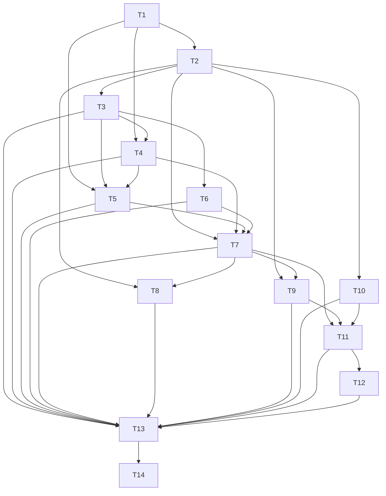

# D7 — Back up my journal: task-level breakdown

Status: draft for user review. Not frozen. Phase 3 artifact for `planning-protocol.md:61-135`.

## 0. Scope, boundary, and what this deliverable deliberately does not do

### Advertised outcome

A trader can download their whole journal as one file they control, and the app is honest that a
downloaded file is not yet a verified backup, so they do not believe they are protected when they
are not.

Concretely, after D7 a trader on a `Writable` installation can invoke Backup, receive one
self-contained versioned artifact covering Workspace settings and all four authoritative sections
read from **one coherent read snapshot**, and take it away as an ordinary browser download. The
result they see is `Downloaded`, never "backup complete". The artifact carries a Workspace Backup
Manifest that states schema/capability versions, the capability footprint, per-section counts, the
exclusion list, a digest per section and one full artifact digest, so a reader can audit what is in
the file without trusting the app's word for it. Export also still works in `Recovery Only`, because
it is a read, not an authoritative mutation.

### In scope

| Item | What D7 delivers | Spec |
|---|---|---|
| `Workspace.exportBackup` | New operation; `Downloaded`, `Conflict`, or `Not Completed` | `workspace.md:15`, `workspace.md:110` |
| One coherent read snapshot | All four sections plus settings read at one snapshot `S` | `workspace.md:110`, `workspace.md:129-143` |
| `exportSnapshot` × 4 | Trade Record, Journal, Market Data, Reference Catalog section payloads | `trade-record.md:143`, `journal.md:217`, `market-data.md:152`, `reference-catalog.md:139` |
| Workspace Backup Manifest | Versions, capability footprint, counts, exclusions, section digests, full digest | `workspace.md:116`, `delivery-contract.md:18` |
| Per-section + full digests | Deterministic, canonical, order-insensitive where order is not semantic | `workspace.md:116`, `acceptance-contract.md:406` |
| Secrets exclusion | Credentials, unsaved forms, raw provider payloads, diagnostics, reports, replay projections, cursors, rebuildable indexes/caches/projections absent | `workspace.md:116`, `market-data.md:152-157`, `journal.md:219` |
| `Downloaded` result | Carries source `WorkspaceSnapshotBinding`, full artifact digest, manifest digest, suggested file name; produces no receipt | `workspace.md:110`, `adr/0010:7-13` |
| `Recovery Only` export | Export and presentation stay available; every mutation stays refused | `workspace.md:114`, `delivery-contract.md:32`, `glossary.md:14` |
| Two-step presentation | Download step presented as downloaded-but-not-verified | `ui-contract.md:104`, `ui-contract.md:66` |

The artifact format is designed for all four authoritative sections **now**, even where a section is
thin at this point in the sequence, because it is a durable format: a shipped backup file must stay
readable by a much later release, and adding a section to the envelope later is exactly the kind of
durable-representation change that would force a format break. So the envelope declares four section
slots, the manifest always reports four counts (an empty section is reported as an explicit zero, not
omitted), and a section with no rows still carries its section schema version and section digest. A
thin section here is a designed slot, not a placeholder to be filled in later.

### Explicitly out of scope, and why it is safe

- **`confirmBackup`, read-back verification, and the `CompletedBackupReceipt`.** These are D20's
  (`workspace.md:112-114`, `adr/0010:7`, `plan/vertical-deliverables.md:167-184`). D7 must return
  `Downloaded` and explicitly **not** a receipt. D7 is safe to ship without them because the product
  claim it makes is smaller and honest: the trader holds a file, and the app says plainly that it
  cannot see whether or where the host saved it (`adr/0010:5-7`).
- **`prepareRestore` and `applyPreparedRestore`.** D21. Nothing in D7 writes to or replaces the live
  Workspace, so the absence of the Restore safety path cannot corrupt data.
- **Provider configuration and credentials.** D8. D7 still implements and proves the exclusion rule,
  but proves it against nonsecret configuration, because no credential exists to be excluded until a
  provider is configured. §8 states this rather than implying a credential was excluded.
- **The artifact's file representation.** `delivery-contract.md:83` says the file representation is
  intentionally unspecified; D7 fixes the *semantic* envelope and manifest contents and leaves the
  concrete media type and extension to Phase 6 version pinning, disclosed in §8.
- **Anything that would let a downloaded file satisfy the Restore safety choice.**
  `workspace.md:171` requires a `CompletedBackupReceipt` for that; D7 cannot produce one, and nothing
  in D7 may be read as a substitute.

### What this deliverable deliberately does not demonstrate

- A completed or verified backup. No receipt is issued anywhere in D7, and no surface may say
  "Backup Complete" (`ui-contract.md:66`).
- Restore, in whole or in part, including any round-trip equivalence claim. D7 does not re-import its
  own artifact; the "four sections are complete enough for round-trip equivalence"
  (`workspace.md:108`) is a design obligation discharged here, not a demonstrated equivalence.
- Secrets exclusion **for a real credential**. The exclusion is implemented and proven against
  nonsecret provider configuration and against carried-but-empty credential slots (`market-data.md:152-157`).
- Any latency or scale number. `AC-PERF-001` is not claimed anywhere in this file; §8 discloses the
  gap. Boundedness is asserted instead: a fixed four-section read set, bounded manifest counts, and no
  per-record storage read during export.

### No migration task, and why

D7 carries **no migration task**. A migration task exists to move a *stored* durable representation
from one version to another while preserving every authoritative identity, fact, audit revision and
provenance field (`delivery-contract.md:63`, `planning-protocol.md:77`). D7 changes no durable
representation: the backup artifact is an outgoing serialization of facts that already exist in the
Workspace, built in memory and handed to the host as a file. Nothing new is stored, no object store is
added, no index changes, and the authoritative stores are unchanged in shape and content. The one
version-like fact D7 introduces — the artifact's schema/capability version — is written *into the
exported file*, not into the Workspace, so there is no stored record to migrate. Consequently the
"Every durable representation change has an explicit version and a supported forward migration path"
obligation (`delivery-contract.md:63`) has nothing to attach to here. This is a stated absence, not a
silent omission. If a later decision makes the artifact version a *stored* record (for example, a
persisted "last exported artifact version"), that decision introduces a durable representation and
must bring its own migration task with it; D7 does not make that decision.

## 1. Decisions this breakdown introduces (needing alignment)

1. **The artifact is one portable, self-contained, versioned envelope**: a manifest plus four section
   payloads, with a per-section digest and one full artifact digest, and a declared supported
   schema/capability range. A reader must be able to audit completeness from the manifest alone, and a
   later release must be able to reject an artifact whose schema/capability range it does not support
   (`workspace.md:116`, `workspace.md:163`). Alignment needed: whether the shipped extension is fixed
   now or left to the Phase 6 profile; this file plans for the latter and discloses it in §8.
2. **All four sections are read from a single coherent read snapshot**, so a concurrent later mutation
   is wholly outside the artifact rather than torn across sections (`workspace.md:110`,
   `workspace.md:157`). Alignment needed: whether the snapshot seam is D1's transaction seam reused
   verbatim (`D1:T14`) or a dedicated read-snapshot wrapper; D7 assumes reuse, which is the smaller
   change and keeps one atomic boundary (`planning-decisions-2026-10-10.md:176-178`).
3. **`exportBackup` returns `Downloaded`, `Conflict` with the current binding, or `Not Completed`**
   with the failed stage, reason and unchanged-Workspace evidence — and `Downloaded` is not a
   completed backup (`workspace.md:110`, `adr/0010:7`). Settled by decision PD17: the failure-stage
   vocabulary is a fixed four-stage enumeration — snapshot, section, digest, exclusion — fixed by T9
   and named in the manifest schema task T1 so it is not invented twice.
4. **The exclusion allowlist is explicit, and nonpresence is proven rather than asserted**: an
   exclusion set that is checked against the artifact's actual bytes and against the read set the
   export opened, not merely documented in prose. The categories are credentials, unsaved forms, raw
   provider payloads, transient diagnostics, reports, replay projections, cursors, and safely
   rebuildable indexes/caches/projections (`workspace.md:116`). Alignment needed: whether proving
   absence means "no key present" (this file's choice for D7) or a stronger cryptographic statement;
   D20's read-back work may strengthen it.
5. **Export stays possible in `Recovery Only`** because it is not an authoritative mutation, while the
   write gate still governs every mutation at the transaction seam
   (`workspace.md:114`, `delivery-contract.md:32`, `planning-decisions-2026-10-10.md:220`).
   Alignment needed: none expected; this is recorded so the gate is not "helpfully" tightened around
   export by a later implementer.
6. **The Workspace Backup Manifest records counts and exclusions explicitly** so a reader can audit
   completeness without opening the payloads (`workspace.md:116`). Settled by decision PD17:
   per-section totals plus the per-kind counts each section already knows, because a bare total cannot
   distinguish "0 Marks" from "0 Marks because Market Data was skipped".

## 2. Task graph

This breakdown declares **14 tasks in 11 dependency layers** (grouped into 5 implementation phases in §3). Layer 1 is the format and manifest schema
(T1); layer 2 is the snapshot-bound export and its four section producers (T2–T6); layer 3 is the
result, concurrency, failure and readiness behavior (T7–T10); layer 4 is presentation and its
responsive/accessibility treatment (T11–T12); layer 5 is the mock-free integration suite and the
independent browser-critic gate (T13–T14).

One structural task (T1) fixes the durable artifact format; one structural task (T14) is the
independent critic gate with exact verification instead of invented unit tests
(`planning-protocol.md:113`). The other twelve are behaviour-bearing and carry TDD cases.



### Declared blocking edges

Per task, as the bodies in §3 declare them. Cross-deliverable prerequisites
(`D1:T3`, `D1:T7`, `D1:T9`, `D1:T11`, `D1:T14`, `D1:T26`, `D1:T28`) are declared here and deliberately
not drawn in the diagram above, because the diagram validator reads only local `T<n>` endpoints.

- **T1** — `D1:T9`. Consumed by T2, T4, T5.
- **T2** — `T1`, `D1:T14`. Consumed by T3, T7, T8, T9, T10.
- **T3** — `T2`, `D1:T11`. Consumed by T4, T5, T6, T13.
- **T4** — `T1`, `T3`. Consumed by T5, T7, T13.
- **T5** — `T1`, `T3`, `T4`. Consumed by T7, T13.
- **T6** — `T3`. Consumed by T7, T13.
- **T7** — `T2`, `T4`, `T5`, `T6`, `D1:T7`. Consumed by T8, T9, T11, T13.
- **T8** — `T2`, `T7`. Consumed by T13.
- **T9** — `T2`, `T7`. Consumed by T11, T13.
- **T10** — `T2`, `D1:T26`. Consumed by T11, T13.
- **T11** — `T7`, `T9`, `T10`. Consumed by T12, T13.
- **T12** — `T11`. Consumed by T13.
- **T13** — `T3`, `T4`, `T5`, `T6`, `T7`, `T8`, `T9`, `T10`, `T11`, `T12`, `D1:T3`, `D1:T28`.
  Consumed by T14.
- **T14** — `T13`. `none` consumes it locally; its consumer is the cross-deliverable release gate.

### Verifying the graph itself

- The prose edges and the diagram carry the same dependency order; the diagram draws 32 local edges,
  and the task bodies declare exactly those 32 local edges plus the seven cross-deliverable edges
  (`D1:T9`, `D1:T14`, `D1:T11`, `D1:T7`, `D1:T26`, `D1:T3`, `D1:T28`).
- The graph is acyclic and has the five layers named above. T1 is the only local root, and its
  `D1:T9` prerequisite is outside this file. T14 is the only sink. No task declares a mutual blocking
  pair.
- Every task appears as an endpoint in the diagram, so no header is orphaned.
- Cross-deliverable prerequisites are real tasks in D1: the transaction/snapshot seam (`D1:T14`),
  the snapshot-consistent read seam (`D1:T11`), the Runtime Readiness gate and its `Recovery Only`
  outcome (`D1:T7`, `D1:T26`), the artifact-format schema registration (`D1:T9`), the recorded release
  provenance (`D1:T3`) and the Installed Capability Manifest (`D1:T28`).
- Boundedness assertion for this graph: export performs a fixed number of section reads (four) plus
  bounded count queries per section, and never one storage read per record. That is the only
  performance claim D7 makes; no latency figure is claimed anywhere in this file.

## 3. Task detail

### Phase P1 — the durable artifact shape

#### T1 — `S` Backup artifact format version and the Workspace Backup Manifest schema

- **Blocking edges:** D1:T9.
- **Consumed by:** T2, T4, T5.

**Deliverable of this task.** The single written definition of the durable format: one envelope type
with a format version, a declared supported schema/capability range, a manifest member, and exactly
four named section slots; plus the manifest schema — schema/capability versions, capability
footprint, per-section and per-kind counts, the exclusion list, per-section digests and the full
artifact digest — and the canonical byte encoding that every digest is taken over. This task exists
because the artifact is durable and outlives the release that wrote it (`workspace.md:108`,
`workspace.md:163`); it must be defined once and consumed by T2, T4 and T5 rather than re-created by
each.

The four section slots are `tradeRecord`, `journal`, `marketData`, `referenceCatalog`, and all four are
unconditional in the schema: a slot is always present, and an empty section is `{ schemaVersion, digest,
counts: { total: 0, byKind: {} }, payload: [] }`. This is the concrete meaning of "designed for all
four sections now … because it is a durable format" (`plan/vertical-deliverables.md:183-184`).

**Exact verification**

| # | Command | Expected result |
|---|---|---|
| V1.1 | `npx tsc --noEmit` (once the Phase 6 pin exists; see §8) | Compiles with no error; the envelope, manifest, section and result types are exported from one module and imported by T2/T4/T5 without a second definition of any of them |
| V1.2 | `npx vitest run test/unit/backup/artifact-format.test.ts` | The recorded fixture parses against the declared manifest schema; parsing rejects a fixture with a missing `marketData` slot and rejects one with an unknown fifth section, and both rejections name the offending key |
| V1.3 | `npx vitest run test/unit/backup/artifact-format.test.ts -t "excluded top-level keys"` | The envelope's allowed-key set contains no key from the exclusion list of decision 4 in §1, asserted against the recorded allowed-key list rather than against a hand-written object |
| V1.4 | `npx vitest run test/unit/backup/canonical-encoding.test.ts` | Recorded canonical-encoding vectors (map-key reordering, number formatting, nested empty sections, unicode labels) produce byte-identical output to their recorded expected bytes, and each vector's recorded SHA-256 hex matches |
| V1.5 | `npx vitest run test/unit/backup/artifact-format.test.ts -t "format version"` | The declared format version and supported schema/capability range appear exactly once in the module; the manifest schema requires both, and a fixture missing either is rejected |

**Depends on it:** T2 cannot open one coherent write of a shaped artifact, T4 cannot take a digest over
an undefined byte encoding, and T5 cannot emit a manifest whose members are not fixed — and a later
release cannot read an artifact from today without this version declaration.

### Phase P2 — one coherent read snapshot and the four sections

#### T2 — `B` `Workspace.exportBackup`: one coherent full read snapshot

- **Blocking edges:** T1, D1:T14.
- **Consumed by:** T3, T7, T8, T9, T10.

The public seam is `Workspace.exportBackup(request: ExportWorkspaceBackup) -> ExportWorkspaceBackupResult`
(`workspace.md:15`, `workspace.md:110`). This task owns the operation's skeleton: opening the one read
snapshot, resolving the expected-binding comparison, invoking the four section producers at that
snapshot, assembling the envelope, and returning the result union. Unit tests may substitute the four
section producers; the snapshot seam is D1's transaction seam (`D1:T14`), reused rather than
re-implemented, so one atomic boundary still spans the whole export
(`planning-decisions-2026-10-10.md:176-178`).

**Unit test cases**

```text
describe("Workspace.exportBackup opens exactly one coherent read snapshot")
  it should read all four section slots from one and the same snapshot identity when a populated Writable Workspace is exported in one call
  it should return Conflict carrying the current WorkspaceSnapshotBinding and write nothing when the caller supplies an expected binding that no longer matches the live Workspace
  it should return Conflict naming the binding difference when the live Workspace binding changes between the caller's read and the snapshot open
  it should return Downloaded carrying that same snapshot identity when the export completes, so the result binding is provably the artifact's source binding
  it should leave the artifact's four slots byte-identical to their pre-mutation state when an authoritative mutation commits after the snapshot was opened
  it should return Not Completed with the failed stage, a reason and unchanged-Workspace evidence when the snapshot cannot be opened
  it should return Not Completed naming the failing stage without assembling a partial artifact when one section producer fails at the snapshot
  it should write no row to any store during a successful export, asserted over the whole Workspace revision set before and after
```

**Integration case.** Invoke the real `exportBackup` command against a seeded Workspace through the
production application/domain path with no application-dependency mocks, and let it reach real
persistence. Assert the durable result: the Workspace binding returned in the `Downloaded` result
equals the binding recorded inside the produced artifact's manifest, the authoritative store rows are
unchanged, and the four section payloads correspond to the store contents at that snapshot. The only
disclosed substitution is `fake-indexeddb` standing in for browser IndexedDB in the Node run
(`planning-decisions-2026-10-10.md:184`, `planning-protocol.md:120`); the same case reruns against a
real engine in the T13 Playwright leg.

**Red/green evidence**

| Case | Red command and the reason it must fail | Green command and expected result |
|---|---|---|
| one snapshot identity for all four slots | `npx vitest run test/unit/workspace/export-backup.test.ts -t "one coherent read snapshot"` — fails because no `exportBackup` exists, so no result binding can equal an artifact source binding | same command — passes with one snapshot identity recorded for all four slots |
| `Conflict` on a stale expected binding | `npx vitest run test/unit/workspace/export-backup.test.ts -t "Conflict carrying the current binding"` — fails because the operation returns no `Conflict` branch at all | same command — passes and the store revision set is unchanged |
| `Downloaded` binding equals artifact source | `npx vitest run test/unit/workspace/export-backup.test.ts -t "Downloaded carrying that same snapshot identity"` — fails because there is no result binding to compare | same command — passes |
| no partial artifact on a producer failure | `npx vitest run test/unit/workspace/export-backup.test.ts -t "assembling a partial artifact"` — fails because nothing suppresses a partial envelope yet | same command — passes and no artifact bytes are offered to the host |
| export writes no row | `npx vitest run test/unit/workspace/export-backup.test.ts -t "write no row to any store"` — fails because the export path does not exist to be observed | same command — passes over the unchanged revision set |

#### T3 — `B` `exportSnapshot` across Trade Record, Journal, Market Data and Reference Catalog

- **Blocking edges:** T2, D1:T11.
- **Consumed by:** T4, T5, T6, T13.

Each module already declares the seam: `TradeRecord.exportSnapshot` (`trade-record.md:17`),
`Journal.exportSnapshot` (`journal.md:18`), `MarketData.exportSnapshot` (`market-data.md:14`) and
`ReferenceCatalog.exportSnapshot` (`reference-catalog.md:15`). This task binds all four to the single
snapshot opened in T2 and fixes what each section must contain — and, just as importantly, that a
thin section still produces a well-formed empty payload rather than being skipped. The read seam is
`D1:T11` (snapshot-consistent reads), so the four producers read at one snapshot through the existing
consistent-read path instead of four independent reads.

**Unit test cases**

```text
describe("exportSnapshot emits each authoritative section at the bound snapshot")
  it should emit every Trade identity, sequence, fact version and Void, lifecycle record, Lot-Match and Deviation history, participation and lineage when the Trade Record section is exported at snapshot S
  it should emit fixed Entry Type and Source identities, every definition revision, every Entry/Edit/Addendum/Void, Debt and decline history and all Anchor/origin/Prompt/Tag identities when the Journal section is exported at snapshot S
  it should emit every Mark, Daily Bar and acknowledgment revision chain, effective heads, nonsecret provider settings and session-policy compatibility metadata when the Market Data section is exported at snapshot S
  it should emit every Catalog identity, origin, label/availability revision and immutable parent/shape/role/policy plus seed-manifest state when the Reference Catalog section is exported at snapshot S
  it should still emit a well-formed marketData slot carrying zero counts, a section schema version and a section digest when the Workspace holds no Mark, Bar or acknowledgment
  it should emit all four slots in one artifact when three sections are populated and one is empty, with the empty slot reported as an explicit zero rather than omitted
  it should read each section from the snapshot passed by Workspace rather than from a fresh read when a mutation commits between two section exports
  it should exclude private indexes and projections from every section payload while leaving every authoritative identity and revision present
```

**Integration case.** Run the real export command against a populated, corrected Workspace (Plan
confirmed, a Position Change with a Void, a Manual Mark, a Daily Bar, an acknowledgment, a Catalog
edit and a Journal definition revision) with no application-dependency mocks, then inspect the
produced artifact's four sections against the authoritative store rows read at the same snapshot.
Assert section by section that every recorded identity and revision is present exactly once, that an
empty Market Data Workspace still yields a present-and-zeroed `marketData` slot, and that the
Workspace's durable rows are unchanged. `fake-indexeddb` is the disclosed substitution in Node; the
real-engine counterpart reruns in T13.

**Red/green evidence**

| Case | Red command and the reason it must fail | Green command and expected result |
|---|---|---|
| Trade Record section content | `npx vitest run test/unit/backup/section-export.test.ts -t "Trade Record section"` — fails because no section producer is wired, so the section is absent | same command — passes against the recorded expected identity/revision set |
| Journal section content | `npx vitest run test/unit/backup/section-export.test.ts -t "Journal section"` — fails because definition revisions and Debt history are not emitted | same command — passes |
| empty Market Data slot is present and zeroed | `npx vitest run test/unit/backup/section-export.test.ts -t "no Mark, Bar or acknowledgment"` — fails because an empty section is currently skipped rather than emitted | same command — passes with `total: 0` and a section digest |
| all four slots in one artifact | `npx vitest run test/unit/backup/section-export.test.ts -t "explicit zero rather than omitted"` — fails because the envelope is assembled from whichever sections returned rows | same command — passes |
| reads come from the bound snapshot | `npx vitest run test/unit/backup/section-export.test.ts -t "mutation commits between two section exports"` — fails because each producer reads fresh | same command — passes with both sections at one snapshot |
| private projections excluded | `npx vitest run test/unit/backup/section-export.test.ts -t "exclude private indexes and projections"` — fails because projection rows currently leak into a section payload | same command — passes |

### Phase P3 — digests, manifest and exclusion proof

#### T4 — `B` Per-section digests and the full artifact digest

- **Blocking edges:** T1, T3.
- **Consumed by:** T5, T7, T13.

`workspace.md:116` requires the manifest to record section digests and a full digest, and
`workspace.md:112` shows verification later re-checking the full artifact digest, so digest
determinism is load-bearing for D20 and must be right here. The digest inputs are the canonical
encoding fixed by T1 (V1.4). "Canonical" means: map keys sorted, arrays in their semantic order,
numbers in one fixed textual form, and the four section slots always present in the full-digest input.

**Unit test cases**

```text
describe("section digests and the full artifact digest are deterministic and sensitive")
  it should compute each section digest over exactly the canonical encoding of that section when the section payload is unchanged across two builds with different in-memory key insertion order
  it should compute the full artifact digest over the whole envelope with the full-digest field itself held at a fixed placeholder value when the artifact is serialized for hashing
  it should leave both the section digest and the full digest identical when unrelated properties of another section are reordered in memory
  it should change that section's digest and the full artifact digest when any single byte inside a section payload changes
  it should change the full artifact digest while leaving all four section digests unchanged when only the manifest's exclusion list or counts change
  it should record one digest per section, four exactly, plus one full artifact digest in the manifest when the artifact is assembled at any snapshot
  it should detect an internally inconsistent artifact by recomputing and comparing digests when a section payload is swapped for another section's payload
  it should keep every section digest unchanged when the manifest's suggested file name differs between two exports of the same snapshot
```

**Integration case.** Export the same populated Workspace twice from the same snapshot through the
real command with no mocks, and assert the two artifacts have byte-identical digest sets and identical
section digests; then export at a later snapshot after one Manual Mark is recorded and assert exactly
the Market Data section digest and the full artifact digest changed while the other three section
digests are unchanged. This proves digest determinism and locality against real persistence, with
`fake-indexeddb` disclosed as the Node substitution.

**Red/green evidence**

| Case | Red command and the reason it must fail | Green command and expected result |
|---|---|---|
| per-section digest over canonical bytes | `npx vitest run test/unit/backup/artifact-digest.test.ts -t "canonical encoding of that section"` — fails because no digest is computed for a section | same command — passes against recorded hex |
| full digest over placeholder-normalized envelope | `npx vitest run test/unit/backup/artifact-digest.test.ts -t "fixed placeholder value"` — fails because the full digest is undefined or self-referentially hashed | same command — passes and two exports of one snapshot agree |
| digest locality | `npx vitest run test/unit/backup/artifact-digest.test.ts -t "only the manifest's exclusion list"` — fails because the full digest is not recomputed on a manifest-only change | same command — passes |
| four section digests plus one full digest | `npx vitest run test/unit/backup/artifact-digest.test.ts -t "four exactly"` — fails because the manifest records no digest map | same command — passes |
| swapped-payload detection | `npx vitest run test/unit/backup/artifact-digest.test.ts -t "swapped for another section's payload"` — fails because nothing recomputes a stored digest | same command — passes with the mismatch identified by section name |

#### T5 — `B` Workspace Backup Manifest: versions, capability footprint, counts, exclusions

- **Blocking edges:** T1, T3, T4.
- **Consumed by:** T7, T13.

The manifest is the auditable claim about the file (`workspace.md:116`, `delivery-contract.md:18`,
decision 6 in §1). It records: the artifact format version and the supported schema/capability range;
the capability footprint of the installed release, which is *not* trader data and cannot be toggled
(`workspace.md:27`); counts per section including explicit zeros; the exclusion list; the per-section
digests from T4; and the full artifact digest. The capability footprint must be copied from the
Installed Capability Manifest (`D1:T28`) so the manifest can never advertise a capability the release
does not have (`delivery-contract.md:75`, `plan/vertical-deliverables.md:22`).

**Unit test cases**

```text
describe("Workspace Backup Manifest states versions, capability footprint, counts and exclusions")
  it should record the artifact format version and the full supported schema/capability range when the manifest is built by an installed release
  it should record the capability footprint equal to that installed release's Installed Capability Manifest when the release declares a subset of all planned capabilities
  it should record exactly four section count entries, one per authoritative section, each with a numeric total when the artifact is built at any snapshot
  it should record an explicit zero total for a section with no rows rather than omitting the section entry when the Workspace holds no Market Data
  it should record the exclusion list naming every excluded category with its stated proof status when the manifest is built
  it should record all four section digests and the full artifact digest in the manifest when assembly completes
  it should keep the manifest free of any credential, raw provider payload, cursor, report or private projection value when nonsecret configuration is present
  it should record per-kind counts in addition to the section total when a section holds records of more than one kind
```

**Integration case.** Export a populated Workspace through the real command with no mocks, parse the
produced artifact's manifest, and assert it against the live stores and the live Installed Capability
Manifest: counts equal the store contents at that snapshot, the footprint equals the installed
manifest exactly, the four section digests and the full digest match a recomputation, and no excluded
value occurs anywhere in the manifest. Repeat for a Workspace with no Market Data rows and assert the
`marketData` count is present and zero. `fake-indexeddb` is the disclosed substitution in Node.

**Red/green evidence**

| Case | Red command and the reason it must fail | Green command and expected result |
|---|---|---|
| versions and supported range | `npx vitest run test/unit/backup/manifest.test.ts -t "supported schema/capability range"` — fails because the manifest has no version or range members | same command — passes |
| capability footprint equals installed manifest | `npx vitest run test/unit/backup/manifest.test.ts -t "Installed Capability Manifest"` — fails because the footprint is hardcoded or absent | same command — passes for a release declaring a subset |
| four counts including explicit zeros | `npx vitest run test/unit/backup/manifest.test.ts -t "explicit zero total"` — fails because an empty section is dropped from the counts | same command — passes |
| exclusion list with proof status | `npx vitest run test/unit/backup/manifest.test.ts -t "exclusion list naming every excluded category"` — fails because no exclusion list is emitted | same command — passes |
| per-kind counts | `npx vitest run test/unit/backup/manifest.test.ts -t "per-kind counts"` — fails because only a bare section total exists, which cannot distinguish a skipped section from an empty one | same command — passes |

#### T6 — `B` Secrets exclusion and its nonpresence proof

- **Blocking edges:** T3.
- **Consumed by:** T7, T13.

The exclusion list is fixed by `workspace.md:116`: credentials, unsaved forms, raw provider payloads,
transient diagnostics, reports, replay projections, cursors, and safely rebuildable
indexes/caches/projections. `delivery-contract.md:85` adds the qualifier that projections may be
omitted only when reconstruction produces observationally equivalent results, and
`market-data.md:152-157` names the Market Data specifics (credentials, raw payloads, diagnostics,
request logs, rebuildable coverage indexes). Decision 4 in §1 requires *proven* nonpresence, not an
assertion in prose. Two proofs are planned here: (a) the artifact's actual serialized bytes contain no
value reachable from an excluded store or field, computed over the same canonical bytes T4 hashes, and
(b) the export's read set never opened, and its write set never touched, an excluded store — observed
at the persistence seam. At D7 no credential exists yet (D8 introduces it), so proof (a) is exercised
against populated nonsecret provider configuration and an empty credential slot, and §8 states that
limitation plainly.

**Unit test cases**

```text
describe("secrets exclusion is proven, not asserted")
  it should contain no credential value from the credential store when the artifact's canonical bytes are searched for every recorded credential-shaped value
  it should contain no raw provider response payload when a provider fetch artifact exists in the Workspace and the artifact is exported
  it should contain no transient diagnostic, request-log or readiness transcript row when the Workspace has recorded diagnostics
  it should contain no report, scorecard, replay projection, coverage index or cursor row when those rebuildable stores are populated
  it should list as absent every category in its own exclusion list when the artifact is scanned for each category's marker keys, so the manifest cannot claim an exclusion the bytes contradict
  it should read from no excluded store when the export's persistence read set is recorded at the transaction seam
  it should fail the export with Not Completed naming the exclusion stage when a packaged value matches an exclusion category, rather than emitting the artifact
  it should keep the exclusion proof derived from the artifact bytes rather than from a hand-maintained key list when a new excluded field is added to the schema
```

**Integration case.** With a populated Workspace through the real stack — Mark and Bar history,
nonsecret provider settings present, diagnostics and a provider-configuration revision recorded, a
report projection built — run the real export with no mocks and assert from the produced artifact
bytes that none of those excluded values occur, while every nonsecret provider setting and every
authoritative Mark/Bar revision *is* present. Record the read set the export touched and assert it
contains no excluded store. The credential slot is carried but empty at D7, and the case asserts the
empty slot rather than inventing a credential. `fake-indexeddb` is the disclosed substitution in Node.

**Red/green evidence**

| Case | Red command and the reason it must fail | Green command and expected result |
|---|---|---|
| no credential value in artifact bytes | `npx vitest run test/unit/backup/exclusion-proof.test.ts -t "credential value"` — fails because no scan over artifact bytes exists | same command — passes with the empty credential slot explicitly asserted |
| no raw provider payload | `npx vitest run test/unit/backup/exclusion-proof.test.ts -t "raw provider response payload"` — fails because raw payloads are not filtered from the section | same command — passes |
| no diagnostics, reports, cursors or projections | `npx vitest run test/unit/backup/exclusion-proof.test.ts -t "rebuildable stores are populated"` — fails because those stores are not excluded yet | same command — passes |
| manifest exclusions agree with bytes | `npx vitest run test/unit/backup/exclusion-proof.test.ts -t "manifest cannot claim an exclusion the bytes contradict"` — fails because the manifest list and the byte scan are unconnected | same command — passes |
| read set excludes excluded stores | `npx vitest run test/unit/backup/exclusion-proof.test.ts -t "recorded at the transaction seam"` — fails because export currently reads a projection store | same command — passes |
| fail rather than emit on a leak | `npx vitest run test/unit/backup/exclusion-proof.test.ts -t "Not Completed naming the exclusion stage"` — fails because a leak is currently emitted silently | same command — passes with no artifact offered |

### Phase P4 — result semantics, concurrency, failure and readiness

#### T7 — `B` `Downloaded` result with source binding and digest, and no receipt

- **Blocking edges:** T2, T4, T5, T6, D1:T7.
- **Consumed by:** T8, T9, T11, T13.

`ExportWorkspaceBackupResult` is Downloaded, Conflict with the current binding, or Not Completed with
the failed stage, reason and unchanged-Workspace evidence; Downloaded carries the source
`WorkspaceSnapshotBinding`, the full artifact digest, the Workspace Backup Manifest digest and a
suggested file name, and **it is not a completed backup**: no `CompletedBackupReceipt` is produced
(`workspace.md:110`, `adr/0010:7`, `glossary.md:16`). This task also owns the `RuntimeNotWritable`
posture of the operation: export is a read, so it is *not* gated the way a mutation is
(`workspace.md:114`, `delivery-contract.md:32`), and the readiness input comes from `D1:T7`.

**Unit test cases**

```text
describe("exportBackup result semantics and the absence of a receipt")
  it should return Downloaded carrying source binding, full artifact digest, manifest digest and suggested file name when the export completes in a Writable Workspace
  it should produce no CompletedBackupReceipt, and no receipt-shaped field, on any successful export result
  it should return Conflict carrying the current binding and leave the Workspace unchanged when the expected binding no longer matches
  it should return Not Completed carrying the failed stage, a reason and evidence that the Workspace is unchanged when a section read is made to fail
  it should return Not Completed rather than Downloaded when the artifact cannot be completed, so an incomplete file is never offered as a download result
  it should keep a Downloaded result usable for later verification without storing anything about a pending verification when the trader leaves before verifying
  it should carry values in the result that a later read-back verification can compare against a re-imported file, namely the full artifact digest and the source binding, without those values being persisted
  it should never present Downloaded as a completed backup in the result type itself, asserted by the absence of any completed state on the export result union
```

**Integration case.** Export through the real command with no application-dependency mocks, then in
the same run parse the artifact the host was handed and assert that the result's binding and full
digest equal the artifact's manifest binding and recomputed digest, that the result carries a
non-empty suggested file name, and that no receipt row exists in any store before or after. Record in
the run evidence that the suggested file name is the only host-facing artifact identity D7 owns.

**Red/green evidence**

| Case | Red command and the reason it must fail | Green command and expected result |
|---|---|---|
| `Downloaded` payload fields | `npx vitest run test/unit/workspace/export-result.test.ts -t "source binding, full artifact digest, manifest digest"` — fails because the result union has no such members | same command — passes |
| no receipt on success | `npx vitest run test/unit/workspace/export-result.test.ts -t "no receipt-shaped field"` — fails because no assertion can be met while the receipt path is undefined | same command — passes, and the store contains no receipt row |
| `Conflict` leaves the Workspace unchanged | `npx vitest run test/unit/workspace/export-result.test.ts -t "expected binding no longer matches"` — fails because no `Conflict` branch exists | same command — passes over an unchanged revision set |
| `Not Completed` on a failed read | `npx vitest run test/unit/workspace/export-result.test.ts -t "section read is made to fail"` — fails because failure currently surfaces as an untyped error | same command — passes with stage and reason |
| nothing pending is persisted | `npx vitest run test/unit/workspace/export-result.test.ts -t "leaves before verifying"` — fails because no comparison values are carried on the result | same command — passes, and no workspace row was added |

#### T8 — `B` Concurrent-mutation isolation: a later mutation lies outside the artifact

- **Blocking edges:** T2, T7.
- **Consumed by:** T13.

`workspace.md:157`: "A concurrent later mutation is outside the artifact rather than torn across
sections." `acceptance-contract.md:406` requires the later mutation to be "wholly outside it". This is
the hard part of the deliverable and needs the upper end of the case range. The condition to prove is
*mutation-after-snapshot*, not merely mutation-during-a-long-call: the artifact must equal a
consistent read of the pre-mutation snapshot in all four sections, and the concurrent write must be
durable in the live Workspace. Note the fidelity caveat carried into §8: under `fake-indexeddb` the
isolation story is weaker than in a real engine, so this task also contributes the real-engine
counterpart that T13 runs in Playwright.

**Unit test cases**

```text
describe("a mutation concurrent with export lies wholly outside the artifact")
  it should produce an artifact whose four sections all equal their pre-mutation snapshot values when an authoritative mutation commits after the snapshot is opened
  it should record the pre-mutation snapshot identity in the Downloaded result and in the manifest when that later mutation commits
  it should exclude the later mutation's new record from every section payload when the mutation adds a Trade, a Journal Entry and a Mark
  it should exclude the later mutation's revision metadata from the manifest counts when the mutation changes a count-visible record
  it should exclude a Void or correction committed after the snapshot from the artifact while the fact it voids remains in its pre-mutation form
  it should commit the concurrent mutation durably in the live Workspace when the export completes, so isolation is achieved without blocking or losing writes
  it should never mix two snapshots inside one artifact when mutations commit between the first section read and the last section read
  it should return a coherent artifact rather than Not Completed when a later mutation merely invalidates derived agreement, because a stale derived record is disclosed rather than rejected
```

**Integration case.** Through the real stack with no application-dependency mocks: open the export,
inject a real authoritative mutation (a Position Change plus a Mark) so it commits after the snapshot
boundary, complete the export, then assert three durable facts — the live Workspace contains the new
revision, the artifact contains no trace of it in any of the four sections or in the manifest counts,
and the artifact's section digests still verify against the canonical encoding of the pre-mutation
snapshot. The real-engine leg runs in Playwright over a real IndexedDB with real transaction scheduling;
the Node leg uses the disclosed `fake-indexeddb` substitution and its weaker isolation guarantee is
stated in the run note.

**Red/green evidence**

| Case | Red command and the reason it must fail | Green command and expected result |
|---|---|---|
| artifact excludes a later commit | `npx vitest run test/unit/workspace/export-isolation.test.ts -t "mutation commits after the snapshot is opened"` — fails because sections currently read fresh, so the new record appears | same command — passes against the pre-mutation snapshot |
| result and manifest name the pre-mutation snapshot | `npx vitest run test/unit/workspace/export-isolation.test.ts -t "pre-mutation snapshot identity"` — fails because no snapshot identity is bound | same command — passes |
| concurrent commit is durable | `npx vitest run test/unit/workspace/export-isolation.test.ts -t "commit the concurrent mutation durably"` — fails because the mutation is not injected yet | same command — passes with the new revision present in the store |
| no snapshot mixing across reads | `npx vitest run test/unit/workspace/export-isolation.test.ts -t "between the first section read and the last"` — fails because two reads can straddle the mutation | same command — passes |
| real-engine counterpart | `npx playwright test e2e/backup-isolation.spec.ts` — fails because the concurrency injection does not exist | same command — passes over a real IndexedDB with the pre-mutation snapshot asserted |

#### T9 — `B` Failed-stage export returns `Not Completed` with unchanged-Workspace evidence

- **Blocking edges:** T2, T7.
- **Consumed by:** T11, T13.

`workspace.md:110` requires `Not Completed` to carry the failed stage, reason and unchanged-Workspace
evidence; `workspace.md:157` says a failed read returns Not Completed and that neither it, an
unverified download, nor a failed verification issues a `CompletedBackupReceipt` or is presented as a
completed backup. This task also fixes the stage vocabulary, so T1's schema, T9's result and T11's
presentation name the same stages.

**Unit test cases**

```text
describe("exportBackup reports a controlled failure as Not Completed with evidence")
  it should return Not Completed naming the failed stage and a reason when the snapshot cannot be opened
  it should return Not Completed naming the failing section stage when one of the four section producers throws at the snapshot
  it should return Not Completed naming the digest stage when artifact assembly or full-digest computation fails
  it should return Not Completed naming the exclusion stage when the exclusion proof rejects a packaged value
  it should return unchanged-Workspace evidence that a caller can compare, namely the Workspace binding and revision set before and after the failure
  it should write nothing and offer no file to the host when the export fails at any stage
  it should keep the failure result free of any completed-backup or receipt claim when the failure is a read error rather than a validation rejection
  it should return the same stage name from the unit seam and from the production result when the same failure is induced through the real command
```

**Integration case.** Through the real stack with no application-dependency mocks, induce a
controlled source-read failure at the persistence seam for one section (an aborted read transaction,
not a mock returning an error), run the real export command, and assert the result is `Not Completed`
with the section's stage name, that no artifact bytes were offered, that no store row changed, and that
the Workspace binding and revision set after the failure equal the values recorded before it. Then
re-read the Workspace through a normal read path and assert it is fully readable, proving the failure
did not damage it.

**Red/green evidence**

| Case | Red command and the reason it must fail | Green command and expected result |
|---|---|---|
| snapshot-open failure stage | `npx vitest run test/unit/workspace/export-failure.test.ts -t "snapshot cannot be opened"` — fails because the failure has no typed result | same command — passes with the named stage |
| section producer failure stage | `npx vitest run test/unit/workspace/export-failure.test.ts -t "one of the four section producers"` — fails because the error escapes as an exception | same command — passes |
| exclusion rejection stage | `npx vitest run test/unit/workspace/export-failure.test.ts -t "exclusion proof rejects"` — fails because no stage is attributed | same command — passes |
| unchanged-Workspace evidence | `npx vitest run test/unit/workspace/export-failure.test.ts -t "Workspace binding and revision set before and after"` — fails because no before/after evidence is returned | same command — passes with equal values |
| no artifact offered, nothing written | `npx vitest run test/unit/workspace/export-failure.test.ts -t "write nothing and offer no file"` — fails because a partial artifact can still be handed to the host | same command — passes |
| no receipt on failure | `npx vitest run test/unit/workspace/export-failure.test.ts -t "free of any completed-backup or receipt claim"` — fails because the failure path is untyped | same command — passes |

#### T10 — `B` Export available in `Recovery Only`

- **Blocking edges:** T2, D1:T26.
- **Consumed by:** T11, T13.

`workspace.md:114` puts export and verification among the operations that remain possible in
`Recovery Only` because they are result evidence rather than authoritative Workspace mutations;
`delivery-contract.md:32` allows ordinary reads and backup export there; `glossary.md:14` states the
same, and the readiness outcome is owned by `D1:T26`. This task makes export pass the gate *because it
is a read*, while the write gate continues to refuse every mutation at the transaction seam
(`planning-decisions-2026-10-10.md:220`) — decision 5 in §1 exists so nobody later "tightens" export
into refusal.

**Unit test cases**

```text
describe("exportBackup remains available in Recovery Only while mutations are refused")
  it should return Downloaded when Runtime Readiness is Recovery Only and the existing Workspace is readable
  it should produce a complete four-section artifact with the same manifest members in Recovery Only as in Writable
  it should refuse an authoritative mutation with the cross-cutting RuntimeNotWritable result when the same session is Recovery Only
  it should keep ordinary reads and history navigation working alongside the export when readiness is Recovery Only
  it should return Not Completed rather than a fabricated artifact when Recovery Only readiness is combined with an unreadable section
  it should never return RuntimeNotWritable for export itself, because export is not an authoritative mutation
  it should carry the Recovery Only readiness outcome as context on the export result when readiness is not Writable, without weakening the Downloaded payload
  it should re-evaluate readiness at the transaction seam when readiness degrades between the caller's check and the export, and still refuse only the mutation
```

**Integration case.** Through the real stack with no application-dependency mocks, force `Recovery
Only` by failing exactly one write-safety readiness condition while leaving the Workspace readable,
then invoke the real export command and assert a complete artifact with the same manifest members as a
`Writable` run, assert a representative authoritative mutation returns `RuntimeNotWritable` with
unchanged revisions in the same session, and assert ordinary reads and history still succeed. The
readiness failure is induced by the real gate rather than by a stub, and the readiness outcome is the
one D1's gate reports.

**Red/green evidence**

| Case | Red command and the reason it must fail | Green command and expected result |
|---|---|---|
| export succeeds in `Recovery Only` | `npx vitest run test/unit/workspace/export-recovery-only.test.ts -t "Recovery Only and the existing Workspace is readable"` — fails because the read gate currently refuses export along with mutations | same command — passes |
| manifest members equivalent across readiness | `npx vitest run test/unit/workspace/export-recovery-only.test.ts -t "same manifest members in Recovery Only as in Writable"` — fails because no artifact is produced | same command — passes |
| mutation still refused | `npx vitest run test/unit/workspace/export-recovery-only.test.ts -t "RuntimeNotWritable"` — fails because the mutation path is not exercised in this configuration | same command — passes with unchanged revisions |
| export is never `RuntimeNotWritable` | `npx vitest run test/unit/workspace/export-recovery-only.test.ts -t "never return RuntimeNotWritable for export itself"` — fails because export is currently gated as a mutation | same command — passes |
| unreadable section is honest | `npx vitest run test/unit/workspace/export-recovery-only.test.ts -t "combined with an unreadable section"` — fails because the combination is untested and a partial artifact is returned | same command — passes with `Not Completed` |

### Phase P5 — presentation, accessibility, integration and the critic gate

#### T11 — `B` Download backup presentation and the downloaded-but-not-verified state

- **Blocking edges:** T7, T9, T10.
- **Consumed by:** T12, T13.

`ui-contract.md:104` fixes the presentation: Backup is a two-step flow; Download backup saves the
artifact as an ordinary file download; until verification succeeds the UI shows the backup as
downloaded but not verified and explains that the application cannot see where the browser saved it.
`ui-contract.md:66` forbids presenting a failed export, an unverified download or a failed
verification as a completed backup, and `delivery-contract.md:75` forbids a present-but-broken
capability, so the Verify step is *absent* from navigation rather than present-and-disabled. D7 owns
the download step and the honest state; D20 owns the Verify step.

**Unit test cases**

```text
describe("backup download presentation and the downloaded-but-not-verified state")
  it should hand the artifact to the host as an ordinary file download using the suggested file name when the trader activates Download backup and the result is Downloaded
  it should render the state as downloaded but not verified, with the explanation that the application cannot see whether or where the browser saved the file, when the result is Downloaded
  it should never render a completed-backup or Backup Complete label for a Downloaded, Not Completed or Not Verified result
  it should render a distinct failed-export state naming the failed stage and the unchanged-Workspace evidence when the result is Not Completed
  it should offer a retry action that re-runs the download step in place when the previous export returned Not Completed
  it should keep the Download backup action available and remove the Verify affordance entirely when the release does not declare verification
  it should show the two-step flow's first step as the current step and the later verification step as absent rather than disabled, so the honest state matches the installed capability
  it should re-read nothing authoritative and mutate nothing when the trader leaves the downloaded-but-not-verified state without verifying
```

**Integration case.** Through the real application stack with no application-dependency mocks,
exercise the real Download backup command from the production entry point against a populated
Workspace, capture the presented state, and assert the artifact was offered with the suggested file
name, the state reads downloaded-but-not-verified with the host-location explanation, no completed
backup text exists in the rendered surface, and the Workspace revision set is unchanged. Then force a
`Not Completed` result and assert the failed state names the stage and offers retry. The host download
is the substituted seam, disclosed in the run note as the ordinary browser download path rather than
an app-owned file write.

**Red/green evidence**

| Case | Red command and the reason it must fail | Green command and expected result |
|---|---|---|
| ordinary download offered | `npx vitest run test/unit/ui/backup-presentation.test.ts -t "ordinary file download"` — fails because no backup surface exists | same command — passes with the suggested file name |
| downloaded-but-not-verified state | `npx vitest run test/unit/ui/backup-presentation.test.ts -t "cannot see whether or where the browser saved the file"` — fails because the state is unimplemented | same command — passes |
| no completed-backup label | `npx vitest run test/unit/ui/backup-presentation.test.ts -t "Backup Complete"` — fails because no surface suppresses the label yet | same command — passes for all three non-completed results |
| failed-export state with retry | `npx vitest run test/unit/ui/backup-presentation.test.ts -t "Not Completed"` — fails because a failed export currently renders as an untyped error | same command — passes with stage name and retry |
| verification is absent, not disabled | `npx vitest run test/unit/ui/backup-presentation.test.ts -t "remove the Verify affordance entirely"` — fails because an unimplemented Verify affordance is currently rendered | same command — passes |

#### T12 — `B` Responsive layout and accessibility for D7's surfaces

- **Blocking edges:** T11.
- **Consumed by:** T13.

`ui-contract.md:104` and `delivery-contract.md:103` require the same application at every supported
width with live resize and no lost state; `ui-contract.md:125` requires keyboard-only completion,
programmatic names/roles/states, logical focus, readable zoom/reflow, non-color cues and equivalent
narrow/wide actions. D7's flows are the two-step download surface, the manifest view and the
failure/recovery-only variants of both.

**Unit test cases**

```text
describe("D7 backup surfaces are responsive and accessible at both widths")
  it should expose an accessible name and a reachable role for every control on the backup surface at both narrow and wide widths
  it should complete the download step and reach the downloaded-but-not-verified state using only the keyboard when focus starts from the backup entry point
  it should move keyboard focus to the exported state heading, with a programmatic announcement, when the download result becomes Downloaded
  it should preserve the selected backup step, the result state and the suggested file name without reload when the viewport is resized narrow then wide
  it should present the state, the failure and the exclusion summary as text, not by color alone, at both widths
  it should expose the full artifact digest and manifest digest to assistive technology as selectable text rather than an image or truncated label
  it should render the surface at 200 percent zoom without horizontal scrolling of an action away from its label at the narrow width
  it should satisfy the automated accessibility scan with no serious or critical violation when the downloaded, failed and recovery-only presentations are each scanned
```

**Integration case.** Run the D7 backup flows in a real browser at both a narrow and a wide viewport
with axe-core enabled on each presentation state (downloaded, failed export, recovery-only export),
drive the download step keyboard-only, resize live between widths while asserting the state is
preserved, and record the automated scan results together with the exact viewport sizes used. This is
an automated browser check that supports, and does not replace, the T14 critic's manual behavior
verification (`ui-contract.md:125`).

**Red/green evidence**

| Case | Red command and the reason it must fail | Green command and expected result |
|---|---|---|
| keyboard-only completion | `npx playwright test e2e/backup-a11y.spec.ts -t "keyboard"` — fails because the backup surface is not keyboard-completable | same command — passes at both viewports |
| focus after result | `npx playwright test e2e/backup-a11y.spec.ts -t "focus"` — fails because focus is not moved or announced | same command — passes |
| live resize preserves state | `npx playwright test e2e/backup-a11y.spec.ts -t "resize"` — fails because state is lost on resize | same command — passes |
| axe-core scan clean | `npx playwright test e2e/backup-a11y.spec.ts -t "axe"` — fails because the surface currently reports serious violations | same command — passes with zero serious or critical violations |
| digest text alternative | `npx playwright test e2e/backup-a11y.spec.ts -t "assistive technology"` — fails because the digest is rendered as an unlabelled truncated element | same command — passes |

#### T13 — `B` Mock-free integration suite for D7

- **Blocking edges:** T3, T4, T5, T6, T7, T8, T9, T10, T11, T12, D1:T3, D1:T28.
- **Consumed by:** T14.

`planning-protocol.md:115-122`: automated integration tests with no mocks or stubs for application
dependencies, traversing the production code paths and every application layer used by the
capability, using real persistence behavior, proving durable state as well as the visible result, and
joining a cumulative suite that protects earlier deliverables. This task is the D7 contribution to
that suite. It consumes D1's release provenance (`D1:T3`) so each run can be bound to an exact
release, and the Installed Capability Manifest (`D1:T28`) so the capability-footprint assertion is
against the installed release rather than a constant.

**Unit test cases**

```text
describe("D7 end-to-end backup evidence through the real stack")
  it should produce one four-section artifact for a populated Workspace when the Backup flow is driven from the production entry point with no application-dependency mocks
  it should leave durable authoritative state unchanged and add no row that a later release cannot rebuild when the export completes
  it should keep a concurrent mutation wholly outside the artifact while committing that mutation durably in the live Workspace
  it should produce a manifest whose counts, exclusions, section digests and full digest all verify against a recomputation of the produced bytes
  it should contain no excluded value anywhere in the produced bytes while containing every nonsecret setting and authoritative revision
  it should return Downloaded with no receipt from the production command, and never render a completed-backup claim anywhere in the flow
  it should return Not Completed with the failed stage, a reason and unchanged-Workspace evidence on a controlled source-read failure induced at the persistence seam
  it should keep export working with the same manifest members while ordinary mutations are refused when readiness is Recovery Only
  it should be reproducible from the recorded run configuration alone, so a later reviewer can regenerate the same artifact digests for the same snapshot
```

**Integration case.** This task *is* the mock-free integration case for D7, in two legs. Node leg:
drive the real Backup command end to end against a real seeded Workspace with no application-
dependency mocks, the disclosed `fake-indexeddb` substitution standing in for browser IndexedDB, and
assert the artifact, the manifest, the digests, the exclusion proof, the concurrent-mutation
isolation, the `Downloaded`-with-no-receipt result, the `Not Completed` failure and the `Recovery
Only` run. Browser leg: run the same flows through Playwright against a real engine and a real
IndexedDB, at both viewports, joining the cumulative suite so earlier deliverables stay protected. Both
legs record the exact run provenance (`D1:T3`) and the capability footprint checked against
`D1:T28`.

**Red/green evidence**

| Case | Red command and the reason it must fail | Green command and expected result |
|---|---|---|
| full artifact for a populated Workspace | `npm run test:integration -t "four-section artifact"` — fails because the suite file does not exist | same command — passes |
| digests and exclusion verify from bytes | `npm run test:integration -t "verify against a recomputation"` — fails because no recomputation path is exercised | same command — passes |
| concurrency isolation through the stack | `npm run test:integration -t "outside the artifact"` — fails because the concurrent injection is absent | same command — passes with the mutation durable in the store |
| failure path with evidence | `npm run test:integration -t "controlled source-read failure"` — fails because the failure injection is absent | same command — passes with unchanged-Workspace evidence |
| browser leg at both viewports | `npx playwright test e2e/backup-integration.spec.ts` — fails because the browser leg does not exist | same command — passes at narrow and wide |
| no completed-backup claim anywhere | `npm run test:integration -t "never render a completed-backup claim"` — fails because the claim is not asserted yet | same command — passes |

#### T14 — `S` Independent browser-critic gate for D7

- **Blocking edges:** T13.
- **Consumed by:** none (cross-deliverable only).

`planning-protocol.md:124-135`: a fresh critic agent, spawned per verification attempt, starts the
runtime itself and exercises every planned browser flow against the production UI; it does not modify
the implementation; every defect it finds is also a testing failure; a deliverable is not complete
without a passing fresh-critic report. D7's flows are listed in §4. This task is structural:
`planning-protocol.md:113` allows exact reproducible verification instead of invented unit tests.

**Exact verification**

| # | Command | Expected result |
|---|---|---|
| V14.1 | `npm run dev:web` in one terminal, with `DEV_PORT` honoured from the environment, then a headless browser at a narrow viewport | The production UI starts on the configured port and the backup surface is reachable through ordinary production navigation, with installation or a browser tab both acceptable |
| V14.2 | For each flow in §4, a fresh critic run: start the runtime, run the flow, capture browser actions, observed result and pass/fail | Every §4 flow reports pass, in a report that names the viewport used and the exact recorded result for each step of the flow |
| V14.3 | Critic reports console and network capture for each flow | No uncaught error, no failed request, and no request that would require a network while offline; the page never claims a completed backup |
| V14.4 | Critic defect re-run: `npm run test:integration -t "<defect>"` then `npx vitest run <affected test file> -t "<defect>"` | Every critic-found defect first reproduces as an automated test failure before any implementation change, then passes after the fix with the cumulative unit and integration suites green |
| V14.5 | Critic re-verification after a fix: a *fresh* critic repeats V14.2 in full | All §4 flows pass; the loop repeats until a fresh critic reports every current-deliverable flow passing |
| V14.6 | Critic classification check against §4's intentional non-defects | No report lists an absent future capability (Verify step, Restore, provider credentials) as a defect |

**Depends on it:** D7 has no passing acceptance evidence at all without this task. The unit and
integration suites prove the mechanisms; only a fresh critic starting the runtime shows the flows are
reachable and honest through the production UI, and `planning-protocol.md:135` makes a passing
fresh-critic report a completion condition rather than an optional check.

## 4. Browser-critic flow list for D7

Every flow below is run at **both** a narrow viewport and a wide viewport (the recorded pixel sizes are
declared in the critic report; the contract fixes no breakpoint, `ui-contract.md:32`). A critic carries
full regression responsibility for earlier deliverables, so only D7's flows appear here; earlier flows
are covered by the cumulative automated suites, not re-listed.

| # | Flow | Steps | Expected observable result |
|---|---|---|---|
| 1 | Download a backup from a populated Workspace | Populate a Workspace with a Trade, Journal Entry, Mark and reference data; navigate to Backup; activate Download backup | The file is offered as an ordinary download with the suggested file name; the presented state reads downloaded but not verified; no "Backup Complete" text appears anywhere |
| 2 | Read the downloaded-but-not-verified explanation | After flow 1, inspect the presented state without verifying | The surface explains clearly that the application cannot see whether or where the browser saved the file; the state is visually and textually distinct from any completed state |
| 3 | Audit the manifest view | Open the manifest view for the produced artifact | Versions, capability footprint, per-section counts (including an explicit zero for an empty Market Data section), the exclusion list, the four section digests and the full digest are all explicit on screen, not summarized away |
| 4 | Confirm no secret or private value is present | Inspect the artifact and the manifest view for credentials, raw provider payloads and diagnostics | None appears; the surface states the exclusion categories honestly, including that no credential exists yet because no provider is configured |
| 5 | Controlled source-read failure | Induce a read failure for one section, then activate Download backup | The result is Not Completed naming the failed stage and reason, with unchanged-Workspace evidence shown; no file is offered; the Workspace remains readable |
| 6 | Mutation while the export is in flight | Start the export and commit a mutation before it completes | The artifact is coherent and contains no trace of the mutation; the mutation is durable in the Workspace; the reported counts and digests match the pre-mutation snapshot |
| 7 | Recovery Only export | Enter `Recovery Only` (a write-safety readiness condition fails while the Workspace stays readable); activate Download backup; attempt a mutation | Export succeeds with the same manifest members as in `Writable`; the mutation is refused with `RuntimeNotWritable` and unchanged revisions; ordinary reads and history keep working |
| 8 | Live narrow/wide resize on the backup surface | Reach the downloaded-but-not-verified state, then resize narrow to wide and back without reload | The layout switches between single-column bottom navigation and left sidebar while the selected step, the result state and the suggested file name are preserved; no reload, no lost state |
| 9 | Keyboard and accessibility on the backup surface | Complete the download step using only the keyboard; check names, roles, focus order, contrast and the digest text alternatives | The flow completes keyboard-only; focus moves logically to the exported state; names/roles/states are programmatic; the state is not carried by color alone; digests are readable as text |

### Intentional non-defects

A critic must **not** report the following for D7:

- **No Verify step exists.** `confirmBackup` and read-back verification are D20's
  (`workspace.md:112`, `plan/vertical-deliverables.md:167-184`). The Verify affordance is deliberately
  *absent* rather than present-and-disabled, per `delivery-contract.md:75`.
- **No Restore exists.** `prepareRestore` and `applyPreparedRestore` are D21's; nothing in D7 replaces
  or restores a Workspace.
- **No "Backup Complete" state is reachable.** That is correct behavior, not a missing state
  (`ui-contract.md:66`, `adr/0010:7`). A critic must not ask for it.
- **No provider credentials exist yet.** No provider is configured until D8
  (`plan/vertical-deliverables.md:186-204`), so the exclusion proof states that the credential slot is
  empty rather than faking an excluded credential. This is the disclosed limitation, not a defect.
- **The downloaded file is not validated by the app.** The app cannot observe the host's save
  location, so a critic must not expect the app to confirm the saved file in D7.
- **The artifact's concrete extension or media type is not yet pinned.** The representation is
  intentionally unspecified (`delivery-contract.md:83`) and the file-name convention is fixed at the
  Phase 6 version profile; the suggested-file-name behavior itself is in scope.
- **Documented false positives** carried forward from the plan's own trap list, where they touch D7:
  readiness checks are enumerated in `delivery-contract.md:23-28`; internal result unions are not
  structurally defined in `specs/` by design (`acceptance-contract.md:5`); sequence-diagram call order
  is not a required call order; and `specs/adr/0008`'s stale body text about host-confirmed transfer
  is superseded by ADR 0010.
- **A Partial coverage row is not a pass.** A critic must not read §5's Partial rows as claims that the
  whole scenario passes.

## 5. Acceptance coverage for D7

**A Partial row is not a pass.** Partial means exactly the tasks cited are planned and no more; the
rest of the scenario is genuinely absent from D7. `AC-BACK-001` completes at **D20** (read-back
verification, the `CompletedBackupReceipt`) with the Restore-dependent parts at **D21**;
`AC-DEL-005`'s completed-receipt evidence completes at **D20**; and `AC-UI-002`'s destructive-Restore
states complete at **D21**. A downloaded file is never presented as a completed backup, and no row
here may be read as one.

| Scenario | Status | Tasks and evidence |
|---|---|---|
| AC-BACK-001 | Partial — one coherent four-section snapshot with a manifest carrying versions, capability footprint, counts, exclusions, section digests and a full digest; every identity, revision and nonsecret setting included with the later concurrent mutation wholly outside the artifact; credentials, raw payloads, diagnostics, reports, cursors and private projections absent with their nonpresence proven; `Downloaded` carrying the source binding and digest and producing no receipt; a controlled source-read failure returning `Not Completed` with unchanged-Workspace evidence. Read-back verification, the `CompletedBackupReceipt`, and the Restore safety path land at D20 and D21. | T2, T3, T4, T5, T6, T7, T8, T9, T10, T13, T14. |
| AC-DEL-005 | Partial — backup export remains available while `Recovery Only`, which is the readable half of this scenario; the completed-receipt and failed-verification evidence it also requires lands at D20. | T10, T11, T13. |
| AC-UI-002 | Partial — the downloaded-but-not-verified state is clearly distinguishable from a verified backup and from a failed export, with an accessible explanation that the application cannot see where the browser saved the file, and no false Backup Complete claim; destructive-Restore states land at D21. | T9, T11, T12, T13. |

## 6. What counts as valid red evidence

Restated for D7 from `planning-protocol.md:104-111`. For every planned `it should` case, one test at a
time through the identified public seam is added **before** the production behavior, run, and confirmed
to fail **because the planned behavior is absent or incorrect**. What does **not** count as red, for
this deliverable specifically:

- A test that passes immediately, before any production change. For example a case asserting that
  export writes no row passes trivially while `exportBackup` does not exist at all — that is not
  evidence; the case must be written so it fails on the missing behavior, not on the empty assertion.
- A test that fails for syntax, TypeScript compilation, module resolution, or import reasons.
- A test that fails because the fixture is absent, the seeded Workspace is empty, or the record
  fixture does not yet contain the identity being asserted.
- A test that fails for an unrelated defect in another deliverable's code.
- A test that asserts an implementation detail (a private helper call, a module-internal field) instead
  of the public seam's observable outcome.
- A test whose failure is caused by a mock or stub standing in for an application dependency in the
  **integration** suite (`planning-protocol.md:117`). Unit tests may isolate with mocks
  (`planning-protocol.md:102`); integration tests may not.

**Exact red and green commands for this stack.** Per case, the identified seam and its test file:

- Unit: `npx vitest run <path/to/file.test.ts> -t "<case title fragment>"` — red when it fails with
  an assertion failure naming the missing behavior; green when the same command exits 0 with the case
  reported passing.
- Integration: `npm run test:integration -t "<case title fragment>"`, which runs the mock-free suite
  through the real application stack, with the `fake-indexeddb` substitution disclosed
  (`planning-decisions-2026-10-10.md:184`).
- Browser: `npx playwright test <path/to/spec.ts>` for the flows that must run against a real engine
  and a real IndexedDB.

The package scripts and the pinned versions behind them are fixed at the Phase 6 version profile, not
by this breakdown (§8). The `<path/to/file.test.ts>` values above are the planned file locations this
breakdown introduces; a test file may be created only by the task that owns its case.

**Recorded outcome format.** Each case records one row: case name, the exact command, the observed
exit status and failure message for red, the observed exit status for green, and the commit or working
revision the run was taken at. A case with a recorded red command and no recorded green command is
incomplete, and a case may be recorded green only after its preceding red is recorded
(`planning-protocol.md:111`).

**Structural tasks have exact verification instead of red/green.** T1 and T14 are structural
(`planning-protocol.md:113`): they state numbered, exactly reproducible commands and expected results
in their `**Exact verification**` tables, and no invented `describe`/`it should` cases. A structural
task is complete when every row of that table is observed as stated.

**Every critic-found defect is a testing failure first.** When the T14 critic reports a defect, the
first action is a new or strengthened unit, integration, or automated browser test that reproduces it;
that test is run and confirmed red for the reported defect, then the fix is implemented and the
complete cumulative unit and integration suites are rerun (`planning-protocol.md:131`). No
implementation change happens before that reproducing test exists.

## 7. planning-decisions PD3 verification items inside this deliverable

`planning-decisions-2026-10-10.md:212-228` lists the items that must be verified before the plan is
frozen. D7 owns parts of two of them and re-exercises, without claiming ownership of, the rest.

| Item | Where it is resolved | Status |
|---|---|---|
| 7 | T6 and T9 prove secrets exclusion and a controlled failed export with unchanged-Workspace evidence, and T5 gives the manifest; read-back verification of the trader-selected file and the `CompletedBackupReceipt` are deferred to D20. | Partial here, deferred |
| 8 | T11, T12, T13 and T14 drive keyboard-only completion of the two-step backup flow plus axe-core checks. | Owned |

Items 1, 2, 3, 4, 5, 6 and 9 are owned or explicitly deferred in D1's §7 mapping table and item 5 is
owned by D2; this deliverable re-exercises them without claiming ownership.

## 8. Open items and risks

1. **The artifact format is a durable commitment, not a placeholder.** D7 ships the envelope with all
   four authoritative section slots, four manifest count entries and four section digests, even though
   Market Data and Reference Catalog content is thin at this point in the sequence. This is recorded
   as a deliberate design decision: `plan/vertical-deliverables.md:183-184` requires the format to be
   designed for all four sections now because it is durable, and `workspace.md:108` names all four as
   part of one backup. A thin section here is an explicitly zeroed, versioned, digested slot. If a
   later release ever adds a fifth section, that is a format-version change and needs its own
   compatibility treatment; D7's version declaration is what makes that possible.
2. **No migration task, by design.** D7 changes no durable representation (see §0): the artifact is an
   outgoing serialization of facts that already exist, and nothing new is stored. That is the reason
   the deliverable carries no migration task. If a later decision makes the artifact version a stored
   record, that decision introduces a durable representation and must bring a migration task with it.
3. **Secrets exclusion is proved against nonsecret configuration only.** No credential exists until
   D8 configures a provider (`plan/vertical-deliverables.md:186-204`). T6 therefore proves exclusion
   against populated nonsecret provider settings, diagnostics and projections, and asserts the
   *empty* credential slot; it must say so rather than implying a credential was excluded. The
   read-back verification that would strengthen this is D20's.
4. **The `CompletedBackupReceipt`, read-back verification and the Restore safety choice are not D7's.**
   `workspace.md:112-114` and `adr/0010:7` place verification and the receipt at D20; the Restore
   safety choice that consumes a receipt is D21's (`workspace.md:171`). D7 must not claim any of them,
   and no D7 surface may present `Downloaded` as a completed backup.
5. **`fake-indexeddb` fidelity gap.** The Node leg substitutes `fake-indexeddb` for browser IndexedDB
   (`planning-decisions-2026-10-10.md:184`, `planning-protocol.md:120`). Its known gap for D7 is
   transaction/concurrency fidelity: its snapshot isolation and abort scheduling do not reproduce a
   real engine's behavior precisely, which weakens the T8 concurrency proof. The real-engine
   counterpart is therefore mandatory, not optional: T8 and T13 run the concurrent-mutation isolation
   flow in Playwright against a real engine and a real IndexedDB, and the run note must disclose which
   leg produced each result. Item 9 of the PD3 verification list
   (`planning-decisions-2026-10-10.md:228`) requires exactly this.
6. **The deferred pinned version profile.** The concrete `package.json` scripts, test-runner version,
   Playwright version, digest library, and the artifact media type/extension are pinned at the Phase 6
   freeze, not here (`planning-decisions-2026-10-10.md:167`, `plan/handoff-deepseek-v41-flash-2026-10-11.md`).
   Every command in this file is stated at the level of a named script (`npx vitest run`,
   `npx playwright test`, `npm run test:integration`, `npx tsc --noEmit`) plus a planned test file path;
   no version number is invented. Where a command depends on a pin, this document says so instead of
   guessing one.
7. **`AC-PERF-001` is owned by no deliverable and is not claimed here, and no latency figure appears
   in this breakdown.** The gap is disclosed rather than hidden. D7's contribution to boundedness is
   the assertion it *can* make: a fixed four-section read set, bounded per-section count queries, and
   no per-record storage read during export. Whether that holds at the working scale targets
   (25,000 Trades / about 200,000 facts) is a later scale deliverable's measurement, not a D7 claim.
8. **`AC-LIFE-003` is an open under-specification and is not claimed or interpreted by D7.** It is
   raised here only to stay out of this deliverable's scope; whether inducing a stored-lifecycle
   disagreement qualifies under `acceptance-contract.md:7` remains open and belongs to the
   deliverable that owns lifecycle state.
9. **Open question: the fail-closed boundary of the exclusion proof.** Decision 4 in §1 makes D7 fail
   the export (`Not Completed`, exclusion stage) when a packaged value matches an exclusion category.
   The brief does not settle whether a *false positive* in that scan should also fail the export or
   merely warn. This breakdown chooses fail-closed with the matching category named in the reason,
   because silently shipping a possibly-included value is worse than refusing a download the trader can
   retry; user alignment is requested on that choice.
10. **Open question: whether counts are top-level only or per-kind.** D7 plans per-section totals plus
    per-kind counts (T5), on the reasoning that a bare total cannot distinguish an empty section from
    a skipped one (§1 decision 6). If the reader prefers a flat section-total-only manifest, T5's
    per-kind cases shrink; nothing else in the graph changes.
11. **Open question: the exact failure-stage vocabulary.** T9 proposes a fixed four-stage enumeration
    (snapshot, section, digest, exclusion) and T1 declares it so it is not invented twice. The brief
    does not name the stages; if a later deliverable needs finer stages, that is an additive change to
    a non-persisted value and does not force an artifact format change.
12. **A Partial row is not a pass.** Every row in §5 above is Partial for a stated reason, and the
    remainder lands at D20/D21. Do not read, or let a critic read, D7's coverage as a completed
    backup, a verified backup, or a Restore safety path.
